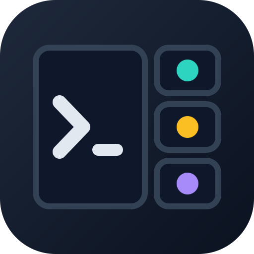

<p align="center"></p>

# mux-agents

Start Claude Code and Copilot CLI agents in tmux or rmux panes, see what each is doing, message them and stop them.

mux-agents is a plugin for Claude Code and GitHub Copilot CLI. From a chat running in a multiplexer pane, you ask for helpers; each one opens in its own window or split of the same session. An agent of the same client starts from a fork of your conversation; another client, or `-NoFork`, starts from a brief you write. A side bar shows how many are running and what each is doing. Agents talk through mailboxes on disk, never by typing into each other's panes.

## Status

0.1.0 runs on Windows with rmux 0.10.0, and on Linux and macOS with tmux 3.2 or later. The code moved here from the Terminal Profiles repository and no longer depends on it.

On Linux and macOS with .NET older than 8.0.32, 9.0.21 or 10.0.13, another local user can make mux-agent commands time out with check `lock`. Nothing leaks and no state is damaged. Use a current PowerShell.

## Quick start

Start the multiplexer, then the client inside it:

```sh
tmux        # Linux and macOS; on Windows: rmux
claude      # or: copilot
```

Then ask in the chat, for example: "spawn a Copilot agent to write the tests for parser.ps1, and open the side bar". The skill turns that into the commands below.

## Commands

Every command is `pwsh -NoProfile -File <plugin>/scripts/mux-agent.ps1 <verb> …` and prints one JSON object (`-Text` prints lines instead). An agent passes free text in a file (`-TaskFile`, `-BodyFile`), never on the command line.

| verb | example | what it does |
|---|---|---|
| `spawn` | `spawn -Client copilot -TaskFile task.md -Split h` | start an agent in a new window, or a split with `-Split h\|v` |
| `list` | `list -All` | live agents, what each is doing, unread messages; `-All` adds ended ones |
| `status` | `status -BodyFile step.txt` | an agent says what it is doing now |
| `send` | `send claude-1 -BodyFile note.md`, `send parent -BodyFile result.md` | post a message to an agent or to your parent |
| `read` | `read -Wait 600`, `read claude-1 -Lines 40` | wait for your messages, or read an agent's pane |
| `focus` | `focus claude-1` | switch the multiplexer to an agent's pane |
| `stop` | `stop claude-1` | close an agent's pane and its processes |
| `sidebar` | `sidebar`, `sidebar -Close` | open or close the side-bar split |

## Side bar

In Claude Code, an `Agents` pane beside the chat opens after the first successful `spawn` (or with `/mux-agents-pane`) and refreshes every 3 seconds. In any client, `sidebar` opens a narrow split that redraws every 2 seconds:

```text
mux-agents · 2 running
● claude-1  claude  4m
  writing parser tests
● copilot-1  copilot  1m
  reviewing the diff
○ copilot-2  exited 0
```

"Doing" is what the agent last reported with `status`, else the first line of its last message, else its task.

## How it works

- `spawn` opens a detached window (or `-Split h|v` splits the caller's pane) running the launcher, tags the pane with `@agent-*` options, and records the agent in the state folder: `MUX_AGENTS_STATE` if set, else `%LOCALAPPDATA%\mux-agents\state` on Windows and `$XDG_STATE_HOME/mux-agents/state` or `~/.local/state/mux-agents/state` on Linux and macOS.
- Children run `claude --dangerously-skip-permissions --effort high` or `copilot --no-sandbox --allow-all`.
- Messages go to per-pane mailboxes, never as keystrokes. `read -Wait` returns each message once. Every child posts exactly one exit notice to its parent: `exited`, `stopped` or `lost`.

## Safety checks

Agents start with permission prompts off, so mux-agents never gives an agent more than its caller already has. A `spawn` is refused, naming the check, unless:

- `sandbox`: the caller is not sandboxed.
- `policy`: the caller already runs with bypass or allow-all.
- `flags`: every client command line from the agent up to the pane uses only allowlisted flags.
- `directory`: the caller's working directory can be confirmed; the agent starts there.
- `tagged`: the caller is not itself an agent; children cannot spawn.
- `cap`: fewer than 6 agents are live in the session.

## Requirements

- Windows, Linux or macOS, PowerShell 7.4 or later.
- rmux 0.10.0 on Windows, or tmux 3.2 or later on Linux and macOS, with the caller inside a pane.
- Claude Code or GitHub Copilot CLI on `PATH` (`claude` or `copilot`; `.exe` on Windows).

Inside rmux both `RMUX` and `TMUX` are set; `RMUX` wins. Other platforms are refused with check `platform`.

## Install

```text
claude plugin marketplace add D0n9X1n/mux-agents
claude plugin install mux-agents@mux-agents
copilot plugin marketplace add D0n9X1n/mux-agents
copilot plugin install mux-agents@mux-agents
```

Each [release](https://github.com/D0n9X1n/mux-agents/releases) also carries the plugin files as `mux-agents-<tag>.zip`.

## Layout

| Path | Job |
|---|---|
| `.claude-plugin/plugin.json`, `marketplace.json` | Plugin and marketplace manifests, read by Claude Code and Copilot CLI |
| `skills/mux-agents/SKILL.md` | The skill both clients load: verbs, the file-only rule, listening etiquette |
| `scripts/mux-agent.ps1` | Entry: one verb per call, one JSON object out |
| `scripts/MuxAgents.ps1` | Library: caller, checks, registry, locks, spawn, list, focus, send, read, stop, status, sidebar, watch, launcher |
| `scripts/MuxAgents.Unix.ps1`, `MuxAgents.Native.Unix.cs` | Linux and macOS: processes, sandbox, kill, state folders and locks |
| `scripts/mux-agent-launcher.ps1` | Pane launcher: waits for the launch commit, then starts the client |
| `hooks/`, `types/` | The Claude Code `Agents` pane and its state contract |
| `tests/` | Pester 4.10.1 tests on fakes; `Invoke-MuxAgentTests.ps1` runs them; `tests/claude/` holds the pane's tests |
| `wiki/` | Documentation, the source of the GitHub wiki: every page in English (`Page.md`) and Chinese (`Page-zh-CN.md`) |
| `scripts/wiki/` | Wiki publisher run by the Publish wiki workflow; not in the plugin zip |

## Test

Install Pester 4.10.1 and powershell-yaml 0.4.12 once, then run the tests:

```powershell
Install-Module Pester -RequiredVersion 4.10.1 -Scope CurrentUser
Install-Module powershell-yaml -RequiredVersion 0.4.12 -Scope CurrentUser
pwsh -NoProfile -File tests/Invoke-MuxAgentTests.ps1
claude plugin test .
```

With Claude Code 2.1.310 or later, `claude plugin test .` runs the pane's tests.

Each OS skips the suites tagged for the other OSes. Suites tagged integration run only with -Integration, on Linux or macOS with tmux 3.2+ and cc: pwsh -NoProfile -File tests/Invoke-MuxAgentTests.ps1 -Path tests/integration -Integration. The script exits 1 when any test fails.

## More

- [Wiki](https://github.com/D0n9X1n/mux-agents/wiki): design pages and release notes, in English and Chinese.
- [Contributing](CONTRIBUTING.md): layout, tests and how changes land.

MIT licensed.
