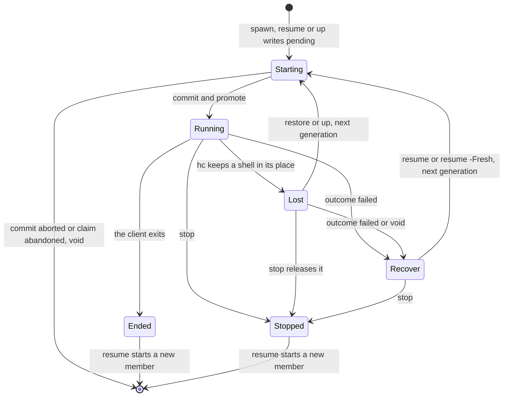

# 智能体生命周期

[English](Agent-Lifecycle)

成员不是一个进程：它是状态根目录下的一个文件夹，它的每次启动是一个带编号的代次，各有自己的证据文件。侧边栏、`list` 或任何动词显示的每种状态，都由这些文件以及 hc 显示的该代次终端决定，从不依赖内存，也从不依赖窗格。本页先介绍证据、各种状态及其判定方式，再介绍让成员在状态间转换的动词：`stop`、`resume`、恢复、`restore`、`up` 以及团队退役。首次启动本身见[从启动到窗格](From-Spawn-to-Pane-zh-CN)；从使用者角度看团队见[团队与生命周期](Teams-and-Lifecycle-zh-CN)。

### 成员文件夹

成员位于 `<root>/<serverKey>/agents/<id>`（`<id>` 为 12 个十六进制字符）。其中的文件：

| 文件 | 内容 |
|---|---|
| `record.json` | 名称、颜色、客户端、目录、父级、深度、选项、`lifecycle: 1`，以及活动的 `generation` 及其 `hcAddress`、`hcName`、`launcherArgv` 和 `sessionId`；启动未决时还有 `pending` |
| `desired.json` | `running` 或 `stopped`；不存在时读作 `running`（`cascade::desired_of`） |
| `view.json` | 成员视图窗格所在位置：`session`、`pane`、`window`、`startCommand`、`gen` 以及 hc 身份 |
| `gens/<n>.claim` | 谁取得了代次 `n`：`run` 或 `abandoned` |
| `gens/<n>/*.json` | 代次 `n` 的证据 |

没有 `lifecycle: 1` 的记录是生命周期之前的成员：它会被列出并可停止，但永远不会被恢复运行、级联或还原（`src/agents/prelife.rs`）。每个读取者都从状态根目录经同一条路径遍历（`gens::walk`）：途中遇到链接、连接点或残缺文件即为 `evidence`，绝不猜测。

### 代次及其证据

每次启动取下一个编号（`gens::next`：1 + 任何文件中出现的最大编号，首次为 0），其 hc 终端以 `mux.gen=<n>` 携带该编号。一个代次的文件（`src/agents/gens.rs` 中的 `gens::FILES`）通过同一个发布者只创建一次（`gens::publish_once`）：第一个写入者胜出，竞争者读取已存在的内容。每个文件证明一件事：

| 文件 | 写入者 | 证明什么 |
|---|---|---|
| `<n>.claim` | 启动器（`run`），或在没有启动器认领时由 settle 写入（`abandoned`） | 至多一个启动器运行过这个代次 |
| `spec.json`、`launch.json` | `core_launch::forward` | 要启动什么，以及终端身份（`hcName`、`launcherArgv`、`sessionId`） |
| `commit.json` | `forward`（`committed: true`），它的中止或启动器的放弃（`aborted: true`） | 该代次能否运行；只有单独的 `committed: true` 才运行 |
| `launcher.json` | 启动器 | 启动器的 `pid` 和 `start` |
| `client.json` | 启动器 | 它启动的客户端，`pid` 和 `start` |
| `exit.json` | 启动器 | 客户端的 `exitCode` 和 `reason`（`exited`、`client-conflict`、`gave up` 等） |
| `report.json` | 客户端钩子中的 `report -Session` | 报告的对话，以及报告者的 `pid` 和 `start` |
| `ready.json` | `gens::promote_ready` | 报告者正是启动器证明的客户端：该代次已就绪 |
| `failure.json`、`outcome.json` | `outcome::adjudicate` | 唯一的裁决，以及它所依据的失败 |
| `ended.json` | `gens::record_end`，或停止时的终止 | 终端已结束：`state`、`reason`、`exitCode` |
| `terminating.json`、`kill.json` | `settle::terminate` | 停止正在结束一个待定的启动；终止尝试，在 `hc kill` 之前记录 |
| `release.json`、`released.json` | `release::release` | 被保留的终端已放手（`cause`：`restore`、`recovery` 或 `lost`），以及放手已完成 |
| `notice.json`、`route.json` | 发给父级的通知 | 唯一的退出通知，以及它的去向 |

当代次的认领为 `abandoned`、提交为 `aborted`，或已有 `ended.json` 或 `released.json`，且记录的 `completing` 没有指向它时，该代次即为完成（`gens::done`）。未完成的代次占用成员的名称和名额，所以终端可能仍在运行时，崩溃绝不会释放名称。

### 代次的结果

每个代次只得到一个裁决，在其代次锁下决定并保存在 `outcome.json`（`src/agents/outcome.rs`）。已有的 `outcome.json` 直接决定；其次是 `failure.json`；其次 `ready.json` 即为 `ok`；其次与已证明客户端相符的 `report.json` 会变成 `ready.json`。否则：

| 裁决 | 何时 | 原因 |
|---|---|---|
| `void` | 认领为 `abandoned` | `claim abandoned` |
| `void` | 提交为 `aborted` | `commit aborted` |
| `failed` | 客户端在就绪前退出（`exit.json`） | `client exited before readiness` |
| `failed` | 终端已结束（`ended.json`） | `terminal ended` |
| `failed` | hc 显示终端已丢失 | `terminal lost` |
| `failed` | 到规格的 `deadline` 仍没有 `report.json` | `no readiness report` |
| `failed` | 有报告，但截止时间之后 60 秒仍没有客户端身份（`GRACE`） | `client identity not published` |

只有当认领为 `run` 且提交判定为 `Run` 时，才按上表顺序尝试这些失败条件；没有条件触发时，什么都不写，该代次保持未决。看板只尝试一次而不等待（`Wait::Try`）：锁被占用时，显示最后一份已刷新的 `outcome.json` 或 `failure.json`。

### 成员状态

hc 显示的代次终端会对照记录的启动器进行分类（`src/agents/lifecycle.rs` 中的 `lifecycle::classify`）：

| 生命 | hc 显示 | 含义 |
|---|---|---|
| `running` | 存活，且正好运行记录的 `launcherArgv` | 启动器（因而客户端）在运行 |
| `lost` | 存活，运行一个裸 shell（`sh`、`bash`、`zsh`、`fish`、`dash`、`ksh`，可带 `-l`；Windows 上为带 hc 提示钩子的 PowerShell） | 在核心重启（例如重启电脑）之后，hc 的 `--keep` 用 shell 顶替了启动器的程序 |
| `ended` | 已结束，`exited` 或 `killed` | 智能体已结束 |
| `unknown` | 其他任何情况，包括 `server_stop` 或无应答 | 不据此做任何判定 |

看板把这些变成行（`board_rows::hc_row`）：运行中的成员显示客户端报告的状态（需要你、完成、工作中、空闲）；已结束的成员若是被终止则显示 `stopped`，否则显示 `exited <code>`。活动代次结果为 `failed` 的生命周期成员需要恢复（`outcome::needs_recovery`）：侧边栏显示 `recover`，放得下时显示 `recover: <reason>`，该代次尚未完成时显示 `recover (still running)`（`src/sidebar.rs`）。

`reconcile` 把团队中的每个成员归入一行（`reconcile::classify`），按以下顺序检查：

| 行 | 何时 | reconcile 做什么 |
|---|---|---|
| 已停止 | `desired.json` 为 `stopped` | 什么都不做 |
| 未知 `pending` | settle 之后启动仍未决 | 列出它 |
| 未知 `release` | 有 `release.json` 但没有 `released.json` | 列出它 |
| 等待 | 为 `restore` 而放手，且结果为 `ok` | 启动下一个代次 |
| 搁置 `outcome` | 为 `restore` 而放手，尚无裁决 | 列出它 |
| 恢复 | 为 `restore` 或 `recovery` 而放手且裁决为失败或作废，或已丢失且裁决为失败、作废或未决 | 在 `recover` 下列出它 |
| 已结束 | 已结束或已放手 | 什么都不做 |
| 未知 `hc` | hc 没有给出可用的应答 | 列出它 |
| 运行中 | `running` | 什么都不做 |
| 丢失 | `lost` 且结果为 `ok` | 还原它 |

### `stop`：整棵子树，自底向上

`stop <name>`（`src/agents/message.rs` 中的 `stop_hc`）结束一个成员以及它启动的每个成员。谁可以停止：个人，或在团队中作为目标祖先的成员（`tree::authority`）；团队之外为其父级或个人。`drop <id>` 是个人按精确 id 进行的停止，走同一条路径。

在团队锁下，`stop` 先完成被中断的停止留下的每份日志（`cascade::finish`），然后执行目标的级联（`src/agents/cascade.rs`）：

1. `prepare`：一次树快照（`Tree::read`）列出目标及其下的所有成员，最深的在前，每项带有其在日志中的父级和未完成的代次。在终止任何东西之前，日志发布到 `teams/<sha16(session)>.cascade/` 下。
2. 每一项的期望状态设为 `stopped`（`desired.json`），这样 reconcile 永远不会把它带回来，然后日志标记为已准备。
3. `execute` 从最深处开始结束各项。对每一项，所有列出、命名、活动或待定的代次，从最新的开始，经过 `settle::terminate`：运行中的终端先写 `kill.json`，再 `hc kill`，再写原因为 `terminated` 的 `ended.json`；丢失的终端被放手，从不终止；生命周期之前的项保持未解决（`prelife`）。随后向父级发出最高代次的 `stopped` 通知并加以核对。
4. 每一项都完成后，删除日志。否则每个失败的项都在 `unresolved` 中报告其 `check` 和 `reason`，其在日志中的祖先被保留，所以父级绝不会先于子级结束。

因崩溃或终止被拒而中断的停止，会由下一次 `stop`、`up`、reconcile 过程或侧边栏刷新根据其日志完成（`cascade::finish`，调用自 `src/agents/message.rs`、`src/agents/up/mod.rs`、`src/agents/reconcile/pass.rs` 和 `src/agents/adopt_bar.rs`）。回复给出成员、其 `hcAddress`、`life`（`ended`、`lost`、`running`，或停止后为 `unknown`）、`stopped` 和 `unresolved`。成员停止后，`stop` 释放所有锁并等待其记录的客户端进程退出，这样紧接着的 `resume` 不会被拒绝为 `session`；超过 8000 毫秒（`CLIENT_EXIT_BOUND`）则回复 `clientExited: false`。

`stop <name> -Generation`（`src/agents/message/generations.rs`）是个人在团队中更窄的停止：成员每个未完成的代次，从最新的开始，只经过 `terminate`。没有日志，不写 `desired.json`，不涉及其他成员；当每个代次都已完成时拒绝为 `state`。

### `resume`：已停止或已结束的成员

`resume <name>`（`src/agents/resume.rs`）先询问该成员是否需要恢复（见下一节）。若不需要，它在启动锁下把已结束的成员 X 作为新成员 Y 以 X 的对话重新启动。`admit` 在以下条件不全满足时拒绝：X 已证明结束且未被另一次恢复运行占用，X 不是领导者（`leader`），没有存活进程可能仍持有 X 的对话（`session`，`src/agents/occupancy.rs`），且没有同名成员在运行（`name`）。团队之外适用会话 6 个存活智能体的上限；团队之内依次检查调用方的权限、树的 `limit`、父级和团队的 `ceiling`、名称以及成员的 `budget`。

Y 通过与启动相同的 `forward` 启动，类型为 `resume`：新的 id，X 的名称、客户端、对话、目录、父级和深度，指向 X 的 `resumedFrom`，X 的邮箱，以及 X 记录的标志作为其选项。客户端以 `--resume <session>` 运行，团队笔记本最新的标题作为新一轮输入，X 的任务永远不会再次发送。X 的文件夹从不被写入。回复给出 `from` 和 `agent`，以及与启动相同的视图字段。

### 恢复：重试或重新开始

当成员活动代次的结果为 `failed` 时，它需要恢复。此时 `resume <name>` 以同一 id 的下一个代次重试它，`resume <name> -Fresh` 则让该代次以新对话开始（`resume/recovery.rs`）。两者都要求会话中有团队（没有团队时 `-Fresh` 被拒绝为 `team`），并在团队准入锁 `up|<T>` 下、在一个团队事务中运行：

1. 处理该成员，完成崩溃遗留的半完成放手，并观察它一次（`reconcile::observe_recovery`）。
2. 没有 `failed` 裁决时：对已结束或已放手成员的普通 `resume` 转到上面的恢复运行；其他情况拒绝为 `state`（"does not need recovery"）。
3. 检查调用方是个人。
4. 关口：丢失的活动代次以原因 `recovery` 放手；每个代次都必须已完成；适用上限（领导者除外）；对话必须空闲。
5. `cascade::reopen_same`：重新打开检查，`desired.json` 改回 `running`，然后经 `reconcile::launch_next` 启动代次 `n+1`，保存的选项受团队上限约束，没有提示也没有任务。

重试恢复失败代次的对话（类型 `retry`）；`-Fresh` 使用新对话（类型 `fresh`）。被停止结束的该成员后代保持停止。

### `restore`：终端丢失之后

当 hc 丢失成员的程序（核心重启、电脑重启）时，它用 shell 保留终端，所以成员读作 `lost`。它的对话仍在磁盘上。`restore`（`src/agents/reconcile.rs` 中的 `reconcile::restore`）是个人在团队会话中使用的动词：在 `up|<T>` 下它检查团队发现过程是否把本会话认作锚点，否则为 `team`（"no team in this session; run up from the team folder"），然后对会话中每个生命周期成员执行一次 reconcile 过程（`reconcile/pass.rs`），按上表分类。

对结果为 `ok` 的丢失成员（`reconcile/restore.rs`）：

1. 关口：成员没有被停止关闭，且每个更早的代次都已完成；否则搁置为 `closed` 或 `older`。
2. 以原因 `restore` 调用 `release::release`：写 `release.json`，然后清除旧终端的标签并设为 `mux.kept=<serverKey>:<session>` 和 `mux.keptName=<name>`，再写 `released.json`。不终止任何东西。
3. 若没有存活进程持有该对话（否则搁置为 `occupied` 并指出持有者），代次 `n+1` 经 `forward` 以类型 `restore` 启动，并以 `--resume` 恢复代次 `n` 的 `sessionId`。

已为还原而放手但尚未重新启动的成员（等待行）在通过团队的 `limit`（领导者除外）后直接进入第 3 步。回复列出 `restored`（带 `generation` 和 `sessionId`）、`held`、`unknown` 和 `recover`，相应步骤失败时还有 `sweepError` 和 `adoptError`；运行中、已停止和已结束的成员不列出。`restore` 不打开视图：用 `focus <name>` 打开。

### 保留的 shell

被放手的旧终端作为普通 shell 保持打开，其旧窗格继续显示它。保留的 shell 只是它的 hc 标签（`src/agents/kept.rs`）；没有任何文件记录它。`kept` 列出带有本团队键标签的存活 shell，以及本团队已退役前任的 shell（`retire::kept_teams`）；`kept -Close <address>` 在一次重读显示它仍存活且由本团队保留后关闭它，否则为 `target`。`stop` 和 `restore` 从不关闭保留的 shell，关闭后的 shell 也永远不会回来。

### `up`：创建或重新进入团队

`up -Client <client> [-Name <name>] -- <client options>`（`src/agents/up/mod.rs`）是个人在 tmux 或 rmux 窗格中使用的动词；智能体或成员被拒绝为 `tagged`。团队 id `T` 由文件夹、客户端和名称推导（`up/identity.rs`），一切都在准入锁 `up|<T>` 下运行，并在调用方会话的停止日志完成之后进行。

团队索引 `<root>/up/<T>.json`（`up/index.rs`）保存个人的输入（客户端、选项、提示、名称、文件夹）、`anchor`（持有团队的服务器键和会话）、`view` 会话、一个 `pending` 会话请求以及尚未发布的 `releases`。第一次 `up` 写入它并带一个 `pending` 请求。之后每次 `up` 都从第一个未完成的步骤继续（`up/replay.rs`），最多 8 轮：

| 步骤 | 何时 | 做什么 |
|---|---|---|
| `Session` | 没有领导者、没有锚点、没有 `pending` | 复用已证明存活的视图会话，或新建一个（`publish::ensure`） |
| `Repair` | 没有领导者，有崩溃遗留的 `pending` 请求 | 发布它创建的会话，或移除 `pending` 并保留其放行文件 |
| `Launch` | 没有领导者，有锚点 | 在锚点启动领导者 |
| `Settle` | 领导者的启动待定 | 处理它 |
| `Team` | 本次调用启动了领导者 | 写入团队记录，仅一次 |
| `Reenter` | 团队记录已存在，或有一个不是本次调用启动的活动领导者 | reconcile、视图、侧边栏、放行 |

新会话的第一个窗口运行 `mux-agent hold <release file>`（`src/hold.rs`），使 `up` 工作期间会话不为空：放行文件出现后它就退出，每 200 毫秒检查一次（`POLL`），或在 600 秒后退出（`LIMIT`）。`up` 最后发布所有待发布的放行文件（`publish::release_all`）；无法发布的放行为 `releaseError`。

领导者（`src/agents/leader.rs`）经同一个 `forward` 以类型 `leader` 启动：新的 id 和对话（`--session-id <uuid>`），深度 0，没有父级，带 `upTeam`，以及逐字节保留的个人选项和提示；重新启动只重放选项。团队记录 `<serverKey>/teams/<sha16(session)>.json`（`src/agents/team.rs`）只写一次且从不替换：它固定个人的标志以及由此推导的策略，即之后每次启动和恢复运行都要对照检查的上限。

在 `Reenter`（`up/reenter.rs`）时，除非本次调用刚刚启动了领导者，`up` 会像 `restore` 一样在锚点执行 reconcile 过程，并多一步：已结束的领导者会被恢复运行（`leader::resume_ended`，报告为 `leaderResume`）。丢失的成员像 `restore` 那样以下一个代次回来。然后在视图会话中查找、接管或打开每个运行中成员的视图（新窗口，从不分屏），没有成员运行时创建 `status` 窗口，保持侧边栏，选中领导者的窗口（或最早启动成员的窗口），并发布放行文件。在关闭视图、杀掉多路复用器服务器或重启电脑之后再次运行 `up`，就是这样重新进入：智能体一直在 hc 中运行，只有视图、侧边栏和丢失的成员会被重建。回复给出 `team`、`session`、`name`、`created`、`replayed` 和 `reentered`。

### 团队退役

当领导者的期望状态为 `stopped` 时，团队就结束了：`up` 的 reconcile 过程报告它已停止，`up` 在同一循环中创建继任团队之前先让团队退役（`up/retire.rs`）：

1. 完成团队的每个级联；有未解决的级联时拒绝为 `stopping`（"the team's stop is unresolved; run stop again"）。
2. 发布标记 `<serverKey>/teams/<sha16(session)>.retired.json`，绑定到旧锚点和 `T`。
3. 把索引重命名为 `<root>/up/retired/<T>.<digits of at>.<sha16(key:session)>.json`，从不覆盖已有文件，并刷新到磁盘。
4. 写入一个带新 `pending` 请求的新索引，带上现有的和已归档的放行文件，然后启动新会话和领导者。

重放时每一步都会再次检查，所以在步骤之间崩溃会从中断处继续。回复以 `retired` 给出已退役的 `<serverKey>:<session>`。已退役团队的保留 shell 仍列在继任团队的侧边栏中。

### 源码索引

| 部分 | 源码 |
|---|---|
| 代次文件、完成、客户端证明、就绪 | `src/agents/gens.rs`、`src/agents/session_report.rs` |
| 启动步骤、启动器 | `src/agents/core_launch.rs`、`src/launcher.rs` |
| 结果与恢复判定 | `src/agents/outcome.rs` |
| 由 hc 得出生命 | `src/agents/lifecycle.rs`、`src/agents/board_rows.rs` |
| settle、终止 | `src/agents/settle.rs` |
| 停止级联与日志 | `src/agents/cascade.rs`、`src/agents/cascade_journal.rs`、`src/agents/cascade_tree.rs`、`src/agents/message.rs` |
| 恢复运行与恢复 | `src/agents/resume.rs`、`src/agents/resume/recovery.rs` |
| reconcile 与还原 | `src/agents/reconcile.rs`、`src/agents/reconcile/pass.rs`、`src/agents/reconcile/restore.rs` |
| 放手与保留的 shell | `src/agents/release.rs`、`src/agents/kept.rs` |
| `up`、索引、重新进入、退役 | `src/agents/up/`、`src/agents/leader.rs`、`src/agents/team.rs`、`src/hold.rs` |
