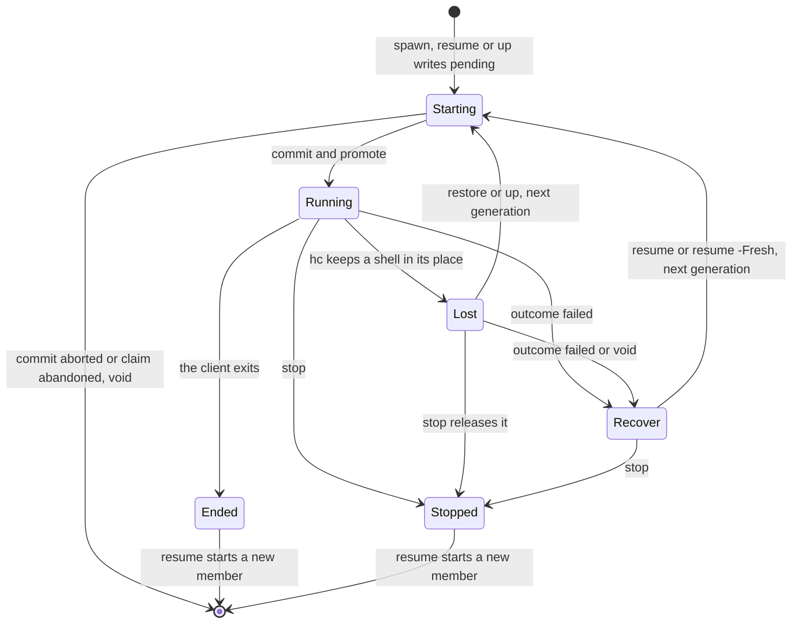

# Agent Lifecycle

[简体中文](Agent-Lifecycle-zh-CN)

A member is not a process: it is a folder under the state root, and each launch of it is a numbered generation with its own evidence files. Every state the side bar, `list` or a verb shows is decided from those files and from what hc shows of the generation's terminal, never from memory and never from the pane. This page covers the evidence, the states and how each is decided, then the verbs that move a member between them: `stop`, `resume`, recovery, `restore`, `up` and team retirement. The first launch itself is in [From Spawn to Pane](From-Spawn-to-Pane); the person's view of teams is in [Teams and Lifecycle](Teams-and-Lifecycle).

### The member folder

A member lives at `<root>/<serverKey>/agents/<id>` (`<id>` is 12 hex characters). Its files:

| file | what it holds |
|---|---|
| `record.json` | name, color, client, directory, parent, depth, options, `lifecycle: 1`, and the active `generation` with its `hcAddress`, `hcName`, `launcherArgv` and `sessionId`; `pending` while a launch is undecided |
| `desired.json` | `running` or `stopped`; absent reads `running` (`cascade::desired_of`) |
| `view.json` | where the member's view pane is: `session`, `pane`, `window`, `startCommand`, `gen` and the hc identity |
| `gens/<n>.claim` | who took generation `n`: `run` or `abandoned` |
| `gens/<n>/*.json` | the evidence of generation `n` |

A record without `lifecycle: 1` is a pre-lifecycle member: it is listed and can be stopped, but is never resumed, cascaded or restored (`src/agents/prelife.rs`). Every reader goes through one walk from the state root (`gens::walk`): a link, a junction or a torn file on the way is `evidence`, never a guess.

### Generations and their evidence

Each launch takes the next number (`gens::next`: 1 + the highest any file names, 0 for the first), and its hc terminal carries it as `mux.gen=<n>`. The files of a generation (`gens::FILES` in `src/agents/gens.rs`) are create-once through one publisher (`gens::publish_once`): the first writer wins, and a racer reads what stands. Each proves one thing:

| file | written by | what it proves |
|---|---|---|
| `<n>.claim` | the launcher (`run`), or settle (`abandoned`) when no launcher claimed it | at most one launcher ran this generation |
| `spec.json`, `launch.json` | `core_launch::forward` | what to start, and the terminal identity (`hcName`, `launcherArgv`, `sessionId`) |
| `commit.json` | `forward` (`committed: true`), its abort or the launcher's give-up (`aborted: true`) | whether the generation may run; only a lone `committed: true` runs |
| `launcher.json` | the launcher | the launcher's `pid` and `start` |
| `client.json` | the launcher | the client it started, `pid` and `start` |
| `exit.json` | the launcher | the client's `exitCode` and `reason` (`exited`, `client-conflict`, `gave up` and others) |
| `report.json` | `report -Session` from the client's hook | the conversation reported, with the reporter's `pid` and `start` |
| `ready.json` | `gens::promote_ready` | the reporter is the client the launcher proved: the generation is ready |
| `failure.json`, `outcome.json` | `outcome::adjudicate` | the one verdict, and the failure it rests on |
| `ended.json` | `gens::record_end`, or a stop's kill | the terminal finished: `state`, `reason`, `exitCode` |
| `terminating.json`, `kill.json` | `settle::terminate` | a stop is ending a pending launch; the kill attempt, recorded before `hc kill` |
| `release.json`, `released.json` | `release::release` | the kept terminal was let go (`cause`: `restore`, `recovery` or `lost`), and that it is finished |
| `notice.json`, `route.json` | the notice to the parent | the one exit notice, and where it goes |

A generation is done (`gens::done`) when its claim is `abandoned`, its commit `aborted`, or it has `ended.json` or `released.json`, and the record's `completing` does not name it. A generation that is not done holds the member's name and slot, so a crash never frees a name while a terminal may still run.

### The outcome of a generation

Each generation gets one verdict, decided under its generation lock and kept in `outcome.json` (`src/agents/outcome.rs`). An existing `outcome.json` decides; then `failure.json`; then `ready.json` is `ok`; then a `report.json` that matches the proven client becomes `ready.json`. Otherwise:

| verdict | when | reason |
|---|---|---|
| `void` | the claim is `abandoned` | `claim abandoned` |
| `void` | the commit is `aborted` | `commit aborted` |
| `failed` | the client exited before readiness (`exit.json`) | `client exited before readiness` |
| `failed` | the terminal ended (`ended.json`) | `terminal ended` |
| `failed` | hc shows the terminal lost | `terminal lost` |
| `failed` | no `report.json` by the spec's `deadline` | `no readiness report` |
| `failed` | a report, but no client identity 60 s past the deadline (`GRACE`) | `client identity not published` |

The failure legs are tried only when the claim is `run` and the commit decides `Run`, in the order above; when none fires, nothing is written and the generation stays undecided. The board asks once without waiting (`Wait::Try`): with the lock busy it shows the last flushed `outcome.json` or `failure.json`.

### Member states

What hc shows of the generation's terminal is classified against the recorded launcher (`lifecycle::classify` in `src/agents/lifecycle.rs`):

| life | hc shows | meaning |
|---|---|---|
| `running` | live, running exactly the recorded `launcherArgv` | the launcher (and so the client) runs |
| `lost` | live, running a bare shell (`sh`, `bash`, `zsh`, `fish`, `dash`, `ksh`, optionally with `-l`; on Windows PowerShell with hc's prompt hook) | hc's `--keep` put a shell where the launcher's program was, after a core restart such as a reboot |
| `ended` | finished, `exited` or `killed` | the agent is over |
| `unknown` | anything else, including `server_stop` or no answer | nothing is decided from it |

The board turns these into rows (`board_rows::hc_row`): a running member shows the client's reported state (needs you, done, working, idle); an ended one shows `stopped` when it was killed, else `exited <code>`. A lifecycle member whose active generation's outcome is `failed` needs recovery (`outcome::needs_recovery`): the bar shows `recover`, `recover: <reason>` when it fits, and `recover (still running)` while that generation is not done yet (`src/sidebar.rs`).

`reconcile` sorts each member of a team into one row (`reconcile::classify`), checked in this order:

| row | when | what reconcile does |
|---|---|---|
| stopped | `desired.json` is `stopped` | nothing |
| unknown `pending` | a launch is still undecided after settle | lists it |
| unknown `release` | `release.json` without `released.json` | lists it |
| await | released for `restore` and its outcome is `ok` | starts the next generation |
| held `outcome` | released for `restore`, no verdict yet | lists it |
| recover | released for `restore` or `recovery` with a failed or void verdict, or lost with a failed, void or undecided verdict | lists it under `recover` |
| ended | ended or released | nothing |
| unknown `hc` | hc gave no usable answer | lists it |
| running | `running` | nothing |
| lost | `lost` and the outcome is `ok` | restores it |

### `stop`: a sub-tree, bottom-up

`stop <name>` (`stop_hc` in `src/agents/message.rs`) ends a member and every member it started. Who may stop: a person, or in a team a member that is the target's ancestor (`tree::authority`); outside a team, its parent or a person. `drop <id>` is a person's stop by exact id, with the same path.

Under the team lock, `stop` first finishes every journal a cut-short stop left (`cascade::finish`), then the target's cascade (`src/agents/cascade.rs`):

1. `prepare`: one snapshot of the tree (`Tree::read`) lists the target and everything below it, deepest first, each with its in-journal parents and its open generations. The journal is published under `teams/<sha16(session)>.cascade/` before anything is killed.
2. Each entry is made desired `stopped` (`desired.json`), so reconcile never brings it back, then the journal is marked prepared.
3. `execute` ends the entries deepest first. For each, every listed, named, active or pending generation, newest first, goes through `settle::terminate`: a running terminal gets `kill.json`, then `hc kill`, then `ended.json` with reason `terminated`; a lost one is released, never killed; a pre-lifecycle entry is left unresolved (`prelife`). Then the `stopped` notice of the highest generation is posted to the parent and checked.
4. With every entry complete the journal is removed. Otherwise each failed entry is reported in `unresolved` with its `check` and `reason`, and its ancestors in the journal are held, so no parent ends before its child.

A stop cut short by a crash or a refused kill is finished from its journal by the next `stop`, `up`, reconcile pass or side-bar tick (`cascade::finish`, called from `src/agents/message.rs`, `src/agents/up/mod.rs`, `src/agents/reconcile/pass.rs` and `src/agents/adopt_bar.rs`). The reply names the member, its `hcAddress`, `life` (`ended`, `lost`, `running`, or `unknown` once stopped), `stopped` and `unresolved`. Once the member is stopped, `stop` waits with every lock released until its recorded client process exits, so a `resume` right after is not refused `session`; past 8000 ms (`CLIENT_EXIT_BOUND`) it replies with `clientExited: false`.

`stop <name> -Generation` (`src/agents/message/generations.rs`) is a person's narrower stop in a team: every generation of the member that is not done, newest first, through `terminate` alone. No journal, no `desired.json`, no other member; it is refused `state` when every generation is already done.

### `resume`: a stopped or ended member

`resume <name>` (`src/agents/resume.rs`) first asks whether the member needs recovery (next section). If not, it starts the ended member X again as a new member Y with X's conversation, under the spawn lock. `admit` refuses unless X is proven ended and not already taken by another resume, X is not a leader (`leader`), no live process may still hold X's conversation (`session`, `src/agents/occupancy.rs`), and no member of X's name is running (`name`). Outside a team the session's cap of 6 live agents applies; in a team, the caller's authority, the tree's `limit`, the parent's and the team's `ceiling`, the name and a member's `budget`, in that order.

Y is launched through the same `forward` as a spawn, with kind `resume`: a new id, X's name, client, conversation, directory, parent and depth, `resumedFrom` naming X, X's mailbox, and X's recorded flags as its options. The client runs `--resume <session>` with the team notebook's newest titles as its new turn, and X's task is never sent again. X's folder is never written. The reply names `from` and `agent`, with the view fields of a spawn.

### Recovery: retry or start fresh

A member needs recovery when its active generation's outcome is `failed`. `resume <name>` then retries it as the next generation of the same id, and `resume <name> -Fresh` starts that generation on a new conversation (`resume/recovery.rs`). Both need a team in the session (`-Fresh` without one is refused `team`) and run under the team's admission lock `up|<T>`, in one team transaction:

1. Settle the member, finish a release a crash left half done, and observe it once (`reconcile::observe_recovery`).
2. Without a `failed` verdict: a plain `resume` of an ended or released member falls through to the resume above; anything else is refused `state` ("does not need recovery").
3. Check the caller is a person.
4. The gates: a lost active generation is released with cause `recovery`; every generation must be done; the cap applies (never to the leader); the conversation must be free.
5. `cascade::reopen_same`: the reopen check, `desired.json` back to `running`, then generation `n+1` through `reconcile::launch_next`, with the stored options held to the team's ceiling and no prompt or task.

A retry resumes the failed generation's conversation (kind `retry`); `-Fresh` takes a new one (kind `fresh`). The member's descendants that a stop ended stay stopped.

### `restore`: after a lost terminal

When hc loses a member's program (a core restart, a reboot) it keeps the terminal with a shell, so the member reads `lost`. Its conversation is still on disk. `restore` (`reconcile::restore` in `src/agents/reconcile.rs`) is a person's verb in the team's session: under `up|<T>` it checks that the team's discovery names this session as the anchor, else `team` ("no team in this session; run up from the team folder"), then runs one reconcile pass (`reconcile/pass.rs`) over every lifecycle member of the session, classifying each as in the table above.

For a lost member with outcome `ok` (`reconcile/restore.rs`):

1. The gate: the member is not closed by a stop, and every older generation is done; else held `closed` or `older`.
2. `release::release` with cause `restore`: `release.json`, then the old terminal's labels are cleared and set to `mux.kept=<serverKey>:<session>` and `mux.keptName=<name>`, then `released.json`. Nothing is killed.
3. When no live process holds the conversation (else held `occupied`, naming the holder), generation `n+1` launches through `forward` with kind `restore` and `--resume` of generation `n`'s `sessionId`.

A member released for restore whose relaunch did not happen yet (the await row) goes straight to step 3, after the team's `limit` for any member but the leader. The reply lists `restored` (with `generation` and `sessionId`), `held`, `unknown` and `recover`, plus `sweepError` and `adoptError` when those steps failed; running, stopped and ended members are not listed. `restore` opens no view: `focus <name>` opens one.

### Kept shells

The released old terminal stays open as a plain shell, and its old pane keeps showing it. A kept shell is only its hc labels (`src/agents/kept.rs`); no file records it. `kept` lists the live shells labelled with this team's key, and those of the team's retired predecessors (`retire::kept_teams`); `kept -Close <address>` closes one after one reread shows it still live and kept by this team, else `target`. `stop` and `restore` never close a kept shell, and a closed one never comes back.

### `up`: creating or re-entering a team

`up -Client <client> [-Name <name>] -- <client options>` (`src/agents/up/mod.rs`) is a person's verb from a tmux or rmux pane; an agent or a member is refused `tagged`. The team id `T` is derived from the folder, the client and the name (`up/identity.rs`), and everything runs under the admission lock `up|<T>`, after any stop journal of the caller's session is finished.

The team's index `<root>/up/<T>.json` (`up/index.rs`) keeps the person's inputs (client, options, prompt, name, folder), the `anchor` (the server key and session that hold the team), the `view` session, a `pending` session request and the `releases` not yet published. The first `up` writes it with a `pending` request. Every `up` then resumes from the first unfinished step (`up/replay.rs`), at most 8 rounds:

| step | when | what it does |
|---|---|---|
| `Session` | no leader, no anchor, no `pending` | reuse a proven live view session, or start one (`publish::ensure`) |
| `Repair` | no leader, a `pending` request a crash left | publish the session it made, or drop `pending` and keep its release |
| `Launch` | no leader, an anchor | launch the leader at the anchor |
| `Settle` | the leader's launch is pending | settle it |
| `Team` | this call launched the leader | write the team record, once |
| `Reenter` | the team record exists, or an active leader this call did not launch | reconcile, views, bar, release |

A new session's first window runs `mux-agent hold <release file>` (`src/hold.rs`), so the session is not empty while `up` works: it exits once the release file exists, checked every 200 ms (`POLL`), or after 600 s (`LIMIT`). `up` publishes every outstanding release last (`publish::release_all`); a release it cannot publish is `releaseError`.

The leader (`src/agents/leader.rs`) launches through the same `forward` with kind `leader`: a new id and conversation (`--session-id <uuid>`), depth 0, no parent, `upTeam`, and the person's options and prompt byte for byte; a relaunch replays only the options. The team record `<serverKey>/teams/<sha16(session)>.json` (`src/agents/team.rs`) is written once and never replaced: it fixes the person's flags and the policy derived from them, the ceiling every later spawn and resume is checked against.

On `Reenter` (`up/reenter.rs`), unless this call just launched the leader, `up` runs the reconcile pass at the anchor as `restore` does, with one more step: an ended leader is resumed (`leader::resume_ended`, reported as `leaderResume`). Lost members come back as their next generation, as with `restore`. Then each running member's view is found, adopted or opened in the view's session (a new window, never a split), a `status` window is made when no member runs, the bar is kept, the leader's window (or the earliest started member's) is selected, and the releases are published. Running `up` again after a closed view, a killed multiplexer server or a reboot re-enters this way: the agents kept running in hc, and only views, the bar and lost members are rebuilt. The reply names `team`, `session`, `name`, `created`, `replayed` and `reentered`.

### Team retirement

When the leader is desired `stopped`, the team is over: the reconcile pass of `up` reports it stopped, and `up` retires the team before it makes a successor in the same loop (`up/retire.rs`):

1. Finish every cascade of the team; an unresolved one refuses `stopping` ("the team's stop is unresolved; run stop again").
2. Publish the marker `<serverKey>/teams/<sha16(session)>.retired.json`, bound to the old anchor and `T`.
3. Rename the index to `<root>/up/retired/<T>.<digits of at>.<sha16(key:session)>.json`, never over an existing file, and flush.
4. Write a fresh index with a new `pending` request, carrying the live and archived releases, then start the new session and leader.

Each step is checked again on replay, so a crash between them resumes where it stopped. The reply names the retired `<serverKey>:<session>` as `retired`. The retired team's kept shells stay listed in its successor's bar.

### Source map

| part | source |
|---|---|
| generation files, done, client proof, readiness | `src/agents/gens.rs`, `src/agents/session_report.rs` |
| launch steps, launcher | `src/agents/core_launch.rs`, `src/launcher.rs` |
| outcome and recovery predicate | `src/agents/outcome.rs` |
| life from hc | `src/agents/lifecycle.rs`, `src/agents/board_rows.rs` |
| settle, terminate | `src/agents/settle.rs` |
| stop cascade and journal | `src/agents/cascade.rs`, `src/agents/cascade_journal.rs`, `src/agents/cascade_tree.rs`, `src/agents/message.rs` |
| resume and recovery | `src/agents/resume.rs`, `src/agents/resume/recovery.rs` |
| reconcile and restore | `src/agents/reconcile.rs`, `src/agents/reconcile/pass.rs`, `src/agents/reconcile/restore.rs` |
| release and kept shells | `src/agents/release.rs`, `src/agents/kept.rs` |
| `up`, index, re-entry, retirement | `src/agents/up/`, `src/agents/leader.rs`, `src/agents/team.rs`, `src/hold.rs` |
