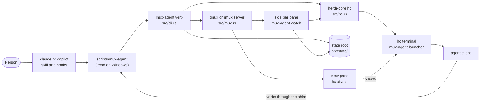

# 架构

[English](Architecture)

从这里开始了解 mux-agents 的全貌：它解决什么问题、由哪些部分组成、各部分如何相连，以及每个部分都遵守的规则。一次启动的全过程见[从启动到窗格](From-Spawn-to-Pane-zh-CN)，成员的一生见[智能体生命周期](Agent-Lifecycle-zh-CN)，磁盘上的文件见[状态与持久性](State-and-Durability-zh-CN)，各项检查见[安全与占用](Safety-and-Occupancy-zh-CN)，源码树见[模块参考](Module-Reference-zh-CN)。

## 要解决的问题

在终端里运行 Claude Code 或 Copilot CLI 的人，想要一些看得见、管得住的助手智能体：每个都在自己的 tmux 或 rmux 会话里占一个窗格，报告自己在做什么，能收消息，被要求时就停下。窗格很脆弱：人会关掉标签页，多路复用器服务器会退出，机器会重启。用 `up` 启动的团队必须挺过这三种情况：关掉视图或杀掉服务器不会结束智能体；重启之后，`up` 或 `restore` 会把每个丢失的成员作为同一对话的新一代带回来。

智能体启动时关闭了权限提示，所以一次启动绝不能给智能体超出调用者已有的权限。每次拒绝都是一行 JSON，其中 `check` 指明原因（见[使用 mux-agents](Usage-zh-CN)）。

## 组成部分

| 部分 | 位置 | 作用 |
|---|---|---|
| 技能 | `skills/mux-agents/SKILL.md` | 告诉客户端何时使用 mux-agents、运行哪些动词；自由文本放在文件里 |
| Copilot CLI 钩子 | `hooks.json` | 在会话开始、提交提示、提问和停止时运行 `report`，让侧边栏显示客户端正在做什么 |
| Claude Code 钩子模块 | `hooks/register.tsx`、`hooks/activity.ts`、`hooks/deliver.ts`、`hooks/board.ts` | 同样的报告、聊天旁的 `Agents` 窗格，以及在成员轮次时投递邮件 |
| 入口垫片 | `scripts/mux-agent`、`scripts/mux-agent.cmd` | 运行适合本机操作系统和架构的第一个可用 `mux-agent` 二进制，原样传递参数和退出码 |
| `mux-agent` 二进制 | `src/main.rs`、`src/cli.rs` | 每次调用一个动词，stdout 上一个 JSON 回复；退出码 0 成功，1 错误，2 拒绝或用法错误 |
| 多路复用器接缝 | `src/mux.rs` | 每一次 tmux 或 rmux 调用，形如 `<mux> -S <socket> -N <argv>`，只针对调用者自己的服务器 |
| herdr-core（`hc`） | `src/hc.rs` | 每个智能体运行所在的终端运行时，与显示它的窗格分开 |
| 启动器 | `src/launcher.rs` | `mux-agent launcher <spec>`，在 hc 终端里运行：等待启动提交，运行客户端一次，记录其退出 |
| 状态根目录 | `src/state/` | 用户私有的文件夹，存放记录、代际证据、邮箱和团队文件，外加按用户划分的锁 |
| 侧边栏 | `src/sidebar.rs`、`src/sidebar/` | `sidebar` 打开一个运行 `mux-agent watch` 的分屏，绘制团队看板并接收点击和按键 |

## 各部分如何相连

箭头表示谁调用谁，并未画出每一次文件读取。智能体本身和人一样是客户端：它只通过同一个垫片和同样的动词使用 mux-agents，从不向别的窗格里打字。

### 一次调用

垫片依次尝试 `MUX_AGENTS_BIN`、`scripts/bin/<os>-<arch>/mux-agent[.exe]` 和 `target/release/mux-agent[.exe]`，运行第一个可用的；一个都没有时，它打印 JSON 的 `entry` 拒绝并以 1 退出。在二进制里，`main` 先构建各个提供者（`src/ctx.rs`：环境、主目录、状态根目录、二进制自身路径、进程表、多路复用器、hc 和时钟），然后 `cli::run` 按 `cli::VERBS` 解析动词并分派给它的处理函数。多路复用器在第一次使用时才连接。处理函数先解析调用者（`src/caller.rs`）：窗格、服务器的身份，以及它上方最近的 Claude 或 Copilot 客户端。之后它在按用户划分的锁下工作，并打印一个回复（`src/json.rs`）。panic 以 `internal` 拒绝的形式离开，不带负载也不带回溯。

### 动词

| 分组 | 动词 | 处理函数 |
|---|---|---|
| 启动 | `spawn`、`up`、`placement` | `src/agents/spawn.rs`、`src/agents/up/mod.rs`、`src/agents/placement.rs` |
| 结束与带回 | `stop`、`drop`、`resume`、`restore` | `src/agents/message.rs`、`src/agents/resume.rs`、`src/agents/reconcile.rs` |
| 沟通 | `send`、`read`、`peek`、`notify`、`note`、`notes` | `src/agents/message.rs`、`src/agents/notebook.rs` |
| 查看 | `list`、`focus`、`status`、`report`、`kept`、`version` | `src/agents/view.rs`、`src/agents/kept.rs`、`src/cli.rs` |
| 侧边栏 | `sidebar`、`watch` | `src/sidebar.rs` |

有两种形式不在表中：`mux-agent launcher <spec> --state-root <abs> --path <value>`（`src/launcher_scope.rs`、`src/launcher.rs`），以及 `mux-agent hold <release file>`（`src/hold.rs`），后者是 `up` 新建会话时的第一个窗口，在文件出现后或 10 分钟后退出。[使用 mux-agents](Usage-zh-CN)列出了每个动词及其参数。

### 状态根目录

根目录在设置了 `MUX_AGENTS_STATE` 时就是它，否则在 Windows 上是 `%LOCALAPPDATA%\mux-agents\state`，在 Linux 和 macOS 上是 `$XDG_STATE_HOME/mux-agents/state` 或 `~/.local/state/mux-agents/state`（`src/state/root.rs`）。在它之下，每个多路复用器服务器有一个按其身份命名的文件夹，内含 `agents/<id>/`（成员的 `record.json`、`desired.json`、`view.json`，以及 `gens/` 下的各代）、`mail/`（邮箱及其游标）和 `teams/`（每个团队的预算、级联与收养日志、发送记录和笔记本）。与它们并列，`up/` 存放每个 `up` 团队的索引，`live/` 存放客户端会话的登记表。锁按用户划分：Unix 上是 passwd 主目录下 `.local/state/mux-agents/locks` 里的文件，Windows 上是命名互斥体（`src/state/lock.rs`）。布局和写入规则见[状态与持久性](State-and-Durability-zh-CN)。

## 设计规则

### 每个平台一个二进制

mux-agents 是一个 Rust crate，构建出一个二进制 `mux-agent`。发布时为 macOS、Linux 和 Windows 各构建 `x86_64` 和 `aarch64` 两种，放进 `dist` 分支的 `scripts/bin/`，由垫片挑选适合本机的那个。原因：插件之外无需构建、下载或安装任何东西；不需要 PowerShell；进程层直接读取操作系统，不启动辅助进程（`src/proc/`）。窗格按启动时的绝对路径运行二进制，所以在重启之前一直保持原来的版本。

### 用文件，不用按键

自由文本只能通过文件进入 mux-agents（`-TaskFile`、`-BriefFile`、`-BodyFile`）；在命令行上传递自由文本的智能体会被拒绝。消息写入磁盘上的邮箱（`src/agents/mail.rs`），每一行都通过回执游标读取（`src/agents/receipt.rs`）；侧边栏读取的是客户端自己的 `report`，从不读它的屏幕。原因：窗格里可能有人正在起草的内容或忙碌的客户端，按键会落在当前焦点所在的地方，打进终端的文字既不持久也得不到确认。mux-agents 放进别的会话里的唯一文字，是一行写明发送者的固定唤醒语（`src/agents/team_mail.rs` 中的 `hc send`，以及 `hooks/deliver.ts` 中的钩子）；消息本身始终留在邮箱里。

### 状态不可读时拒绝

无法读取、不是 JSON 或大于 1 MB（`src/state/fs.rs` 中的 `STATE_MAX`）的状态文件会导致拒绝；状态或锁文件夹是链接、属于其他用户、对其他用户开放或被扩展 ACL 打开时也会拒绝（`src/state/private_unix.rs`、`src/state/private_windows.rs`、`src/state/acl.rs`）。不可读的代际证据以 `evidence` 拒绝（`src/agents/gens.rs`），未通过校验的记录身份不与任何东西匹配（`src/agents/ident.rs`），占用检查把任何读不出的东西都算作占用该对话（`src/agents/occupancy.rs`）。原因：每一次猜测都有坏的分支。把不可读的成员当作已消失，可能会在同一对话上启动第二个客户端，或结束错误的终端；而拒绝只需要重试一次。

### 智能体住在 hc 终端里，与你看到的窗格分开

成员的每一代都以 `hc run --bg --keep --outlive-parent --no-notify` 运行，带有标签 `mux.managed`、`mux.team`、`mux.id`、`mux.gen` 和 `mux.name`（`src/agents/core_launch.rs`）。人看到的窗格只是一个运行 `hc attach <address>` 的视图（`src/agents/attachment.rs`）；侧边栏、`list` 和 `stop` 按标签和记录的地址找到成员（`src/agents/core_facts.rs`、`src/agents/membership.rs`）。原因：窗格会随标签页或服务器一起消失，而 hc 保留的终端比两者都活得久，所以关掉视图或杀掉服务器后智能体仍在运行，`up` 会重新打开它的视图。当终端本身丢失时，`restore` 和 `up` 会在同一对话上启动该成员的下一代（`src/agents/reconcile.rs`），旧终端作为保留的 shell 留下。

### 每个子进程都有界

只有 `src/spawn.rs` 会启动进程；`tests/repo.rs`（`process_spawn_only_in_spawn_rs`）遇到任何其他启动位置都会失败。它的 `captured` 调用关闭 stdin，把两个管道读到底，超时后杀掉子进程的整棵树：Unix 上是它的进程组，Windows 上是它的作业对象。多路复用器和 hc 调用最多等待 15 秒，版本探测 5 秒（`src/mux.rs`、`src/hc.rs`）。唯一没有上限的等待是 `attached`：启动器在自己的终端里等待它运行的客户端。原因：动词运行在客户端的一个轮次、一个钩子或侧边栏的一次刷新之内，常常持有团队锁；一个卡住的子进程会让它们全部停摆。

### 绝不按名字杀

只有在读取进程启动时间之后打开的句柄，才会用来向进程发信号，所以绝不会打到被复用的 pid；没有句柄时什么都不发送，只观察它是否退出（`src/proc/seam.rs` 中的 `kill_with`）。窗格只由服务器的条件式 `kill-pane` 关闭，且仅当该窗格仍在运行记录的启动命令或 pid 时才生效（`src/agents/registry.rs` 中的 `kill_if_dead`，`src/sidebar.rs` 中的 `kill_command`）；`@agent-*` 标签不参与判断。hc 终端通过 `hc kill` 结束，目标是与该代匹配的终端地址，而且只有在再次读取确认它未变、并发布 `kill.json` 之后才执行（`src/agents/settle.rs` 中的 `terminate`）。原因：名字、标题、标签和 pid 都不是身份。rmux 的 `rotate-window` 会把标签留在原处，人可以给窗格起任意名字，pid 也会被复用；瞄准其中任何一个的杀操作都可能结束人自己的工作。

## 源码地图

| 主题 | 路径 |
|---|---|
| 入口与分派 | `src/main.rs`、`src/cli.rs`、`src/ctx.rs`、`src/error.rs`、`src/json.rs` |
| 调用者与启动检查 | `src/caller.rs`、`src/checks.rs`、`src/sandbox.rs` |
| 外部世界 | `src/mux.rs`、`src/hc.rs`、`src/spawn.rs`、`src/proc/` |
| 启动与生命周期 | `src/agents/core_launch.rs`、`src/launcher.rs`、`src/agents/gens.rs`、`src/agents/settle.rs`、`src/agents/reconcile.rs` |
| 状态与锁 | `src/state/`、`src/agents/team_state.rs` |
| 侧边栏 | `src/sidebar.rs`、`src/sidebar/`、`src/agents/board.rs`、`src/paint.rs` |

[模块参考](Module-Reference-zh-CN)列出了每个模块及其入口函数。
