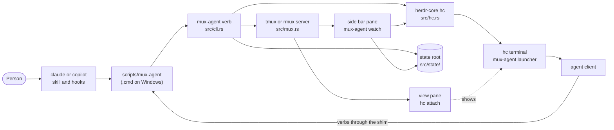

# Architecture

[简体中文](Architecture-zh-CN)

Start here for the map of mux-agents: the problem it solves, the parts and how they connect, and the rules every part follows. Follow one spawn in [From Spawn to Pane](From-Spawn-to-Pane), a member's life in [Agent Lifecycle](Agent-Lifecycle), the files in [State and Durability](State-and-Durability), the checks in [Safety and Occupancy](Safety-and-Occupancy), and the source tree in [Module Reference](Module-Reference).

## The problem

A person running Claude Code or Copilot CLI in a terminal wants helper agents they can see and steer: each in a pane of their own tmux or rmux session, reporting what it does, reachable by message, and stopped when asked. Panes are fragile: a person closes a tab, the multiplexer server dies, the machine reboots. A team started with `up` must outlive all three: closing a view or killing the server does not end an agent, and after a reboot `up` or `restore` brings each lost member back as a new generation of the same conversation.

Agents start with permission prompts off, so a spawn must never give an agent more than its caller already has. Every refusal is one JSON line whose `check` names the cause ([Usage](Usage)).

## The parts

| Part | Where | What it does |
|---|---|---|
| Skill | `skills/mux-agents/SKILL.md` | Tells the client when to use mux-agents and which verbs to run; free text goes in files |
| Copilot CLI hooks | `hooks.json` | Run `report` on session start, prompt, question and stop, so the side bar shows what the client is doing |
| Claude Code hooks module | `hooks/register.tsx`, `hooks/activity.ts`, `hooks/deliver.ts`, `hooks/board.ts` | The same reports, the `Agents` pane beside the chat, and mail delivery at a member's turn |
| Entry shims | `scripts/mux-agent`, `scripts/mux-agent.cmd` | Run the first usable `mux-agent` binary for this OS and architecture, passing arguments and exit code through |
| `mux-agent` binary | `src/main.rs`, `src/cli.rs` | One verb per call, one JSON reply on stdout; exit 0 ok, 1 error, 2 refused or usage |
| Multiplexer seam | `src/mux.rs` | Every tmux or rmux call, as `<mux> -S <socket> -N <argv>` against the caller's own server |
| herdr-core (`hc`) | `src/hc.rs` | The terminal runtime each agent runs in, apart from the pane that shows it |
| Launcher | `src/launcher.rs` | `mux-agent launcher <spec>`, run inside the hc terminal: waits for the launch commit, runs the client once, records its exit |
| State root | `src/state/` | The user's private folder of records, generation evidence, mailboxes, team files, plus the per-user locks |
| Side bar | `src/sidebar.rs`, `src/sidebar/` | `sidebar` opens a split running `mux-agent watch`, which draws the team's board and takes clicks and keys |

## How they connect

The arrows show who calls whom, not every file read. The agent itself is a client like the person's: it reaches mux-agents only through the same shim and verbs, never by typing into another pane.

### One call

The shim runs the first usable of `MUX_AGENTS_BIN`, `scripts/bin/<os>-<arch>/mux-agent[.exe]` and `target/release/mux-agent[.exe]`; with none it prints a JSON `entry` refusal and exits 1. In the binary, `main` builds the providers (`src/ctx.rs`: environment, home, state root, the binary's own path, the process table, the multiplexer, hc and the clock), and `cli::run` parses the verb against `cli::VERBS` and dispatches to its handler. The multiplexer connects on first use. A handler resolves its caller (`src/caller.rs`): the pane, the server's identity and the nearest Claude or Copilot client above it. It then works under the per-user locks and prints one reply (`src/json.rs`). A panic leaves as the `internal` refusal, with no payload or backtrace.

### Verbs

| Group | Verbs | Handlers |
|---|---|---|
| Start | `spawn`, `up`, `placement` | `src/agents/spawn.rs`, `src/agents/up/mod.rs`, `src/agents/placement.rs` |
| End and bring back | `stop`, `drop`, `resume`, `restore` | `src/agents/message.rs`, `src/agents/resume.rs`, `src/agents/reconcile.rs` |
| Talk | `send`, `read`, `peek`, `notify`, `note`, `notes` | `src/agents/message.rs`, `src/agents/notebook.rs` |
| See | `list`, `focus`, `status`, `report`, `kept`, `version` | `src/agents/view.rs`, `src/agents/kept.rs`, `src/cli.rs` |
| Side bar | `sidebar`, `watch` | `src/sidebar.rs` |

Two forms sit outside the table: `mux-agent launcher <spec> --state-root <abs> --path <value>` (`src/launcher_scope.rs`, `src/launcher.rs`) and `mux-agent hold <release file>` (`src/hold.rs`), the first window of a session `up` creates, which exits once the file exists or after 10 minutes. [Usage](Usage) lists every verb with its flags.

### The state root

The root is `MUX_AGENTS_STATE` when set, else `%LOCALAPPDATA%\mux-agents\state` on Windows and `$XDG_STATE_HOME/mux-agents/state` or `~/.local/state/mux-agents/state` on Linux and macOS (`src/state/root.rs`). Under it, each multiplexer server has a folder keyed by its identity with `agents/<id>/` (a member's `record.json`, `desired.json`, `view.json` and its generations under `gens/`), `mail/` (mailboxes and their cursors) and `teams/` (each team's budget, cascade and adoption journals, sends and notebook). Beside them, `up/` holds each `up` team's index and `live/` the registry of client sessions. Locks are per user: files under the passwd home's `.local/state/mux-agents/locks` on Unix, a named mutex on Windows (`src/state/lock.rs`). [State and Durability](State-and-Durability) has the layout and write rules.

## Design rules

### One binary per platform

mux-agents is one Rust crate that builds one binary, `mux-agent`. A release builds it for macOS, Linux and Windows, each `x86_64` and `aarch64`, into `scripts/bin/` on the `dist` branch, and the shim picks the one for the machine. Why: nothing to build, download or install beside the plugin; no PowerShell; and the process layer reads the OS directly with no helper processes (`src/proc/`). A pane runs the binary by the absolute path it started with, so it keeps its version until restarted.

### Files, not keystrokes

Free text reaches mux-agents only in files (`-TaskFile`, `-BriefFile`, `-BodyFile`); an agent that passes it on the command line is refused. Messages go to mailboxes on disk (`src/agents/mail.rs`), each line read through a receipt cursor (`src/agents/receipt.rs`), and the side bar reads activity from the client's own `report`, never from its screen. Why: a pane may hold a person's draft or a busy client, a keystroke lands wherever focus is, and text typed into a terminal is neither durable nor acknowledged. The only text mux-agents puts into another session is a fixed wake line naming the sender (`hc send` in `src/agents/team_mail.rs`, the hook in `hooks/deliver.ts`); the message itself stays in the mailbox.

### Fail closed on unreadable state

A state file that cannot be read, is not JSON or is larger than 1 MB (`STATE_MAX` in `src/state/fs.rs`) refuses; so does a state or lock folder that is a link, owned by another user, open to other users or opened by an extended ACL (`src/state/private_unix.rs`, `src/state/private_windows.rs`, `src/state/acl.rs`). Unreadable generation evidence refuses `evidence` (`src/agents/gens.rs`), a recorded identity that fails its validator matches nothing (`src/agents/ident.rs`), and occupancy counts anything it cannot read as holding the conversation (`src/agents/occupancy.rs`). Why: every guess has a bad branch. Treating an unreadable member as gone could launch a second client on one conversation, or end the wrong terminal; refusing costs one retry.

### Agents live in hc terminals, apart from the panes you see

Each generation of a member runs as `hc run --bg --keep --outlive-parent --no-notify` with labels `mux.managed`, `mux.team`, `mux.id`, `mux.gen` and `mux.name` (`src/agents/core_launch.rs`). The pane a person sees is only a view running `hc attach <address>` (`src/agents/attachment.rs`); the side bar, `list` and `stop` find members by their labels and recorded address (`src/agents/core_facts.rs`, `src/agents/membership.rs`). Why: a pane dies with its tab or its server. A terminal hc keeps outlives both, so closing a view or killing the server leaves the agent running, and `up` opens its views again. When a terminal itself is lost, `restore` and `up` start the member's next generation on the same conversation (`src/agents/reconcile.rs`), and the old terminal stays as a kept shell.

### Every child process is bounded

Only `src/spawn.rs` starts a process; `tests/repo.rs` (`process_spawn_only_in_spawn_rs`) fails on any other spawn site. Its `captured` call closes stdin, reads both pipes to the end and, past its timeout, kills the child's whole tree: its process group on Unix, its job object on Windows. Multiplexer and hc calls wait at most 15 s, version probes 5 s (`src/mux.rs`, `src/hc.rs`). The one unbounded wait is `attached`: the launcher waiting for the client it runs in its own terminal. Why: a verb runs inside a client's turn, a hook or the side bar's tick, often under a team lock; one hung child would stall all of them.

### Never kill by name

A process is signalled only through a handle opened after its start time was read, so a reused pid is never hit; without a handle nothing is sent and only its exit is watched (`kill_with` in `src/proc/seam.rs`). A pane is closed only by the server's conditional `kill-pane`, which acts only while the pane still runs the recorded launch command or pid (`kill_if_dead` in `src/agents/registry.rs`, `kill_command` in `src/sidebar.rs`); `@agent-*` tags play no part. An hc terminal is ended through `hc kill` on the address of the terminal matched to that generation, only after it is read again unchanged and `kill.json` is published (`terminate` in `src/agents/settle.rs`). Why: names, titles, tags and pids are not identities. rmux's `rotate-window` leaves tags behind, a person can name a pane anything, and a pid can be reused; a kill aimed at any of them could end the person's own work.

## Source map

| Topic | Paths |
|---|---|
| Entry and dispatch | `src/main.rs`, `src/cli.rs`, `src/ctx.rs`, `src/error.rs`, `src/json.rs` |
| Caller and spawn checks | `src/caller.rs`, `src/checks.rs`, `src/sandbox.rs` |
| Outside world | `src/mux.rs`, `src/hc.rs`, `src/spawn.rs`, `src/proc/` |
| Launch and lifecycle | `src/agents/core_launch.rs`, `src/launcher.rs`, `src/agents/gens.rs`, `src/agents/settle.rs`, `src/agents/reconcile.rs` |
| State and locks | `src/state/`, `src/agents/team_state.rs` |
| Side bar | `src/sidebar.rs`, `src/sidebar/`, `src/agents/board.rs`, `src/paint.rs` |

[Module Reference](Module-Reference) lists every module with its entry points.
