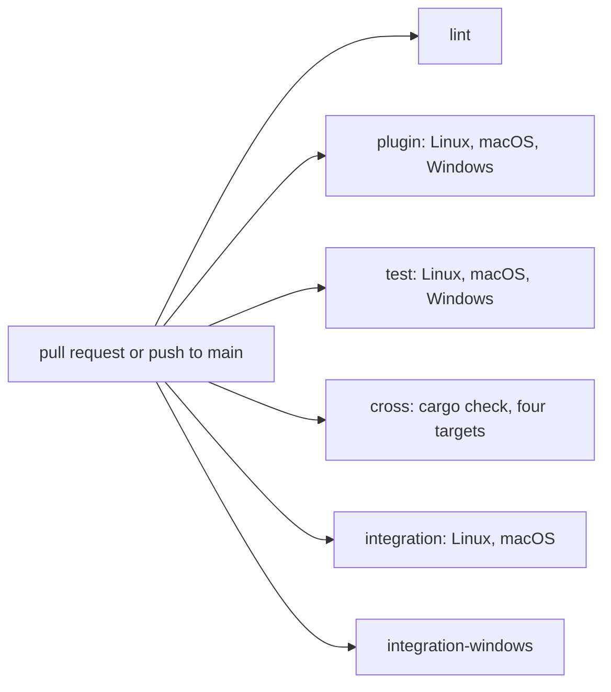
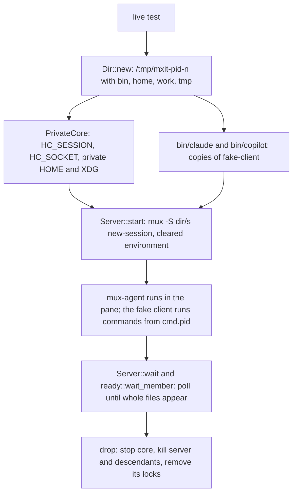
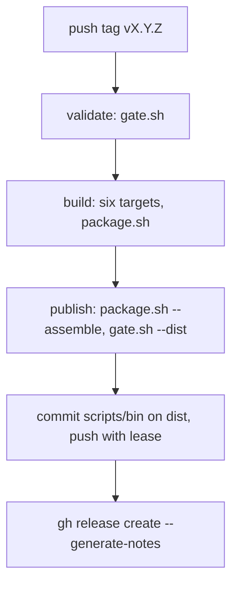
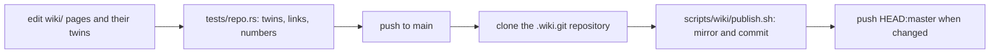

# 开发与发布

[English](Development-and-Release)

mux-agents 如何构建、测试、合并、发布和编写文档：仓库布局、固定的工具链、CI 运行的每项检查、实时测试如何搭起私有多路复用器和私有 herdr-core、`tests/repo.rs` 强制的规则、合并流程、发布到 `dist` 分支，以及 wiki 发布。依据是 `CONTRIBUTING.md`、`CLAUDE.md`、`RELEASE-CHECKLIST.md`、`.github/workflows/`、`scripts/` 和 `tests/`。

## 仓库布局

mux-agents 是一个 Rust crate `mux-agent`，有两个二进制：`mux-agent`（`src/main.rs`），即插件运行的那个；以及 `fake-client`（`src/bin/fake-client.rs`），它只在启用 `live` 特性时构建，在实时测试中替身 `claude` 和 `copilot`。插件通过一个 shim 运行 `mux-agent`，shim 依次选第一个可用的 `MUX_AGENTS_BIN`、`scripts/bin/<os>-<arch>/mux-agent[.exe]` 和 `target/release/mux-agent[.exe]`；都没有时它打印一条 JSON `entry` 拒绝并以 1 退出。因此 `main` 的检出在 `cargo build --release` 之后即可运行。

| 路径 | 内容 |
|---|---|
| `src/` | 二进制本身：动词、检查、状态、锁、按操作系统划分的进程层（`src/proc/`）、启动器、侧边栏和 `watch`；见 [模块参考](Module-Reference-zh-CN) |
| `src/bin/fake-client.rs` | 实时测试的替身客户端，用 `--features live` 构建 |
| `tests/` | `repo.rs`（仓库规则）、`cli.rs`、`panic.rs`、`crash_point.rs`、各实时测试套件、sh 与 cmd 脚本测试、`tests/support/`（实时测试夹具）和 `tests/claude/`（Claude Code 面板） |
| `scripts/mux-agent`, `scripts/mux-agent.cmd`, `scripts/mux-agent.ps1` | 分别面向 POSIX sh、cmd 和 PowerShell 的入口 shim |
| `scripts/release/` | `package.sh` 构建、校验并为二进制生成校验和；`gate.sh` 决定一个标签能否发布、`dist` 能否移动 |
| `scripts/wiki/` | `publish.sh`，Publish wiki 工作流运行的发布器 |
| `scripts/shell/` | `mux-agents.sh`（bash 和 zsh）与 `mux-agents.ps1`（PowerShell）：`cc` 和 `gg` 快捷命令 |
| `scripts/dev/` | `tmux32.sh` 构建 tmux 3.2a，`hc.sh` 在 CI 中安装私有测试用的 herdr-core，`bench-list.sh` 为 `list` 计时 |
| `skills/mux-agents/SKILL.md` | 插件附带的技能 |
| `hooks.json` | Copilot CLI 钩子：六条命令，每条都经 shim 运行一次 `report` |
| `hooks/`, `types/` | Claude Code 的 `Agents` 面板及其状态契约 |
| `.claude-plugin/` | `plugin.json`（名称和版本）与 `marketplace.json`，后者安装 ref `dist` |
| `wiki/` | 本 wiki，唯一的文档；仓库不跟踪 `docs/` 文件夹 |

## 工具链

CI 在所有地方安装同一个 Rust 版本，因此 lint 或格式规则不会在一个拉取请求之下悄然变化。本地请使用同一工具链。

| 项目 | 值 | 设置位置 |
|---|---|---|
| CI 中的 Rust | `1.95.0`；`test` 作业加装 `clippy` 和 `rustfmt`，`integration-windows` 加装 `clippy` | `.github/workflows/ci.yml` 和 `release.yml` 的每个 Rust 步骤 |
| 最低 Rust 版本 | `rust-version = "1.89"` | `Cargo.toml` |
| 语言版本 | `2024` | `Cargo.toml` |
| 特性 `test-panic` | `MUX_AGENTS_TEST_PANIC` 设为 `dispatch` 或 `lock` 时在该处 panic | `Cargo.toml` |
| 特性 `live` | `tests/live.rs`、`fake-client` 二进制和启动审计日志 | `Cargo.toml` |
| 发布配置 | `lto = true`、`codegen-units = 1`、`strip = true`、`panic = "unwind"` | `Cargo.toml` |
| tmux | `PATH` 上的 tmux，以及最旧的受支持版本 tmux 3.2a，来自 `sh scripts/dev/tmux32.sh` | `scripts/dev/tmux32.sh` |
| rmux | `0.10.0`，来自 `cargo install rmux --version 0.10.0 --locked`；Windows 上是同一标签的调试构建 | `ci.yml` |
| herdr-core | `0.1.21`，下载后以 `SHA-256` 校验 | `scripts/dev/hc.sh` |
| Claude Code | `plugin` 作业用 `2.1.325`，`tests/upgrade.sh` 用 `2.1.310` | `ci.yml` |
| actionlint | `1.7.12`，以 `SHA-256` 固定 | `ci.yml` |

## 必须通过的检查

`CONTRIBUTING.md` 列出每个拉取请求必须通过的检查，`.github/workflows/ci.yml` 在每个拉取请求和每次推送到 `main` 时运行它们。打开拉取请求之前，先在本机运行你的主机能运行的部分。



### test 作业（Linux、macOS、Windows）

```sh
cargo fmt --check
cargo clippy --all-targets --features test-panic --locked -- -D warnings
cargo test --features test-panic --locked
cargo test --locked --test crash_point
cargo build --release --locked
cargo test --release --features test-panic --locked --test panic
sh tests/shim.sh
```

- Clippy 在全部三个运行器上运行，因此 `cfg(unix)` 和 `cfg(windows)` 之后的代码都在编译它的操作系统上接受检查；`-D warnings` 让每条警告都成为失败。
- `cargo test --features test-panic` 运行单元测试和所有不依赖 `live` 的集成测试，其中包括 `tests/repo.rs`、`tests/cli.rs` 和 `tests/panic.rs`；该特性让测试可以通过 `MUX_AGENTS_TEST_PANIC` 让分发或锁发生 panic。
- `crash_point` 在不带该特性时再运行一次：发布出去的库从不因 `MUX_AGENTS_CRASH` 退出，而 `test-panic` 构建只在 `MUX_AGENTS_CRASH` 指名的步骤停下。
- 发布版 panic 测试证明：在发布配置下，panic 以内部拒绝的形式离开，不带负载也不带回溯。
- `sh tests/shim.sh` 在 bash 和 zsh 下测试 `scripts/mux-agent` 和 shell 快捷命令（该作业在 Linux 上安装 zsh）。在 Windows 上它以 `SHIM_SHELLS=bash bash tests/shim.sh` 在 Git Bash 下运行，并且 `tests\shim.cmd` 必须以 `0 failed` 这一行结尾。
- Windows 上还多两步：在多路复用器之外运行 `scripts\mux-agent.cmd list` 必须以 1 退出并带 `"check":"endpoint"`；`hooks.json` 的六条命令每条都必须以 0 退出且什么都不打印。

### lint、plugin 与 cross

```sh
./actionlint -color
jq . .claude-plugin/plugin.json .claude-plugin/marketplace.json >/dev/null
git ls-files -z 'scripts/*.sh' scripts/mux-agent 'tests/*.sh' | xargs -0 shellcheck
claude plugin validate .
claude plugin test .
```

- `lint`（Linux）运行 actionlint，把两个清单当作 JSON 解析，并对每个被跟踪的 sh 脚本运行 shellcheck。
- `plugin` 在全部三个运行器上运行 `claude plugin validate .` 和 `claude plugin test .`。
- `cross` 对 `x86_64-unknown-linux-gnu`、`aarch64-unknown-linux-musl`、`x86_64-pc-windows-msvc` 和 `aarch64-pc-windows-msvc` 运行 `cargo check --all-targets --locked --target "$target"`，让每个发布目标在标签需要它之前就能编译；只做检查，因此不需要链接器。

### integration 作业（Linux、macOS）

```sh
sh scripts/dev/tmux32.sh
sh scripts/dev/hc.sh
cargo test --features live,test-panic --locked --test live_core -- --nocapture
cargo test --features live,test-panic --locked --test live_session -- --nocapture
cargo test --features live,test-panic --locked --test live preflight -- --nocapture
cargo test --features live,test-panic --locked --test cli
cargo test --features live,test-panic --locked --test fake_client_bg
cargo test --features live,test-panic --locked --bin fake-client
sh tests/serial_resume.sh check live
sh tests/serial_resume.sh parallel live
sh tests/serial_resume.sh serial live
sh tests/release.sh
sh tests/wiki.sh
sh tests/upgrade.sh
```

- 该作业安装 tmux 和 rmux `0.10.0`，构建 tmux 3.2a，把 `tmux32.sh` 打印的 `MUX_AGENTS_TMUX32=<path>` 行写入环境，然后用 `hc.sh` 安装 herdr-core `0.1.21`。
- `live_core` 测试私有核心夹具本身；`live_session` 在真实进程表上测试会话登记表。
- 每个运行 `--test live` 的步骤都设置 `MUX_AGENTS_LIVE_REQUIRE: tmux,tmux32,rmux`，因此运行找不到的多路复用器会让整套测试失败，而不是跳过其测试；`preflight` 打印每个多路复用器的版本和二进制路径。
- `cli` 带 `live` 再运行一次，用于需要假客户端的 CLI 测试；`fake_client_bg` 和 `--bin fake-client` 测试假客户端本身。
- 实时测试套件经 `tests/serial_resume.sh` 分两轮运行（见下文的串行列表）。
- 串行轮之后，只要还有私有核心的 holder 在运行，该作业就失败：比测试活得更久的 holder 会保留它保管的 shell 及其 pty，积累够多就会耗尽 pty 上限，后续测试便无法 fork。每个实时夹具目录都是 `/tmp/mxit-*` 或 `/tmp/mxc-*`（macOS 上为 `/private/tmp`），每个 holder 的 argv 都指名其中的套接字：

```sh
left=$(ps -A -o pid=,ppid=,command= | grep -E 'hold --socket (/private)?/tmp/mx(it|c)-' || true)
```

- `tests/release.sh` 测试 `package.sh` 和 `gate.sh`；`tests/wiki.sh` 测试 wiki 发布器；`tests/upgrade.sh` 用真实的 Claude Code（以及在 `PATH` 上时的 Copilot CLI）运行真实的一行升级，市场由本地裸仓库提供，因此每次 git 获取都留在运行器上。

### integration-windows 作业

```sh
sh scripts/dev/hc.sh
cargo test --features live,test-panic --locked --test live_core -- --nocapture
cargo test --features live,test-panic --locked --test live_session -- --nocapture
cargo clippy --all-targets --features live,test-panic --locked -- -D warnings
cargo test --features live,test-panic --locked --test cli
cargo test --features live,test-panic --locked --test fake_client_bg
cargo test --features live,test-panic --locked --bin fake-client
sh tests/serial_resume.sh check live_windows
sh tests/serial_resume.sh parallel live_windows --nocapture
sh tests/serial_resume.sh serial live_windows --nocapture
```

- 该作业以 `MUX_AGENTS_LIVE_REQUIRE: rmux` 运行，`timeout-minutes` 为 30。
- 发布版 rmux `0.10.0` 无法在运行器的作业对象内启动其守护进程（报错 "Access is denied"），因此该作业从标签 `v0.10.0` 的提交 `dfd68c774ca0f4212139a21d37d09c90f75f8bd7` 构建调试版 rmux，并设置 `RMUX_ALLOW_INTERNAL_DAEMON_IN_CALLER_JOB: '1'`，与 rmux 自己的 CI 做法相同。
- 这是唯一一次带 `live` 特性的 clippy 运行，它检查实时测试和假客户端。
- Windows 没有遗留 holder 检查步骤：在那里读取另一个进程的命令行需要 PowerShell，而没有工作流使用它；夹具自己的清理会让 holder 存活下来的 Windows 测试失败。

## 实时测试如何工作

实时测试驱动真实的多路复用器和真实的 herdr-core，但从不使用用户自己的。每个测试搭建自己的环境并将其拆除，因此测试可以并行运行，失败时留下的是证据而不是残骸。测试夹具是 `tests/support/mod.rs`（Unix）、`tests/support/private_core.rs`、`tests/support/ready.rs` 和 `tests/support/bounded.rs`。



### 每个测试一个私有多路复用器

- `Dir::new()` 创建一个短路径临时目录 `/tmp/mxit-<pid>-<n>`，权限为 `0700`，内含 `bin/`、`home/`、`home/.claude/sessions/`、`work/` 和 `tmp/`。丢弃它时会删除全部内容，除非核心停止失败。
- `Server::start(mux, &dir)` 在清空的环境中运行 `<mux> -S <dir>/s -f /dev/null new-session -d -x 200 -y 50 -c <dir>/work sh`，之后的每次调用都是 `<mux> -S <socket> -N …`。调用方自己会话中的 `TMUX`、`RMUX`、`MUX_AGENTS_STATE` 或客户端变量都不会到达窗格。
- `Mux::ALL` 是 `PATH` 上的 `tmux`、`$MUX_AGENTS_TMUX32`（tmux 3.2a）和 `PATH` 上的 `rmux`。未安装的多路复用器会附一条消息被跳过，除非 `MUX_AGENTS_LIVE_REQUIRE` 指名了它。
- 丢弃服务器时，先快照其后代进程，写入 `<dir>/quit`，杀掉服务器，等待它和每个后代退出（5 秒后 SIGKILL），删除套接字，再删除键名指向此服务器的锁文件。只有当 pid 仍具有 `start` 时读到的启动时间才被信任，因此被复用的 pid 永远不会收到信号。
- 在 Windows 上，`tests/live_windows.rs` 为每个测试启动一个私有 rmux 服务器（`rmux -L <name>`），其根窗格是 `cmd.exe`，`PATH` 上的 `claude.exe` 是假客户端，并像终端那样驱动侧边栏的点击和按键。

### 每个夹具一个私有 herdr-core

- `PrivateCore` 清空环境，只保留列出的账户和运行时变量，并把 `HOME`、`USERPROFILE`、`APPDATA`、`LOCALAPPDATA`、`XDG_STATE_HOME`、`XDG_CONFIG_HOME`、`XDG_RUNTIME_DIR` 和 `TMPDIR` 指向夹具目录内部。
- 它把 `HC_SESSION` 设为 `mux-test-<pid>-<hex>`，把 `HC_SOCKET` 设为 `<dir>/h.sock`（Windows 上为 `\\.\pipe\<session>`），并为假客户端设置 `MUX_IT_DIR` 和 `MUX_IT_ENTRY`。
- 它用 `server start --json` 启动核心，用 `server stop --json` 停止核心。停止失败时写入 `core-stop-failed`，并保留夹具文件夹作为证据。
- `kill_hard` 直接杀掉核心（SIGKILL；Windows 上为 `taskkill /F`）再重新启动它；它运行的终端在 hc 的 `hold` 中存活，因此仅杀掉核心不会丢失任何成员。清理扫描会结束每个 argv 指名此夹具套接字前缀 `<socket stem>.holder.` 的 holder，并按 pid 和启动时间核对。
- 当 `PATH` 上既没有 `hc` 也没有 `herdr-core`，或其 `--version` 更旧时，`PrivateCore::installed()` 以 `live tests require hc >=0.1.21` 失败。`scripts/dev/hc.sh` 需要 `RUNNER_TEMP` 和 `GITHUB_PATH`，因此只在 CI 中运行；在本地请自行安装 herdr-core。

### 假客户端

- `src/bin/fake-client.rs` 被复制为 `<dir>/bin/claude` 和 `<dir>/bin/copilot`，位于 `PATH` 最前，因此窗格启动客户端时启动的就是它。没有 `MUX_IT_DIR` 时它立即以 2 退出。
- 启动时它写入 `client.<pid>.json`（pid、argv、会话 id、cwd、tty 和选定的变量），并把自己的 pid 追加到 `clients.log`；带会话 id 时，它像客户端钩子那样经 `MUX_IT_ENTRY` 运行 `report -Session <sid> -Source startup`。
- 它轮询 `cmd.<pid>`，把每一行按制表符拆分后作为 `mux-agent` 参数运行，依次写入 `reply.<pid>.<n>.err`、`reply.<pid>.<n>.code`，最后写 `reply.<pid>.<n>.json`。`@detach`、`@say`、`@sleep` 和 `@bg` 这几种行不运行 `mux-agent`。
- 它从 stdin 读到的每一行（即 `send` 键入窗格的内容）都追加到 `input.<pid>.log`；`quit` 或 `quit.<pid>` 让它写入 `exited.<pid>` 后退出。
- 它写的每个文件都以完整形式出现：先写在旁边，再重命名到位。

### 就绪等待与时限

- 测试从不固定睡眠一段时间。`Server::wait` 每 50 毫秒（`POLL`）轮询一次，最长 60 秒（`WAIT`），超时则带上窗格的截屏内容失败。
- `ready::wait_proof` 等到启动器发布了某一代的 `client.json`，且它能解析并指名一个 pid；每个向成员发命令的实时辅助函数都先经过 `ready::wait_member` 到达它。其时限为 60 秒。
- 实时测试夹具、假客户端或 `tests/crash_point.rs` 启动的每个子进程都经 `tests/support/bounded.rs` 运行，其 `LIMIT` 为 60 秒；超过即杀掉子进程，测试失败。

### 串行 resume 列表

并行实时测试中的假客户端，对另一个状态根而言是一个非托管客户端；它一旦恢复或报告某个会话，就会占住该会话。因此运行 `resume`、运行 `up` 或杀掉核心的实时测试单独运行。`tests/serial_resume.txt` 列出它们，每行一个名称，并用注释说明每组为何在列。

- `sh tests/serial_resume.sh parallel <target>` 运行除列出项之外的所有已注册测试；`serial <target>` 以 `--test-threads=1` 运行列出的测试。两者都用 `--exact` 按全名选择：每个列出的名称解析为所有以它为最后一段路径的已注册测试（Unix 上为 `e2e::<mux>::<name>`，Windows 上为 `<name>`）。
- `sh tests/serial_resume.sh check <target>` 是自检：根据 libtest 自己对每一轮的 `--list`，每个列出的测试都在串行轮中，没有一个在并行轮中，也没有测试丢失。
- 当某个运行 `resume` 或 `up` 的实时测试不在列表中，或列表指名了未注册的测试时，`tests/serial_resume.rs` 失败。

## 仓库规则

`tests/repo.rs` 读取仓库自己的文件，规则被打破时让 `cargo test` 失败。每条规则都注明其测试。

### 文本与 wiki

- 永远不要在被跟踪的文件里写 issue 或拉取请求编号、CI 运行或 issue URL：不要有读起来像这类编号的 `#` 加数字（`no_issue_or_pull_request_numbers`）。代码可能迁移到别的托管平台，那些编号随后就指向虚无；请改写为原因和做法。提交信息和拉取请求描述可以提及它们。
- 每个 wiki 页面 `X.md` 都有孪生页 `X-zh-CN.md`，并在前五行内链接它；相对链接指向存在的页面；`Home` 和 `Home-zh-CN` 链接其语言的每个页面；`wiki/` 保持扁平（`wiki_pairs_and_links`）。
- 孪生页逐行对应：行数相同，每行的形态、代码片段和数字相同，每个中文正文行都含中文，围栏块完全一致。（`zh_twins_match_line_counts`）
- 仓库不跟踪 `docs/` 路径（`tracks_no_docs_path`），`CONTRIBUTING.md` 和拉取请求模板逐字保留合并流程（`contributing_and_pr_template_merge_sentences`）。

### 源码与测试

- 只有 `src/spawn.rs` 启动进程；`src/bin/fake-client.rs` 不在扫描范围内（`process_spawn_only_in_spawn_rs`）。
- 只有 `src/agents/team_state.rs` 写成员记录；其他任何指名成员文件并带写入记号的语句，都需要一条经过审阅、写明原因的允许列表条目（`only_team_state_writes_member_records`）。
- 在 `src/agents/` 和 `src/sidebar.rs` 中，对 `.server_key` 的读取，或对调用方 `.session` 的读取，只能出现在列出的文件和函数中，并写明原因（`state_reads_go_through_scope`）。
- 每个名为 `*_tests.rs` 或 `tests.rs` 的源文件都在 `TEST_ONLY` 中，其父模块恰好声明一次 `#[cfg(test)] mod <name>;`，且不带 `#[path]`（`every_test_file_is_exempt_by_name`、`each_exempt_file_is_declared_test_only`）。
- 实时测试夹具、假客户端或 `tests/crash_point.rs` 中不得出现裸的 `.output()`、`.spawn()` 或 `.status()`：每个子进程都有时限（`live_harness_subprocesses_are_bounded`）。

### 工作流与发布

- 不用 `continue-on-error`（`no_continue_on_error`）；每个工作流在顶部授予 `contents: read`，写权限只出现在 `release.yml` 和 `publish-wiki.yml` 的 `publish` 作业上（`permissions_minimal_per_job`）。
- 每次 checkout 都设置 `persist-credentials: false`（`checkout_persist_credentials_false`）；每个 `uses:` 都固定到 40 位十六进制提交并附版本注释（`action_pins_are_40_hex_with_version_comment`）；没有工作流提及 PowerShell（`no_pwsh_in_workflows`）。
- 发布的 `publish` 依赖 `validate` 和 `build`（`publish_needs_validate_and_build`），令牌不会出现在任何命令行上（`release_token_never_in_argv`、`wiki_publish_runs_sh_with_token_off_argv`）。
- `test` 作业按上文顺序运行其命令（`ci_jobs_run_cargo_and_sh`）；每个实时步骤都要求 `tmux,tmux32,rmux`（`integration_runs_live_on_every_multiplexer`）；`sh scripts/dev/hc.sh` 在第一个实时测试之前运行（`live_core_installer_precedes_tests`）；遗留 holder 检查步骤位于串行实时轮之后（`integration_fails_on_a_leftover_private_core_holder`）。
- `plugin.json`、`Cargo.toml` 和 `Cargo.lock` 持有同一版本（`plugin_version_is_0_3_5_and_matches_cargo`）；`marketplace.json` 固定 ref `dist`，`.gitignore` 含 `/scripts/bin/`（`marketplace_pins_dist_ref`）；`.gitattributes` 保留其 `export-ignore` 和换行符规则（`export_ignore_rules`）。

## 合并流程

每个 issue 一个拉取请求，各在自己的分支上。提交的作者和提交者都是 `D0n9X1n <D0n9x1n@outlook.com>`。拉取请求通过把 `main` 快进到其已测试的头部落地，从不经 GitHub 合并，因为那会改写作者：

1. 运行 `gh pr view <n> --json headRefOid,statusCheckRollup`
2. 该 `headRefOid` 上的每项检查都是 `SUCCESS`，并且 `lint`、`test (ubuntu-latest)`、`test (macos-latest)`、`test (windows-latest)`、`integration (ubuntu-latest)` 和 `integration (macos-latest)` 全部存在。
3. 先 `git fetch origin <sha>`，再 `git push origin <sha>:main`，其中 `<sha>` 是第 1 步得到的 `headRefOid`。推送不是强制的，因此只有当 `<sha>` 建立在当前 `main` 之上时才会落地；随后 GitHub 把该拉取请求标记为已合并。

推送到 `main` 会启动 CI 的推送运行（之后的发布需要它）以及 Publish wiki 工作流。

## 发布

`main` 只放源码：`.gitignore` 含 `/scripts/bin/`。一次发布把六个二进制构建到 `scripts/bin/<os>-<arch>/`，附一个 `SHA256SUMS`，并提交到 `dist` 分支。`.claude-plugin/marketplace.json` 固定 `"ref": "dist"`，因此市场安装的是 `dist`，用户从不需要构建或下载二进制。

1. 在 `main` 上，把 `.claude-plugin/plugin.json` 和 `Cargo.toml` 设为同一版本，然后 `cargo build` 以更新 `Cargo.lock`。`tests/repo.rs` 中的 `plugin_version_is_0_3_5_and_matches_cargo` 固定了版本，因此发布提交也要更新它。
2. 等该提交的 CI 推送运行变绿后，在其上推送标签 `v<version>`。
3. 在 GitHub 发布中撰写发布说明：`gh release edit v<version> --notes-file <file>`。发布说明只存在于那里；仓库不保留变更日志，wiki 描述代码是什么以及为什么，从不为每个版本单写一页。

发布之前，还要有人手动运行 `RELEASE-CHECKLIST.md` 中的检查，在 macOS、Linux 和 Windows 上使用真实的 Claude Code 和 Copilot CLI，因为 CI 不运行经过认证的客户端。



`.github/workflows/release.yml` 在匹配 `v[0-9]+.[0-9]+.[0-9]+` 的标签上运行，分三个作业：

| 作业 | 做什么 |
|---|---|
| `validate` | 拒绝不指向 `$GITHUB_SHA` 的标签，然后运行 `sh scripts/release/gate.sh "$TAG" "$sha" "$on_main" "$RUNNER_TEMP/runs.json" "$version" "$cargo_version"` |
| `build` | 每个目标一行（见下表），各运行 `sh scripts/release/package.sh --target "$TARGET" --os "$OS" --arch "$ARCH" --out package`，只上传二进制 |
| `publish` | 运行 `sh scripts/release/package.sh --assemble scripts/bin`，除非 `SHA256SUMS` 恰有 6 行否则拒绝，重新核对远端标签，询问 `gate.sh --dist`，提交 `dist $TAG` 并以 `--force-with-lease` 推送，然后在发布不存在时运行 `gh release create "$TAG" --verify-tag --title "$TAG" --generate-notes` |

| 运行器 | 目标 | 目录 |
|---|---|---|
| `macos-latest` | `aarch64-apple-darwin` | 放入 `macos-aarch64` |
| `macos-latest` | `x86_64-apple-darwin` | 放入 `macos-x86_64` |
| `ubuntu-latest` | `x86_64-unknown-linux-musl` | 放入 `linux-x86_64` |
| `ubuntu-24.04-arm` | `aarch64-unknown-linux-musl` | 放入 `linux-aarch64` |
| `windows-latest` | `x86_64-pc-windows-msvc` | 放入 `windows-x86_64` |
| `windows-latest` | `aarch64-pc-windows-msvc` | 放入 `windows-aarch64` |

- `gate.sh` 依次检查：标签在 `main` 上，其提交存在一次成功的 CI 推送运行，标签等于 `v` 加 `plugin.json` 版本，也等于 `v` 加 `Cargo.toml` 版本；第一个失败的检查打印 `refused: ...` 并以 1 退出。
- `gate.sh --dist` 在 `dist` 不存在或持有更旧版本时回答 `push`，在它已持有来自同一提交的同一版本时（重跑）回答 `same`，其他情况一律拒绝：`dist` 只会前进。
- 每个 `dist` 提交的父提交是其打标签的提交，因此 `dist` 是被替换而不是被延长；推送以读到的 `dist` 为租约。`release-dist` 并发组一次只运行一个发布，且从不取消排队中的发布。
- `package.sh` 运行 `cargo build --release --locked --target <triple>`，拒绝文件头指向别的操作系统或架构的二进制，在 macOS 上做临时签名，设为 `0755`，并由 `--assemble` 写出唯一的 `SHA256SUMS`。`sh scripts/release/package.sh --host` 在本地打包主机二进制。
- 令牌只通过 `GIT_CONFIG_*` 变量中设置的凭据助手到达 git；没有任何命令行持有它。

## Wiki 发布

`wiki/` 是文档的唯一来源。每个页面都用英文和中文各写一份，即 `Page.md` 和 `Page-zh-CN.md`，在顶部链接其孪生页，并按页面名链接其他页面，如 `[Home](Home)`。在浏览器中对 GitHub wiki 的编辑会被下一次发布覆盖。



- `.github/workflows/publish-wiki.yml` 在每次推送到 `main` 和 `workflow_dispatch` 时运行，属于不取消的 `publish-wiki` 并发组。它把 `https://github.com/${GITHUB_REPOSITORY}.wiki.git` 克隆到 `wiki-repo`，运行 `sh scripts/wiki/publish.sh wiki wiki-repo "$GITHUB_SHA"`，并且只在发布器报告 `changed=true` 时运行 `git -C wiki-repo push origin HEAD:master`。
- `publish.sh` 在改动目标之前读取每个顶层 `*.md` 页面，拒绝本身是链接的页面和没有页面的来源，删除目标中的每个 `.md` 条目以便重命名和删除得以传递，并逐页写入而非复制，这样 git 就不会把同样大小的改动误认为没有改动。
- 它以 `D0n9X1n` 身份提交，消息为 `Publish wiki from <sha>`（取来源提交的前七个字符），从不推送，并把 `changed=true` 或 `changed=false` 追加到 `$GITHUB_OUTPUT`。wiki 未变时打印 `wiki already matches <sha>`。
- 只有克隆和推送通过同一个 `GIT_CONFIG_*` 凭据助手拿到令牌；发布器从不拿到。`sh tests/wiki.sh` 测试发布器。
- `.gitattributes` 把 `scripts/release`、`scripts/wiki`、`scripts/dev`、`wiki` 和 `assets` 标为 `export-ignore`，因此 `git archive` 会将它们排除。
