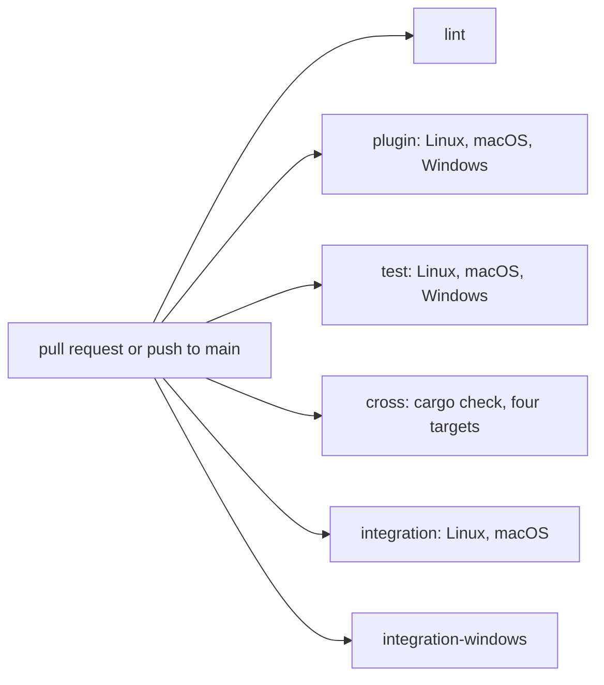
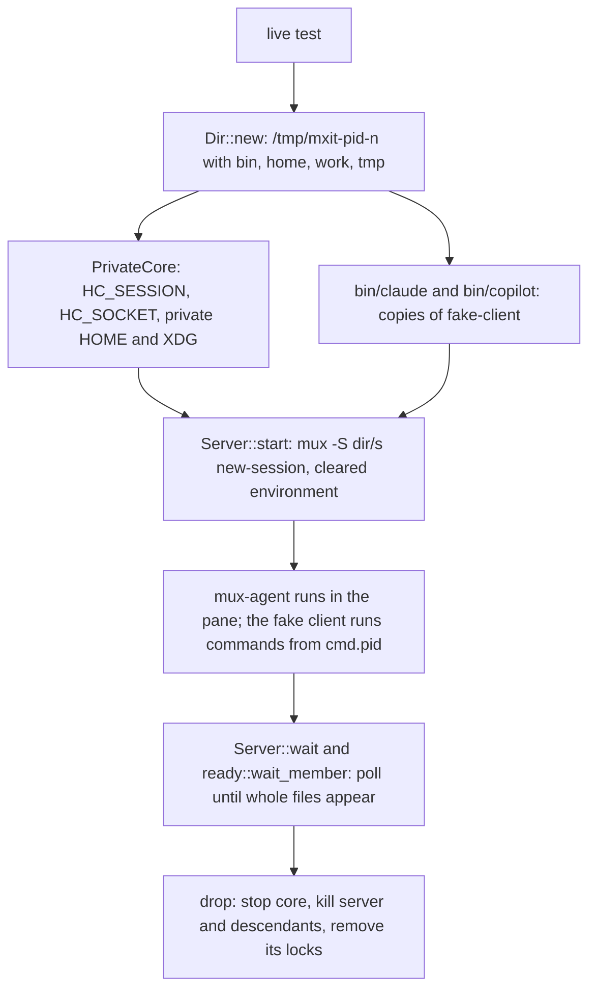
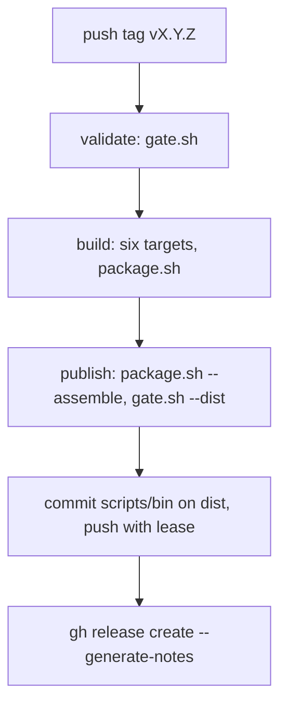
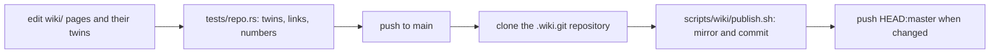

# Development and Release

[简体中文](Development-and-Release-zh-CN)

How mux-agents is built, tested, merged, released and documented: the repository layout, the pinned toolchain, every check CI runs, how the live tests stand up private multiplexers and a private herdr-core, the rules `tests/repo.rs` enforces, the merge procedure, the release onto the `dist` branch, and the wiki publication. The sources are `CONTRIBUTING.md`, `CLAUDE.md`, `RELEASE-CHECKLIST.md`, `.github/workflows/`, `scripts/` and `tests/`.

## Repository layout

mux-agents is one Rust crate, `mux-agent`, with two binaries: `mux-agent` (`src/main.rs`), the one the plugin runs, and `fake-client` (`src/bin/fake-client.rs`), which builds only with the `live` feature and stands in for `claude` and `copilot` in the live tests. The plugin runs `mux-agent` through a shim that picks the first usable of `MUX_AGENTS_BIN`, `scripts/bin/<os>-<arch>/mux-agent[.exe]` and `target/release/mux-agent[.exe]`; with none it prints a JSON `entry` refusal and exits 1. A checkout of `main` therefore runs after `cargo build --release`.

| Path | What it holds |
|---|---|
| `src/` | The binary: verbs, checks, state, locks, the process layer per OS (`src/proc/`), the launcher, the side bar and `watch`; see [Module Reference](Module-Reference) |
| `src/bin/fake-client.rs` | The live tests' stand-in client, built with `--features live` |
| `tests/` | `repo.rs` (repository rules), `cli.rs`, `panic.rs`, `crash_point.rs`, the live suites, the sh and cmd script tests, `tests/support/` (the live harness) and `tests/claude/` (the Claude Code pane) |
| `scripts/mux-agent`, `scripts/mux-agent.cmd`, `scripts/mux-agent.ps1` | The entry shims for POSIX sh, cmd and PowerShell |
| `scripts/release/` | `package.sh` builds, checks and checksums the binaries; `gate.sh` decides whether a tag may be released and whether `dist` may move |
| `scripts/wiki/` | `publish.sh`, the publisher the Publish wiki workflow runs |
| `scripts/shell/` | `mux-agents.sh` (bash and zsh) and `mux-agents.ps1` (PowerShell): the `cc` and `gg` shortcuts |
| `scripts/dev/` | `tmux32.sh` builds tmux 3.2a, `hc.sh` installs the private-test herdr-core in CI, `bench-list.sh` times `list` |
| `skills/mux-agents/SKILL.md` | The skill the plugin ships |
| `hooks.json` | The Copilot CLI hooks: six commands, each a `report` through the shim |
| `hooks/`, `types/` | The Claude Code `Agents` pane and its state contract |
| `.claude-plugin/` | `plugin.json` (name and version) and `marketplace.json`, which installs ref `dist` |
| `wiki/` | This wiki, the only documentation; the repository tracks no `docs/` folder |

## Toolchain

CI installs one Rust release everywhere, so a lint or a format rule cannot change under a pull request. Use the same toolchain locally.

| Item | Value | Where it is set |
|---|---|---|
| Rust in CI | `1.95.0`; the `test` job adds `clippy` and `rustfmt`, `integration-windows` adds `clippy` | every Rust step of `.github/workflows/ci.yml` and `release.yml` |
| Minimum Rust | `rust-version = "1.89"` | `Cargo.toml` |
| Edition | `2024` | `Cargo.toml` |
| Feature `test-panic` | `MUX_AGENTS_TEST_PANIC` set to `dispatch` or `lock` panics there | `Cargo.toml` |
| Feature `live` | `tests/live.rs`, the `fake-client` bin and the spawn audit log | `Cargo.toml` |
| Release profile | `lto = true`, `codegen-units = 1`, `strip = true`, `panic = "unwind"` | `Cargo.toml` |
| tmux | the tmux on `PATH`, and tmux 3.2a, the oldest supported, from `sh scripts/dev/tmux32.sh` | `scripts/dev/tmux32.sh` |
| rmux | `0.10.0`, from `cargo install rmux --version 0.10.0 --locked`; on Windows a debug build of the same tag | `ci.yml` |
| herdr-core | `0.1.21`, downloaded and checked by `SHA-256` | `scripts/dev/hc.sh` |
| Claude Code | `2.1.325` in the `plugin` job, `2.1.310` for `tests/upgrade.sh` | `ci.yml` |
| actionlint | `1.7.12`, pinned by `SHA-256` | `ci.yml` |

## Must-pass checks

`CONTRIBUTING.md` lists what every pull request must pass, and `.github/workflows/ci.yml` runs it on every pull request and every push to `main`. Run what your host can run before you open one.



### test (Linux, macOS, Windows)

```sh
cargo fmt --check
cargo clippy --all-targets --features test-panic --locked -- -D warnings
cargo test --features test-panic --locked
cargo test --locked --test crash_point
cargo build --release --locked
cargo test --release --features test-panic --locked --test panic
sh tests/shim.sh
```

- Clippy runs on all three runners, so code behind `cfg(unix)` and `cfg(windows)` is linted on the OS that compiles it; `-D warnings` makes every warning a failure.
- `cargo test --features test-panic` runs the unit tests and every integration test not gated on `live`, among them `tests/repo.rs`, `tests/cli.rs` and `tests/panic.rs`; the feature lets a test make dispatch or the lock panic through `MUX_AGENTS_TEST_PANIC`.
- `crash_point` runs once more without the feature: the library that ships never exits on `MUX_AGENTS_CRASH`, and a `test-panic` build stops only where `MUX_AGENTS_CRASH` names the step.
- The release panic test proves that in the release profile a panic leaves as the internal refusal, with no payload or backtrace.
- `sh tests/shim.sh` tests `scripts/mux-agent` and the shell shortcuts under bash and zsh (the job installs zsh on Linux). On Windows it runs as `SHIM_SHELLS=bash bash tests/shim.sh` under Git Bash, and `tests\shim.cmd` must end with the line `0 failed`.
- On Windows two more steps run: `scripts\mux-agent.cmd list` outside a multiplexer must exit 1 with `"check":"endpoint"`, and each of the six `hooks.json` commands must exit 0 and print nothing.

### lint, plugin and cross

```sh
./actionlint -color
jq . .claude-plugin/plugin.json .claude-plugin/marketplace.json >/dev/null
git ls-files -z 'scripts/*.sh' scripts/mux-agent 'tests/*.sh' | xargs -0 shellcheck
claude plugin validate .
claude plugin test .
```

- `lint` (Linux) runs actionlint, parses both manifests as JSON and runs shellcheck over every tracked sh script.
- `plugin` runs `claude plugin validate .` and `claude plugin test .` on all three runners.
- `cross` runs `cargo check --all-targets --locked --target "$target"` for `x86_64-unknown-linux-gnu`, `aarch64-unknown-linux-musl`, `x86_64-pc-windows-msvc` and `aarch64-pc-windows-msvc`, so every release target compiles before a tag needs it; check only, so no linker is needed.

### integration (Linux, macOS)

```sh
sh scripts/dev/tmux32.sh
sh scripts/dev/hc.sh
cargo test --features live,test-panic --locked --test live_core -- --nocapture
cargo test --features live,test-panic --locked --test live_session -- --nocapture
cargo test --features live,test-panic --locked --test live preflight -- --nocapture
cargo test --features live,test-panic --locked --test cli
cargo test --features live,test-panic --locked --test fake_client_bg
cargo test --features live,test-panic --locked --bin fake-client
sh tests/serial_resume.sh check live
sh tests/serial_resume.sh parallel live
sh tests/serial_resume.sh serial live
sh tests/release.sh
sh tests/wiki.sh
sh tests/upgrade.sh
```

- The job installs tmux and rmux `0.10.0`, builds tmux 3.2a and writes the `MUX_AGENTS_TMUX32=<path>` line `tmux32.sh` prints into the environment, then installs herdr-core `0.1.21` with `hc.sh`.
- `live_core` tests the private-core fixture itself; `live_session` tests the session registry on the real process table.
- Every step that runs `--test live` sets `MUX_AGENTS_LIVE_REQUIRE: tmux,tmux32,rmux`, so a multiplexer the run cannot find fails the suite instead of skipping its tests; `preflight` prints each one's version and binary.
- `cli` runs again with `live`, for the CLI tests that need the fake client; `fake_client_bg` and `--bin fake-client` test the fake client itself.
- The live suite runs in two passes through `tests/serial_resume.sh` (see the serial list below).
- After the serial pass, the job fails when any private core holder is still running: a holder that outlives its test keeps its kept shells and their ptys, and enough of them exhaust the pty limit so that later tests fail to fork. Every live fixture dir is `/tmp/mxit-*` or `/tmp/mxc-*` (`/private/tmp` on macOS), and each holder's argv names its socket there:

```sh
left=$(ps -A -o pid=,ppid=,command= | grep -E 'hold --socket (/private)?/tmp/mx(it|c)-' || true)
```

- `tests/release.sh` tests `package.sh` and `gate.sh`; `tests/wiki.sh` tests the wiki publisher; `tests/upgrade.sh` runs the real one-line upgrade with real Claude Code (and Copilot CLI when it is on `PATH`), with the marketplace served from a local bare repository so every git fetch stays on the runner.

### integration-windows

```sh
sh scripts/dev/hc.sh
cargo test --features live,test-panic --locked --test live_core -- --nocapture
cargo test --features live,test-panic --locked --test live_session -- --nocapture
cargo clippy --all-targets --features live,test-panic --locked -- -D warnings
cargo test --features live,test-panic --locked --test cli
cargo test --features live,test-panic --locked --test fake_client_bg
cargo test --features live,test-panic --locked --bin fake-client
sh tests/serial_resume.sh check live_windows
sh tests/serial_resume.sh parallel live_windows --nocapture
sh tests/serial_resume.sh serial live_windows --nocapture
```

- The job runs with `MUX_AGENTS_LIVE_REQUIRE: rmux` and a `timeout-minutes` of 30.
- A release rmux `0.10.0` cannot start its daemon inside the runner's job object (it fails with "Access is denied"), so the job builds rmux from commit `dfd68c774ca0f4212139a21d37d09c90f75f8bd7` of tag `v0.10.0` as a debug build and sets `RMUX_ALLOW_INTERNAL_DAEMON_IN_CALLER_JOB: '1'`, as rmux's own CI does.
- This is the one clippy run with the `live` feature, which lints the live tests and the fake client.
- Windows has no leftover-holder step: reading another process's command line there needs PowerShell, which no workflow uses; the fixture's own teardown fails a Windows test whose holder survives it.

## How the live tests work

The live tests drive real multiplexers and a real herdr-core, never the person's own. Every test builds its own world and tears it down, so tests run in parallel and a failure leaves evidence instead of debris. The harness is `tests/support/mod.rs` (Unix), `tests/support/private_core.rs`, `tests/support/ready.rs` and `tests/support/bounded.rs`.



### A private multiplexer per test

- `Dir::new()` makes a short temp dir, `/tmp/mxit-<pid>-<n>` with mode `0700`, holding `bin/`, `home/`, `home/.claude/sessions/`, `work/` and `tmp/`. Dropping it removes everything unless the core stop failed.
- `Server::start(mux, &dir)` runs `<mux> -S <dir>/s -f /dev/null new-session -d -x 200 -y 50 -c <dir>/work sh` from a cleared environment, and every later call is `<mux> -S <socket> -N …`. No `TMUX`, `RMUX`, `MUX_AGENTS_STATE` or client variable of the caller's own session reaches a pane.
- `Mux::ALL` is `tmux` on `PATH`, `$MUX_AGENTS_TMUX32` (tmux 3.2a) and `rmux` on `PATH`. A multiplexer that is not installed is skipped with a message, unless `MUX_AGENTS_LIVE_REQUIRE` names it.
- Dropping the server snapshots its descendants, writes `<dir>/quit`, kills the server, waits for it and each descendant (SIGKILL after 5 s), removes the socket, then removes the lock files whose keys name this server. A pid is trusted only while it has the start read at `start`, so a reused pid is never signalled.
- On Windows, `tests/live_windows.rs` starts a private rmux server per test (`rmux -L <name>`) whose root pane is `cmd.exe`, with `claude.exe` on `PATH` as the fake client, and drives the side bar's clicks and keys as a terminal would.

### A private herdr-core per fixture

- `PrivateCore` clears the environment, keeps only listed account and runtime variables, and points `HOME`, `USERPROFILE`, `APPDATA`, `LOCALAPPDATA`, `XDG_STATE_HOME`, `XDG_CONFIG_HOME`, `XDG_RUNTIME_DIR` and `TMPDIR` into the fixture dir.
- It sets `HC_SESSION` to `mux-test-<pid>-<hex>` and `HC_SOCKET` to `<dir>/h.sock` (on Windows `\\.\pipe\<session>`), plus `MUX_IT_DIR` and `MUX_IT_ENTRY` for the fake client.
- It starts the core with `server start --json` and stops it with `server stop --json`. A failed stop writes `core-stop-failed` and keeps the fixture folder as evidence.
- `kill_hard` kills the core outright (SIGKILL; on Windows `taskkill /F`) and starts it again; the terminals it ran survive in hc's `hold`, so a core kill alone loses no member. The teardown sweep ends every holder whose argv names this fixture's socket prefix, `<socket stem>.holder.`, checked by pid and start.
- `PrivateCore::installed()` fails with `live tests require hc >=0.1.21` when neither `hc` nor `herdr-core` is on `PATH`, or its `--version` is older. `scripts/dev/hc.sh` needs `RUNNER_TEMP` and `GITHUB_PATH`, so it runs in CI only; locally, install herdr-core yourself.

### The fake client

- `src/bin/fake-client.rs` is copied to `<dir>/bin/claude` and `<dir>/bin/copilot`, first on `PATH`, so a pane that starts a client starts it. Without `MUX_IT_DIR` it exits 2 at once.
- On start it writes `client.<pid>.json` (pid, argv, session id, cwd, tty and selected variables) and appends its pid to `clients.log`; with a session id it runs `report -Session <sid> -Source startup` through `MUX_IT_ENTRY`, as a client's hook would.
- It polls `cmd.<pid>` and runs each line, split on tabs, as `mux-agent` arguments, writing `reply.<pid>.<n>.err`, `reply.<pid>.<n>.code` and then `reply.<pid>.<n>.json` last. The lines `@detach`, `@say`, `@sleep` and `@bg` run no `mux-agent`.
- Each line it reads on stdin, what `send` types into the pane, is appended to `input.<pid>.log`; `quit` or `quit.<pid>` makes it write `exited.<pid>` and exit.
- Every file it writes appears whole: written aside, then renamed.

### Readiness waits and bounds

- A test never sleeps a fixed time. `Server::wait` polls every 50 ms (`POLL`) up to 60 s (`WAIT`) and, on a timeout, fails with the pane's captured screen.
- `ready::wait_proof` waits until the launcher has published a generation's `client.json` and it parses and names a pid; `ready::wait_member` reaches it first in every live helper that commands a member. Its bound is 60 s.
- Every child the live harness, the fake client or `tests/crash_point.rs` starts runs through `tests/support/bounded.rs`, whose `LIMIT` is 60 s; past it the child is killed and the test fails.

### The serial resume list

A fake client of a parallel live test is an unmanaged client of another state root, and one that resumes or reports a conversation holds it. So the live tests that run `resume`, run `up`, or kill the core run alone. `tests/serial_resume.txt` lists them, one name per line, with a comment saying why each group is there.

- `sh tests/serial_resume.sh parallel <target>` runs every registered test except the listed ones; `serial <target>` runs the listed ones with `--test-threads=1`. Both select by full name with `--exact`: each listed name resolves to every registered test whose last path segment it is (`e2e::<mux>::<name>` on Unix, `<name>` on Windows).
- `sh tests/serial_resume.sh check <target>` is the self-test: from libtest's own `--list` of each pass, every listed test is in the serial pass, none is in the parallel pass, and no test is lost.
- `tests/serial_resume.rs` fails when a live test that runs `resume` or `up` is missing from the list, or the list names a test that is not registered.

## Repository rules

`tests/repo.rs` reads the repository's own files and fails `cargo test` when a rule breaks. Each rule names its test.

### Text and the wiki

- Never write an issue or pull request number, a CI run or an issue URL in a tracked file: no `#` followed by digits that reads as one (`no_issue_or_pull_request_numbers`). The code may move to another hosting platform, and those numbers then point nowhere; write why and how instead. Commit messages and pull request descriptions may name them.
- Every wiki page `X.md` has a twin `X-zh-CN.md` and links it in its first five lines; a relative link names an existing page; `Home` and `Home-zh-CN` link every page of their language; `wiki/` stays flat (`wiki_pairs_and_links`).
- Twins match line for line: the same line count and, per line, the same shape, code spans and numbers, Chinese in every Chinese prose line, and identical fenced blocks. (`zh_twins_match_line_counts`)
- The repository tracks no `docs/` path (`tracks_no_docs_path`), and `CONTRIBUTING.md` and the pull request template keep the merge procedure word for word (`contributing_and_pr_template_merge_sentences`).

### Source and tests

- Only `src/spawn.rs` starts a process; `src/bin/fake-client.rs` is outside the scan (`process_spawn_only_in_spawn_rs`).
- Only `src/agents/team_state.rs` writes member records; any other statement that names a member file and holds a writer token needs a reviewed allowlist entry with its reason (`only_team_state_writes_member_records`).
- In `src/agents/` and `src/sidebar.rs`, a read of `.server_key`, or of `.session` on a caller, sits only in a listed file and function, with its reason (`state_reads_go_through_scope`).
- Every source file named `*_tests.rs` or `tests.rs` is in `TEST_ONLY`, and its parent declares `#[cfg(test)] mod <name>;` once, with no `#[path]` (`every_test_file_is_exempt_by_name`, `each_exempt_file_is_declared_test_only`).
- No bare `.output()`, `.spawn()` or `.status()` in the live harness, the fake client or `tests/crash_point.rs`: every child is bounded (`live_harness_subprocesses_are_bounded`).

### Workflows and release

- No `continue-on-error` (`no_continue_on_error`); every workflow grants `contents: read` at the top, and a write grant lives only on the `publish` job of `release.yml` and of `publish-wiki.yml` (`permissions_minimal_per_job`).
- Every checkout sets `persist-credentials: false` (`checkout_persist_credentials_false`); every `uses:` pins a 40-hex commit with a version comment (`action_pins_are_40_hex_with_version_comment`); no workflow names PowerShell (`no_pwsh_in_workflows`).
- The release's `publish` needs `validate` and `build` (`publish_needs_validate_and_build`), and no token reaches a command line (`release_token_never_in_argv`, `wiki_publish_runs_sh_with_token_off_argv`).
- The `test` job runs its commands in the order above (`ci_jobs_run_cargo_and_sh`); every live step requires `tmux,tmux32,rmux` (`integration_runs_live_on_every_multiplexer`); `sh scripts/dev/hc.sh` runs before the first live test (`live_core_installer_precedes_tests`); the leftover-holder step follows the serial live pass (`integration_fails_on_a_leftover_private_core_holder`).
- `plugin.json`, `Cargo.toml` and `Cargo.lock` hold the same version (`plugin_version_is_0_3_5_and_matches_cargo`); `marketplace.json` pins ref `dist` and `.gitignore` holds `/scripts/bin/` (`marketplace_pins_dist_ref`); `.gitattributes` keeps its `export-ignore` and line-ending rules (`export_ignore_rules`).

## Merge procedure

One pull request per issue, on its own branch. Commits are authored and committed as `D0n9X1n <D0n9x1n@outlook.com>`. A pull request lands by fast-forwarding `main` to its tested head, never through a GitHub merge, which would re-author it:

1. `gh pr view <n> --json headRefOid,statusCheckRollup`
2. Every check on that `headRefOid` is `SUCCESS`, and `lint`, `test (ubuntu-latest)`, `test (macos-latest)`, `test (windows-latest)`, `integration (ubuntu-latest)` and `integration (macos-latest)` are all present.
3. `git fetch origin <sha>`, then `git push origin <sha>:main`, with `<sha>` the `headRefOid` from step 1. The push is not forced, so it lands only when `<sha>` builds on the current `main`; GitHub then marks the pull request merged.

The push to `main` starts CI's push run, which a release later requires, and the Publish wiki workflow.

## Release

`main` is source only: `.gitignore` holds `/scripts/bin/`. A release builds six binaries into `scripts/bin/<os>-<arch>/` with one `SHA256SUMS` and commits them on the `dist` branch. `.claude-plugin/marketplace.json` pins `"ref": "dist"`, so the marketplace installs `dist` and a person never builds or downloads a binary.

1. On `main`, set the same version in `.claude-plugin/plugin.json` and `Cargo.toml`, then `cargo build` to update `Cargo.lock`. `plugin_version_is_0_3_5_and_matches_cargo` in `tests/repo.rs` pins the version, so the release commit updates it too.
2. Push tag `v<version>` on that commit once its CI push run is green.
3. Write the release notes in the GitHub release: `gh release edit v<version> --notes-file <file>`. Release notes live only there; the repository keeps no changelog, and the wiki describes what the code is and why, never one page per version.

Before a release a person also runs the hand checks in `RELEASE-CHECKLIST.md`, with real Claude Code and Copilot CLI on macOS, Linux and Windows, because CI runs no authenticated client.



`.github/workflows/release.yml` runs on a tag that matches `v[0-9]+.[0-9]+.[0-9]+`, in three jobs:

| Job | What it does |
|---|---|
| `validate` | Refuses a tag that does not point at `$GITHUB_SHA`, then runs `sh scripts/release/gate.sh "$TAG" "$sha" "$on_main" "$RUNNER_TEMP/runs.json" "$version" "$cargo_version"` |
| `build` | One row per target (below), each `sh scripts/release/package.sh --target "$TARGET" --os "$OS" --arch "$ARCH" --out package`, uploading only the binary |
| `publish` | Runs `sh scripts/release/package.sh --assemble scripts/bin`, refuses unless `SHA256SUMS` has 6 lines, rechecks the remote tag, asks `gate.sh --dist`, commits `dist $TAG` and pushes it with `--force-with-lease`, then runs `gh release create "$TAG" --verify-tag --title "$TAG" --generate-notes` unless the release exists |

| Runner | Target | Folder |
|---|---|---|
| `macos-latest` | `aarch64-apple-darwin` | `macos-aarch64` |
| `macos-latest` | `x86_64-apple-darwin` | `macos-x86_64` |
| `ubuntu-latest` | `x86_64-unknown-linux-musl` | `linux-x86_64` |
| `ubuntu-24.04-arm` | `aarch64-unknown-linux-musl` | `linux-aarch64` |
| `windows-latest` | `x86_64-pc-windows-msvc` | `windows-x86_64` |
| `windows-latest` | `aarch64-pc-windows-msvc` | `windows-aarch64` |

- `gate.sh` checks, in order, that the tag is on `main`, that a successful CI push run exists for its commit, and that the tag is `v` plus the `plugin.json` version and the `Cargo.toml` version; the first failed check prints `refused: ...` and exits 1.
- `gate.sh --dist` answers `push` when `dist` is absent or holds an older version, `same` when it already holds this version from this commit (a rerun), and refuses anything else: `dist` only moves forward.
- Each `dist` commit's parent is its tagged commit, so `dist` is replaced, not extended; the push leases the `dist` it read. The `release-dist` concurrency group runs one release at a time and never cancels a queued one.
- `package.sh` runs `cargo build --release --locked --target <triple>`, refuses a binary whose header names another OS or arch, ad-hoc signs it on macOS, makes it `0755`, and lets `--assemble` write the one `SHA256SUMS`. `sh scripts/release/package.sh --host` packages the host binary locally.
- The token reaches git only through a credential helper set in `GIT_CONFIG_*` variables; no command line holds it.

## Wiki publication

`wiki/` is the source of truth for documentation. Every page is written in English and Chinese, as `Page.md` and `Page-zh-CN.md`, links its twin at the top, and links other pages by page name, as in `[Home](Home)`. A browser edit of the GitHub wiki is overwritten by the next publication.



- `.github/workflows/publish-wiki.yml` runs on every push to `main` and on `workflow_dispatch`, in the `publish-wiki` concurrency group without cancelling. It clones `https://github.com/${GITHUB_REPOSITORY}.wiki.git` into `wiki-repo`, runs `sh scripts/wiki/publish.sh wiki wiki-repo "$GITHUB_SHA"`, and runs `git -C wiki-repo push origin HEAD:master` only when the publisher reports `changed=true`.
- `publish.sh` reads every top-level `*.md` page before it changes the destination, refuses a page that is a link and a source with no page, removes every `.md` entry of the destination so renames and deletions carry over, and writes each page rather than copying it, so git never mistakes a same-size change for none.
- It commits as `D0n9X1n` with the message `Publish wiki from <sha>`, the first seven characters of the source commit, never pushes, and appends `changed=true` or `changed=false` to `$GITHUB_OUTPUT`. An unchanged wiki prints `wiki already matches <sha>`.
- Only the clone and the push get the token, through the same `GIT_CONFIG_*` credential helper; the publisher never does. `sh tests/wiki.sh` tests the publisher.
- `.gitattributes` marks `scripts/release`, `scripts/wiki`, `scripts/dev`, `wiki` and `assets` as `export-ignore`, so `git archive` leaves them out.
