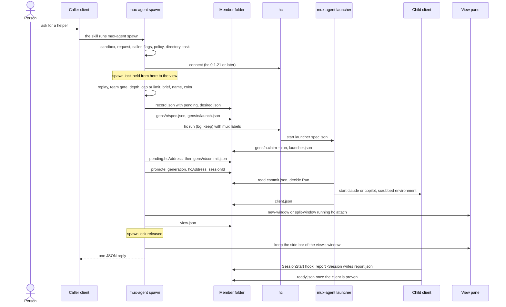

# 从启动到窗格

[English](From-Spawn-to-Pane)

本页沿当前代码跟踪一次请求：一个人让自己的 Claude Code（或 Copilot CLI）对话启动一个帮手，最后一个新智能体在旁边运行起来。每一步都写出完成它的代码。

智能体并不在窗格里运行。它运行在 `hc run` 启动的 herdr-core（`hc`）终端中；窗格只是附着到那个终端。`spawn` 和启动器彼此从不直接通信：它们通过状态根目录下成员文件夹中只创建一次的文件相会。首次启动之后发生的事见[智能体生命周期](Agent-Lifecycle-zh-CN)；命令本身见[使用说明](Usage-zh-CN)。

`spawn` 与启动器之间的先后并不固定：启动器可能在地址记录之前或之后认领，客户端通常在 `spawn` 已经回复之后才报告。

### 1. 技能运行 `spawn`

`mux-agents` 技能（`skills/mux-agents/SKILL.md`）把请求变成一条命令 `"<entry>" spawn -Client <client> -Name <name> -TaskFile <task-file> -BriefFile <brief-file>`，其中 `<entry>` 是插件的 `scripts/mux-agent`（Windows 上是 `scripts/mux-agent.cmd`）。智能体只通过文件传递自由文本，所以任务和简报先写入文件。入口脚本挑选适合本机的预编译二进制；`src/main.rs` 解析动词，`src/cli.rs` 中的 `dispatch` 执行它。

### 2. 在创建任何东西之前先检查调用方

`dispatch` 在任何多路复用器调用之前，首先拒绝处于沙箱中的调用方（`sandbox`，`src/sandbox.rs`：`SANDBOX_RUNTIME=1`、macOS 沙箱、Linux `NoNewPrivs`、受限的 Windows 令牌）。在带有成员标签的 hc 终端中，调用方由这些标签解析（`src/caller_hc.rs`），尚未成为已提交成员的候选者只能运行 `spawn`、`stop`、`resume` 和 `read <name>`，这些动词会在团队锁下再次证明它（`tree::candidate_verb`）；其他动词一律为 `tagged`。

`spawn`（`src/agents/spawn.rs`）随后检查请求的形式：已知的 `-Client`，`-Task` 与 `-TaskFile` 恰好其一，`-Split h|v` 或 `-Tab` 但不能同时出现，以及最多 64 个普通字符的 `-Model`（`model_name`）；其他情况均为 `usage`。

它从进程链解析调用方（`caller::resolve_tree`），并确定其所处位置（`tree::scope`）：

| 调用方 | 检查什么 |
|---|---|
| 个人窗格中的客户端，团队之外 | 不是智能体窗格（`registry::untagged`），然后是 `flags`、`policy` 和 `directory` |
| 个人的 shell，团队之外 | 不是智能体窗格；智能体在调用方的文件夹中启动 |
| 团队之外的智能体 | 拒绝为 `tagged`：团队之外只有顶层对话可以启动智能体 |
| `up` 团队的成员 | 在团队锁下读取团队记录；它的身份在启动锁下检查（第 4 步） |

`checks::assert_spawn_allowed`（`src/checks.rs`）按此顺序执行三项调用方检查。`flags`：从调用方到窗格的每个 `claude` 或 `copilot` 进程只使用白名单中的标志（`CLAUDE_FLAGS`、`COPILOT_FLAGS`），且其命令行可读。`policy`：调用方的实时策略是完全绕过，因为子智能体将在关闭提示的情况下运行；对 Claude Code，其记录和屏幕都必须如此显示，对 Copilot CLI 则看其会话事件（没有事件时看启动标志）。`directory`：调用方的启动目录可从其会话或进程确认，并且是一个存在的绝对路径文件夹；子智能体在那里启动。

任务来自 `-TaskFile`，相对调用方的文件夹读取，最多 16 KB（`src/state/fs.rs` 中的 `TASK_MAX`），因为它要放在客户端的命令行上；智能体的 `-Task` 会被拒绝为 `usage`，空任务也一样。简报来自 `-BriefFile`，最多 1 MB（`BRIEF_MAX`）。放置方式取 `-Split` 或 `-Tab`，否则取会话的 `placement`，再否则为 `tab`（`src/agents/placement.rs`）。

### 3. 连接 hc 并取得启动锁

`spawn::launch_hc` 连接 herdr-core（`src/hc.rs` 中的 `hc::connect`），当 `hc`（或 `herdr-core`）缺失或版本早于 0.1.21 时拒绝。随后它取得会话的启动锁，该锁同时也是团队锁（`team_lock`）。直到视图为止的所有步骤都在锁内运行，所以同一会话中的两次启动不会交错进行准入和启动。`launch_hc_locked` 首先重放崩溃遗留的半完成接管（`adopt::replay_held`）。

### 4. 准入：身份、深度、上限、名称

`spawn` 传入的 `reserve` 闭包根据会话的一份快照（`membership::Snapshot::for_spawn`）决定子智能体是否获得名额，快照读取每条成员记录以及 hc 显示的其终端（`core_facts::take`）：

- 在团队中，`tree::admit` 检查调用方的身份和子智能体的深度：领导者深度为 0，子智能体深度最多为 3（`tree::MAX_DEPTH`），否则为 `depth`；子智能体的父级不能已被停止关闭。
- 自快照以来代次已结束的成员会被回收（`registry::reap_hc` 记录结束并向父级发出通知），若因此有变化，则重新获取快照。
- 若智能体调用方的子智能体将从简报而非其对话的分叉启动，则必须传入 `-BriefFile`，否则为 `brief`。
- 在团队之外，当会话已有 10 个存活智能体时，`Snapshot::admit_name` 拒绝为 `cap`。在团队中，`tree::place` 依次检查 `limit`（领导者之外 10 个成员，`tree::MAX_MEMBERS`）、团队记录固定的 `ceiling`、名称，最后是该成员的启动 `budget`。
- 名称为 `-Name`，或由任务推导出的名称，在会话中唯一（`checks::resolve_name`），否则为 `name`。
- 颜色取存活智能体使用最少的调色板条目（`paint::PALETTE`）。

预算只在这里检查：令牌作为启动在 `hc run` 之前的最后一步扣除，所以之后的任何拒绝都不会耗费令牌。

### 5. 成员文件夹及其启动规格

`Launch::prepare_hc` 构建新成员：一个 12 字符的十六进制 id（`util::hex_id`）及其私有文件夹 `<root>/<serverKey>/agents/<id>`；如有简报，保存为其中的 `brief.md`；客户端参数（`client_args`：分叉调用方的对话，新对话则为 `--session-id <uuid>`）；启动规格正文；以及成员记录正文：名称、颜色、客户端、目录、父级、深度、上下文、选项和提示。窗格、窗口和会话 id 不在其中：会话 id 在提升时写入，视图所在位置保存在 `view.json`。

### 6. `forward` 在 `hc run` 之前记录代次

`core_launch::forward`（`src/agents/core_launch.rs`）拥有本次启动的每个文件，全部在团队锁下。每一步在下一步之前都已持久化：

| 步骤 | 写入什么 | 为什么 |
|---|---|---|
| `allocated` | 尚未写入：代次 `n`（`gens::next`：1 + 任何文件中出现的最大编号，首次为 0）和一个新的 hc 名称 `m<8 hex>` | 每次启动一个新编号，从不复用 |
| `pending` | 带 `pending` 的 `record.json`：`gen`、`kind`、`hcName`、`sessionId`、`launcherArgv` | 从此处起，崩溃都能被发现并处理 |
| `desired` | `desired.json` 为 `running`（仅新成员） | 停止日志可以分辨运行与停止 |
| `spec` | `gens/<n>/spec.json`：规格正文加上 `id`、`generation`、`kind`、`sessionId` 和 150 秒之后的 `deadline`（`DEADLINE_SECS`） | 启动器运行什么，以及就绪何时算迟到 |
| `launch` | `gens/<n>/launch.json`：`hcName`、`launcherArgv`、`sessionId` | 后续步骤用来与 hc 比对的终端身份 |
| `run` | 成员的预算令牌，然后 `hc run` | 启动器开始运行 |
| `address` | 终端地址写入 `pending`，仅当记录仍指向这个 `n` 和 hc 名称时 | `hc run` 之后的崩溃仍能找到终端 |
| `commit` | 带 `committed: true` 的 `gens/<n>/commit.json` | 允许启动器启动客户端的认领 |
| `promote` | 一次记录写入：`generation`、`hcAddress`、`hcName`、`launcherArgv`、`team`、`sessionId`；`pending` 移除 | 成员此后呈现这个代次 |

`gens/` 下的每个文件都通过同一个发布者只创建一次（`gens::publish_once`）：第一个写入者胜出，之后的写入者读取已存在的内容。`pending` 与提交之间的每次失败都交给 `abort`：仅当本次启动仍拥有代次 `n` 时，它发布带 `aborted: true` 的 `commit.json` 并移除 `pending`；等待中的启动器读到后停止。若 `forward` 发布自己的提交时 `commit.json` 已经存在，说明启动器先放弃了：该代次作废，`spawn` 被拒绝为 `launch`（"the launcher gave up before the commit"）。

### 7. `hc run` 启动启动器

启动器的命令行为 `launcher_scope::argv`：二进制的绝对路径，然后是 `launcher <spec.json> --state-root <root> --path <PATH>`。`forward` 把它交给 `hc run --bg --keep --outlive-parent --no-notify --name <hcName>`，以子智能体的目录为 `--cwd`，并附上这些标签（`src/hc.rs` 中的 `Core::run`）：

| 标签 | 值 |
|---|---|
| `mux.managed` | 固定为 `1` |
| `mux.team` | `<serverKey>:<session>` 形式 |
| `mux.id` | 成员 id |
| `mux.gen` | 代次 `n` |
| `mux.name` | 成员名称 |
| `mux.up` | 所属的 `up` 团队（仅团队成员） |

`--keep` 在之后很重要：当 hc 丢失启动器的程序（核心重启）时，它保留终端并用一个 shell 代替，这正是区分丢失的智能体与已结束智能体的方式（[智能体生命周期](Agent-Lifecycle-zh-CN)）。这些标签让之后的每一步都能准确找到这个代次的终端（`gens::find`）。

### 8. 启动器认领它的代次

启动器（`src/launcher.rs` 中的 `run_gen`）在 hc 终端内运行，只有 `PATH` 和 `MUX_AGENTS_STATE` 由其参数替换（`launcher_scope::environment`）。依次：

1. 规格路径必须位于状态根目录之下，不经过链接或连接点，并指向 `<root>/<key>/agents/<id>/gens/<n>/spec.json`；不属于任何代次的文件夹级规格会被拒绝（"this pane was started by an older mux-agent"）。
2. `own_spec`：`spec.json` 与 `launch.json` 在 id、代次、hc 名称和会话上一致；否则以 1 退出且不创建任何东西。
3. 认领 `gens/<n>.claim` 为 `run`，只创建一次。认领已存在（无论内容为何）意味着另一个启动器或 `settle` 已决定这个代次：以 0 退出，不动任何东西。
4. 赢得认领后，若 `launcher.json`、`client.json` 或 `exit.json` 已经存在，就是损坏的证据：什么都不启动。
5. 认领所在文件夹及其上的每个文件夹都刷新到磁盘（`flush_claim`），然后 `launcher.json` 记录启动器的 `pid`、`start` 和 `startedAt`。

### 9. 启动器等待提交

`wait_gen_commit` 每 250 毫秒读取一次 `commit.json`（`COMMIT_POLL`）。完整的提交立即决定（`gens::decide`）：只有单独的 `committed: true` 才运行；`aborted: true` 停止，即使旁边有 `committed: true`；其他都无效。`Run` 决定只在提交所在文件夹已刷新后生效。30 秒后仍无提交（`COMMIT_WAIT`），启动器发布自己的 `aborted: true`；由于 `commit.json` 只创建一次，`spawn` 的提交与放弃只有一个会落地，不会两者都有。没有 `Run` 时，启动器写入带原因的 `exit.json`（`aborted`、`gave up`、`commit invalid` 等）并以 1 退出。

### 10. 客户端启动

`client_command` 根据规格中的标志和参数构建 `claude` 或 `copilot`；默认情况下，`spawn` 的子智能体以 `--dangerously-skip-permissions --effort high`（Claude Code）或 `--no-sandbox --allow-all`（Copilot CLI）运行（`spawn::launch_flags`）。启动器启动它时从环境中移除父级的客户端身份（`SCRUB`：`CLAUDECODE`、`CLAUDE_CODE_SESSION_ID`、`COPILOT_AGENT_SESSION_ID` 等），所以子智能体是一个新会话，而不是嵌套会话。一旦得知 pid，它就发布带 `pid` 和 `start` 的 `client.json`，失败时重试一次（`CLIENT_ATTEMPTS`）；指向其他进程的 `client.json` 即为 `client-conflict`。客户端退出时，`exit.json` 记录 `exitCode` 和 `reason`，启动器以客户端的退出码退出。

### 11. 就绪：客户端报告自己

已启动的进程还不是正在工作的智能体，所以客户端通过自己的会话开始钩子证明自己。Claude Code 的钩子模块（`hooks/register.tsx`、`hooks/activity.ts`）在 `SessionStart` 时运行 `report -Session <id> -Source <source> -Quiet`；Copilot CLI 的 `hooks.json` 在 `sessionStart` 时运行 `report -Session -Stdin -Quiet`，它从标准输入读取 `sessionId` 和 `source`。

`report -Session`（`src/agents/session_report.rs`）通过沙箱检查，不需要调用方证明：它找到其上方的客户端（`ancestry::first_client`），写入该客户端的实时条目（`state::live::report`），并在 hc 终端中读取其 `mux.team`、`mux.id` 和 `mux.gen` 标签。随后进行握手：

1. 代次 `n` 必须是该成员的待定或活动代次，且规格中的 `sessionId` 必须是本会话；否则为 `stale` 或 `session`，什么都不写。
2. 在代次锁下（`team_state::gen_lock_key`）：若已有 `outcome.json` 或 `failure.json`，或已过规格的 `deadline`，握手为 `closed`；否则只创建一次 `report.json`（`sessionId`、`pid`、`start`、`at`）。
3. 不持有任何锁，等待启动器的 `client.json` 得到证明：最多 50 次检查，间隔 200 毫秒（`POLLS`、`POLL`）。
4. 只有当报告的 pid 和启动时间与启动器证明的客户端相同，且该客户端与启动器都存活、互为子进程与父进程并符合记录的启动时间时，`gens::promote_ready` 才写入 `ready.json`。

始终未到这一步的代次稍后由 `outcome::adjudicate` 决定：当客户端先退出、终端结束或丢失、截止时间前没有报告，或有报告但截止时间之后 60 秒仍没有客户端身份时（`GRACE`），判为 `failed`。[智能体生命周期](Agent-Lifecycle-zh-CN)列出了各种裁决。`spawn` 不等待就绪：视图步骤完成后它就回复。

### 12. 视图窗格附着到 hc 终端

提升之后，仍在团队锁下，`forward` 调用 `view::launch_view`。它在成员锁下查找或创建视图（`view_locked`），所以期间运行过的 `focus` 会被接管，而不会出现两个视图。新视图由 `attachment::attach`（`src/agents/attachment.rs`）创建：

- 不分屏时，在调用方的会话中创建以智能体命名的 `new-window -d`；使用 `h` 或 `v` 时，在主对话保留最多空间的位置创建 50% 的 `split-window`（`split::plan`），没有空间时则新建窗口。
- 窗格在成员的目录中运行 `<hc binary> attach <hcAddress>`；在 Unix 上，状态根目录通过其环境传入。
- 它带有 `@agent-id`、`@agent-name` 以及其他 `@agent-*` 选项，以名称为标题，且只有在它自己的启动命令证明它之后才算数。

描述写入成员的 `view.json`：`serverKey`、`session`、`pane`、`window`、`startCommand`、`attachProgram`、`gen`、`hcAddress`、`hcName`。视图是可选的：失败时关闭它创建的窗格，回复显示 `view: "none"` 和 `viewError`；其他内容不回滚，之后可用 `focus <name>` 打开视图。

### 13. 侧边栏显示智能体

`spawn` 释放启动锁，然后 `keep_bar` 向 `sidebar::keep` 请求视图所在窗口的侧边栏，没有时在右边缘打开一个。这一步尽力而为：拒绝或崩溃会把 `sidebar` 设为空并加上 `sidebarError`，从不使启动失败。若视图是在调用方旁边分屏的，`split::keep_main_half` 会把一半空间还给主对话。侧边栏在下一次重绘时画出新成员，显示为 `◉ working`，直到客户端通过钩子报告状态（[侧边栏](Side-Bar-zh-CN)）。

### 14. 回复

`spawn` 输出一个 JSON 对象（`-Text` 改为输出多行）：

| 键 | 值 |
|---|---|
| `ok`、`verb` | 分别为 `true`、`spawn` |
| `name`、`id`、`client` | 新成员 |
| `pane`、`window` | 视图窗格及其窗口 |
| `sessionId` | 子智能体的对话 id |
| `context`、`reason` | `fork` 或 `brief`，以及原因 |
| `model` | 给出的 `-Model`，或 `inherited` |
| `placement`、`placementSource` | `tab`、`h` 或 `v`，来源为 `flag`、`session` 或 `default` |
| `sidebar`、`sidebarError` | 侧边栏的窗格或空，以及失败原因 |
| `life` | 固定为 `running` |
| `view`、`viewError` | `attached`，或 `none` 及原因 |
| `hcAddress` | hc 终端 |

拒绝时则是一行 JSON，带 `ok: false`、其 `check` 和 `message`，退出码为 1 或 2。

### 失败留下什么

| 停在哪里 | 留下什么 | 之后会怎样 |
|---|---|---|
| `pending` 之前 | 什么都没有 | 直接再次启动即可 |
| 从 `pending` 到提交 | 带 `aborted: true` 的 `commit.json`：该代次作废 | 启动器停止；被拒绝的启动可以再次运行 |
| 启动器先放弃 | 它自己的 `aborted: true` | `spawn` 被拒绝为 `launch` |
| `pending` 之后崩溃 | 一个未决代次，它占用成员的名称和名额 | settle 的重放（`src/agents/settle.rs`）完成它，或以认领 `abandoned` 使其作废 |
| 视图或侧边栏 | `viewError` 或 `sidebarError` | 智能体照常运行；之后由 `focus` 或 `sidebar` 打开它们 |

### 源码索引

| 步骤 | 源码 |
|---|---|
| 动词表、分发、沙箱 | `src/cli.rs`、`src/sandbox.rs` |
| 调用方、标志、策略、目录 | `src/caller.rs`、`src/caller_hc.rs`、`src/checks.rs` |
| 请求、准入、回复 | `src/agents/spawn.rs`、`src/agents/tree.rs`、`src/agents/membership.rs` |
| 启动步骤、中止、提升 | `src/agents/core_launch.rs`、`src/agents/team_state.rs` |
| 启动器、认领、客户端 | `src/launcher.rs`、`src/launcher_scope.rs` |
| 代次文件、就绪 | `src/agents/gens.rs`、`src/agents/session_report.rs`、`src/agents/outcome.rs` |
| hc 调用 | `src/hc.rs` |
| 视图与侧边栏 | `src/agents/view.rs`、`src/agents/attachment.rs`、`src/agents/split.rs`、`src/sidebar.rs` |
| 钩子 | `hooks.json`、`hooks/register.tsx`、`hooks/activity.ts` |
