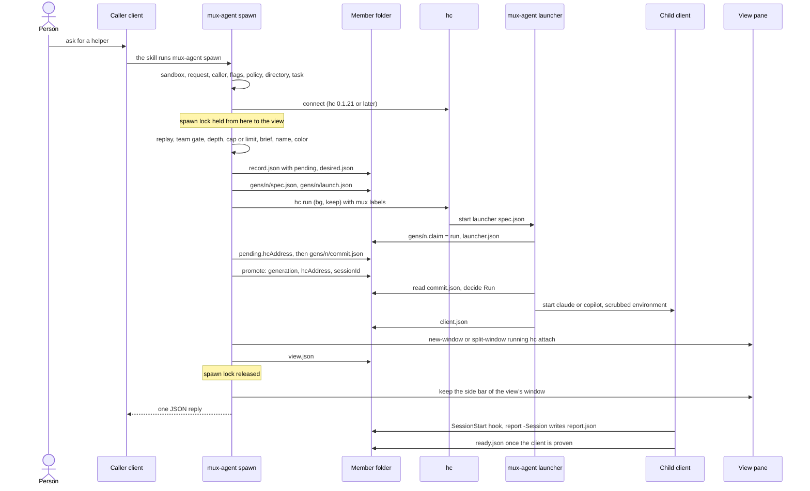

# From Spawn to Pane

[简体中文](From-Spawn-to-Pane-zh-CN)

This page follows one request through the current code: a person asks their Claude Code (or Copilot CLI) chat to start a helper, and a new agent ends up running beside them. Each step names the code that does it.

The agent does not run in the pane. It runs in a herdr-core (`hc`) terminal that `hc run` started; the pane only attaches to that terminal. `spawn` and the launcher never talk to each other: they meet through create-once files in the member's folder under the state root. What happens after the first launch is in [Agent Lifecycle](Agent-Lifecycle); the commands themselves are in [Usage](Usage).

The order between `spawn` and the launcher is not fixed: the launcher may claim before or after the address is recorded, and the client usually reports after `spawn` has replied.

### 1. The skill runs `spawn`

The `mux-agents` skill (`skills/mux-agents/SKILL.md`) turns the request into one command, `"<entry>" spawn -Client <client> -Name <name> -TaskFile <task-file> -BriefFile <brief-file>`, where `<entry>` is the plugin's `scripts/mux-agent` (`scripts/mux-agent.cmd` on Windows). An agent passes free text only in files, so the task and the brief are written to files first. The entry picks the prebuilt binary for the machine; `src/main.rs` parses the verb and `dispatch` in `src/cli.rs` runs it.

### 2. The caller is checked before anything is made

`dispatch` refuses a sandboxed caller first, before any multiplexer call (`sandbox`, `src/sandbox.rs`: `SANDBOX_RUNTIME=1`, a macOS sandbox, Linux `NoNewPrivs`, a restricted Windows token). In an hc terminal that carries member labels, the caller is resolved from those labels (`src/caller_hc.rs`), and a candidate that is not yet a committed member may run only `spawn`, `stop`, `resume` and `read <name>`, which prove it again under the team lock (`tree::candidate_verb`); any other verb is `tagged`.

`spawn` (`src/agents/spawn.rs`) then checks the request's shape: a known `-Client`, exactly one of `-Task` and `-TaskFile`, `-Split h|v` or `-Tab` but not both, and a `-Model` of at most 64 plain characters (`model_name`); anything else is `usage`.

It resolves the caller from its process chain (`caller::resolve_tree`) and finds where it stands (`tree::scope`):

| caller | what is checked |
|---|---|
| a client in a person's pane, outside a team | not an agent pane (`registry::untagged`), then `flags`, `policy` and `directory` |
| a person's shell, outside a team | not an agent pane; the agent starts in the caller's folder |
| an agent outside a team | refused `tagged`: outside a team only the top-level chat spawns |
| a member of an `up` team | the team record is read under the team lock; its standing is checked under the spawn lock (step 4) |

`checks::assert_spawn_allowed` (`src/checks.rs`) runs the three caller checks in this order. `flags`: every `claude` or `copilot` process from the caller up to the pane uses only allowlisted flags (`CLAUDE_FLAGS`, `COPILOT_FLAGS`), and its command line can be read. `policy`: the caller's live policy is full bypass, because the child will run with prompts off; for Claude Code both its transcript and its screen must say so, for Copilot CLI its session events (or, with none, its launch flags). `directory`: the caller's launch directory is confirmed from its session or process and is an existing absolute folder; the child starts there.

The task comes from `-TaskFile`, read relative to the caller's folder and at most 16 KB (`TASK_MAX` in `src/state/fs.rs`), because it travels on the client's command line; an agent's `-Task` is refused `usage`, and so is an empty task. A brief comes from `-BriefFile`, at most 1 MB (`BRIEF_MAX`). The placement is `-Split` or `-Tab`, else the session's `placement`, else `tab` (`src/agents/placement.rs`).

### 3. hc is connected and the spawn lock is taken

`spawn::launch_hc` connects to herdr-core (`hc::connect` in `src/hc.rs`), which refuses when `hc` (or `herdr-core`) is missing or older than 0.1.21. It then takes the session's spawn lock, which is also the team lock (`team_lock`). Everything up to the view runs under it, so two spawns in one session never interleave their admission and launch. `launch_hc_locked` first replays any adoption a crash left half done (`adopt::replay_held`).

### 4. Admission: standing, depth, cap, name

The `reserve` closure `spawn` passes in decides whether the child gets a slot, from one snapshot of the session (`membership::Snapshot::for_spawn`) that reads every member record and what hc shows of its terminal (`core_facts::take`):

- In a team, `tree::admit` checks the caller's standing and the child's depth: the leader is depth 0 and a child is at most depth 3 (`tree::MAX_DEPTH`), else `depth`; the child's parent must not be closed by a stop.
- Members whose generation ended since the snapshot are reaped (`registry::reap_hc` records the end and posts the parent's notice), and the snapshot is taken again when that changed anything.
- An agent caller whose child would start from a brief, not a fork of its conversation, must pass `-BriefFile`, else `brief`.
- Outside a team, `Snapshot::admit_name` refuses `cap` when the session already has 6 live agents. In a team, `tree::place` checks `limit` (6 members besides the leader, `tree::MAX_MEMBERS`), the `ceiling` the team's record fixed, the name, then the member's spawn `budget`, in that order.
- The name is `-Name` or one derived from the task, unique in the session (`checks::resolve_name`), else `name`.
- The color is the palette entry (`paint::PALETTE`) the fewest live agents use.

The budget is only checked here: the token is spent as the launch's last step before `hc run`, so no later refusal costs one.

### 5. The member folder and its launch spec

`Launch::prepare_hc` builds the new member: a 12-character hex id (`util::hex_id`) and its private folder `<root>/<serverKey>/agents/<id>`; the brief, if any, as `brief.md` there; the client arguments (`client_args`: a fork of the caller's conversation, `--session-id <uuid>` for a new one); the launch spec body; and the member record body: name, color, client, directory, parent, depth, context, options and prompt. The pane, window and session id are left out: the session id arrives at promotion, and where the view is lives in `view.json`.

### 6. `forward` records the generation before `hc run`

`core_launch::forward` (`src/agents/core_launch.rs`) owns every file of the launch, all under the team lock. Each step is durable before the next:

| step | what is written | why |
|---|---|---|
| `allocated` | nothing yet: generation `n` (`gens::next`: 1 + the highest number any file names, 0 for the first) and a fresh hc name `m<8 hex>` | a new number per launch, never reused |
| `pending` | `record.json` with `pending`: `gen`, `kind`, `hcName`, `sessionId`, `launcherArgv` | from here on a crash is found and settled |
| `desired` | `desired.json` `running` (a new member only) | a stop's journal can tell running from stopped |
| `spec` | `gens/<n>/spec.json`: the spec body plus `id`, `generation`, `kind`, `sessionId` and a `deadline` 150 s ahead (`DEADLINE_SECS`) | what the launcher runs, and when readiness is late |
| `launch` | `gens/<n>/launch.json`: `hcName`, `launcherArgv`, `sessionId` | the terminal identity later steps match hc against |
| `run` | the member's budget token, then `hc run` | the launcher starts |
| `address` | the terminal's address in `pending`, only while the record still names this `n` and hc name | a crash after `hc run` can still find the terminal |
| `commit` | `gens/<n>/commit.json` with `committed: true` | the claim that lets the launcher start the client |
| `promote` | one record write: `generation`, `hcAddress`, `hcName`, `launcherArgv`, `team`, `sessionId`; `pending` gone | the member now presents this generation |

Every file under `gens/` is create-once through one publisher (`gens::publish_once`): the first writer wins and a later one reads what stands. Every failure between `pending` and the commit goes to `abort`, which, only while this launch still owns generation `n`, publishes `commit.json` with `aborted: true` and drops `pending`; a waiting launcher reads that and stops. If a `commit.json` is already there when `forward` publishes its own, the launcher gave up first: the generation is void and `spawn` is refused `launch` ("the launcher gave up before the commit").

### 7. `hc run` starts the launcher

The launcher's command line is `launcher_scope::argv`: the binary's absolute path, then `launcher <spec.json> --state-root <root> --path <PATH>`. `forward` passes it to `hc run --bg --keep --outlive-parent --no-notify --name <hcName>`, with the child's directory as `--cwd` and these labels (`Core::run` in `src/hc.rs`):

| label | value |
|---|---|
| `mux.managed` | `1` |
| `mux.team` | `<serverKey>:<session>` |
| `mux.id` | the member id |
| `mux.gen` | the generation `n` |
| `mux.name` | the member name |
| `mux.up` | the `up` team, for a member of one |

`--keep` matters later: when hc loses the launcher's program (a core restart), it keeps the terminal with a shell in its place, and that is how a lost agent is told from one that ended ([Agent Lifecycle](Agent-Lifecycle)). The labels let every later step find exactly this generation's terminal (`gens::find`).

### 8. The launcher claims its generation

The launcher (`run_gen` in `src/launcher.rs`) runs inside the hc terminal with only `PATH` and `MUX_AGENTS_STATE` replaced from its arguments (`launcher_scope::environment`). In order:

1. The spec path must lie under the state root with no link or junction and name `<root>/<key>/agents/<id>/gens/<n>/spec.json`; a folder-level spec, outside any generation, is refused ("this pane was started by an older mux-agent").
2. `own_spec`: `spec.json` and `launch.json` agree on the id, the generation, the hc name and the session; else it exits 1 and creates nothing.
3. The claim `gens/<n>.claim` is `run`, create-once. A claim already there, whatever it holds, means another launcher or `settle` decided this generation: exit 0, nothing touched.
4. With the claim won, a `launcher.json`, `client.json` or `exit.json` already there is corrupt evidence: nothing starts.
5. The claim's folder and every folder above it are flushed to disk (`flush_claim`), then `launcher.json` records the launcher's `pid`, `start` and `startedAt`.

### 9. The launcher waits for the commit

`wait_gen_commit` reads `commit.json` every 250 ms (`COMMIT_POLL`). A whole commit decides at once (`gens::decide`): only a lone `committed: true` runs; `aborted: true` stops, even beside `committed: true`; anything else is invalid. A `Run` decision acts only once the commit's folders are flushed. With no commit after 30 s (`COMMIT_WAIT`), the launcher publishes its own `aborted: true`; since `commit.json` is create-once, either the commit of `spawn` or the give-up lands, never both. Without `Run`, the launcher writes `exit.json` with its reason (`aborted`, `gave up`, `commit invalid` and others) and exits 1.

### 10. The client starts

`client_command` builds `claude` or `copilot` from the spec's flags and arguments; by default a child of `spawn` runs with `--dangerously-skip-permissions --effort high` (Claude Code) or `--no-sandbox --allow-all` (Copilot CLI) (`spawn::launch_flags`). The launcher starts it with the parent's client identity removed from its environment (`SCRUB`: `CLAUDECODE`, `CLAUDE_CODE_SESSION_ID`, `COPILOT_AGENT_SESSION_ID` and others), so the child is a new session, not a nested one. As soon as the pid is known it publishes `client.json` with `pid` and `start`, retried once (`CLIENT_ATTEMPTS`); a `client.json` that names another process is a `client-conflict`. When the client exits, `exit.json` records `exitCode` and `reason`, and the launcher exits with the client's code.

### 11. Readiness: the client reports itself

A started process is not yet a working agent, so the client proves itself through its own session-start hook. Claude Code's hooks module (`hooks/register.tsx`, `hooks/activity.ts`) runs `report -Session <id> -Source <source> -Quiet` on `SessionStart`; Copilot CLI's `hooks.json` runs `report -Session -Stdin -Quiet` on `sessionStart`, which reads `sessionId` and `source` from stdin.

`report -Session` (`src/agents/session_report.rs`) passes the sandbox check and needs no caller proof: it finds the client above it (`ancestry::first_client`), writes that client's live entry (`state::live::report`) and, in an hc terminal, reads its `mux.team`, `mux.id` and `mux.gen` labels. The handshake then runs:

1. Generation `n` must be the member's pending or active one, and the spec's `sessionId` must be this session; else `stale` or `session`, and nothing is written.
2. Under the generation lock (`team_state::gen_lock_key`): with `outcome.json` or `failure.json` there, or past the spec's `deadline`, the handshake is `closed`; else `report.json` (`sessionId`, `pid`, `start`, `at`) is created once.
3. Holding no lock, it waits for the launcher's `client.json` to be proven: at most 50 checks 200 ms apart (`POLLS`, `POLL`).
4. `gens::promote_ready` writes `ready.json` only when the report's pid and start equal the client the launcher proved, and that client and the launcher are both live, as child and parent, with their recorded starts.

A generation that never gets there is decided later by `outcome::adjudicate`: `failed` when the client exited first, the terminal ended or was lost, no report came by the deadline, or a report came but no client identity by 60 s past the deadline (`GRACE`). [Agent Lifecycle](Agent-Lifecycle) lists the verdicts. `spawn` does not wait for readiness: it replies once the view step is done.

### 12. The view pane attaches to the hc terminal

Right after the promotion, still under the team lock, `forward` calls `view::launch_view`. Under the member lock it finds or makes the view (`view_locked`), so a `focus` that ran in between is adopted, never doubled. A new view is made by `attachment::attach` (`src/agents/attachment.rs`):

- With no split, a `new-window -d` named after the agent in the caller's session; with `h` or `v`, a `split-window` of 50% where the main chat keeps the most room (`split::plan`), or a new window when there is no room.
- The pane runs `<hc binary> attach <hcAddress>` in the member's directory; on Unix the state root reaches it through its environment.
- It is tagged with `@agent-id`, `@agent-name` and the other `@agent-*` options, titled with the name, and counts only once its own start command proves it.

The descriptor goes to the member's `view.json`: `serverKey`, `session`, `pane`, `window`, `startCommand`, `attachProgram`, `gen`, `hcAddress`, `hcName`. The view is optional: a failure closes the pane it made and the reply says `view: "none"` with `viewError`; nothing else is rolled back, and `focus <name>` opens a view later.

### 13. The side bar shows the agent

`spawn` releases the spawn lock, then `keep_bar` asks `sidebar::keep` for the bar of the view's window, opening one at the right edge when there is none. It is best effort: a refusal or a panic sets `sidebar` to null and adds `sidebarError`, and never fails the spawn. When the view was split beside the caller, `split::keep_main_half` gives the main chat its half back. The bar draws the new member on its next redraw, as `◉ working` until the client reports a state through its hooks ([Side Bar](Side-Bar)).

### 14. The reply

`spawn` prints one JSON object (`-Text` prints lines instead):

| key | value |
|---|---|
| `ok`, `verb` | `true`, `spawn` |
| `name`, `id`, `client` | the new member |
| `pane`, `window` | the view pane and its window |
| `sessionId` | the child's conversation id |
| `context`, `reason` | `fork` or `brief`, and why |
| `model` | the `-Model` given, or `inherited` |
| `placement`, `placementSource` | `tab`, `h` or `v`, from `flag`, `session` or `default` |
| `sidebar`, `sidebarError` | the bar's pane or null, and why it failed |
| `life` | `running` |
| `view`, `viewError` | `attached`, or `none` and why |
| `hcAddress` | the hc terminal |

A refusal is one JSON line instead, with `ok: false`, its `check` and its `message`, and exit code 1 or 2.

### What a failure leaves

| where it stops | what is left | what happens next |
|---|---|---|
| before `pending` | nothing | the spawn can simply run again |
| from `pending` to the commit | `commit.json` with `aborted: true`: the generation is void | the launcher stops; the refused spawn can run again |
| the launcher gives up first | its own `aborted: true` | `spawn` is refused `launch` |
| a crash after `pending` | an undecided generation, which holds the member's name and slot | settle's replay (`src/agents/settle.rs`) finishes it, or voids it with the claim `abandoned` |
| the view or the side bar | `viewError` or `sidebarError` | the agent runs; `focus` or `sidebar` opens them later |

### Source map

| step | source |
|---|---|
| verb table, dispatch, sandbox | `src/cli.rs`, `src/sandbox.rs` |
| caller, flags, policy, directory | `src/caller.rs`, `src/caller_hc.rs`, `src/checks.rs` |
| request, admission, reply | `src/agents/spawn.rs`, `src/agents/tree.rs`, `src/agents/membership.rs` |
| launch steps, abort, promotion | `src/agents/core_launch.rs`, `src/agents/team_state.rs` |
| launcher, claim, client | `src/launcher.rs`, `src/launcher_scope.rs` |
| generation files, readiness | `src/agents/gens.rs`, `src/agents/session_report.rs`, `src/agents/outcome.rs` |
| hc calls | `src/hc.rs` |
| view and bar | `src/agents/view.rs`, `src/agents/attachment.rs`, `src/agents/split.rs`, `src/sidebar.rs` |
| hooks | `hooks.json`, `hooks/register.tsx`, `hooks/activity.ts` |
