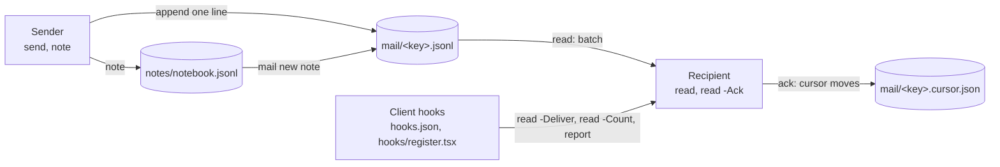
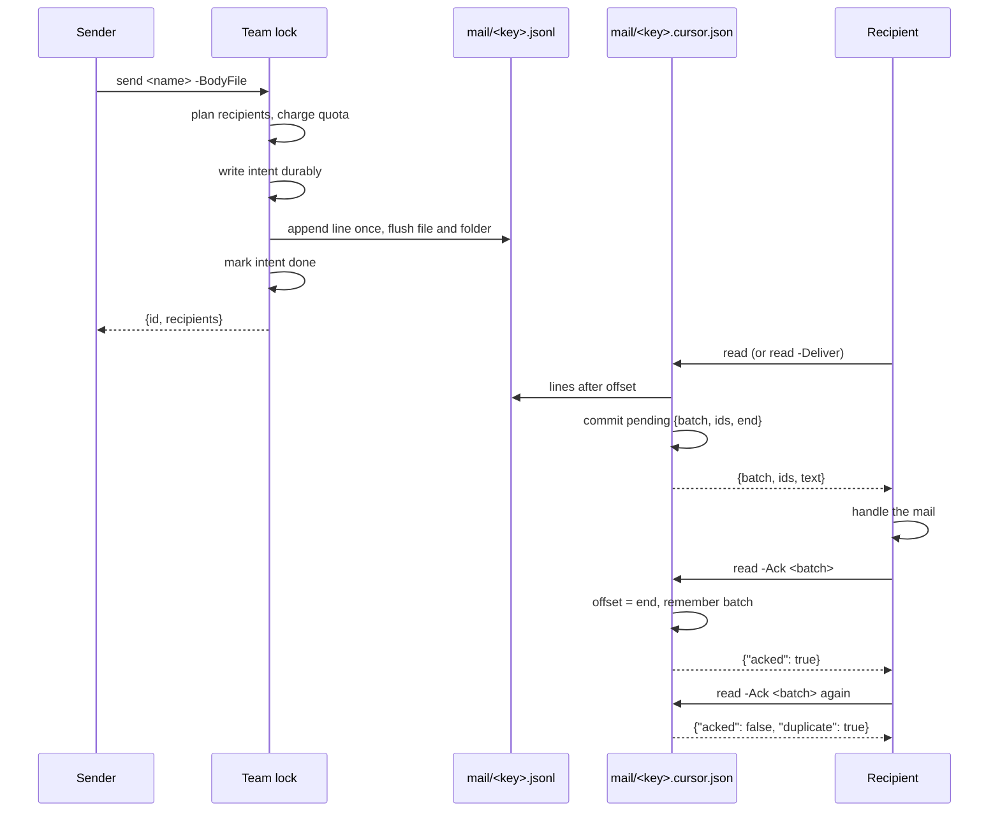

# 消息与笔记本

[English](Messaging-and-Notebook)

团队中的代理通过邮件交流，并共享一个团队笔记本。`send` 向收件人的邮箱文件追加一行 JSON；收件人用 `read` 取走它，并用 `read -Ack <batch>` 将其标为已读。任何东西都不会向另一个代理的窗格打字。笔记本是每个团队一份只追加的日志，团队的每个成员和人员都可以添加和阅读。

本页说明如何发送、阅读和确认邮件，谁可以给谁发消息，邮件如何到达 Claude Code 或 Copilot CLI 客户端，笔记本如何工作，以及两者如何存储在磁盘上。动词在 `src/cli.rs` 中；代码在 `src/agents/message.rs`、`src/agents/team_mail.rs`、`src/agents/mail.rs`、`src/agents/receipt.rs` 和 `src/agents/notebook.rs` 中。



## 为什么用邮件而不是按键

窗格属于正在其中打字的人。粘贴到另一个代理窗格中的文字可能落在人员正在编写的提示中间，被当作人员自己的指令，或在客户端忙碌时丢失。所以 `send` 只追加到邮箱文件（`src/agents/message.rs`：“Appends a message to a live agent's, the parent's or a session pane's mailbox. Never types into a pane.”），收件人在准备好时再取它的邮件。技能对每个代理说的也一样：“Never type into panes.”

邮件是代理的报告，绝不是用户的指令（`skills/mux-agents/SKILL.md`，Listening 一节）。邮箱在客户端崩溃或恢复后依然存在，所以消息不会因为读者当时没有运行而丢失。唯一的可选例外是下文的 `notify -On`，它粘贴一条固定的单行通知，绝不粘贴消息本身。

## 发送

```
"<entry>" send <name> -BodyFile <body-file>
"<entry>" send parent -BodyFile <body-file>
"<entry>" send parent -BodyFile <body-file> -Re <id>
"<entry>" send <name> -BodyFile <body-file> -Id <id>
```

目标词是以下之一（`team_mail::target`、`team_mail::pick`）：

| 目标 | 谁收到消息 |
|---|---|
| `<name>` | 本团队中叫这个名字的那一个运行中成员 |
| `parent` | 发送者的父级：一个成员，或启动它的人员窗格 |
| `leader` | 团队的领导者；没有领导者时以 `this team has no leader` 拒绝 |
| `children` | 发送者的子代理；由人员发送时，是领导者的子代理 |
| `team` | 除发送者外的每个运行中成员 |
| `%<n>` | 本会话中一个存活的窗格 |

- 代理只能用 `-BodyFile` 传递正文；代理使用 `-Body` 会以 `agents pass free text only in files: use -BodyFile` 被拒绝。文字会被清理（CRLF 转为 LF，除 LF 和 TAB 外的 C0 控制字符被移除，DEL 被移除），最多 64 KB（`src/state/fs.rs` 中的 `BODY_MAX`）。
- `team` 和 `children` 是投递给每个收件人的同一个消息 id；消息头用 ` to team` 或 ` to children` 标明群发对象。
- `-Re <id>` 回复你自己邮箱中的一条消息。它只发给该消息的发送者（一个名字、`parent` 或 `leader`），否则返回 `a reply goes only to the message's sender`。每次回复比它所回复的消息多一跳；会成为第 4 跳的回复以 `this reply would be hop 4; the thread is closed` 被拒绝（`src/agents/team_mail.rs` 中的 `HOP_LIMIT`）。
- 一个成员一小时内最多发送 120 条消息（`QUOTA`、`WINDOW`）。第 121 条以检查 `quota` 和 `retryAt` 被拒绝，后者是这一小时内最早一次发送离开窗口的时间。人员不受限制。
- 发送以检查 `mail` 失败时（`the message could not be saved; retry with -Id <id>`），回复带有 `id` 和已投递的名字 `delivered`。用 `-Id <id>` 再次运行同一发送会完成那次发送：相同的正文（以其 SHA-256 校验）到达每个缺少它的收件人，任何邮箱都不会收到第二份。同一 id 下的不同正文以 `that id belongs to a different send` 被拒绝。

回复包含 `to`、`id`、`from`、`recipients`（每个的 `name` 和 `id`）、`hop` 和 `re`，当唯一收件人是 Claude Code 成员时还有 `toSessionId`。

## 谁可以给谁发消息

消息留在团队之内（`team_mail::route`）。来自团队成员的发送，或来自有团队成员的会话中人员的发送，在团队锁下走团队路径：

- 名字必须是本团队中运行中且已提交的成员；其他名字以 `no agent of this team has that name` 被拒绝。
- 人员发往 `parent` 会以 `only an agent has a parent` 被拒绝。
- 一个被成员记录认领、但其成员无法证明的窗格以 `tagged` 被拒绝；它绝不回退到旧路径。

有两种情况仍走 0.2 路径（`src/agents/message.rs` 中的 `send_legacy`）：不是团队成员的代理窗格，以及人员指定了团队中没有的名字。该路径没有意图记录也没有回复，所以 `-Id` 和 `-Re` 在那里以 `-Id and -Re work only inside a team` 被拒绝。

`peek <name>` 显示成员存活窗格的最后几行（默认 60 行，`-Lines <n>` 最多 2000 行）。只有团队的人员或该成员的祖先可以查看，不会向窗格打字，焦点也不会移动。

## 阅读

```
"<entry>" read
"<entry>" read -Wait 600
"<entry>" read -Ack <batch>
"<entry>" read -Deliver -Ack <batch>
"<entry>" read -Wait 600 -Ack <batch>
"<entry>" read -Id <id> -Ack <batch>
"<entry>" read -Count
"<entry>" read -Cancel
```

| 形式 | 作用 |
|---|---|
| `read` | 提供一批未读邮件，或者没有 |
| `read -Wait <s>` | 每 500 ms 轮询一次，最多 `<s>` 秒（0 到 600），直到有邮件；没有时返回 `"timeout": true` |
| `read -Deliver` | 立即提供一批；投递钩子与 `-Ack` 一起使用的形式 |
| `read -Ack <batch>` | 确认一批；返回 `"acked": true`，对已确认过的批次返回 `"acked": false, "duplicate": true` |
| `read -Id <id>` | 完整提供一条被暂存的大消息 |
| `read -Count` | 只读：`badge`（未读加暂存）、`wake`（未读）、`end`、`id`、`gen`、`leader`、`member` |
| `read -Cancel` | 仅限代理：停止监听，直到有新邮件到达 |

`-Wait`、`-Deliver`、`-Count`、`-Id` 和 `-Cancel` 最多给出一个。`-Ack` 可与 `-Wait`、`-Deliver` 和 `-Id` 组合：先确认，再提供。批次 id 和消息 id 是 8 到 32 位小写十六进制数字。每次提供返回 `{batch, ids, text}`；没有可提供的内容时，`batch` 为 null，`ids` 为空。

### 批次与 4096 字节预算

一批的 `text` 最多容纳 4096 字节 UTF-8（`src/agents/mail.rs` 中的 `BUDGET`）。每条消息是一行消息头加上它的正文，最旧的在前。消息头是 `[mux-agent from <name> (<pane>) #<id>]`，设置时追加 ` re #<id>`、` hop <n>`（n 大于 0 时）和 ` to <cast>`。

- 单独也放不下的消息以引用形式提供：`message <id> from <name>, <n> bytes: run mux-agent read -Id <id>`。它所在的批次被确认后，它就被暂存。
- 放不下的部分在 `+N more: run mux-agent read` 后面等待。
- 被暂存的消息列在结尾行中：`N held: run mux-agent read -Id <id>`。
- `read -Id <id>` 只有在承载它的批次被确认后，才完整提供一条暂存消息（最多到 64 KB 的正文上限，不计入预算）。它的正文有自己的批次需要确认。在它未确认期间，另一个 `read -Id` 会再次提供它，并带有 `"note": "ack it first"`。
- 会使暂存消息超过 1024 条的确认（`src/agents/receipt.rs` 中的 `HELD_MAX`）会被拒绝，直到 `read -Id` 取走一些。

### 回执、确认与重复

每个邮箱有一个游标 `mail/<key>.cursor.json`（`src/agents/receipt.rs`）：

| 字段 | 含义 |
|---|---|
| `offset` | 邮箱中的字节偏移，此前的每条消息都已确认 |
| `held` | 以引用形式提供、尚未用 `read -Id` 取走的 id |
| `pending` | 已提供但尚未确认的批次：它的 id、所有者、ids、refs、结束偏移和文字 |
| `idPending` | `read -Id` 已提供但尚未确认的暂存消息 |
| `acked` | 每个所有者最近确认的 16 个批次（`HISTORY`） |
| `uncertain` | 最近一次确认，直到确知它的文件夹已刷盘 |

提供（`mail::serve`）在邮箱锁下进行。当 `pending` 属于同一读者时，原样再次提供同一回执。否则，从 `offset` 之后的完整行构建新批次，赋予新的 16 位十六进制批次 id，并在回答之前提交为 `pending`。提供只读取，不消耗任何东西。

对读者的 `pending` 批次的确认（`mail::ack`）把 `offset` 移到该批次的结尾，并暂存其中的引用；对 `idPending` 的确认把该 id 从 `held` 中删除。读者 `acked` 历史中的批次返回 `duplicate`。其他情况以检查 `ack` 和 `stale receipt` 被拒绝，其邮件会再次被提供。

所以在提供和确认之间崩溃的客户端会在下一次阅读时拿到同一批次，一旦确认，就不会丢失也不会重复提供。游标提交失败时以检查 `mail` 拒绝（`the receipt could not be saved; retry` 或 `the acknowledgement could not be saved; retry`），而文件夹刷盘情况未知的先前确认会以 `the last acknowledgement is not yet on disk; retry` 拒绝，直到它被刷盘。

读者是回执的所有者：它的成员 id 和代。恢复的成员是新的一代，所以它绝不会确认提供给前任的批次。成员还在一道栅栏后阅读（`message::current`）：只有已提交、未被取代或结束、且其 hc 终端此刻正在运行的成员，才会被提供邮件或进行确认。

## 邮件如何到达客户端

邮件在邮箱中等待，直到收件人运行 `read`。是什么触发这次 `read` 取决于客户端。



### 钩子

每个客户端通过钩子报告自己的状态并说明它所在的对话。Copilot CLI 读取插件根目录的 `hooks.json`；Claude Code 不读取它，而是加载 `hooks/hooks.json`，后者指定模块 `hooks/register.tsx`。

| 事件 | Copilot CLI（`hooks.json`） | Claude Code（`hooks/register.tsx`） |
|---|---|---|
| 会话开始 | `report -Session -Stdin -Quiet` | `report -Session <id> -Source <word> -Quiet`；启动唤醒计时器 |
| 提交提示 | `report working -Quiet` | 邮件附加到这一轮（`deliver.ts`） |
| 一轮开始与结束 | `agentStop`：`report idle -Quiet` | `report working`、`report idle`（`activity.ts`） |
| 向人员提问 | `ask_user`：`report blocked -Kind question -Quiet`，然后 `report working -Quiet` | `AskUserQuestion`：`report blocked -Kind question`，然后 `report working` |

每个 Copilot 钩子都有 `bash` 形式（`sh scripts/mux-agent ...`）和 Windows 的 `command` 形式（`scripts\mux-agent.cmd ...`），会话钩子超时为 30 s，其他为 10 s。`report -Session` 说明客户端所在的对话（`src/agents/session_report.rs`）；它不证明任何成员身份，也不授予任何东西。代理绝不自己运行它。

### Claude Code：在一轮中收到邮件

`hooks/deliver.ts` 只在 tmux、rmux 或 hc 终端中、且只为团队成员投递邮件。它每次加载运行一次 `read -Count`：`member:false` 或 `tagged` 拒绝会停止本会话的投递，它返回的 `id` 和 `gen` 从此就是所有者；之后出现另一个所有者也会停止投递。

每次提交提示时，它先重试确认任何仍未关闭的批次，然后运行 `read -Deliver`，再次用 `read -Count` 检查所有者未变，并把文字作为 `<mux-agents-mail batch="<batch>">...</mux-agents-mail>` 上下文附加上去。只有当引擎跟踪显示引擎本身收到并返回了这一模一样的块时，它才用 `read -Ack` 确认该批次。被某个钩子丢弃的块不会被确认，会再次被提供。

### Claude Code：自我唤醒

会话开始时，插件启动一个每 5 s 触发一次的计时器（`arm`、`tick`）。每次触发运行 `read -Count`；当成员空闲、有未读邮件（`wake` 大于 0）、不是领导者且没有未完成的唤醒时，它提交提示 `mux-agents mail is waiting (wake <nonce>): run mux-agent read`，带一个 8 位十六进制数字的 nonce。`end` 不变时，每 60000 ms（`REFILL_MS`）最多再唤醒一次，未得到回应的唤醒在同样的时间后过期。

唤醒的这一轮不带邮件，也不确认任何东西。代理运行 `read`，在回复中引用 nonce，处理邮件，再运行 `read -Ack <batch>`；它不确认的邮件会再次唤醒它。在客户端环境中设置 `MUX_AGENTS_WAKE=0` 会关闭唤醒（测试开关；一轮中的邮件投递照常）。被拒绝或失败的触发，或被丢弃的唤醒提示，也只会停止唤醒。

任务完成时，Claude 成员运行 `report done`，然后在最终回答之前以后台命令启动 `read -Wait 600`。它以 `"timeout": true` 结束时，成员再次启动它；它返回邮件时，成员处理邮件、确认批次并再次启动它。

### Copilot CLI：待命

Copilot 的钩子不带邮件。每一轮开始时，Copilot 成员运行 `read -Deliver -Ack <batch>`，即它上一次阅读的批次。任务完成时，它运行 `report done`，然后把 `read -Wait 600 -Ack <batch>` 作为最后一次工具调用，遇到 `"timeout": true` 时再次运行。

成员的 `read -Wait` 运行期间，它持有一个租约 `agents/<id>/waiting-<pid>.json` = `{pid, start, since, owner, until}`，阅读返回时被删除。只要该进程以记录的启动时间运行、租约指名当前所有者、且 `until` 在未来，租约就是有效的。持有有效租约的成员在侧边栏显示 `on call`，排在需要你之下、working 和 done 之上；`blocked` 优先于它，领导者从不待命（`board_rows::listening`）。`send`、`status` 或 `report` 只删除过期的租约。Ctrl-C 结束这次阅读；进程消失后，它的租约就不再有效。

`read -Cancel` 写入带有所有者和邮箱结尾的 `agents/<id>/oncall-cancel.json`；之后该所有者的 `read -Wait` 返回 `"cancelled": true`，直到有新邮件到达。领导者从不待命监听：它在下一轮阅读，或用 `read -Wait` 等待。

### 报告状态

`report <working|blocked|idle|done> [-Kind <permission|question>]` 在代理锁下写入 `agents/<id>/activity.json` = `{state, kind, since}`（`view::report`）。`-Kind` 只能与 `blocked` 一起使用，`since` 只在状态或类型变化时更新，且只回应代理自己的窗格（`only an agent reports its activity`）。`-Quiet` 不输出任何内容且总是成功，所以钩子不需要 shell 来消除输出。`done` 由任务已完成的成员在开始监听之前报告。

### 终端通知

`notify -On` 是人员的可选设置；只有人员可以设置它（`only a person sets notices`）。它在团队会话上设置选项 `@mux-agents-notify-send`，并警告 `warning: hc's draft hold expires; a notice may land in a draft`。开启时，每次团队发送还会为每个收件人运行一次 `hc send`，文字为 `mail from <name>: run mux-agent read`；失败会被丢弃，因为邮件已经持久保存。`notify -Off` 关闭它。

## 状态

```
"<entry>" status -BodyFile <status-file>
```

被启动的代理每开始任务的一个步骤就运行一次 `status`（`view::status`）。只有运行中代理自己的窗格可以设置它（`only an agent reports status`），且只能来自文件。第一行非空行经清理后最多 80 个 UTF-16 单元（`mail::doing_line`），写入 `agents/<id>/status.json` = `{text, at}`；空的状态以 `the status is empty` 被拒绝。侧边栏的进行中行在有状态时显示状态，否则显示代理最后一次 `send` 的那一行（`last-sent.json`），再否则显示它的任务行（`board::select_doing`）。状态也会删除过期的租约。

## 团队笔记本

笔记本保存团队应与所有人共享的内容，例如计划、决定和发现，与一对一的邮件分开。

```
"<entry>" note -Title <title> -BodyFile <body-file>
"<entry>" note -Title <title> -BodyFile <body-file> -Id <id>
"<entry>" notes
"<entry>" notes -Since <id> -Lines <n>
"<entry>" notes <id>
```

- `note` 添加一个条目。标题是一行，最多 80 个字符（`TITLE_MAX`），正文清理后最多 4096 字节（`BODY_LIMIT`）；超出任何限制都以检查 `usage` 拒绝。回复包含 `id`、`duplicate`、`notified` 和 `notifyErrors`。
- 当 note 返回 `the note could not be saved; retry with -Id <id>` 时，带 `-Id <id>` 的同一 `note` 只保存一次。该 id 下相同的作者、标题和正文返回 `"duplicate": true`；不同的笔记以 `that id belongs to a different note` 被拒绝。
- `notes` 列出最新的 20 个标题（`LIST_DEFAULT`），最新的在前，每个带有 `id`、`author`、`at` 和 `title`，`older` 统计其余的。`-Lines <n>` 取 1 到 1000（`LIST_MAX`）；`-Since <id>` 只列出该条目之后的条目。
- `notes <id>` 完整打印一个条目：`{id, author: {name, id, key}, at, title, body}`。未知的 id 以 `no note with that id` 被拒绝。
- 列出不会把任何东西标为已读，也不会移动游标。`the notebook is not yet on disk; retry` 表示什么都没有列出或保存：再次运行同一命令。在团队之外，每个笔记本动词都以 `the notebook belongs to a team` 拒绝。

### 每条新笔记一封邮件

笔记保存后，团队中其他每个当前成员会收到一封邮件 `new note <id> from <author>: <title> — run mux-agent notes <id>`，消息 id 为 `note-<id>`（`notebook::news::notify`）。重试的笔记不会再发第二份，并会补上先前调用遗漏的通知。失败的通知连同其 `check` 列在 `notifyErrors` 中，绝不跳过其他成员；无论如何笔记都会保留。

### 每次启动的第一条消息中的最新标题

每次启动的第一条消息在其头部行（`You are ...`、`Your parent is ...`、`Context:`、`Reply:`、`Listen:`）之后、任务之前带有一个笔记本块（`src/agents/spawn.rs`、`notebook::news::index`）。它以 `Team notebook: shared notes of this team; read them with mux-agent notes.` 开头，然后在块不超过 1024 字节（`INDEX_MAX`）的前提下按最新在前列出 `- <title> (<author>)`，并以 `+N older notes: run mux-agent notes` 结尾说明未列出的部分。空笔记本只有第一行；无法读取的笔记本会追加 `(notebook unreadable: <check>)`。启动绝不会因笔记本而失败。

## 磁盘上的位置

状态根目录在设置了 `MUX_AGENTS_STATE` 时就是它；否则在 Unix 上是 `$XDG_STATE_HOME/mux-agents/state` 或 `$HOME/.local/state/mux-agents/state`，在 Windows 上是 `%LOCALAPPDATA%\mux-agents\state`（`src/state/root.rs`）。在它之下，每个多路复用器服务器有一个文件夹 `<key>`，其中的 `agents` 和 `mail` 文件夹被设为私有（`agents::state_dir`）。

| `<root>/<key>` 下的路径 | 内容 |
|---|---|
| `mail/<mailbox>.jsonl` | 邮箱：每个以 LF 结尾的行是一条 JSON 消息 |
| `mail/<mailbox>.cursor.json` | 回执游标；旧的 `<mailbox>.offset` 在下次提交时迁移 |
| `teams/<sha16>/sends/<sender>/<id>.json` | 一个发送意图：收件人、正文哈希、跳数、群发对象、`done` |
| `teams/<sha16>/notes/notebook.jsonl` | 笔记本日志：每行一个条目 |
| `teams/<sha16>/notes/notebook.state.json` | `{durable, uncertain}`：确知日志已在磁盘上的程度 |
| `agents/<id>/status.json`、`activity.json`、`last-sent.json` | 进行中行、报告的状态和最后发送的一行 |
| `agents/<id>/waiting-<pid>.json`、`oncall-cancel.json` | `read -Wait` 的租约和取消标记 |

成员的邮箱键是它 12 位十六进制的代理 id，或它的记录所指名的邮箱（恢复的成员保留它继承的那个）；人员的是 `pane-<n>`，在团队锚点服务器之外则是 `pane-<serverKey>-<n>`（`mail::mailbox_key`、`mail::pane_box`）。`<sha16>` 是会话名 SHA-256 的前 16 位十六进制数字。

## 写入如何保持持久与有序

- **单一的加锁顺序。** 团队发送先取团队锁，再取发送者的代理锁，然后是每个邮箱的锁。收件人的规划和配额的扣除基于同一份成员快照，所以发送绝不会与启动或停止竞争。
- **先写意图。** 在投递任何副本之前，发送意图被持久写入（文件刷盘、重命名、各级文件夹刷盘直到服务器文件夹）。在此之后崩溃会留下一个可用 `-Id` 完成的意图。
- **每个邮箱一份。** 每份副本只在邮箱锁下、且邮箱中没有该 id 的行时才追加，然后刷盘文件和文件夹，每次调用都如此，包括重复的调用（`mail::deliver_once`）。只有每份副本都持久后，意图才被标记为完成；完成超过一天的意图会被清理。
- **没有撕裂的行。** 被中断的追加留下的、缺少 LF 的最后一行会先补上 LF，所以它绝不会与下一条消息连在一起。读者只取完整的行。
- **有序阅读。** 邮箱只增长，游标是字节偏移，所以邮件按最旧在前提供，而一次提供只读取偏移之后的字节。
- **游标整体写入。** 游标以持久写入整体提交（文件刷盘、重命名、文件夹刷盘），超过 1 MB（`STATE_MAX`）则被拒绝并保留旧的游标。
- **笔记本的确定前缀。** 一条笔记在团队锁下运行：它确定 `notebook.state.json` 中记录的确定结尾，截掉其后任何未回应的尾部，写入该行，刷盘文件和文件夹，然后发布新的结尾，先是不确定，再是完成。读者只看到在该结尾或之前结束的完整行。

## 用真实客户端检查

CI 不运行已认证的客户端，所以 `RELEASE-CHECKLIST.md` 的 “4b real clients” 一节由人手动运行，使用 Claude Code 2.1.325 和 Copilot CLI，在 macOS、Linux 和 Windows 上进行。人员运行 `up`，然后启动 Claude 成员 A 和 Copilot 成员 B。凡是成员引用 nonce 的地方，运行还要记录回执的了结：它的 `read -Ack <batch>` 返回 `"acked": true`，或者 `duplicate` 回复加上一个没有 `pending` 批次的游标。

1. 空闲时自我唤醒：A 在 10 s 内自己开始一轮，这一轮的文字就是唤醒行。
2. 在 `MUX_AGENTS_WAKE=0` 下，附加在手动输入的一轮上的邮件到达 A，A 引用正文中的 nonce。
3. 仍在 `MUX_AGENTS_WAKE=0` 下，A 运行 `report done`，然后在后台运行 `read -Wait 600`，下一条消息开启它的下一轮。
4. B 运行 `report done`，然后以 `read -Wait 600 -Ack <batch>` 作为最后一次工具调用，侧边栏显示 `on call`。
5. 钩子的 `read -Count` 在 A 中返回成功，在人员会话中不投递任何东西（`member:false`）。
6. 在一轮开始与确认之间被杀死的客户端：`resume` 之后，邮件恰好再被提供一次，然后被确认。
7. 被另一个插件丢弃的唤醒：没有额外的一轮，没有任何确认，邮件在下一次手动输入的一轮被阅读。
8. 在 B 的 `read -Wait 600` 期间按 Ctrl-C：侧边栏在 10 s 内离开 `on call`，之后的邮件在 B 再次监听时被阅读。
9. 被唤醒的 A 运行 read，引用 nonce，运行 `read -Ack <batch>`，这些邮件不再引起唤醒。

## 源码地图

- `src/agents/message.rs`：`send`、`read`、`notify`、`peek`、阅读栅栏、`read -Wait` 租约和 `on_call`。
- `src/agents/team_mail.rs`：目标、团队名单、意图、配额、回复与跳数、持久投递。
- `src/agents/mail.rs`：邮箱键、追加、消息头、批次、`serve`、`ack`、`serve_id`、`counts`。
- `src/agents/receipt.rs`：游标、它的历史和它的持久提交。
- `src/agents/notebook.rs`、`src/agents/notebook/news.rs`：`note`、`notes`、日志、通知和启动块。
- `src/agents/view.rs`：`status` 和 `report`；`src/agents/session_report.rs`：`report -Session`。
- `hooks.json`、`hooks/register.tsx`、`hooks/deliver.ts`、`hooks/activity.ts`：客户端钩子。
- `skills/mux-agents/SKILL.md`：告诉代理的内容；`RELEASE-CHECKLIST.md`：真实客户端检查。

另见 [使用](Usage-zh-CN)、[团队与生命周期](Teams-and-Lifecycle-zh-CN)、[侧边栏](Side-Bar-zh-CN)、[代理生命周期](Agent-Lifecycle-zh-CN) 和 [状态与持久性](State-and-Durability-zh-CN)。
