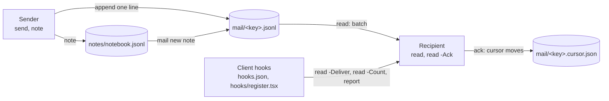
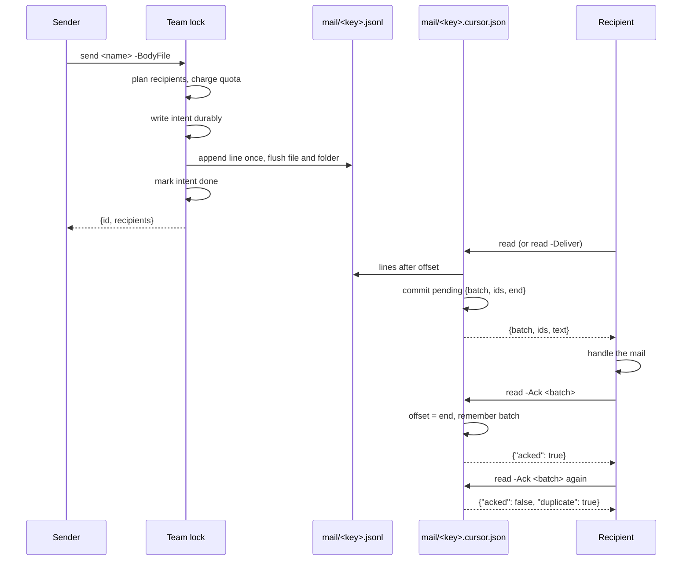

# Messaging and Notebook

[简体中文](Messaging-and-Notebook-zh-CN)

Agents in a team talk through mail and share a team notebook. A `send` appends one JSON line to the recipient's mailbox file; the recipient takes it with `read` and marks it read with `read -Ack <batch>`. Nothing ever types into another agent's pane. The notebook is one append-only log per team that every member and person of the team can add to and read.

This page shows how to send, read and acknowledge mail, who may message whom, how mail reaches a Claude Code or Copilot CLI client, and how the notebook works, then how both are stored on disk. The verbs are in `src/cli.rs`; the code is in `src/agents/message.rs`, `src/agents/team_mail.rs`, `src/agents/mail.rs`, `src/agents/receipt.rs` and `src/agents/notebook.rs`.



## Why mail and not keystrokes

A pane belongs to whoever is typing in it. Text pasted into another agent's pane can land in the middle of a prompt the person is writing, be taken as the person's own instruction, or be lost when the client is busy. So `send` only appends to a mailbox file (`src/agents/message.rs`: "Appends a message to a live agent's, the parent's or a session pane's mailbox. Never types into a pane."), and the recipient asks for its mail when it is ready. The skill tells every agent the same: "Never type into panes."

Mail is an agent's report, never the user's instructions (`skills/mux-agents/SKILL.md`, Listening). A mailbox survives a crashed or resumed client, so a message is never lost because its reader was not running. The one opt-in exception is `notify -On`, below, which pastes a fixed one-line notice and never the message.

## Send

```
"<entry>" send <name> -BodyFile <body-file>
"<entry>" send parent -BodyFile <body-file>
"<entry>" send parent -BodyFile <body-file> -Re <id>
"<entry>" send <name> -BodyFile <body-file> -Id <id>
```

The target word is one of these (`team_mail::target`, `team_mail::pick`):

| Target | Who gets the message |
|---|---|
| `<name>` | the one running member of this team with that name |
| `parent` | the sender's parent: a member, or the person's pane that started it |
| `leader` | the team's leader; refused `this team has no leader` when there is none |
| `children` | the sender's children; from a person, the leader's children |
| `team` | every running member but the sender |
| `%<n>` | a live pane of this session |

- An agent passes the body only as `-BodyFile`; `-Body` from an agent is refused with `agents pass free text only in files: use -BodyFile`. The text is cleaned (CRLF to LF, C0 controls but LF and TAB removed, DEL removed) and may be at most 64 KB (`BODY_MAX` in `src/state/fs.rs`).
- `team` and `children` are one message id delivered to each recipient; the header names the cast with ` to team` or ` to children`.
- `-Re <id>` answers a message in your own mailbox. It goes only to that message's sender (a name, `parent` or `leader`), else `a reply goes only to the message's sender`. Each reply is one hop more than the message it answers; one that would be hop 4 is refused with `this reply would be hop 4; the thread is closed` (`HOP_LIMIT` in `src/agents/team_mail.rs`).
- A member may send at most 120 messages in an hour (`QUOTA`, `WINDOW`). The 121st is refused with check `quota` and `retryAt`, the time the oldest send of the hour leaves the window. A person is not limited.
- When a send fails with check `mail` (`the message could not be saved; retry with -Id <id>`), the reply carries `id` and the names already `delivered`. Running the same send with `-Id <id>` finishes that send: the same body (checked by its SHA-256) reaches every recipient that lacks it, and no mailbox gets a second copy. A different body under that id is refused with `that id belongs to a different send`.

The reply names `to`, `id`, `from`, `recipients` (`name` and `id` of each), `hop` and `re`, plus `toSessionId` when the one recipient is a Claude Code member.

## Who may message whom

Messaging stays inside the team (`team_mail::route`). A send from a member of a team, or from a person in a session that has team members, takes the team path under the team lock:

- A name must be a running, committed member of this team; any other name is refused with `no agent of this team has that name`.
- `parent` from a person is refused with `only an agent has a parent`.
- A pane that a member record claims but whose member cannot be proven is refused `tagged`; it never falls back to an older path.

Two cases still take the 0.2 path (`send_legacy` in `src/agents/message.rs`): an agent pane that is not a team member, and a person naming a name the team lacks. That path has no intents and no replies, so `-Id` and `-Re` refuse there with `-Id and -Re work only inside a team`.

`peek <name>` shows the last lines of a member's live pane (60 by default, `-Lines <n>` up to 2000). Only a person of the team or an ancestor of the member can peek, nothing is typed into the pane and focus does not move.

## Read

```
"<entry>" read
"<entry>" read -Wait 600
"<entry>" read -Ack <batch>
"<entry>" read -Deliver -Ack <batch>
"<entry>" read -Wait 600 -Ack <batch>
"<entry>" read -Id <id> -Ack <batch>
"<entry>" read -Count
"<entry>" read -Cancel
```

| Form | What it does |
|---|---|
| `read` | serves one batch of unread mail, or none |
| `read -Wait <s>` | polls every 500 ms for up to `<s>` seconds (0 to 600) until there is mail; with none, answers `"timeout": true` |
| `read -Deliver` | serves one batch at once; the form the delivery hooks use with `-Ack` |
| `read -Ack <batch>` | acknowledges a batch; answers `"acked": true`, or `"acked": false, "duplicate": true` for one already acked |
| `read -Id <id>` | serves one held large message whole |
| `read -Count` | reads only: `badge` (unread plus held), `wake` (unread), `end`, `id`, `gen`, `leader`, `member` |
| `read -Cancel` | an agent only: stops listening until new mail arrives |

At most one of `-Wait`, `-Deliver`, `-Count`, `-Id` and `-Cancel` is given. `-Ack` combines with `-Wait`, `-Deliver` and `-Id`: the ack runs first, then the serve. Batch and message ids are 8 to 32 lowercase hex digits. Each serve answers `{batch, ids, text}`; with nothing to serve, `batch` is null and `ids` is empty.

### Batches and the 4096-byte budget

A batch's `text` holds at most 4096 bytes of UTF-8 (`BUDGET` in `src/agents/mail.rs`). Each message is a header line and its body, oldest first. The header is `[mux-agent from <name> (<pane>) #<id>]`, with ` re #<id>`, ` hop <n>` (when n is above 0) and ` to <cast>` added when set.

- A message too large to fit alone is served as a reference, `message <id> from <name>, <n> bytes: run mux-agent read -Id <id>`. Once its batch is acked it is held.
- What does not fit waits behind `+N more: run mux-agent read`.
- Held messages are listed in a trailer, `N held: run mux-agent read -Id <id>`.
- `read -Id <id>` serves a held message whole (up to the 64 KB body limit, outside the budget) only after the batch that carried it is acked. Its body has a batch of its own to ack. While one is open, another `read -Id` serves it again with `"note": "ack it first"`.
- An ack that would hold more than 1024 messages (`HELD_MAX` in `src/agents/receipt.rs`) is refused until `read -Id` drains some.

### Receipts, acks and duplicates

Each mailbox has a cursor, `mail/<key>.cursor.json` (`src/agents/receipt.rs`):

| Field | Meaning |
|---|---|
| `offset` | the byte offset in the mailbox up to which every message is acked |
| `held` | ids served as references and not yet drained with `read -Id` |
| `pending` | the batch served and not yet acked: its id, owner, ids, refs, end offset and text |
| `idPending` | the held message `read -Id` served and not yet acked |
| `acked` | the last 16 batches acked by each owner (`HISTORY`) |
| `uncertain` | the last ack, until its folder is known to be flushed |

A serve (`mail::serve`) works under the mailbox lock. When `pending` belongs to the same reader, the same receipt is served again, unchanged. Otherwise a new batch is built from the complete lines after `offset`, given a new 16-hex batch id, and committed as `pending` before it is answered. A serve reads but consumes nothing.

An ack (`mail::ack`) of the reader's `pending` batch moves `offset` to that batch's end and holds its references; an ack of `idPending` drops that id from `held`. A batch in the reader's `acked` history answers `duplicate`. Anything else is refused with check `ack` and `stale receipt`, and its mail is served again.

So a client that crashes between a serve and an ack gets the same batch at its next read, and nothing is lost or served twice once it is acked. A cursor commit that fails refuses with check `mail` (`the receipt could not be saved; retry` or `the acknowledgement could not be saved; retry`), and an earlier ack whose folder flush is unknown refuses with `the last acknowledgement is not yet on disk; retry` until it is flushed.

The reader is the owner of the receipt: its member id and generation. A resumed member is a new generation, so it never acks a batch served to its predecessor. A member also reads behind a fence (`message::current`): only a committed member, not superseded or ended, whose hc terminal runs now, is served or acks.

## How mail reaches a client

Mail waits in the mailbox until the recipient runs `read`. What starts that `read` depends on the client.



### The hooks

Each client reports its own state and names its conversation through hooks. Copilot CLI reads `hooks.json` at the plugin root; Claude Code does not, and loads `hooks/hooks.json`, which names the module `hooks/register.tsx`.

| Event | Copilot CLI (`hooks.json`) | Claude Code (`hooks/register.tsx`) |
|---|---|---|
| session start | `report -Session -Stdin -Quiet` | `report -Session <id> -Source <word> -Quiet`; arms the wake timer |
| prompt submitted | `report working -Quiet` | mail attached to the turn (`deliver.ts`) |
| turn start and end | `agentStop`: `report idle -Quiet` | `report working`, `report idle` (`activity.ts`) |
| question to the person | `ask_user`: `report blocked -Kind question -Quiet`, then `report working -Quiet` | `AskUserQuestion`: `report blocked -Kind question`, then `report working` |

Each Copilot hook has a `bash` form (`sh scripts/mux-agent ...`) and a Windows `command` form (`scripts\mux-agent.cmd ...`), with a 30 s timeout for the session hook and 10 s for the others. `report -Session` names the client's conversation (`src/agents/session_report.rs`); it proves no member and grants nothing. An agent never runs it itself.

### Claude Code: mail at the turn

`hooks/deliver.ts` delivers mail only inside tmux, rmux or an hc terminal, and only for a team member. It runs `read -Count` once per load: `member:false` or a `tagged` refusal stops delivery for the session, and the `id` and `gen` it answers are the owner from then on; another owner later also stops it.

On each prompt it first retries the ack of any batch still open, then runs `read -Deliver`, checks `read -Count` again for the same owner, and attaches the text as `<mux-agents-mail batch="<batch>">...</mux-agents-mail>` context. It acks the batch with `read -Ack` only when the engine trace shows the engine itself received and returned that exact block. A block a hook dropped is not acked and is served again.

### Claude Code: self-wake

At session start the plugin arms a timer that ticks every 5 s (`arm`, `tick`). A tick runs `read -Count`; when the member is idle, has unread mail (`wake` above 0), is not the leader and no wake is outstanding, it submits the prompt `mux-agents mail is waiting (wake <nonce>): run mux-agent read`, with an 8-hex-digit nonce. An unchanged `end` wakes again at most once per 60000 ms (`REFILL_MS`), and an unanswered wake expires after the same time.

The wake turn carries no mail and acks nothing. The agent runs `read`, quotes the nonce in its reply, acts on the mail and runs `read -Ack <batch>`; mail it does not ack wakes it again. `MUX_AGENTS_WAKE=0` in the client's environment turns the wake off (a test switch; mail at the turn goes on). A refused or failed tick, or a dropped wake prompt, also stops the wake alone.

When its task is done a Claude member runs `report done`, then starts `read -Wait 600` as a background command before its final answer. When it ends with `"timeout": true` it starts it again; when it returns mail, the member handles it, acks the batch and starts it again.

### Copilot CLI: on call

Copilot's hooks carry no mail. At the start of each turn a Copilot member runs `read -Deliver -Ack <batch>`, the batch of its last read. When its task is done it runs `report done`, then makes `read -Wait 600 -Ack <batch>` its last tool call, and runs it again on `"timeout": true`.

While a member's `read -Wait` runs, it holds a lease, `agents/<id>/waiting-<pid>.json` = `{pid, start, since, owner, until}`, removed when the read returns. A lease is live while that process runs with its recorded start time, names the current owner, and `until` is in the future. A member with a live lease shows `on call` on the side bar, below needs-you and above working and done; `blocked` wins over it and the leader is never on call (`board_rows::listening`). A `send`, `status` or `report` removes only stale leases. Ctrl-C ends the read; its lease is no longer live once its process is gone.

`read -Cancel` writes `agents/<id>/oncall-cancel.json` with the owner and the mailbox end; a `read -Wait` of that owner then answers `"cancelled": true` until new mail arrives. The leader never listens on call: it reads at its next turn or waits with `read -Wait`.

### Report states

`report <working|blocked|idle|done> [-Kind <permission|question>]` writes `agents/<id>/activity.json` = `{state, kind, since}` under the agent lock (`view::report`). `-Kind` goes only with `blocked`, `since` moves only when the state or kind changes, and only an agent's own pane is answered (`only an agent reports its activity`). `-Quiet` prints nothing and always succeeds, so a hook never needs a shell to quiet it. `done` is reported by a member whose task is finished, before it listens.

### Terminal notices

`notify -On` is the person's opt-in; only a person may set it (`only a person sets notices`). It sets the option `@mux-agents-notify-send` on the team session and warns `warning: hc's draft hold expires; a notice may land in a draft`. While it is on, each team send also runs one `hc send` per recipient with the text `mail from <name>: run mux-agent read`; a failure is dropped, since the mail is already durable. `notify -Off` turns it off.

## Status

```
"<entry>" status -BodyFile <status-file>
```

A spawned agent runs `status` each time it starts a step of its task (`view::status`). Only a running agent's own pane may set it (`only an agent reports status`), and only from a file. The first non-blank line, cleaned and at most 80 UTF-16 units (`mail::doing_line`), goes to `agents/<id>/status.json` = `{text, at}`; an empty one is refused with `the status is empty`. The side bar's doing line is the status when there is one, else the line of the agent's last `send` (`last-sent.json`), else its task line (`board::select_doing`). A status also removes stale leases.

## Team notebook

The notebook keeps what a team should share with everyone, such as plans, decisions and findings, apart from one-to-one mail.

```
"<entry>" note -Title <title> -BodyFile <body-file>
"<entry>" note -Title <title> -BodyFile <body-file> -Id <id>
"<entry>" notes
"<entry>" notes -Since <id> -Lines <n>
"<entry>" notes <id>
```

- `note` adds an entry. The title is one line of at most 80 characters (`TITLE_MAX`), the body at most 4096 bytes once cleaned (`BODY_LIMIT`); every limit refuses with check `usage`. The reply names `id`, `duplicate`, `notified` and `notifyErrors`.
- When a note answers `the note could not be saved; retry with -Id <id>`, the same `note` with `-Id <id>` saves it once. The same author, title and body under that id answers `"duplicate": true`; a different note is refused with `that id belongs to a different note`.
- `notes` lists the newest 20 titles (`LIST_DEFAULT`), newest first, each with `id`, `author`, `at` and `title`, and `older` counts the rest. `-Lines <n>` takes 1 to 1000 (`LIST_MAX`); `-Since <id>` lists only entries after that one.
- `notes <id>` prints one entry in full: `{id, author: {name, id, key}, at, title, body}`. An unknown id is refused with `no note with that id`.
- Listing marks nothing read and moves no cursor. `the notebook is not yet on disk; retry` means nothing was listed or saved: run the same command again. Outside a team every notebook verb refuses with `the notebook belongs to a team`.

### Mail per new note

After a note is saved, each other current member of the team gets one mail, `new note <id> from <author>: <title> — run mux-agent notes <id>`, with the message id `note-<id>` (`notebook::news::notify`). A retried note posts no second copy and finishes any notice an earlier call missed. A failed notice is listed in `notifyErrors` with its `check` and never skips the others; the note stands either way.

### Newest titles in each launch's first message

Every launch's first message holds a notebook block after its header lines (`You are ...`, `Your parent is ...`, `Context:`, `Reply:`, `Listen:`) and before the task (`src/agents/spawn.rs`, `notebook::news::index`). It starts with `Team notebook: shared notes of this team; read them with mux-agent notes.`, then lists `- <title> (<author>)` newest first while the block stays within 1024 bytes (`INDEX_MAX`), and ends with `+N older notes: run mux-agent notes` for what is left out. An empty notebook is the first line alone; an unreadable one adds `(notebook unreadable: <check>)`. A launch never fails on its notebook.

## Where it lives on disk

The state root is `MUX_AGENTS_STATE` when set; else `$XDG_STATE_HOME/mux-agents/state` or `$HOME/.local/state/mux-agents/state` on Unix, and `%LOCALAPPDATA%\mux-agents\state` on Windows (`src/state/root.rs`). Under it, each multiplexer server has a folder `<key>` whose `agents` and `mail` folders are made private (`agents::state_dir`).

| Path under `<root>/<key>` | What it holds |
|---|---|
| `mail/<mailbox>.jsonl` | the mailbox: one JSON message per LF-ended line |
| `mail/<mailbox>.cursor.json` | the receipt cursor; a legacy `<mailbox>.offset` is migrated at the next commit |
| `teams/<sha16>/sends/<sender>/<id>.json` | one send intent: recipients, body hash, hop, cast, `done` |
| `teams/<sha16>/notes/notebook.jsonl` | the notebook log: one entry per line |
| `teams/<sha16>/notes/notebook.state.json` | `{durable, uncertain}`: how far the log is known to be on disk |
| `agents/<id>/status.json`, `activity.json`, `last-sent.json` | the doing line, the reported state and the last sent line |
| `agents/<id>/waiting-<pid>.json`, `oncall-cancel.json` | the `read -Wait` lease and the cancel marker |

A member's mailbox key is its 12-hex agent id, or the mailbox its record names (a resumed member keeps the one it inherited); a person's is `pane-<n>`, or `pane-<serverKey>-<n>` off the team's anchor server (`mail::mailbox_key`, `mail::pane_box`). `<sha16>` is the first 16 hex digits of the SHA-256 of the session name.

## How writes stay durable and ordered

- **One lock order.** A team send takes the team lock, then the sender's agent lock, then each mailbox's lock. Recipients are planned and the quota charged on one membership snapshot, so a send never races a spawn or a stop.
- **The intent first.** The send intent is written durably (file flushed, renamed, folders flushed up to the server folder) before any copy is delivered. A crash after it leaves an intent that `-Id` finishes.
- **One copy per mailbox.** Each copy is appended under the mailbox lock only when no line with that id is there, then the file and folder are flushed, on every call, a duplicate included (`mail::deliver_once`). The intent is marked done only after every copy is durable; done intents older than a day are pruned.
- **No torn lines.** A last line without its LF, left by an interrupted append, gets its LF first, so it never joins the next message. A reader takes only complete lines.
- **Ordered reads.** The mailbox only grows and the cursor is a byte offset, so mail is served oldest first, and a serve reads only the bytes after the offset.
- **The cursor whole.** The cursor is committed whole with a durable write (file flushed, renamed, folder flushed) and refused past 1 MB (`STATE_MAX`), keeping the old one.
- **The notebook's certain prefix.** A note runs under the team lock: it settles the certain end recorded in `notebook.state.json`, cuts any unanswered tail past it, writes the line, flushes the file and folder, then publishes the new end, first uncertain, then completed. Readers see only whole lines that end at or before that end.

## Checked with real clients

CI runs no authenticated client, so the "4b real clients" section of `RELEASE-CHECKLIST.md` runs by hand with Claude Code 2.1.325 and Copilot CLI on macOS, Linux and Windows. A person runs `up`, then spawns a Claude member A and a Copilot member B. Where a member quotes a nonce, the run also records receipt retirement: its `read -Ack <batch>` answers `"acked": true`, or a `duplicate` reply comes with a cursor that has no `pending` batch.

1. Idle self-wake: A starts a turn on its own within 10 s, and the turn text is the wake line.
2. With `MUX_AGENTS_WAKE=0`, mail attached to a typed turn reaches A, which quotes the body's nonce.
3. Still under `MUX_AGENTS_WAKE=0`, A runs `report done`, then a background `read -Wait 600`, and the next message starts its next turn.
4. B runs `report done`, then `read -Wait 600 -Ack <batch>` as its last tool call, and the bar shows `on call`.
5. The hook's `read -Count` answers ok in A, and delivers nothing (`member:false`) in a person session.
6. A client killed between the turn start and the ack: after `resume`, the mail is served again exactly once and then acked.
7. A wake another plugin drops: no extra turn, nothing acked, and the mail is read at the next typed turn.
8. Ctrl-C during B's `read -Wait 600`: the bar leaves `on call` within 10 s and later mail is read when B listens again.
9. A woken A runs read, quotes the nonce, runs `read -Ack <batch>`, and no further wake comes for that mail.

## Source map

- `src/agents/message.rs`: `send`, `read`, `notify`, `peek`, the read fence, the `read -Wait` lease and `on_call`.
- `src/agents/team_mail.rs`: targets, the team roster, intents, the quota, replies and hops, durable delivery.
- `src/agents/mail.rs`: mailbox keys, appends, the header, batches, `serve`, `ack`, `serve_id`, `counts`.
- `src/agents/receipt.rs`: the cursor, its history and its durable commit.
- `src/agents/notebook.rs`, `src/agents/notebook/news.rs`: `note`, `notes`, the log, the notices and the launch block.
- `src/agents/view.rs`: `status` and `report`; `src/agents/session_report.rs`: `report -Session`.
- `hooks.json`, `hooks/register.tsx`, `hooks/deliver.ts`, `hooks/activity.ts`: the client hooks.
- `skills/mux-agents/SKILL.md`: what agents are told; `RELEASE-CHECKLIST.md`: the real-client checks.

See also [Usage](Usage), [Teams and Lifecycle](Teams-and-Lifecycle), [Side Bar](Side-Bar), [Agent Lifecycle](Agent-Lifecycle) and [State and Durability](State-and-Durability).
