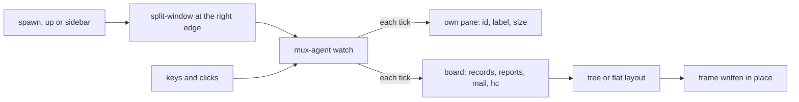

# 侧边栏

[English](Side-Bar)

侧边栏是你窗口右边缘的一个窄拆分，列出每个智能体、它所处的状态以及它此刻在做什么，这样你不必逐个查看窗格就能知道谁需要你。在团队中它把团队画成一棵树；在团队之外它画一个按谁最需要你排序的平铺列表。你用按键或鼠标来打开、查看和逐个切换智能体。本页描述侧边栏的当前行为；[侧边栏设计](Design-Side-Bar-zh-CN) 保留其设计历史，[团队与生命周期](Teams-and-Lifecycle-zh-CN) 介绍其各行背后的动词。

## 打开和关闭

| 操作 | 何时 |
|---|---|
| 会话中第一次成功的 `spawn` | 打开侧边栏；之后的启动复用它 |
| `up` | 在团队视图旁打开侧边栏 |
| `sidebar` | 在 `sidebar -Close` 之后再次打开，或重新打开被关闭的侧边栏 |
| `sidebar -Close` | 在本会话剩余时间内关闭它：之后的启动不会再打开它 |

只有你或团队的领导者能打开或关闭它；成员会得到 `tagged`，团队之外的智能体也一样。无法打开侧边栏的启动仍然成功，并报告 `sidebarError`。在标签页放置方式下，侧边栏留在你发起启动的窗口中。`sidebar -Close` 只关闭这个侧边栏；Claude Code 的 `Agents` 窗格每 3 秒运行一次 `list -All`，与它相互独立。

## 团队树

在 `up` 启动的会话中，侧边栏把团队画成一棵树。大致如下：

```text
 mux-agents       1 need you / 2 working / 1 ended

 ◉ leader                         working   2m
   Planning the parser split
   ! parse-tests                 needs you  12s
   ◉ fix-lexer                    working   4m
     ✓ lexer-bench                   done  10m
```

- 标题行按状态统计团队的存活成员，然后是 `M ended`；侧边栏较窄时从末尾去掉计数，标题保留。
- 领导者排在最前；每个成员的子智能体画在它下方，每一层缩进 2 列（`src/sidebar/tree.rs`）。
- 兄弟节点按创建时间从旧到新排列，其中正在运行的行在运行行所占的位置上按需要你、值守、完成、工作中、空闲排序，因此已结束成员的子树永远不会移动。
- 父级不在团队中、或其链条到达不了领导者的行，画在深度 1 处，并以 `^` 开头。
- 成员名字行下方的进行中行说明它在做什么：它最后的 `status`，否则是它最后一条消息的第一行，否则是它的任务。

窗格太矮时，侧边栏依次去掉：空行、自底向上的进行中行、每个父级的已结束子智能体（折叠为 `+N ended`），然后是既不含领导者也不含选中项的最深子树（折叠为 `+N more`）。窗格窄到放不下一行的必需部分时，它显示 `widen the bar: needs <n> columns` 且不画任何行；按键仍然遍历整棵树。

## 平铺列表

在团队之外，侧边栏像 herdr 的优先级视图一样画一个平铺列表：

```text
 mux-agents        1 need you / 1 done

 Needs you · 1
 ! add-subtract [sonnet]            12s
   Adding subtract(a, b) under add i...

 Done · 1
 ✦ test-calc  ✉ 1                   30s
   Done: test_calc.py passed, exit 0

 ended -------------------------------
 ✓ docs-usage                 done  18m
   +4 more  (list -All)
```

- 最前面的行是 `main`（然后是 `main 2` …）：启动这些智能体的窗格，让你能回到启动它们的对话。
- 之后是存活的智能体，按状态排序，最近变化的在前。它们处于多种状态时，每种状态的第一个智能体上方有带计数的标题（`Needs you · 1`），标题下的行只显示图标和时长；所有智能体处于同一状态时，每行都写出自己的状态。
- 已结束的智能体在列表末尾：没有以丢失结束的最新 3 个，然后在每个已结束智能体都在 `list -All` 显示的 10 个之中时写 `+K more  (list -All)`，否则写 `+K more ended`。

## 每个标记的含义

| 标记（ASCII） | 文字 | 含义 |
|---|---|---|
| `!` 粗体黄色 | `needs you` | 它的客户端在向你提问 |
| `◌`（`o`）暗色 | `on call` | 在有效租约下等待邮件的成员；领导者永远不会是这个状态 |
| `✦`（`@`）粗体青色 | `done` | 在你没有看着它时完成了这一轮；一直保持到你看过它的窗格 |
| `◉`（`*`）绿色 | `working` | 正在运行一轮 |
| `◌`（`o`）整行暗色 | `idle` | 无事可做 |
| `✓`（`+`） | `done` | 以退出码 0 结束 |
| `✗`（`x`）红色 | `exit N` | 以退出码 N 结束 |
| `-` 黄色 | `stopped` | 被 `stop` 或 `drop` 结束 |
| `-` | `lost`、`unknown` | 它的终端已消失，或无法判断它的生命状态 |
| `!` | `recover: <reason>` | 它的当前代失败了；该代尚未结束时显示 `recover (still running)`；`resume` 会重试它 |
| `✉ N`（`m N`） | | 来自它的 N 条未读消息 |
| `kept shell <name>` | | 丢失成员的旧终端，位于标题 `kept shells · N` 之下 |
| 柔和的灰色底带 | | 其窗格正在屏幕上的智能体行或 `main` 行；仅在有颜色时 |
| 第 0 列的 Nerd Font 箭头 U+F054（`>`） | | 按键选中的行 |

每个存活智能体的名字有自己的颜色，取会话中存活智能体用得最少的那种，且永远不是状态颜色。时长是自上次状态变化以来的时间。`MUX_AGENTS_ASCII=1` 画出 ASCII 标记。颜色遵循 `NO_COLOR`（关闭）、`FORCE_COLOR` 或 `CLICOLOR_FORCE`（开启），然后是 `TERM=dumb`（关闭）。

侧边栏底部的提示：`refresh failed`（读取失败时显示的上一个画面）、`layout: repair paused`、`focus failed: <name>`、`nothing to open for <name>`，以及问题 `close? y/n`。

## 按键

只有侧边栏窗格处于活动状态时按键才起作用。

| 按键 | 在团队中 | 在团队之外 |
|---|---|---|
| `j` / `k`、Down / Up | 选中下一行或上一行，循环 | 选中下一行或上一行 |
| Enter | 打开选中的行；没有选中项时，选中第一行 | 切换到选中的智能体或 `main`；没有选中项时，选中第一行 |
| `n` / `N` | 选中下一个或上一个有实时视图的成员，循环；Enter 打开它 | 从屏幕上的那个开始，按侧边栏顺序切换到下一个或上一个智能体 |
| `p` | 选中成员的弹窗，否则是屏幕上的那个：它的实时视图，否则是它保留的输出 | 选中智能体的弹窗，否则是第一个：它的最后 200 行，以 `-- peek: <name> (q closes) --` 结尾 |
| Esc | 清除选中 | 清除选中 |
| Ctrl-C | 结束侧边栏（`interrupted`） | 结束侧边栏（`interrupted`） |

在团队行上按 Enter 会打开它，不重启也不输入任何东西：运行中成员的视图、丢失成员的恢复终端、已结束成员的输出。在保留 shell 上按 Enter 会询问 `close? y/n`：`y` 关闭它，其他任何键都保留它。

`focus -Next` 和 `focus -Prev` 在任何窗格中都做 `n` 和 `N` 所做的事。`~/.tmux.conf` 中绑定的按键可以从任何地方向侧边栏发送按键，例如 `bind ] run-shell 'tmux send-keys -t "$(tmux show -qv @mux-agents-sidebar-id | cut -d" " -f1)" n'`。

## 鼠标

只有开启 `mouse on`（`set -g mouse on`）时点击才会到达侧边栏；此时用 Shift 拖动来选择文本。左键点击智能体的名字行或进行中行会像 Enter 一样打开它；在团队中被点击的行会先被选中，因此之后 `p` 和 Enter 作用于它。在团队之外，`MUX_AGENTS_ASCII=1` 时点击关闭。点击保留 shell、标题、折叠行或提示不起作用，在侧边栏调整大小期间的点击只会重绘它。

## 宽度与提醒

侧边栏的宽度取 `@mux-agents-sidebar-min` 列（1-9999，默认 40）与其窗口的 `@mux-agents-sidebar-percent`（1-100，默认 20）中较大的那个。用 `set -g` 或按会话、窗口、窗格设置它们，例如 `tmux set -g @mux-agents-sidebar-percent 10`；修改在下一次重绘时生效，超出范围的值使用默认值。你拖动出的宽度会一直保留，直到窗口宽度或某个宽度选项改变。

当某个智能体在你没有看着它时开始需要你或完成工作，侧边栏会在会话的客户端上显示一条消息 5 秒，例如 `mux-agents: w2 needs you`。`@mux-agents-alerts` 控制它：`off` 不发送，`blocked` 只提醒谁需要你，其他任何值两者都提醒。

## 实现方式



- **拆分中的一个进程。** `sidebar`、第一次启动或 `up` 在调用者窗口的右边缘运行 `split-window`，占满高度，按二进制文件的绝对路径运行 `<binary> watch`；你的窗格保持活动。侧边栏是这个进程，而不是它的 `@agent-role sidebar` 标签：会话选项 `@mux-agents-sidebar-id` 记录 `<pane> <pid> <start>`，每一步都会证明该窗格仍在运行它。带有该标签却不是这个进程的窗格会被点名，且永远不会被关闭。
- **它读取什么。** 每一拍，即每 2 秒（`src/sidebar.rs` 中的 `TICK`）以及按键或左键按下之后立即，它读取自己窗格的 id、标签和大小，然后在进程内读取面板数据（`src/agents/board.rs`、`src/agents/board_rows.rs`）：每个智能体的记录、其客户端报告的活动、它的状态或最后一条消息、它的未读邮件、它是否需要恢复、团队的保留 shell，以及会话正在显示的窗格。
- **重绘。** 面板按窗格的实际大小布局，从不换行；每一帧都在同步输出中原地写入，不整屏清除，因此不会闪烁。`TERM=dumb` 时它输出普通帧，且不接受按键或点击。
- **保位器。** 当拆分、布局变化、`swap-pane` 或 `rotate-window` 移动了侧边栏，下一拍会把它放回右边缘并重新选中你的窗格。缩放的窗口不受影响。连续 3 次修复失败后，它显示 `layout: repair paused`，直到布局变化或过了一分钟。
- **结束。** `watch` 在其窗格消失时以 `pane-closed` 结束，写入失败时以 `output-closed` 结束，连续 30 次探测无应答后以 `probe-failed` 结束，按 Ctrl-C 时以 `interrupted` 结束；每次退出时它都会恢复终端。

## 代码位置

- `src/sidebar.rs`：`sidebar`、`watch`、平铺布局、标题行、标记、保位器、查看和提醒
- `src/sidebar/tree.rs`：团队树及其折叠
- `src/sidebar/keys.rs`、`src/sidebar/input.rs`：按键和鼠标报告
- `src/sidebar/pick.rs`：选中、保留行和 main 行
- `src/agents/board.rs`、`src/agents/board_rows.rs`：侧边栏绘制的数据
- `src/paint.rs`：颜色和显示宽度
