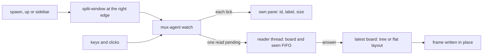

# 侧边栏

[English](Side-Bar)

侧边栏是你窗口右边缘的一个窄拆分，列出每个智能体、它所处的状态以及它此刻在做什么，这样你不必逐个查看窗格就能知道谁需要你。在团队中它把团队画成一棵树；在团队之外它画一个按谁最需要你排序的平铺列表。你用按键或鼠标来打开、查看和逐个切换智能体。[团队与生命周期](Teams-and-Lifecycle-zh-CN) 介绍其各行背后的动词。

## 打开和关闭

| 操作 | 何时 |
|---|---|
| 你的 Claude Code 或 Copilot CLI 对话在 tmux 或 rmux 中启动或恢复 | 在它旁边打开侧边栏（`sidebar -Auto`）；`clear` 或 `compact` 之后不打开，你关闭过它之后也不再打开 |
| 会话中第一次成功的 `spawn` | 侧边栏未打开时打开它；之后的启动复用它 |
| `up` | 在团队视图旁打开侧边栏 |
| `sidebar` | 在 `sidebar -Close` 之后再次打开，或重新打开被关闭的侧边栏 |
| `sidebar -Close` | 在本会话剩余时间内关闭它：之后的启动和对话启动都不会再打开它 |

只有你或团队的领导者能打开或关闭它；成员会得到 `tagged`，团队之外的智能体也一样。无法打开侧边栏的启动仍然成功，并报告 `sidebarError`。在标签页放置方式下，侧边栏留在你发起启动的窗口中。`sidebar -Close` 只关闭这个侧边栏；Claude Code 的 `Agents` 窗格每 3 秒运行一次 `list -All`，与它相互独立。

## 团队树

在 `up` 启动的会话中，侧边栏把团队画成一棵树。大致如下：

```text
 mux-agents                1 inbox · 2 working

 ◉ leader                         working   2m
   Planning the parser split
   ! parse-tests                 needs you  12s
   ◉ fix-lexer                    working   4m
     ✓ lexer-bench                   done  10m
```

- 标题行统计 `N inbox`（黄色）和 `N working`，与平铺列表的标题行相同；侧边栏较窄时从末尾去掉计数，标题保留。提示行在这里也是最后一行。
- 领导者排在最前；每个成员的子智能体画在它下方，每一层缩进 2 列（`src/sidebar/tree.rs`）。
- 兄弟节点按创建时间从旧到新排列，其中正在运行的行在运行行所占的位置上按需要你、值守、完成、工作中、空闲排序，因此已结束成员的子树永远不会移动。
- 父级不在团队中、或其链条到达不了领导者的行，画在深度 1 处，并以 `^` 开头。
- 成员名字行下方的进行中行说明它在做什么：它最后的 `status`，否则是它最后一条消息的第一行，否则是它的任务。未答复的 `ping` 以暗色排在最前：`pinged 4m`，然后是它在做什么。

窗格太矮时，侧边栏依次去掉：空行、自底向上的进行中行、每个父级的已结束子智能体（折叠为 `+N ended`），然后是既不含领导者也不含选中项的最深子树（折叠为 `+N more`）。窗格窄到放不下一行的必需部分时，它显示 `widen the bar: needs <n> columns` 且不画任何行；按键仍然遍历整棵树。

## 平铺列表

在团队之外，侧边栏按智能体需要你做什么来分组（40 列；`$` 代表青色的 `main` 图标）：

```text
 mux-agents         2 inbox · 1 working

 $ main

 Inbox · 2
 ! qa-spec-audit         needs you  12s
   Allow edit to src/lexer.rs?
 ✦ fc-research  ✉ 1           done   3m

 Working · 1
 ◉ dev-fix-l2                        4m
   Splitting parse.rs into modules

 Free · 1
 ◌ docs-usage                       20m

 ▸ Ended · 48

 ⏎ open  p peek  m mail  ? keys
```

- 标题行统计 `N inbox`（黄色）和 `N working`，各自只在不为 0 时显示，以 ` · ` 连接；没有存活的智能体时显示 `0 running`。空闲和已结束的智能体不在这里计数：它们的标题和折叠行会计数。
- 最前面的行是 `main`（然后是 `main 2` …），与标题之间隔一个空行：启动这些智能体的窗格，让你能回到启动它们的对话。侧边栏太矮时最先去掉这个空行。`main` 像标题一样保留：只要标题旁还有一行给它，它就一直显示，智能体先让位。
- 之后是存活的智能体，分为几个区，每个区在带计数的标题之下、上方隔一个空行，按面板数据的顺序排列。**Inbox**（粗体黄色）：需要你、已完成但你还没看过、有未读邮件、需要恢复的成员（无论是否在运行），或 10 分钟未答复 `ping` 的成员（文字为 `no answer` 加 ping 的时长；处于需要你状态的成员保留 `needs you`，需要恢复的成员保留其 `recover` 文字，它们的进行中行显示 `no answer 12m`）；它的行保留状态文字，因为原因各不相同。**Working**（粗体绿色），然后是 **Free**（粗体暗色：空闲或值守）：它们的行只显示图标和时长。
- 已结束的智能体是一行暗色的 `▸ Ended · N`，可以用按键选中。按 Tab，或在它上面按 Enter，会展开它（`▾`）：最近一小时内结束的智能体（按各自结束的时间，而不是启动的时间），最新结束的在前，每个都可选中，然后用 `+N older` 表示其余的。有未读邮件的已结束智能体不会被折叠：它带着已结束的图标和文字、`✉ N` 以及它结束以来的时间留在 Inbox 中，标题行也计入它，直到邮件被读过。它的邮件是它发出的报告；它自己结束的通知在任何侧边栏上都不计入。
- 最后一行是提示行，上方隔一个空行：`⏎ open  p peek  m mail  ? keys`（ASCII 下为 `enter`；选中已结束的行时为 `⏎ resume`，它的恢复进行中时只显示 `resuming…`），按键为普通样式，文字为暗色，每个按键都按 `@mux-agents-keys` 的设置显示。侧边栏较窄时先去掉 `m mail`，再去掉 `p peek`。它只在不占用其他行时显示。
- 侧边栏太矮时依次去掉：空行（从最下面的开始）、标题（这时每行写出自己的状态）、展开的折叠中的行（从最旧的开始，并入 `+N older`）以及这一行、最旧智能体的进行中行、最旧的智能体（并入 `+J more running`），然后是折叠行。

## 每个标记的含义

| 标记（ASCII） | 文字 | 含义 |
|---|---|---|
| `!` 粗体黄色 | `needs you` | 它的客户端在向你提问 |
| `◌`（`o`）暗色 | `on call` | 在有效租约下等待邮件的成员；领导者永远不会是这个状态 |
| `✦`（`@`）粗体青色 | `done` | 在你没有看着它时完成了这一轮；一直保持到你看过它的窗格 |
| `◉`（`*`）绿色 | `working` | 正在运行一轮 |
| `◌`（`o`）整行暗色 | `idle` | 无事可做 |
| `✓`（`+`） | `done` | 以退出码 0 结束 |
| `✗`（`x`）红色 | `exit N` | 以退出码 N 结束 |
| `-` 黄色 | `stopped` | 被 `stop` 或 `drop` 结束 |
| `-` | `lost`、`unknown` | 它的终端已消失，或无法判断它的生命状态 |
| `!` | `recover: <reason>` | 它的当前代失败了；该代尚未结束时显示 `recover (still running)`；`resume` 会重试它 |
| `pinged 4m` 暗色，在进行中行 | | 尚未答复的 `ping` |
| 粗体黄色 | `no answer 12m` | 10 分钟未答复的 `ping`；在它运行 `answer` 之前一直在 Inbox |
| `✉ N`（`m N`） | | 来自它的 N 条未读消息 |
| `kept shell <name>` | | 丢失成员的旧终端，位于标题 `kept shells · N` 之下 |
| `Inbox · N` 粗体黄色、`Working · N` 粗体绿色、`Free · N` 粗体暗色 | | 平铺列表的一个区，带计数 |
| `▸ Ended · N`（`>`）暗色，展开时 `▾`（`v`） | | 折叠起来的已结束智能体；按 Tab，或在它上面按 Enter，展开或收起它 |
| `[model]` 暗色 | | 智能体的模型，仅在存活智能体的模型不同时显示 |
| 柔和的灰色底带 | | 按键选中的智能体，没有选中时为其窗格正在屏幕上的智能体或 `main` 行，覆盖智能体的整块（名字行和正在做的事那一行）；仅在有颜色时。侧边栏本身在前台时（你切换到了它的标签页），为该标签页中另一个窗格的行 |
| 第 0 列的 `>` | | 按键选中的行，仅在无颜色或 `MUX_AGENTS_ASCII=1` 时 |

每个存活智能体的名字有自己的颜色，取会话中存活智能体用得最少的那种，且永远不是状态颜色。时长是自上次状态变化以来的时间。`MUX_AGENTS_ASCII=1` 画出 ASCII 标记。颜色遵循 `NO_COLOR`（关闭）、`FORCE_COLOR` 或 `CLICOLOR_FORCE`（开启），然后是 `TERM=dumb`（关闭）。在展开的折叠中，已结束的行是它的图标、暗色的名字和它结束以来的时间：只有 `exit N` 保留文字，为红色；丢失或未知的行尚未结束，显示它的时长。

侧边栏底部的提示：`refresh failed`（读取失败或等待读取超过 15 秒时，保留上一次的面板数据）、`layout: repair paused`、`focus failed: <name>`、`nothing to open for <name>`、`no notes`、`notes failed`、`opens in: tab|split h|split v`、`placement refused: <reason>`、`close failed: <name>`，以及问题 `close? y/n` 和 `close bar? y/n`。

## 按键

只有侧边栏窗格处于活动状态时按键才起作用。

| 按键 | 在团队中 | 在团队之外 |
|---|---|---|
| `j` / `k`、Down / Up | 选中下一行或上一行，循环 | 选中下一行或上一行 |
| Enter | 打开选中的行；在已结束的成员上，恢复它（见下文）；没有选中项时，选中第一行 | 切换到选中的智能体或 `main`；在已结束的智能体上，在新窗口中恢复它并切换过去（见下文）；在折叠行上，展开或收起它；没有选中项时，选中第一行 |
| `g` / `G` | 选中画面上的第一行或最后一行 | 选中画面上的第一行或最后一行 |
| Tab | 不起作用：树没有折叠 | 展开或收起已结束智能体的折叠；从其中一行收起时，选中折叠行 |
| `n` / `N` | 选中下一个或上一个有实时视图的成员，循环；Enter 打开它 | 从屏幕上的那个开始，按侧边栏顺序切换到下一个或上一个运行中的智能体 |
| `p` | 选中成员的弹窗，否则是屏幕上的那个：它的实时视图，否则是它保留的输出 | 选中智能体的弹窗，否则是屏幕上的那个，否则是第一个运行中的：它的最后 200 行，以 `-- peek: <name> (q closes) --` 结尾；选中已结束的智能体时显示它保留的输出 |
| `o` | 选中成员保留的输出的弹窗，否则是屏幕上的那个的，否则是第一个运行中的；从不显示它的实时视图 | 相同，作用于选中的智能体 |
| `m` | 选中成员未读邮件的弹窗，否则是屏幕上的那个的，否则是第一个运行中的；不会把任何邮件标为已读 | 相同，作用于选中的智能体 |
| `i` | 团队笔记的弹窗，最新的在前：每条的标题，然后是 `author · at · id` | `no notes`：笔记本属于团队 |
| `P` | 新智能体在哪里打开，与 `placement` 设置的相同：tab，然后 split h，然后 split v，再回到 tab；底部一行显示 `opens in: <place>`，或 `placement refused: <reason>` | 相同 |
| Space | 你选中的智能体如果已完成且还没看过，就标为已看过，与离开它的窗格时一样，无论它有没有视图；其他任何行、没有选中项，或你选中的行消失后选中项落到的行：不起作用 | 相同；它离开 Inbox |
| `q` | 询问 `close bar? y/n` | 相同 |
| `?` | 在侧边栏最后几行显示按键，按 `@mux-agents-keys` 的设置：`?` 或 Esc 关闭它；其他任何键关闭它并执行自己的动作 | 相同 |
| Esc | 清除选中 | 清除选中 |
| Ctrl-C | 结束侧边栏（`interrupted`） | 结束侧边栏（`interrupted`） |

在团队行上按 Enter 会打开它，不重启也不输入任何东西：运行中成员的视图、丢失成员的恢复终端。在已结束的成员上按 Enter 会恢复它，与平铺列表相同：在新窗口中打开并切换过去，提示行显示 `⏎ resume`。在两种侧边栏上，恢复都在侧边栏继续绘制的同时进行：它的行显示 `resuming…`（ASCII 下为 `resuming...`），直到面板数据再次显示这个智能体，其间在它上面再按 Enter 不起作用；恢复被拒绝时在最后一行说明原因，`resume refused: <reason>`，`o` 仍可显示它保留的输出。在保留 shell 上按 Enter 会询问 `close? y/n`：`y` 关闭它，其他任何键都保留它。你选中的行消失后选中项落到某个保留 shell 上时，Enter 先把它当作你的选择，不询问。

`q` 会询问 `close bar? y/n`。只有在问题显示至少 250 ms 之后单独按下的 `y` 才会关闭侧边栏，与 `sidebar -Close` 的关闭方式相同，但只针对这个窗口：会话的侧边栏被关闭，因此其他窗口的侧边栏不会再打开它，直到你运行 `sidebar`。更早按下的 `y`，或与其他字节一起读到的 `y`（粘贴，或另一个按键序列的一部分），会保留这个问题；其他任何键都保留侧边栏。

`@mux-agents-keys` 可以改变按键：以逗号分隔的 `action=key`，每个按键是一个可打印字符，例如 `tmux set -g @mux-agents-keys 'notes=I,close=Q'`。动作有 `down`、`up`、`first`、`last`、`next`、`prev`、`peek`、`output`、`mail`、`notes`、`placement`、`ack`（Space）、`close` 和 `help`。另一个动作原有的按键会从它那里拿走。Enter、Tab、Esc、方向键、Ctrl-C 和 `y` 保持不变。未知的动作，或不是一个可打印字符、或为 `y` 的按键，会被忽略，`?` 把它列为 `ignored: <name>`。侧边栏只在启动时读取这个选项一次：修改对下一个侧边栏生效。

`focus -Next` 和 `focus -Prev` 在任何窗格中都做 `n` 和 `N` 所做的事。`~/.tmux.conf` 中绑定的按键可以从任何地方向侧边栏发送按键，例如 `bind ] run-shell 'tmux send-keys -t "$(tmux show -qv @mux-agents-sidebar-id | cut -d" " -f1)" n'`。

## 鼠标

只有开启 `mouse on`（`set -g mouse on`）时点击才会到达侧边栏；此时用 Shift 拖动来选择文本。左键点击某一行会选中它，并做在它上面按 Enter 所做的事：智能体的名字行或进行中行会打开它，已结束的智能体会恢复，折叠行会展开或收起，保留 shell 会询问 `close? y/n`。该行保持选中，因此之后 `p` 和 Enter 作用于它。在团队之外，`MUX_AGENTS_ASCII=1` 时点击关闭。点击标题或提示不起作用，在侧边栏调整大小期间的点击只会重绘它。

## 宽度与提醒

侧边栏的宽度取 `@mux-agents-sidebar-min` 列（1-9999，默认 40）与其窗口的 `@mux-agents-sidebar-percent`（1-100，默认 20）中较大的那个。用 `set -g` 或按会话、窗口、窗格设置它们，例如 `tmux set -g @mux-agents-sidebar-percent 10`；修改在下一次重绘时生效，超出范围的值使用默认值。你拖动出的宽度会一直保留，直到窗口宽度或某个宽度选项改变。

当某个智能体在你没有看着它时开始需要你或完成工作，侧边栏会在会话的客户端上显示一条消息 5 秒，例如 `mux-agents: w2 needs you`。`@mux-agents-alerts` 控制它：`off` 不发送，`blocked` 只提醒谁需要你，其他任何值两者都提醒。

## 实现方式



- **拆分中的一个进程。** `sidebar`、第一次启动或 `up` 在调用者窗口的右边缘运行 `split-window`，占满高度，按二进制文件的绝对路径运行 `<binary> watch -Managed <key>`，`<key>` 是只在该状态根的 `bar-key` 文件中存一次的 32 位随机十六进制，因此同一状态根下的每个进程无论路径如何书写都读到同一个键；你的窗格保持活动。`-Managed` 是只有这个拆分才会传入的标志：打开者在记录它之前就已死亡（打开途中被杀死）的侧边栏会在 10 s 内自行关闭，在同一状态根下运行的 `sidebar -Close` 会立即关闭它；你手动运行的 `watch` 不受影响。侧边栏是这个进程，而不是它的 `@agent-role sidebar` 标签：会话选项 `@mux-agents-sidebar-id` 记录 `<pane> <pid> <start>`，每一步都会证明该窗格仍在运行它。带有该标签却不是这个进程的窗格会被点名，且永远不会被关闭。
- **它读取什么。** 第一帧同步读取面板。之后每一拍（每秒以及输入之后）仅在没有待完成读取时向一个长驻读取线程请求面板；等待期间，循环绘制上一次的结果。读取线程拥有自己的上下文，串行处理面板读取和已看标记。读取未完成时，输入等待切成最多 10 ms 的片段，但不缩短 50 ms 的 Escape 等待。结果到达会结束等待：先按旧画面处理已在等待的输入，再用缓存的尺寸和窗格状态重绘，不重复每拍调用，也不改变下一拍时间。每 200 ms 的轮询检查显示中的窗格和状态文件时间；读取期间窗格变化仍会重绘，文件时间变化则不会启动另一读取。每拍的其他多路复用器调用仍在循环中。读取等待 15 s 后显示 `refresh failed`；请求恐慌或线程启动失败会拒绝待处理工作并在下一拍重试，连续三次读取线程失败后改为同步执行。
- **已看标记。** 离开看过的已完成一轮时，把成员 id、窗格和变化时间交给读取线程；拒绝时保留到后续一拍重试；成功返回无视图时移除但不覆盖为空闲，成功写入时移除并添加空闲覆盖。标记先于队列中的下一次读取执行。Space 仍同步标记，并在当前读取之后请求一次新读取。每个成功标记都会把此轮在后续所有画面上覆盖为 `idle`，包括延迟到达的结果；只有标记成功后请求且成功成为当前面板的读取才能移除覆盖。Enter、点击和 Space 仍可能等待它们自身操作需要的成员锁。
- **重绘。** 面板按窗格的实际大小布局，从不换行；每一帧都在同步输出中原地写入，不整屏清除，因此不会闪烁。时长按每拍画面的时钟前进：缓存的 `age`、数值型 `since` 和 `endedAgo` 从读取时刻调整，已知时保留其绝对起始时间。两拍之间到达的读取结果沿用同一个画面时钟，因此仅时长变化不会多写一帧；真实状态变化仍立即重绘。`TERM=dumb` 时它输出普通帧，且不接受按键或点击。
- **保位器。** 当拆分、布局变化、`swap-pane` 或 `rotate-window` 移动了侧边栏，下一拍会把它放回右边缘并重新选中你的窗格。缩放的窗口不受影响。连续 3 次修复失败后，它显示 `layout: repair paused`，直到布局变化或过了一分钟。
- **结束。** `watch` 在窗格消失时以 `pane-closed` 结束，写入失败时以 `output-closed` 结束，连续 30 次探测无应答后以 `probe-failed` 结束，Ctrl-C 为 `interrupted`，`q` 后确认 `y` 为 `closed`。退出先停止读取队列、丢弃尚未领取的工作并唤醒空闲读取线程，再不另设期限地等待线程结束；只有已领取的请求会完成，由它原有调用的超时限制。工作线程结束后恢复终端。停止之后不会再执行排队中的已看标记。

## 代码位置

- `src/sidebar.rs`：`sidebar`、`watch`、平铺布局、标题行、标记、保位器、查看和提醒
- `src/sidebar/tree.rs`：团队树及其折叠
- `src/sidebar/keys.rs`、`src/sidebar/input.rs`：按键和鼠标报告
- `src/sidebar/pick.rs`：选中、保留行和 main 行
- `src/sidebar/jobs.rs`：串行面板读取线程、已看请求、后台动作和退出处理
- `src/agents/board.rs`、`src/agents/board_rows.rs`：侧边栏绘制的数据
- `src/paint.rs`：颜色和显示宽度
