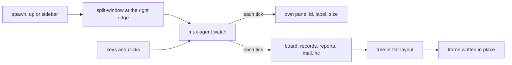

# Side Bar

[简体中文](Side-Bar-zh-CN)

The side bar is a narrow split at the right edge of your window that lists every agent, what state it is in and what it is doing now, so you can see who needs you without visiting each pane. In a team it draws the team as a tree; outside a team it draws a flat list ranked by who needs you first. You drive it with keys or the mouse to open, peek at and step through agents. [Teams and Lifecycle](Teams-and-Lifecycle) covers the verbs behind its rows.

## Open and close it

| what | when |
|---|---|
| your Claude Code or Copilot CLI chat starts or resumes in tmux or rmux | opens the bar beside it (`sidebar -Auto`); not after `clear` or `compact`, and never once you closed it |
| the first successful `spawn` of a session | opens the bar if it is not open; later spawns reuse it |
| `up` | opens the bar beside the team's view |
| `sidebar` | opens it again after `sidebar -Close`, or reopens a closed one |
| `sidebar -Close` | closes it for the rest of the session: no later spawn or chat start reopens it |

Only you or a team's leader opens or closes it; a member gets `tagged`, and an agent outside a team too. A spawn that cannot open the bar still succeeds and reports `sidebarError`. In tab placement the bar stays in the window you spawned from. `sidebar -Close` closes only this bar; the Claude Code `Agents` pane, which runs `list -All` every 3 seconds, is separate.

## The team tree

In a session `up` started, the bar draws the team as a tree. It looks roughly like this:

```text
 mux-agents       1 need you / 2 working / 1 ended

 ◉ leader                         working   2m
   Planning the parser split
   ! parse-tests                 needs you  12s
   ◉ fix-lexer                    working   4m
     ✓ lexer-bench                   done  10m
```

- The header counts the team's live members by state, then `M ended`; a narrow bar drops counts from the end, and the title stays.
- The leader comes first; each member's children are drawn under it, indented 2 columns per level (`src/sidebar/tree.rs`).
- Siblings are oldest first, with the running ones ranked needs you, on call, done, working, idle in the places running rows hold, so an ended member's sub-tree never moves.
- A row whose parent is not in the team, or whose chain does not reach the leader, is drawn at depth 1 with `^` first.
- Under a member's name line its doing line says what it is doing: its last `status`, else the first line of its last message, else its task.

When the pane is too short, the bar drops, in order: the blank line, the doing lines from the bottom up, each parent's ended children (folded into `+N ended`), then the deepest sub-trees that hold neither the leader nor the selection (folded into `+N more`). When it is too narrow for a row's mandatory parts, it shows `widen the bar: needs <n> columns` and draws no rows; keys still walk the whole tree.

## The flat list

Outside a team the bar draws a flat list, as herdr's priority view does:

```text
 mux-agents        1 need you / 1 done

 Needs you · 1
 ! add-subtract [sonnet]            12s
   Adding subtract(a, b) under add i...

 Done · 1
 ✦ test-calc  ✉ 1                   30s
   Done: test_calc.py passed, exit 0

 ended -------------------------------
 ✓ docs-usage                 done  18m
   +4 more  (list -All)
```

- The first rows are `main` (then `main 2` …), after a blank row that sets them apart from the header: the panes the agents were spawned from, so you can go back to the chat that started them. A short bar drops that blank row first.
- Live agents follow, ranked by state, the most recent change first. When they are in more than one state, each state's first agent has a heading with its count (`Needs you · 1`), and rows under headings show only their glyph and age; with every agent in one state each row says its state.
- Ended agents close the list: the 3 newest that did not end lost, then `+K more  (list -All)` when every ended agent is among the 10 `list -All` shows, else `+K more ended`.

## What each mark means

| mark (ASCII) | word | meaning |
|---|---|---|
| `!` bold yellow | `needs you` | its client is asking you something |
| `◌` (`o`) dim | `on call` | a member listening for mail under a live lease; never the leader |
| `✦` (`@`) bold cyan | `done` | finished its turn while you were not looking; stays until you have looked at its pane |
| `◉` (`*`) green | `working` | running a turn |
| `◌` (`o`) dim row | `idle` | nothing to do |
| `✓` (`+`) | `done` | ended with exit 0 |
| `✗` (`x`) red | `exit N` | ended with exit N |
| `-` yellow | `stopped` | ended by `stop` or `drop` |
| `-` | `lost`, `unknown` | its terminal is gone, or its life cannot be told |
| `!` | `recover: <reason>` | its current generation failed; `recover (still running)` while that generation has not ended; `resume` retries it |
| `✉ N` (`m N`) | | N unread messages from it |
| `kept shell <name>` | | a lost member's old terminal, under the heading `kept shells · N` |
| soft grey band | | the agent the keys selected, else the agent or `main` row whose pane is on screen, over the agent's whole block (its name line and doing line); with color only. When the bar itself is in front (you switched to its tab), the row of the other pane in that tab |
| `>` in column 0 | | the row the keys selected, only without color or with `MUX_AGENTS_ASCII=1` |

Each live agent's name has its own color, the one least used by the session's live agents and never a state color. The age is the time since the last change of state. `MUX_AGENTS_ASCII=1` draws the ASCII marks. Color follows `NO_COLOR` (off), `FORCE_COLOR` or `CLICOLOR_FORCE` (on), then `TERM=dumb` (off).

Notes at the bottom of the bar: `refresh failed` (the last board, shown when a read failed), `layout: repair paused`, `focus failed: <name>`, `nothing to open for <name>`, and the question `close? y/n`.

## Keys

The keys act only while the bar pane is active.

| key | in a team | outside a team |
|---|---|---|
| `j` / `k`, Down / Up | select the next or previous row, wrapping | select the next or previous row |
| Enter | open the selected row; with none selected, select the first | switch to the selected agent or `main`; with none selected, select the first |
| `n` / `N` | select the next or previous member with a live view, wrapping; Enter opens it | switch to the next or previous agent in the bar's order, from the one on screen |
| `p` | a popup of the selected member, else the one on screen: its live view, else its retained output | a popup of the selected agent, else the first: its last 200 lines, ending `-- peek: <name> (q closes) --` |
| Esc | clear the selection | clear the selection |
| Ctrl-C | end the bar (`interrupted`) | end the bar (`interrupted`) |

Enter on a team row opens it without restarting or typing anything: a running member's view, a lost member's recovery terminal, an ended member's output. Enter on a kept shell asks `close? y/n`: `y` closes it, and any other key keeps it.

`focus -Next` and `focus -Prev` do what `n` and `N` do from any pane. A key bound in `~/.tmux.conf` can send keys to the bar from anywhere, for example `bind ] run-shell 'tmux send-keys -t "$(tmux show -qv @mux-agents-sidebar-id | cut -d" " -f1)" n'`.

## Mouse

Clicks reach the bar only with `mouse on` (`set -g mouse on`); Shift-drag then selects text. A left click on an agent's name line or doing line opens it as Enter does; in a team the clicked row is selected first, so `p` and Enter act on it after. Outside a team clicks are off with `MUX_AGENTS_ASCII=1`. A click on a kept shell, a heading, a fold line or a note does nothing, and a click made while the bar is being resized only redraws it.

## Width and alerts

The bar's width is the larger of `@mux-agents-sidebar-min` columns (1-9999, default 40) and `@mux-agents-sidebar-percent` of its window (1-100, default 20). Set them with `set -g` or per session, window or pane, for example `tmux set -g @mux-agents-sidebar-percent 10`; a change applies at the next redraw, and a value out of range uses its default. A width you drag the bar to is kept until the window's width or a width option changes.

When an agent starts needing you, or finishes, while you are not looking at it, the bar shows one message for 5 seconds on the session's clients, such as `mux-agents: w2 needs you`. `@mux-agents-alerts` sets it: `off` sends none, `blocked` only who needs you, anything else both.

## How it works



- **A process in a split.** `sidebar`, the first spawn or `up` runs `split-window` at the right edge of the caller's window, full height, running `<binary> watch` by the binary's absolute path; your pane stays active. The bar is that process, not its `@agent-role sidebar` label: the session option `@mux-agents-sidebar-id` records `<pane> <pid> <start>`, and every step proves the pane still runs it. A pane that carries the label without being that process is named and never closed.
- **What it reads.** Each tick, every second (`Pace` in `src/sidebar.rs`) and at once after a key or a left press, it reads its own pane's id, label and size, then the board in-process (`src/agents/board.rs`, `src/agents/board_rows.rs`): each agent's record, the activity its client reported, its status or last message, its unread mail, whether it needs recovery, the team's kept shells and the pane the session shows. Between ticks it polls every 200 ms, cheaply: the pane on screen (one multiplexer read) and the newest change time of the agents' folders and mailboxes (file times, no process). Another pane on screen (a tab switch) or a change there (a report, a status, a message) draws a new frame at once, so the bar shows it within 200 ms. The walk that gives other view windows their bar runs every 5 ticks.
- **Redraw.** The board is laid out at the pane's actual size and never wraps; each frame is written in place inside synchronized output, with no full clear, so it does not flicker. With `TERM=dumb` it prints plain frames and takes no keys or clicks.
- **The keeper.** When a split, a layout change, `swap-pane` or `rotate-window` moves the bar, the next tick puts it back at the right edge and selects your pane again. A zoomed window is left alone. After 3 failed repairs in a row it shows `layout: repair paused` until the layout changes or a minute passes.
- **The end.** `watch` ends `pane-closed` when its pane is gone, `output-closed` when a write fails, `probe-failed` after 30 unanswered probes in a row, and `interrupted` on Ctrl-C; it puts the terminal back on every exit.

## Where it lives

- `src/sidebar.rs`: `sidebar`, `watch`, the flat layout, header, marks, keeper, peek and alerts
- `src/sidebar/tree.rs`: the team tree and its folds
- `src/sidebar/keys.rs`, `src/sidebar/input.rs`: keys and mouse reports
- `src/sidebar/pick.rs`: selection, kept and main rows
- `src/agents/board.rs`, `src/agents/board_rows.rs`: the feed the bar draws
- `src/paint.rs`: colors and display widths
