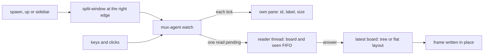

# Side Bar

[简体中文](Side-Bar-zh-CN)

The side bar is a narrow split at the right edge of your window that lists every agent, what state it is in and what it is doing now, so you can see who needs you without visiting each pane. In a team it draws the team as a tree; outside a team it draws a flat list ranked by who needs you first. You drive it with keys or the mouse to open, peek at and step through agents. [Teams and Lifecycle](Teams-and-Lifecycle) covers the verbs behind its rows.

## Open and close it

| what | when |
|---|---|
| your Claude Code or Copilot CLI chat starts or resumes in tmux or rmux | opens the bar beside it (`sidebar -Auto`); not after `clear` or `compact`, and never once you closed it |
| the first successful `spawn` of a session | opens the bar if it is not open; later spawns reuse it |
| `up` | opens the bar beside the team's view |
| `sidebar` | opens it again after `sidebar -Close`, or reopens a closed one |
| `sidebar -Close` | closes it for the rest of the session: no later spawn or chat start reopens it |

Only you or a team's leader opens or closes it; a member gets `tagged`, and an agent outside a team too. A spawn that cannot open the bar still succeeds and reports `sidebarError`. In tab placement the bar stays in the window you spawned from. `sidebar -Close` closes only this bar; the Claude Code `Agents` pane, which runs `list -All` every 3 seconds, is separate.

## The team tree

In a session `up` started, the bar draws the team as a tree. It looks roughly like this:

```text
 mux-agents                1 inbox · 2 working

 ◉ leader                         working   2m
   Planning the parser split
   ! parse-tests                 needs you  12s
   ◉ fix-lexer                    working   4m
     ✓ lexer-bench                   done  10m
```

- The header counts `N inbox` (yellow) and `N working`, as the flat list's header does; a narrow bar drops counts from the end, and the title stays. The hint row is the last row here too.
- The leader comes first; each member's children are drawn under it, indented 2 columns per level (`src/sidebar/tree.rs`).
- Siblings are oldest first, with the running ones ranked needs you, on call, done, working, idle in the places running rows hold, so an ended member's sub-tree never moves.
- A row whose parent is not in the team, or whose chain does not reach the leader, is drawn at depth 1 with `^` first.
- Under a member's name line its doing line says what it is doing: its last `status`, else the first line of its last message, else its task.

When the pane is too short, the bar drops, in order: the blank line, the doing lines from the bottom up, each parent's ended children (folded into `+N ended`), then the deepest sub-trees that hold neither the leader nor the selection (folded into `+N more`). When it is too narrow for a row's mandatory parts, it shows `widen the bar: needs <n> columns` and draws no rows; keys still walk the whole tree.

## The flat list

Outside a team the bar groups the agents by what they ask of you (40 columns; `$` is the cyan `main` glyph):

```text
 mux-agents         2 inbox · 1 working

 $ main

 Inbox · 2
 ! qa-spec-audit         needs you  12s
   Allow edit to src/lexer.rs?
 ✦ fc-research  ✉ 1           done   3m

 Working · 1
 ◉ dev-fix-l2                        4m
   Splitting parse.rs into modules

 Free · 1
 ◌ docs-usage                       20m

 ▸ Ended · 48

 ⏎ open  p peek  m mail  ? keys
```

- The header counts `N inbox` (yellow) and `N working`, each only when not 0, joined by ` · `; `0 running` when no agent lives. Free and ended agents are not counted there: their heading and the fold line count them.
- The first rows are `main` (then `main 2` …), after a blank row that sets them apart from the header: the panes the agents were spawned from, so you can go back to the chat that started them. A short bar drops that blank row first. `main` stays as the header does, while the pane has a row for it beside the header: the agents give way first.
- Live agents follow in sections, each under its heading with its count and a blank row above it, in the board's order. **Inbox** (bold yellow): needs you, done and not yet seen, unread mail, or a member that needs recovery, running or not; its rows keep their word, since their reasons differ. **Working** (bold green), then **Free** (bold dim: idle or on call): their rows show only the glyph and the age.
- The ended agents are one dim line, `▸ Ended · N`, which the keys select. Tab, or Enter on it, opens it (`▾`): the agents that ended in the last hour (by when each ended, not when it started), the newest end first, each selectable, then `+N older` for the rest. An ended agent with unread mail is not folded away: it stands in Inbox with its ended glyph and word and `✉ N` and the time since it ended, and the header counts it, until its mail is read. Its mail is the reports it sent; the notice of its own exit never counts, on any bar.
- The last row is the hint row, after a blank row: `⏎ open  p peek  m mail  ? keys` (`enter` in ASCII; `⏎ resume` on a selected ended row, and `resuming…` alone while its resume runs), keys plain and words dim, each key as `@mux-agents-keys` sets it. A narrow bar drops `m mail`, then `p peek`. It shows only when it costs no other row.
- A short bar drops, in order: the blank rows (the lowest first), the headings (each row then says its state), the open fold's rows (the oldest first, into `+N older`) and that line, the doing lines of the oldest agents, the oldest agents (into `+J more running`), then the fold line.

## What each mark means

| mark (ASCII) | word | meaning |
|---|---|---|
| `!` bold yellow | `needs you` | its client is asking you something |
| `◌` (`o`) dim | `on call` | a member listening for mail under a live lease; never the leader |
| `✦` (`@`) bold cyan | `done` | finished its turn while you were not looking; stays until you have looked at its pane |
| `◉` (`*`) green | `working` | running a turn |
| `◌` (`o`) dim row | `idle` | nothing to do |
| `✓` (`+`) | `done` | ended with exit 0 |
| `✗` (`x`) red | `exit N` | ended with exit N |
| `-` yellow | `stopped` | ended by `stop` or `drop` |
| `-` | `lost`, `unknown` | its terminal is gone, or its life cannot be told |
| `!` | `recover: <reason>` | its current generation failed; `recover (still running)` while that generation has not ended; `resume` retries it |
| `✉ N` (`m N`) | | N unread messages from it |
| `kept shell <name>` | | a lost member's old terminal, under the heading `kept shells · N` |
| `Inbox · N` bold yellow, `Working · N` bold green, `Free · N` bold dim | | a section of the flat list, with its count |
| `▸ Ended · N` (`>`) dim, open `▾` (`v`) | | the ended agents, folded; Tab, or Enter on it, opens or closes it |
| `[model]` dim | | the agent's model, only when the live agents' models differ |
| soft grey band | | the agent the keys selected, else the agent or `main` row whose pane is on screen, over the agent's whole block (its name line and doing line); with color only. When the bar itself is in front (you switched to its tab), the row of the other pane in that tab |
| `>` in column 0 | | the row the keys selected, only without color or with `MUX_AGENTS_ASCII=1` |

Each live agent's name has its own color, the one least used by the session's live agents and never a state color. The age is the time since the last change of state. `MUX_AGENTS_ASCII=1` draws the ASCII marks. Color follows `NO_COLOR` (off), `FORCE_COLOR` or `CLICOLOR_FORCE` (on), then `TERM=dumb` (off). In the open fold an ended row is its glyph, its dim name and the time since it ended: only `exit N` keeps its word, in red; a lost or unknown row, which has not ended, shows its age.

Notes at the bottom of the bar: `refresh failed` (the last board, shown when a read failed or has been pending for 15 seconds), `layout: repair paused`, `focus failed: <name>`, `nothing to open for <name>`, `no notes`, `notes failed`, `opens in: tab|split h|split v`, `placement refused: <reason>`, `close failed: <name>`, and the questions `close? y/n` and `close bar? y/n`.

## Keys

The keys act only while the bar pane is active.

| key | in a team | outside a team |
|---|---|---|
| `j` / `k`, Down / Up | select the next or previous row, wrapping | select the next or previous row |
| Enter | open the selected row; on an ended member, resume it (see below); with none selected, select the first | switch to the selected agent or `main`; on an ended agent, resume it in a new window and switch to it (see below); on the fold line, open or close it; with none selected, select the first |
| `g` / `G` | select the first or last row as drawn | select the first or last row as drawn |
| Tab | nothing: the tree has no fold | open or close the ended fold; closed from one of its rows, the fold line is selected |
| `n` / `N` | select the next or previous member with a live view, wrapping; Enter opens it | switch to the next or previous running agent in the bar's order, from the one on screen |
| `p` | a popup of the selected member, else the one on screen: its live view, else its retained output | a popup of the selected agent, else the one on screen, else the first running one: its last 200 lines, ending `-- peek: <name> (q closes) --`; a selected ended agent shows its retained output |
| `o` | a popup of the selected member's retained output, else the one on screen's, else the first running one's; never its live view | the same, for the selected agent |
| `m` | a popup of the selected member's unread mail, else the one on screen's, else the first running one's; nothing is marked read | the same, for the selected agent |
| `i` | a popup of the team's notes, newest first: each title, then `author · at · id` | `no notes`: the notebook belongs to a team |
| `P` | where new agents open, as `placement` sets it: tab, then split h, then split v, then tab again; the bottom line says `opens in: <place>`, or `placement refused: <reason>` | the same |
| Space | the agent you selected, done and not yet seen, is marked seen, as leaving its pane marks it, with a view or without; any other row, none selected, or a row the selection fell to when yours left: nothing | the same; it leaves Inbox |
| `q` | asks `close bar? y/n` | the same |
| `?` | the keys, in the bar's last rows, as `@mux-agents-keys` sets them: `?` or Esc closes them; any other key closes them and does its action | the same |
| Esc | clear the selection | clear the selection |
| Ctrl-C | end the bar (`interrupted`) | end the bar (`interrupted`) |

Enter on a team row opens it without restarting or typing anything: a running member's view, a lost member's recovery terminal. Enter on an ended member resumes it, as on the flat bar: a new window, switched to, and the hint row says `⏎ resume`. On either bar the resume runs while the bar keeps drawing: its row says `resuming…` (`resuming...` in ASCII) until the board shows the agent again, and a second Enter on it does nothing meanwhile; a resume that is refused says why on the bottom line, `resume refused: <reason>`, and `o` still shows its retained output. Enter on a kept shell asks `close? y/n`: `y` closes it, and any other key keeps it. On a kept shell the selection fell to when your row left, Enter first takes it as yours and asks nothing.

`q` asks `close bar? y/n`. Only a `y` typed on its own, at least 250 ms after the question shows, closes the bar, as `sidebar -Close` closes it but for this window only: the session's bar is turned off, so no other window's bar opens it again, until you run `sidebar`. A `y` typed sooner, or read with other bytes (a paste, or part of another key's sequence), leaves the question; any other key keeps the bar.

`@mux-agents-keys` moves keys: `action=key` pairs, comma-separated, each key one printable character, for example `tmux set -g @mux-agents-keys 'notes=I,close=Q'`. The actions are `down`, `up`, `first`, `last`, `next`, `prev`, `peek`, `output`, `mail`, `notes`, `placement`, `ack` (Space), `close` and `help`. A key another action had is taken from it. Enter, Tab, Esc, the arrows, Ctrl-C and `y` stay. An unknown action, or a key that is not one printable character or is `y`, is ignored, and `?` lists it as `ignored: <name>`. The bar reads the option once when it starts: a change applies to the next bar.

`focus -Next` and `focus -Prev` do what `n` and `N` do from any pane. A key bound in `~/.tmux.conf` can send keys to the bar from anywhere, for example `bind ] run-shell 'tmux send-keys -t "$(tmux show -qv @mux-agents-sidebar-id | cut -d" " -f1)" n'`.

## Mouse

Clicks reach the bar only with `mouse on` (`set -g mouse on`); Shift-drag then selects text. A left click on a row selects it and does what Enter on it does: an agent's name line or doing line opens it, an ended agent resumes, the fold line opens or closes, a kept shell asks `close? y/n`. The row stays selected, so `p` and Enter act on it after. Outside a team clicks are off with `MUX_AGENTS_ASCII=1`. A click on a heading or a note does nothing, and a click made while the bar is being resized only redraws it.

## Width and alerts

The bar's width is the larger of `@mux-agents-sidebar-min` columns (1-9999, default 40) and `@mux-agents-sidebar-percent` of its window (1-100, default 20). Set them with `set -g` or per session, window or pane, for example `tmux set -g @mux-agents-sidebar-percent 10`; a change applies at the next redraw, and a value out of range uses its default. A width you drag the bar to is kept until the window's width or a width option changes.

When an agent starts needing you, or finishes, while you are not looking at it, the bar shows one message for 5 seconds on the session's clients, such as `mux-agents: w2 needs you`. `@mux-agents-alerts` sets it: `off` sends none, `blocked` only who needs you, anything else both.

## How it works



- **A process in a split.** `sidebar`, the first spawn or `up` runs `split-window` at the right edge of the caller's window, full height, running `<binary> watch -Managed <key>` by the binary's absolute path, `<key>` 32 random hex stored once in that state root's `bar-key` file, so every process under the same root reads the same key however its path is spelled; your pane stays active. `-Managed` is a flag only that split passes: a bar whose opener died before it was recorded (killed mid-open) closes itself within 10 s, and `sidebar -Close` under the same state root closes it at once; a `watch` you run by hand is left alone. The bar is that process, not its `@agent-role sidebar` label: the session option `@mux-agents-sidebar-id` records `<pane> <pid> <start>`, and every step proves the pane still runs it. A pane that carries the label without being that process is named and never closed.
- **What it reads.** The first frame reads the board inline. Later ticks (every second, and after input) ask one long-lived reader thread for a board only when no read is pending; the loop draws the last answer meanwhile. The reader owns its context and serializes board reads and seen marks. Input waits are sliced to at most 10 ms while a read is pending, without shortening the 50 ms Escape wait. An answer ends the wait: input already waiting acts on the frame it targeted, then the bar redraws from cached size and pane state without repeating tick calls or moving the next tick. Every 200 ms a poll checks the shown pane and state-file stamps; a moved pane still redraws during a read, but a moved stamp does not start another read. Other tick-time multiplexer calls stay on the loop. A read pending 15 s shows `refresh failed`; a panic or thread-start failure refuses pending work and retries next tick, with inline fallback after three consecutive reader failures.
- **Seen marks.** Leaving a viewed done spell queues its member id, pane and change time on the reader. A refusal keeps it for a later tick; a successful no-view answer removes it without an idle overlay, and a written mark removes it and adds the overlay. Marks run before the next queued read. Space still marks synchronously and requests a fresh read after any read in flight. Every successful mark overlays that same spell as `idle` on all later frames, even a delayed answer; only a successful read requested after the mark and accepted as the displayed board retires the overlay. Enter, clicks and Space can still wait for the member lock they themselves need.
- **Redraw.** The board is laid out at the pane's actual size and never wraps; each frame is written in place inside synchronized output, with no full clear, so it does not flicker. With `TERM=dumb` it prints plain frames and takes no keys or clicks.
- **The keeper.** When a split, a layout change, `swap-pane` or `rotate-window` moves the bar, the next tick puts it back at the right edge and selects your pane again. A zoomed window is left alone. After 3 failed repairs in a row it shows `layout: repair paused` until the layout changes or a minute passes.
- **The end.** `watch` ends `pane-closed` when its pane is gone, `output-closed` when a write fails, `probe-failed` after 30 unanswered probes in a row, `interrupted` on Ctrl-C, and `closed` after `q` and `y`. Exit stops the reader queue, drops unclaimed work and wakes an idle reader, then joins it without an added deadline; only its claimed request finishes, bounded by the calls it already uses. The terminal is restored after workers finish. No queued seen mark runs after shutdown starts.

## Where it lives

- `src/sidebar.rs`: `sidebar`, `watch`, the flat layout, header, marks, keeper, peek and alerts
- `src/sidebar/tree.rs`: the team tree and its folds
- `src/sidebar/keys.rs`, `src/sidebar/input.rs`: keys and mouse reports
- `src/sidebar/pick.rs`: selection, kept and main rows
- `src/sidebar/jobs.rs`: the serial board reader, seen requests, background actions and shutdown
- `src/agents/board.rs`, `src/agents/board_rows.rs`: the feed the bar draws
- `src/paint.rs`: colors and display widths
