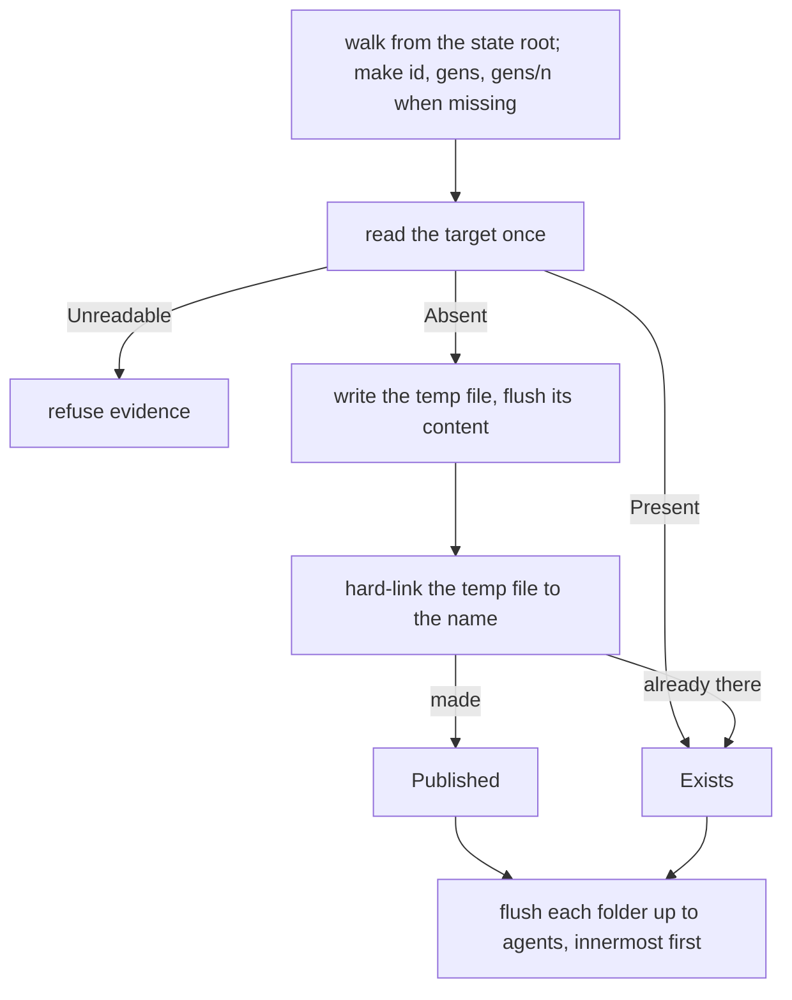

# 状态与持久性

[English](State-and-Durability)

mux-agents 没有守护进程。每个命令都是一个短进程：读取状态文件夹、做出判断、写入然后退出，而智能体在各自的终端里继续运行。因此状态文件夹是系统唯一的记忆，它必须在崩溃、断电、两个命令同时运行和写到一半的文件之后依然正确。本页说明文件夹在哪里、里面有什么、一个事实如何只发布一次并落盘、读取方如何区分缺失的文件和损坏的文件，以及锁、私有文件夹和崩溃测试如何保护它。依据这些证据行事的规则见[安全与占用](Safety-and-Occupancy-zh-CN)。

## 状态根目录

根目录只来自环境变量（`src/state/root.rs`）。空变量视为未设置。

| 系统 | 根目录 |
|---|---|
| Linux、macOS | `MUX_AGENTS_STATE`，必须是绝对路径（否则 1 `state`）；否则在其为绝对路径时用 `$XDG_STATE_HOME/mux-agents/state`；否则用 `$HOME/.local/state/mux-agents/state` |
| Windows | `MUX_AGENTS_STATE`；否则用 `%LOCALAPPDATA%\mux-agents\state` |

在 Unix 上，路径必须是绝对路径，且不含 `.` 或 `..` 部分。对其最长的已存在前缀做 realpath，缺失的其余部分保留，因此根目录之上的链接只解析一次；探测或 realpath 失败时直接拒绝，绝不使用未解析的路径。实机测试传入自己的 `MUX_AGENTS_STATE`，因此从不触碰用户自己的状态。

## 布局

```text
<root>/
  <serverKey>/                    one multiplexer server
    server.json                   socket, serverPid, serverStart (create-once)
    agents/<id>/                  one member
      record.json                 the member record
      desired.json                running or stopped
      view.json                   pane, window and startCommand of the generation it shows
      gens/<n>.claim              the launcher's claim of generation n
      gens/<n>/<file>.json        create-once evidence of generation n
    mail/<box>.jsonl              a mailbox, one JSON message per line
    mail/<box>.cursor.json        its receipt cursor
    teams/<sha16>.json            the team record of a session
    teams/<sha16>.budget.json     the team's spawn budget
    teams/<sha16>.cascade/        the stop cascade's journal
    teams/<sha16>/notes/          notebook.jsonl and notebook.state.json
    teams/<sha16>/sends/          one durable intent per team send
  up/<team>.json                  the index of a team that up started
  live/<kind>-<pid>-<start>.json  the newest session report of one client process
```

- `<serverKey>` 是 `<socket>|<pid>|<start>` 的 SHA-256 的前 16 个十六进制位（`src/caller.rs`）。服务器的启动时间通过打开的进程句柄读取，因此重启后复用同一套接字和 pid 的服务器会得到新的键。
- `<id>` 是 12 个小写十六进制位（`agents::agent_id`），可安全地用作文件夹名或邮箱名。`<sha16>` 是会话 id 的 SHA-256 的前 16 个十六进制位。
- 成员的邮箱就是它的 id。人的窗格邮箱是 `pane-<n>`，在团队锚点以外的服务器上是 `pane-<serverKey>-<n>`（`src/agents/mail.rs`）。
- 状态跟随团队的锚点，而不是调用方自己的服务器（`src/agents/scope.rs`）：调用方有锚点时，`scope::state` 给出锚点的键和会话，否则给出调用方自己的。在另一台服务器上、处于团队已证明视图中的人，仍然读写锚点的文件夹；调用方所连接的多路复用器仍是它自己的（`scope::shown`）。
- `state_dir` 在每次调用时都创建或检查 `<serverKey>`、`agents` 和 `mail` 是否私有（`src/agents/mod.rs`）。

`gens::FILES` 列出一代可能持有的 17 个只创建一次的文件：`spec`、`launch`、`commit`、`launcher`、`exit`、`client`、`report`、`ready`、`failure`、`outcome`、`ended`、`terminating`、`kill`、`release`、`released`、`notice` 和 `route`。每个文件只记录一个事实一次，没有任何东西会改写它。

## 只创建一次的发布

代的证据从不编辑。每个事实是一个独立的文件，由一个发布者只创建一次，因此看到它的读取方可以依赖它，为同一事实竞争的两个写入方不可能都赢。`gens::publish_once` 发布 `gens/<n>/<file>.json`，`gens::publish_claim_once` 发布 `gens/<n>.claim`；两者都运行 `src/agents/gens.rs` 中的 `publish_at`：

1. 从状态根目录往下走。`<serverKey>` 和 `agents` 必须已经是真实的文件夹；`<id>`、`gens` 和 `gens/<n>` 缺失时创建。每一层都用 `symlink_metadata` 检查，它从不跟随链接：链接、联接点或文件都拒绝为 `evidence`。
2. 只读取目标一次。Present 在写入任何东西之前就回答 `Exists`；Unreadable 则拒绝。
3. Absent：`state::fs::claim_json` 把完整的 JSON 写入 `<path>.<32 hex>.tmp`，刷新其内容，硬链接到目标名，再删除临时文件。名字已存在时链接失败，因此两个竞争者中恰好一个成功，另一个得到 `Exists`。
4. 每次调用（包括 `Exists`）都刷新持有该名字的文件夹及其上方直到 `agents` 的每个文件夹，从最内层开始。



在链接之前失败的写入或内容刷新是 1 `state`，“generation evidence could not be published”（`gens::NOT_PUBLISHED`）：名字从未创建。失败的文件夹刷新是 1 `state`，“generation evidence could not be flushed”（`gens::NOT_FLUSHED`）：名字可能可见但没有落盘，需要它的操作就此停止。

每一步的原因：

- **先内容后名字。** 临时文件在链接之前刷新，因此崩溃后看到的名字绝不为空。
- **用链接，不用重命名。** 重命名会替换已存在的文件；硬链接会拒绝。正是这种拒绝让恰好一个竞争者获胜。
- **从最内层开始。** 新名字只有在其文件夹刷新后才能在崩溃后保留，本次调用创建的文件夹只有在其父文件夹刷新后才能保留。先刷新子文件夹再刷新父文件夹，意味着父文件夹的条目不会先于它所指向的内容落盘。
- **`Exists` 也要刷新。** 在链接和刷新之间崩溃的发布者会留下一个可见但未落盘的名字；下一个发布者会完成这些刷新。`gens::read_flushed` 和 `gens::claim_flushed` 在返回内容之前做同样的刷新，因此读取方只在证据落盘后才据此行事，启动器也会在启动客户端之前刷新提交所在的文件夹（`src/launcher.rs`）。

提交是最清楚的竞争。启动过程把 `{"committed": true}` 发布到 `gens/<n>/commit.json`，启动器等待它，每 250 ms 读取一次，持续 `COMMIT_WAIT`（30 s）。如果到期时提交仍是 Absent，启动器就把自己的 `{"aborted": true}` 发布到同一个名字。谁先链接谁决定；另一方得到 `Exists` 并按已有的内容行事。到期时提交为 Unreadable 则什么都不发布。

## 可变文件

`record.json`、`desired.json`、`view.json`、团队记录和 `up` 索引会随时间变化。`state::fs::write_json` 把 JSON 写入文件旁边的 `<path>.<32 hex>.tmp`，再重命名覆盖目标，因此读取方看到的是旧文件或新文件，绝不是其中一部分。`write_json_durable` 还会在重命名之前刷新临时文件的内容、之后刷新文件夹，刷新失败即为错误；成员记录和 `desired.json` 使用它（`src/agents/team_state.rs`）。

`team_state::Tx::record_write` 是 `record.json` 唯一的生命周期写入方。它在成员锁下通过逐层检查读取记录一次，询问一个 `Guard` 这次读取是否仍然符合（例如 `pending.gen` 仍指向本次启动），然后修补并用 `write_json_durable` 写入；新建的记录还会刷新 `agents`。守卫不再成立时什么都不写，因此记录已被另一个写入方拿走的启动无法覆盖它。写入或刷新失败是 1 `state`，“the member record could not be written”。

一次启动就是这些写入组成的链条。下面每个步骤名都是 `src/agents/core_launch.rs` 中的崩溃点，在旁边的写入落盘之后到达：

| 步骤 | 它之前的持久写入 |
|---|---|
| `allocated` | 尚无写入：选定代号、hc 名称和启动器 argv |
| `pending` | `record.json` 增加 `pending`，含 `gen`、`kind`、`hcName`、`sessionId` 和 `launcherArgv` |
| `desired` | 新成员的期望状态为 `running` |
| `spec` | `gens/<n>/spec.json`，只创建一次 |
| `launch` | `gens/<n>/launch.json`，只创建一次 |
| `run` | `hc run` 已在新终端中启动启动器 |
| `address` | `pending.hcAddress`，只在记录仍指向本次启动时写入 |
| `commit` | 带 `committed` 的 `gens/<n>/commit.json` |
| `promote` | 一次记录写入设置身份并删除 `pending` |

`pending` 之后、提交之前的失败交给 `abort`，它只隔离本次启动拥有的东西。无法发布的提交会保留 `pending` 及其地址，留待之后的结算；提交之后不回滚任何东西，由之后的读取方结算剩下的状态。

## 证据模型

`state::evidence::read` 是代的证据和标记的唯一读取方（`src/state/evidence.rs`）。它回答三种结果之一：

| 结果 | 何时 |
|---|---|
| `Present(value)` | 一个普通文件，最多 1 MB，能解析为 JSON |
| `Absent` | 没有这个名字，且最近的已存在祖先是文件夹 |
| `Unreadable` | 其他一切：撕裂或无效的 JSON、I/O 错误、过大的文件、该名字处是 FIFO、套接字、文件夹或链接，或者本应是文件夹的地方是文件 |

名字在打开之前先用 `symlink_metadata` 检查，因此只会打开普通文件：FIFO 无法阻塞读取方，链接也无法通向根目录之外。`gens::walk` 对从状态根目录到该文件的每个文件夹做同样的检查：缺失的文件夹是 `Absent`，链接或文件是 `Unreadable`。

**Unreadable 绝不等于 Absent。** `Evidence::known` 把 `Unreadable` 变成 1 `evidence`，“state evidence cannot be read; retry”，命令随即停止。撕裂的 `commit.json` 不能读作“没有提交”，否则可能启动第二次；无法读取的成员记录不能读作空位，否则团队可能超出上限。每个做判断的读取方都遵循同一规则：成员的证据无法读取时，占用检查认为对话被持有；成员上限把被持有的生命周期前文件夹计入；未通过校验的身份字段拒绝为 `evidence` 且不做任何事（[安全与占用](Safety-and-Occupancy-zh-CN)）。

## 锁

锁按用户划分，而不是按状态根目录划分，因此同一用户的两个状态根目录仍然对每个键共享一把锁（`src/state/lock.rs`）。

- **Linux 和 macOS：** 在 `<lock root>/<32 hex of sha256(key)>.lock` 上做 `File::try_lock`，每 10 ms 重试一次。锁根目录是 `<home>/.local/state/mux-agents/locks`，其中主目录来自有效 uid 的 passwd 条目，从不来自 `HOME`、`XDG_STATE_HOME` 或 `MUX_AGENTS_STATE`。主目录以下每个已存在的部分都用 lstat 读取且从不跟随：链接、文件、其他所有者或组和其他用户的写权限位都拒绝为 1 `state`，因此其他用户无法改指某一部分、把一个键拆到两个锁文件上。缺失的部分以 `0700` 创建。
- **Windows：** 命名互斥体 `Local\MuxAgents-<32 hex of sha256(key)>`。被遗弃的互斥体视为已被持有。
- **准入：** `up` 以及复用其团队关卡的命令在 `up|<team>` 上获取 `state::lock::admission`，它在所有系统上都是文件锁。在 Windows 上它的文件夹是 `<FOLDERID_LocalAppData>\mux-agents\locks`，从用户配置读取，而不是从环境变量读取。

等待超过 `LOCK_WAIT`（15 s）拒绝为 2 `lock`。`try_with_lock` 只尝试一次，另一个持有者持有该键时回答 `None`，因此侧边栏或一代的裁决这类调用方可以推迟工作而不必等待。

使用中的键：

- `spawn|<serverKey>|<session>`，团队锁（`team_state::Scope::team_lock`）：启动、`resume`、权限检查、重放钩子、启动预算、团队邮件和笔记本。
- `member|<serverKey>|<id>`，成员锁：每次写入 `record.json`、`desired.json` 和 `view.json`；`ping` 和 `answer` 在检查成员的 `generation` 时，在该成员的代理锁之内获取它。
- `gen|<serverKey>|<id>.<n>`，代锁：一代的结果、其客户端的会话报告以及就绪提升。
- `mail|...`、`agent|...`、`notice|...` 和 `sidebar|...`，由 `agents::lock_key` 在调用方的状态范围内构造为 `<kind>|<serverKey>|<key>`。
- `live|<pid>-<start>`，实时会话登记表中的一个条目（`src/state/live.rs`）。

顺序是固定的：先团队锁再成员锁，先成员的代理锁再它的成员锁（`send` 为 `send parent` 重放收养时就是这样获取的，`ping` 和 `answer` 也照此获取），先会话锁再邮箱锁。每个命令都按同一顺序获取，因此不会有两个命令各自等待对方持有的锁。在单元测试中 `agents::lock` 记录每次持有而不获取真实的锁，`patch_and_desired_take_the_member_lock_inside_the_team_lock` 等测试断言这一顺序。

## 私有文件夹

状态文件夹存放证明谁是成员的证据、邮箱和服务器绑定。能在那里写入的用户可以伪造提交、以智能体身份投递邮件，或者放置一个把写入引向别处的链接。因此每个状态文件夹都是私有的，任何疑点都拒绝为 1 `state`。

**Unix**（`src/state/private_unix.rs`）：`private_dirs` 从 `/` 往下走每条路径。根目录之上每个已存在的文件夹都必须通过 `decide_parent`，即 OpenSSH StrictModes 规则：所有者是 root 或该用户，并且组和其他用户不可写，除非设置了粘滞位（像 `/tmp` 那样）；在 macOS 上，授予 add_subdirectory 或 delete_child 的允许 ACE 会被拒绝。缺失的文件夹以 `0700` 创建。根目录、其下的一切和刚创建的一切都必须按以下顺序通过 `decide`：

1. 是真实的文件夹，不是链接、文件或缺失；
2. 第二次 lstat 与第一次相同，即检查期间没有变化；
3. 其 realpath 等于其路径；
4. 所有者是该用户；
5. 模式恰好是 `0700`；
6. 没有扩展 ACL（`src/state/acl.rs`：Linux POSIX ACL 属性、macOS ACE）；无法解析的字节视为扩展 ACL。

**Windows**（`src/state/private_windows.rs`）：每个文件夹设为仅该用户、SYSTEM 和 Administrators 私有。所有者和每个允许条目都必须是这三者之一；空 DACL 授予所有人一切权限，会被拒绝。文件夹本身或任何已存在的祖先是联接点或链接时拒绝，属性读取失败是错误，绝不算通过。已存在的文件夹只检查，从不修复。

## 刷新与 Windows 共享冲突

`src/state/fs.rs` 提供每次持久写入都使用的刷新辅助函数：

- `sync_file` 刷新文件的内容。
- `sync_dir` 刷新文件夹的条目，使其中创建的名字在崩溃或断电后保留。在 Windows 上它以 `FILE_APPEND_DATA` 和备份语义打开文件夹，这是 `FlushFileBuffers` 接受的最小访问权限；只读打开无法刷新。
- `durable_dir` 创建文件夹，并在每次调用时刷新直到基准目录的每一层，因此重试可以完成先前调用没做完的刷新。
- `sync_ancestor` 刷新状态根目录之上的文件夹。只有当该用户无法在其中添加条目时（例如 `C:\Users` 或 `/home`），它才跳过被拒绝的刷新，因为此时用户路径上的文件夹不可能是在那里创建的；其他任何失败都是错误。

在 Windows 上，索引器或杀毒软件等其他进程可能短暂地以不共享写入的方式打开文件或文件夹，此时为刷新而做的打开会因共享冲突（`os error 32`）失败。`open_waiting` 对这一种错误每 25 ms 重试一次，持续约一秒，然后让错误成立，因此绝不会在没有刷新的情况下声称已刷新。其他任何错误立即返回。读取共享删除权限，因此读取方从不阻塞替换。

## 崩溃点与崩溃测试

`state::evidence::crash_point(step)` 跟在每个持久步骤之后。当 `MUX_AGENTS_CRASH` 指定该步骤时，进程刷新 stdout 并立即以退出码 86 退出：不展开栈，也不运行 `Drop`，就像被杀死的进程那样留下磁盘状态。它只编译进单元测试、`test-panic` 构建和仅测试用的 `live` 特性；发布的构建完全不含它。

| 位置 | 步骤 |
|---|---|
| `src/agents/core_launch.rs` | `allocated`、`pending`、`desired`、`spec`、`launch`、`run`、`address`、`commit`、`promote` 各步 |
| `src/launcher.rs` | `claim`、`launcher`、`client`、`exit` 各步 |
| `src/agents/release.rs` | 停止释放过程中的每次持久写入，通过 `release::halt` |
| `src/agents/up/mod.rs` | `up` 的每个持久步骤，通过 `up::halt` |

测试方式：

- `tests/crash_point.rs` 检查开关本身。没有 `test-panic` 时，库从被指定的崩溃点返回，子进程以 0 退出。有它时，子进程依次经过八个步骤：不设变量则全部通过，`run` 让它在 `launch` 之后以退出码 86 停止，不是步骤的名字则全部通过。每个子进程都受 `support/bounded.rs` 限时。
- `src/agents/core_launch/crash.rs` 再次运行单元测试二进制，把 `MUX_AGENTS_CRASH` 依次设为每个前进步骤，受 `LIMIT`（120 s）限时。其测试检查：每一步之后被杀死留下的状态都能被读取方分类，崩溃只结算一次且不会重复运行任何东西，启动器放弃之后重试能收敛，以及启动器无法刷新的提交不会启动客户端。
- `tests/live.rs` 在真实的 tmux 或 rmux 服务器上，在 `promote` 或 `run` 处杀死前进中的启动，在指定步骤处杀死 `up`，然后检查下一个命令能够恢复。
- 在进程内，`release::halt_after` 和 `up::halt_after` 让下一次 `halt(step)` 拒绝为 1 `halted`，“halted after <step>”，因此单元测试无需子进程即可在任何持久写入之后停止。`src/state/fs.rs` 中的故障点（`fail_durable_flush`、`fail_sync_dir`、`fail_sync_file`、`fail_create_dir`）让测试线程上的某一次刷新或文件夹创建失败，`gens::publish_hooks::before_link` 让竞争者在读取和链接之间抢先链接（`src/agents/gens/publish_tests.rs`）。

## 源码索引

| 约定 | 源码 |
|---|---|
| 状态根目录 | `src/state/root.rs` |
| 证据读取方、只创建一次的写入方、崩溃点 | `src/state/evidence.rs` |
| 原子与持久写入、刷新、共享冲突重试 | `src/state/fs.rs` |
| 锁 | `src/state/lock.rs`、`src/agents/mod.rs` |
| 私有文件夹 | `src/state/private_unix.rs`、`src/state/private_windows.rs`、`src/state/acl.rs` |
| 实时会话登记表 | `src/state/live.rs` |
| 代的证据与发布 | `src/agents/gens.rs`、`src/agents/gens/publish_tests.rs` |
| 记录、期望状态和视图的写入方；锁键 | `src/agents/team_state.rs` |
| 状态范围 | `src/agents/scope.rs` |
| 启动步骤 | `src/agents/core_launch.rs`、`src/agents/core_launch/crash.rs` |
| 崩溃测试 | `tests/crash_point.rs`、`tests/live.rs` |
