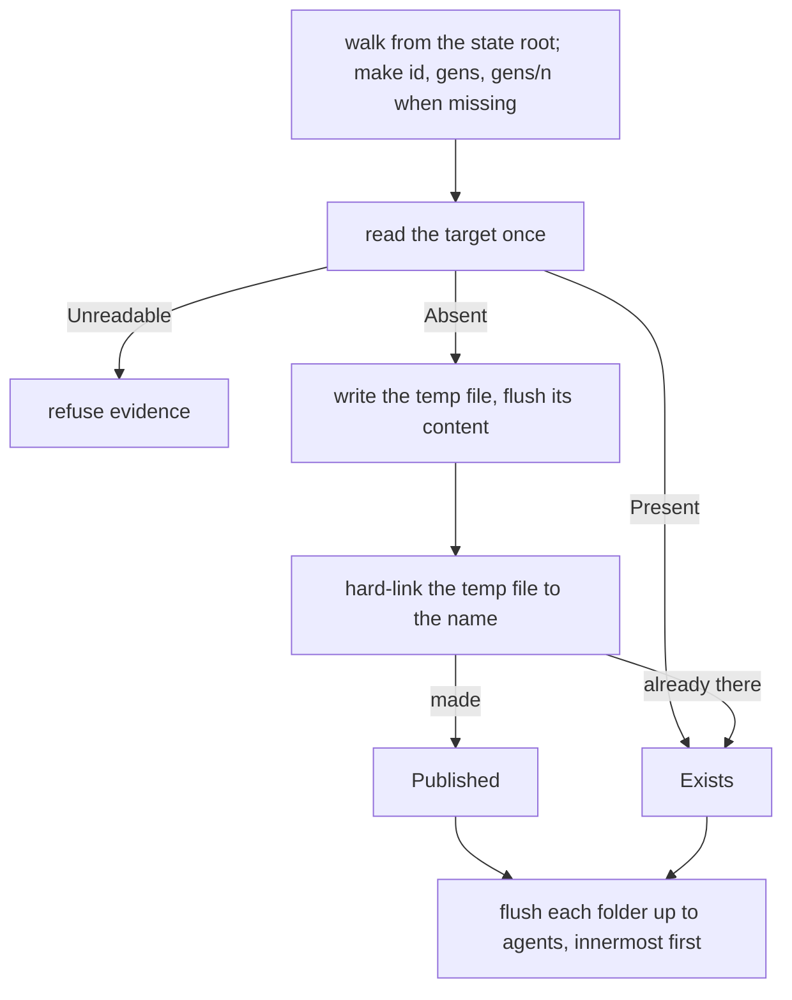

# State and Durability

[简体中文](State-and-Durability-zh-CN)

mux-agents has no daemon. Every command is a short process that reads the state folder, decides, writes and exits, while the agents keep running in their own terminals. The state folder is therefore the system's only memory, and it has to stay right through crashes, power loss, two commands at once and files left half-written. This page covers where the folder is, what is in it, how a fact is published once and made durable, how a reader tells a missing file from a broken one, and how locks, private folders and crash tests protect it. The rules that act on this evidence are in [Safety and Occupancy](Safety-and-Occupancy).

## The state root

The root comes from the environment only (`src/state/root.rs`). An empty variable counts as unset.

| OS | Root |
|---|---|
| Linux, macOS | `MUX_AGENTS_STATE`, which must be absolute (else 1 `state`); else `$XDG_STATE_HOME/mux-agents/state` when that is absolute; else `$HOME/.local/state/mux-agents/state` |
| Windows | `MUX_AGENTS_STATE`; else `%LOCALAPPDATA%\mux-agents\state` |

On Unix the path must be absolute and hold no `.` or `..` part. Realpath is applied to its longest existing prefix and the missing rest is kept, so a link above the root resolves once; a probe or realpath that fails refuses rather than use the unresolved path. Live tests pass their own `MUX_AGENTS_STATE`, so they never touch the user's own state.

## Layout

```text
<root>/
  <serverKey>/                    one multiplexer server
    server.json                   socket, serverPid, serverStart (create-once)
    agents/<id>/                  one member
      record.json                 the member record
      desired.json                running or stopped
      view.json                   pane, window and startCommand of the generation it shows
      gens/<n>.claim              the launcher's claim of generation n
      gens/<n>/<file>.json        create-once evidence of generation n
    mail/<box>.jsonl              a mailbox, one JSON message per line
    mail/<box>.cursor.json        its receipt cursor
    teams/<sha16>.json            the team record of a session
    teams/<sha16>.budget.json     the team's spawn budget
    teams/<sha16>.cascade/        the stop cascade's journal
    teams/<sha16>/notes/          notebook.jsonl and notebook.state.json
    teams/<sha16>/sends/          one durable intent per team send
  up/<team>.json                  the index of a team that up started
  live/<kind>-<pid>-<start>.json  the newest session report of one client process
```

- `<serverKey>` is the first 16 hex digits of the SHA-256 of `<socket>|<pid>|<start>` (`src/caller.rs`). The server's start is read through an open process handle, so a restarted server that reuses the socket and pid gets a new key.
- `<id>` is 12 lowercase hex digits (`agents::agent_id`), safe as a folder or mailbox name. `<sha16>` is the first 16 hex digits of the SHA-256 of the session id.
- A member's mailbox is its id. A person's pane mailbox is `pane-<n>`, or `pane-<serverKey>-<n>` on a server other than the team's anchor (`src/agents/mail.rs`).
- State follows the team's anchor, not the caller's own server (`src/agents/scope.rs`): `scope::state` answers the anchor's key and session when the caller has one, else its own. A person in a team's proven view on another server still reads and writes the anchor's folder; the multiplexer the caller talks to stays its own (`scope::shown`).
- `state_dir` makes or checks `<serverKey>`, `agents` and `mail` private on every call (`src/agents/mod.rs`).

`gens::FILES` lists the 17 create-once files a generation may hold: `spec`, `launch`, `commit`, `launcher`, `exit`, `client`, `report`, `ready`, `failure`, `outcome`, `ended`, `terminating`, `kill`, `release`, `released`, `notice` and `route`. Each records one fact once, and nothing rewrites it.

## Create-once publication

Generation evidence is never edited. Each fact is its own file, made once by one publisher, so a reader that saw it can rely on it and two writers that race for the same fact cannot both win. `gens::publish_once` publishes `gens/<n>/<file>.json` and `gens::publish_claim_once` publishes `gens/<n>.claim`; both run `publish_at` in `src/agents/gens.rs`:

1. Walk from the state root. `<serverKey>` and `agents` must already be real folders; `<id>`, `gens` and `gens/<n>` are made when missing. Each level is checked with `symlink_metadata`, which never follows a link: a link, a junction or a file refuses `evidence`.
2. Read the target once. Present answers `Exists` before anything is written; Unreadable refuses.
3. Absent: `state::fs::claim_json` writes the JSON whole to `<path>.<32 hex>.tmp`, flushes its content, hard-links it to the target name and removes the temp file. The link fails when the name exists, so of two racers exactly one makes it and the other gets `Exists`.
4. On every call, `Exists` included, flush the folder that holds the name and each folder above it up to `agents`, innermost first.



A write or content flush that fails before the link is 1 `state`, "generation evidence could not be published" (`gens::NOT_PUBLISHED`): the name was never made. A folder flush that fails is 1 `state`, "generation evidence could not be flushed" (`gens::NOT_FLUSHED`): the name may be visible but is not durable, and whatever needed it stops.

Why each part:

- **Content before name.** The temp file is flushed before the link, so a name seen after a crash is never empty.
- **A link, not a rename.** A rename replaces a file that is already there; a hard link refuses it. That refusal is what lets exactly one racer win.
- **Innermost first.** A new name survives a crash only once its folder is flushed, and a folder this call made survives only once its parent is flushed. Flushing the child before the parent means no parent entry is durable before what it names.
- **Flush on `Exists` too.** A publisher that crashed between the link and its flushes leaves a name that is visible but not durable; the next publisher finishes the flushes. `gens::read_flushed` and `gens::claim_flushed` make the same flushes before they return a body, so a reader acts on evidence only once it is durable, and the launcher flushes a commit's folders before it starts a client (`src/launcher.rs`).

The commit is the clearest race. The launch publishes `{"committed": true}` to `gens/<n>/commit.json`, and the launcher waits for it, reading every 250 ms for `COMMIT_WAIT` (30 s). If the commit is still Absent at the deadline, the launcher publishes its own `{"aborted": true}` to the same name. Whichever links first decides; the other gets `Exists` and acts on what is there. A commit that is Unreadable at the deadline publishes nothing.

## Mutable files

`record.json`, `desired.json`, `view.json`, team records and the `up` index change over time. `state::fs::write_json` writes the JSON to `<path>.<32 hex>.tmp` beside the file and renames it over the target, so a reader sees the old file or the new one, never part of one. `write_json_durable` also flushes the temp file's content before the rename and the folder after it, and a failed flush is an error; the member record and `desired.json` use it (`src/agents/team_state.rs`).

`team_state::Tx::record_write` is the one lifecycle writer of `record.json`. Under the member lock it reads the record once through the walk, asks a `Guard` whether that read still qualifies (for example, that `pending.gen` still names this launch), patches it and writes it with `write_json_durable`; a created record also flushes `agents`. A guard that no longer holds writes nothing, so a launch that lost the record to another writer cannot overwrite it. A failed write or flush is 1 `state`, "the member record could not be written".

A launch is a chain of these writes. Each step name below is a crash point in `src/agents/core_launch.rs`, reached once the write beside it is on disk:

| Step | Durable write before it |
|---|---|
| `allocated` | none yet: the generation number, hc name and launcher argv are chosen |
| `pending` | `record.json` gains `pending` with `gen`, `kind`, `hcName`, `sessionId` and `launcherArgv` |
| `desired` | a new member is desired `running` |
| `spec` | `gens/<n>/spec.json`, create-once |
| `launch` | `gens/<n>/launch.json`, create-once |
| `run` | `hc run` has started the launcher in a new terminal |
| `address` | `pending.hcAddress`, written only while the record still names this launch |
| `commit` | `gens/<n>/commit.json` with `committed` |
| `promote` | one record write sets the identity and drops `pending` |

A failure after `pending` and before the commit goes to `abort`, which fences only what this launch owns. A commit that cannot be published keeps `pending` and its address for a later settle, and after the commit nothing is rolled back; a later reader settles what is left.

## The evidence model

`state::evidence::read` is the one reader of generation evidence and markers (`src/state/evidence.rs`). It answers one of three things:

| Answer | When |
|---|---|
| `Present(value)` | a regular file, at most 1 MB, that parses as JSON |
| `Absent` | no such name, and the nearest existing ancestor is a folder |
| `Unreadable` | anything else: torn or invalid JSON, an I/O error, an oversized file, a FIFO, socket, folder or link at the name, or a file where a folder should be |

The name is checked with `symlink_metadata` before it is opened, so only a regular file is ever opened: a FIFO cannot block a reader and a link cannot lead out of the root. `gens::walk` applies the same check to every folder from the state root down to the file: a missing folder is `Absent`, a link or a file is `Unreadable`.

**Unreadable is never Absent.** `Evidence::known` turns `Unreadable` into 1 `evidence`, "state evidence cannot be read; retry", and the command stops. A torn `commit.json` must not read as "no commit", or a second launch could start; an unreadable member record must not read as a free slot, or the team could pass its limit. Every reader that decides something follows the same rule: occupancy holds a conversation when a member's evidence cannot be read, the member limit counts a held pre-lifecycle folder, and an identity field that fails its validator refuses `evidence` and does nothing ([Safety and Occupancy](Safety-and-Occupancy)).

## Locks

Locks are per user, not per state root, so two state roots of one user still share one lock per key (`src/state/lock.rs`).

- **Linux and macOS:** a `File::try_lock` on `<lock root>/<32 hex of sha256(key)>.lock`, tried again every 10 ms. The lock root is `<home>/.local/state/mux-agents/locks`, where the home comes from the passwd entry of the effective uid, never from `HOME`, `XDG_STATE_HOME` or `MUX_AGENTS_STATE`. Each existing part below the home is read with lstat and never followed: a link, a file, another owner or a group or other write bit refuses 1 `state`, so no other user can repoint a part and split one key across two lock files. Missing parts are made at `0700`.
- **Windows:** a named mutex `Local\MuxAgents-<32 hex of sha256(key)>`. An abandoned mutex counts as held.
- **Admission:** `up` and the verbs that reuse its team gate take `state::lock::admission` on `up|<team>`, a file lock on every OS. On Windows its folder is `<FOLDERID_LocalAppData>\mux-agents\locks`, read from the profile rather than the environment.

A wait longer than `LOCK_WAIT` (15 s) refuses 2 `lock`. `try_with_lock` makes one attempt and answers `None` when another holder has the key, so a caller such as the side bar or a generation's adjudication can defer its work instead of waiting.

The keys in use:

- `spawn|<serverKey>|<session>`, the team lock (`team_state::Scope::team_lock`): launches, `resume`, authority checks, replay hooks, the spawn budget, team mail and the notebook.
- `member|<serverKey>|<id>`, the member lock: each write of `record.json`, `desired.json` and `view.json`; `ping` and `answer` hold it around the member's agent lock while they check its `generation`.
- `gen|<serverKey>|<id>.<n>`, the generation lock: a generation's outcome, its client's session reports and its ready promotion.
- `mail|...`, `agent|...`, `notice|...` and `sidebar|...`, built by `agents::lock_key` as `<kind>|<serverKey>|<key>` in the caller's state scope.
- `live|<pid>-<start>`, one entry of the live-session registry (`src/state/live.rs`).

Order is fixed: the team lock before a member lock, a member lock before that member's agent lock, and the session lock before a mailbox lock. Every command takes them in the same order, so no two commands can each wait for a lock the other holds. In unit tests `agents::lock` records each hold instead of taking the real lock, and tests such as `patch_and_desired_take_the_member_lock_inside_the_team_lock` assert the order.

## Private folders

The state folder holds the evidence that proves who is a member, the mailboxes and the server binding. A user who could write there could forge a commit, post mail as an agent or plant a link that sends a write elsewhere. So every state folder is private, and any doubt refuses 1 `state`.

**Unix** (`src/state/private_unix.rs`): `private_dirs` walks each path from `/` down. Every existing folder above the root must pass `decide_parent`, the OpenSSH StrictModes rule: owned by root or the user, and not group- or other-writable unless sticky (as `/tmp` is); on macOS an allow ACE that grants add_subdirectory or delete_child refuses. Missing folders are made at `0700`. The root, everything below it and everything just made must pass `decide`, in this order:

1. a real folder, not a link, a file or missing;
2. the same on a second lstat as on the first, so it did not change while it was checked;
3. its realpath equals its path;
4. owned by the user;
5. mode exactly `0700`;
6. no extended ACL (`src/state/acl.rs`: Linux POSIX ACL attributes, macOS ACEs); bytes that do not parse count as extended.

**Windows** (`src/state/private_windows.rs`): each folder is made private to the user, SYSTEM and Administrators. The owner and every allow entry must be one of those three; a null DACL, which grants everyone everything, refuses. A junction or link at the folder or at any existing ancestor refuses, and a failed attribute read is an error, never a pass. An existing folder is checked, never repaired.

## Flushes and Windows sharing violations

`src/state/fs.rs` has the flush helpers every durable write uses:

- `sync_file` flushes a file's content.
- `sync_dir` flushes a folder's entries, so a name made in it survives a crash or power loss. On Windows it opens the folder with `FILE_APPEND_DATA` and backup semantics, the least access `FlushFileBuffers` accepts; a read-only open cannot flush.
- `durable_dir` makes a folder and, on every call, flushes each level up to a base, so a retry finishes a flush an earlier call left undone.
- `sync_ancestor` flushes a folder above the state root. It skips a refused flush only when this user cannot add an entry there (such as `C:\Users` or `/home`), because then no folder on the user's path can have been made in it; any other failure is an error.

On Windows another process, such as an indexer or a virus scanner, may hold a file or folder open for a moment without sharing write, and the open for a flush then fails with a sharing violation (`os error 32`). `open_waiting` retries that one error every 25 ms for about a second, then lets the error stand, so a flush is never claimed without one. Any other error returns at once. Reads share delete, so a reader never blocks a replace.

## Crash points and crash tests

`state::evidence::crash_point(step)` follows each durable step. When `MUX_AGENTS_CRASH` names that step, the process flushes stdout and exits with code 86 at once: no unwinding and no `Drop`, as a killed process would leave the disk. It is compiled only into unit tests, a `test-panic` build and the test-only `live` feature; a shipped build has none of it.

| Where | Steps |
|---|---|
| `src/agents/core_launch.rs` | `allocated`, `pending`, `desired`, `spec`, `launch`, `run`, `address`, `commit`, `promote` |
| `src/launcher.rs` | `claim`, `launcher`, `client`, `exit` |
| `src/agents/release.rs` | each durable write of a stop's release, through `release::halt` |
| `src/agents/up/mod.rs` | each durable step of `up`, through `up::halt` |

How they are tested:

- `tests/crash_point.rs` checks the switch itself. Without `test-panic`, the library returns from a named crash point and the child exits 0. With it, a child walks eight steps: no variable passes them all, `run` stops it after `launch` with exit code 86, and a name that is not a step passes them all. Each child is bounded by `support/bounded.rs`.
- `src/agents/core_launch/crash.rs` runs the unit-test binary again with `MUX_AGENTS_CRASH` set to each forward step, bounded by `LIMIT` (120 s). Its tests check that a kill after each step leaves a state the readers classify, that a crash is settled once and runs nothing twice, that a retry converges after the launcher gives up, and that a commit the launcher cannot flush starts no client.
- `tests/live.rs` kills a forward launch at `promote` or `run`, and an `up` at a named step, against a real tmux or rmux server, then checks that the next command recovers.
- In process, `release::halt_after` and `up::halt_after` make the next `halt(step)` refuse 1 `halted`, "halted after <step>", so a unit test stops after any durable write without a child process. The fault points in `src/state/fs.rs` (`fail_durable_flush`, `fail_sync_dir`, `fail_sync_file`, `fail_create_dir`) fail one flush or folder creation on the test's thread, and `gens::publish_hooks::before_link` lets a racer link between the read and the link (`src/agents/gens/publish_tests.rs`).

## Source map

| Contract | Source |
|---|---|
| State root | `src/state/root.rs` |
| Evidence reader, create-once writer, crash point | `src/state/evidence.rs` |
| Atomic and durable writes, flushes, sharing retry | `src/state/fs.rs` |
| Locks | `src/state/lock.rs`, `src/agents/mod.rs` |
| Private folders | `src/state/private_unix.rs`, `src/state/private_windows.rs`, `src/state/acl.rs` |
| Live-session registry | `src/state/live.rs` |
| Generation evidence and publication | `src/agents/gens.rs`, `src/agents/gens/publish_tests.rs` |
| Record, desired and view writers; lock keys | `src/agents/team_state.rs` |
| State scope | `src/agents/scope.rs` |
| Launch steps | `src/agents/core_launch.rs`, `src/agents/core_launch/crash.rs` |
| Crash tests | `tests/crash_point.rs`, `tests/live.rs` |
