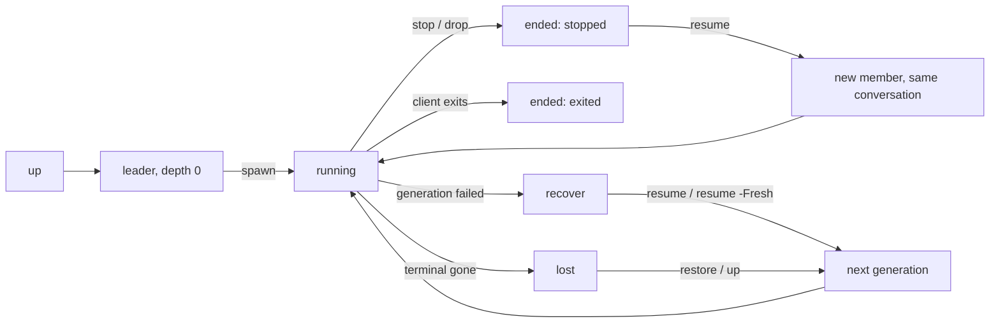

# 团队与生命周期

[English](Teams-and-Lifecycle)

团队是 `up` 在某个文件夹中启动的领导者智能体，加上领导者及其成员启动的成员，以及维持它们的视图、侧边栏和记录。本页是日常指南：启动团队、添加成员、查看成员、停止成员、把成员带回来，以及在视图被关闭、复用器服务器被杀或重启之后如何恢复。每个命令都是 `<plugin>/scripts/mux-agent <verb> …`（Windows 上是 `<plugin>\scripts\mux-agent.cmd <verb> …`），输出一个 JSON 对象；`-Text` 改为输出多行文本。大多数动词由技能替你运行；本页说由你运行的动词，请在你自己的窗格中运行。侧边栏本身见 [侧边栏](Side-Bar-zh-CN)，所有动词见 [使用](Usage-zh-CN)。

## 成员的一生一览



## 用 `up` 启动团队

在 tmux 或 rmux 中你自己的窗格里、团队要工作的文件夹中运行 `up`：

```text
mux-agent up -Client claude
mux-agent up -Client copilot -Name review
mux-agent up -Client claude -- --model opus
```

`up` 在一个 hc 终端中启动领导者，即你指定客户端的一个智能体；为团队打开一个以文件夹命名的视图会话；在视图旁打开侧边栏；并把你的客户端切换过去。领导者的名字是 `leader`。

| 选项 | 作用 |
|---|---|
| `-Client <claude\|copilot>` | 领导者的客户端；必填 |
| `-Name <name>` | 同一文件夹中的第二个团队：团队由文件夹、客户端和名字共同确定 |
| `-- <client flags>` | 之后的每个参数原样交给领导者的客户端，已知参数会在领导者每次重新启动时重放 |
| `-Text` | 输出多行文本而不是 JSON |

在 `--` 之后，会话选择参数 `--resume`、`-r`、`--session-id`、`--continue`、`-c` 和 `--fork-session` 会被丢弃，因为会话由团队选择；未知参数会在任何东西启动之前以 `usage` 拒绝（`src/agents/options.rs`）。

团队的 id 是对状态文件夹、文件夹、客户端和名字计算的 SHA-256 的前 16 个十六进制数字（`src/agents/up/identity.rs`）。因此在同一文件夹中用相同的 `-Client` 和 `-Name` 运行 `up`，指的永远是同一个团队；文件夹的链接或大小写别名算作同一个文件夹。

`up` 的回复包含 `team`、`session` 和 `name`（视图会话）、`leader`（`id`、`name`、`hcAddress`）、`views`（它显示的成员）、`members`，以及 `created`、`replayed` 和 `reentered`。领导者启动之后失败的步骤会在 `viewError`、`layoutError`、`teamRecordError` 或 `releaseError` 中报告；它从不让 `up` 失败。没有成员在运行时，`up` 会打开一个状态窗口而不是视图。

`up` 在智能体或成员窗格中以 `tagged` 拒绝（"a member cannot run up"），在复用器窗格之外以 `endpoint` 拒绝（"up needs tmux or rmux for now"），在 `MUX_AGENTS_STATE` 不是绝对路径时以 `state` 拒绝。

### Shell 快捷命令：`cc` 和 `gg`

对于 bash 4+ 和 zsh 5+，或 PowerShell 7 和 Windows PowerShell 5.1，在配置文件中加一行：

```text
. "<plugin folder>/scripts/shell/mux-agents.sh"     # ~/.bashrc or ~/.zshrc
. "<plugin folder>/scripts/shell/mux-agents.ps1"    # $PROFILE
```

之后 `cc …` 运行 `up -Client claude -- …`，`gg …` 运行 `up -Client copilot -- …`：每个参数原样交给客户端，退出码就是入口的退出码。`cc --model opus` 用该模型启动一个 Claude Code 团队。

- 从插件文件夹本身引入该文件：复制或符号链接的文件找不到入口，此时在那一行之前把 `MUX_AGENTS_HOME` 设为插件文件夹。
- `cc` 会在该 shell 中遮蔽 C 编译器；要用原始客户端，请输入 `claude` 或 `copilot`。
- 在 PowerShell 中，`--%` 会被拒绝，退出码在 `$LASTEXITCODE` 中；请检查它而不是 `$?`。

## 领导者及其成员

领导者位于深度 0。你在它的视图中与它对话；它用技能的 `spawn` 启动成员，成员也可以启动自己的子智能体。每个子智能体比其父级深一层，最深到深度 3（`src/agents/tree.rs` 中的 `MAX_DEPTH`）：深度 4 的子智能体以 `depth` 拒绝。

| 限制 | 值 | 定义位置 | 拒绝 |
|---|---|---|---|
| 深度 | 3 | `MAX_DEPTH`，`src/agents/tree.rs` | `depth` |
| 领导者之外的成员 | 6 | `MAX_MEMBERS`，`src/agents/tree.rs` | `limit` |
| 一个复用器会话中的存活智能体 | 6 | 启动上限 | `cap` |
| 启动预算 | 20 个令牌，每 180 秒多一个 | `src/agents/budget.rs`；会话选项 `@mux-agents-spawn-budget` 和 `@mux-agents-spawn-refill`，1-86400 | `budget`，并说明下一个令牌何时到来 |

一次 `spawn` 和一次成员的 `resume` 各消耗一个预算令牌；被拒绝的请求不消耗。

新成员在哪里打开：`placement` 为整个复用器会话设置它，`tab`（新窗口，默认）、`h` 或 `v`（在调用者旁拆分），单独的 `placement` 显示当前设置。单次 `spawn` 可用 `-Split h`、`-Split v` 或 `-Tab` 覆盖它。在团队中只有你和领导者能设置；成员会得到 `tagged`（"an agent pane cannot choose where agents open"）。

## 查看团队：`list`、`focus`、`peek`

```text
mux-agent list
mux-agent list -All
mux-agent focus <name>
mux-agent focus -Next
mux-agent peek <name> -Lines 120
```

- `list` 显示每个存活成员、它的状态、它正在做什么以及它的未读邮件；需要恢复的成员带有 `needsRecovery` 和 `recoveryReason`。`-All` 增加最新的 10 个已结束成员，每个都带有 `exitCode` 和把它带回来的 `resume` 命令。
- `focus <name>` 把你的客户端切换到该成员的视图，视图被关闭时会在你的窗口中重新打开。`focus -Next` 和 `focus -Prev` 按侧边栏的顺序循环遍历存活成员。
- `peek <name>` 打印该成员实时窗格的最后 60 行（`-Lines` 接受 1-2000），不向其中输入，也不移动焦点。只有团队中的人或该成员的祖先可以查看，且只在团队内部。

## 停止、移除、结束一代

| 命令 | 谁运行 | 结束什么 | 保留什么 |
|---|---|---|---|
| `stop <name>` | 你，或该成员的父级 | 该成员及其启动的每个智能体，自底向上 | 它的记录，以便 `resume` 能把它带回来 |
| `stop <name> -Generation` | 你 | 该成员每个尚未完成的代，从最新开始；丢失的代被释放而不是被杀 | 该成员 |
| `drop <name\|id>` | 你 | 与 `stop` 相同，作用于该成员的确切身份 | 它的保留 shell |

`stop` 在成员的客户端退出后才回复，所以紧接着的 `resume` 不会被拒绝；超过等待时间它仍会回复，并带有 `clientExited: false`。被中断的停止会在下一轮完成。智能体停止不是它启动的智能体会以 `parent` 拒绝。

`stop -Generation` 把无法结束的代报告在 `unresolved` 中，并继续处理其余的代；每一代都已完成时以 `state` 拒绝。要结束整个团队，运行 `stop leader`：之后在该文件夹中的下一次 `up` 会让已停止的团队退役并启动一个新团队，其回复带有 `retired`。

## 把成员带回来：`resume` 与 `recover`

`resume <name>` 以新成员的身份、带着原对话重新启动一个已结束的成员；它的任务永远不会再次发送。在团队之外只有你能恢复；在团队中它消耗一个预算令牌。以下情况会被拒绝：

- `life`：该成员正在运行、已丢失或状态未知（"only an ended member resumes"）；
- `taken`：它已经被恢复过；消息会说出应改为恢复的后继者；
- `name`：同名成员正在运行；
- `leader`：领导者永远不会被恢复；
- `session`：本机上某个进程可能仍持有该对话；消息会说出该进程（pid 和映像）或成员，以及成立的规则；
- `cap`：会话中已有 6 个存活智能体。

当成员的当前代失败时，侧边栏把它标为 `recover` 并附上原因（例如 `recover: exited 1`），失败的代尚未结束时标为 `recover (still running)`，`list` 会设置 `needsRecovery`。把它作为下一代重试：

```text
mux-agent resume <name>
mux-agent resume <name> -Fresh
```

前者恢复失败那一代的对话；`-Fresh` 开始一个新对话。只有你能恢复成员：成员会以 `tagged` 被拒绝。`-Fresh` 只用于恢复：对不需要恢复的成员，它以 `state` 拒绝（"<name> does not need recovery"），在没有团队的会话中以 `team` 拒绝（"no team in this session; run up from the team folder"）。

## 视图被关闭、服务器被杀或重启之后

每个成员都运行在自己的 hc 终端中；你看到的窗格只是它的一个视图。

| 发生了什么 | 你会看到什么 | 怎么做 |
|---|---|---|
| 你关闭了成员的视图 | 成员仍在运行，侧边栏仍列出它 | `focus <name>`、在侧边栏中它的行上按 Enter，或 `up` |
| tmux 或 rmux 服务器被杀 | 成员继续运行；它们的视图动词以 `views` 拒绝（"the team's views are down; run up"） | 启动复用器，然后在同一文件夹中用相同的 `-Client` 和 `-Name` 运行 `up` |
| 重启 | 终端已消失的成员变为丢失 | 同样运行 `up`：它带回视图和侧边栏，并恢复丢失的成员 |
| 领导者被停止 | 团队已停止 | `up` 让它退役并启动一个新团队 |

视图不可用时，成员仍可以 `send`、`read`、`report`、`status`、`stop` 和 `list`；`focus`、`spawn`、`resume`、`sidebar`、`watch` 和 `placement` 会被拒绝，直到你运行 `up`（`src/cli.rs`）。

`restore` 由你在团队会话中的窗格里运行，把每个丢失的成员作为下一代带回来，而不执行 `up` 的其余步骤。`restore` 和 `up` 都不会为新终端打开视图；`focus <name>` 会打开一个。

### 保留 shell

当 `restore` 或 `up` 把丢失的成员带回来时，成员运行在新终端中，它的旧终端作为普通 shell 保持打开，即保留 shell，所以你留在那里的东西不会丢失；它的旧窗格继续显示它。`stop` 和 `restore` 永远不会关闭它。

```text
mux-agent kept
mux-agent kept -Close <address>
```

`kept` 列出它们，带有 `address`、`name` 和 `team`；`-Close <address>` 关闭其中一个，且只在 hc 仍显示它打开并由本团队保留时。关闭的 shell 永远不会回来。在侧边栏中，选中它，按 Enter，然后按 `y`。`kept` 由你运行：成员会以 `tagged` 被拒绝，错误的地址以 `target` 拒绝（"no such kept shell"、"the shell has already finished"、"that shell is not a kept shell of this team"）。

## 从 0.2.x 窗格升级

由 0.2.x 启动且尚未启动客户端的窗格无法在 0.3 下启动：它会打印 "this pane was started by an older mux-agent and cannot launch"。结束它，然后启动一个新智能体：

```text
mux-agent stop <name>
```

在 0.3.0 之前创建、仍占着团队名额的成员会在 `limit` 拒绝中被点名：它的 shell 已丢失或已结束时，`stop <name>` 释放名额；它在运行时则停止它。当文件夹的团队有旧版本的领导者时，`up` 以 `leader` 拒绝（"the team has a leader from an earlier version"）；停止它，然后再次运行 `up`。

## 拒绝与修复

每个拒绝都是一行 JSON，`check` 说明原因；退出码 2 表示拒绝或用法错误，1 表示错误。

| check | 何时 | 修复 |
|---|---|---|
| `tagged` | 在智能体或成员窗格中运行 `up`、`restore`、`drop`、`kept`、`stop -Generation` 或恢复；成员运行 `sidebar` 或 `placement` | 在你自己的窗格中运行，或请领导者来做 |
| `endpoint` | 在 tmux 或 rmux 窗格之外运行 `up` | 启动复用器并在其窗格中运行 |
| `views` | 团队视图不可用时成员运行视图动词 | 运行 `up` |
| `depth` | 深度 3 以下的子智能体 | 让更浅的成员来启动它 |
| `limit` | 领导者之外已有 6 个成员 | `stop` 一个 |
| `budget` | 团队的启动预算已用完 | 等待下一个令牌，或调高 `@mux-agents-spawn-budget` |
| `cap` | 会话中已有 6 个存活智能体 | `stop` 一个 |
| `life` | `resume` 正在运行、已丢失或状态未知的成员 | 先 `stop` 它，或 `restore` 丢失的成员 |
| `taken` | `resume` 已被恢复过的成员 | 恢复消息中点名的后继者 |
| `session` | 某个进程可能仍持有该对话 | 结束消息中点名的进程 |
| `leader` | `resume leader`；在旧版本领导者之上运行 `up` | 用 `up` 启动新团队；停止旧领导者 |
| `state` | 对不需要恢复的成员使用 `-Fresh`；所有代都已完成时 `stop -Generation` | 使用普通的 `resume <name>`；没有需要停止的 |
| `team` | 在没有团队的会话中使用 `-Fresh` | 在团队文件夹中运行 `up` |
| `target` | 本团队没有该名字或 id 的成员；错误的保留 shell 地址 | 用 `list` 或 `kept` 核对 |
| `parent` | 智能体停止不是它启动的智能体 | 请它的父级或一个人来做 |

完整的检查表见 [使用](Usage-zh-CN)。

## 代码位置

- `src/agents/up/`：`up`、团队身份、索引、重放和视图
- `src/agents/tree.rs`：深度与成员限制
- `src/agents/budget.rs`：启动预算
- `src/agents/message.rs` 和 `src/agents/message/`：`stop`、`drop`、`stop -Generation` 与 `peek`
- `src/agents/resume.rs`、`src/agents/resume/recovery.rs`：`resume` 与恢复
- `src/agents/reconcile.rs`：`restore` 命令
- `src/agents/kept.rs`：保留 shell
- `src/launcher.rs`：对 0.2.x 窗格的拒绝
- `scripts/shell/`：`cc` 和 `gg`
