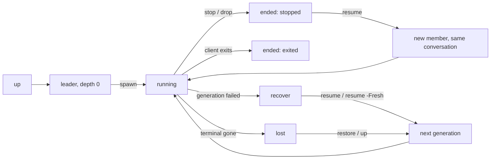

# Teams and Lifecycle

[简体中文](Teams-and-Lifecycle-zh-CN)

A team is a leader agent that `up` starts in a folder, the members the leader and they spawn, and the views, side bar and records that keep them. This page is the day-to-day guide: start a team, add members, look at them, stop them, bring them back, and recover after a closed view, a killed server or a reboot. Every command is `<plugin>/scripts/mux-agent <verb> …` (`<plugin>\scripts\mux-agent.cmd <verb> …` on Windows) and prints one JSON object; `-Text` prints lines instead. The skill runs most verbs for you; the ones this page calls yours you run from your own pane. The bar itself is in [Side Bar](Side-Bar), every verb in [Usage](Usage).

## A member's life at a glance



## Start a team with `up`

Run `up` from your own pane inside tmux or rmux, in the folder the team works in:

```text
mux-agent up -Client claude
mux-agent up -Client copilot -Name review
mux-agent up -Client claude -- --model opus
```

`up` starts the leader, an agent of the client you name, in an hc terminal; opens a view session for the team, named after the folder; opens the side bar beside the view; and switches your client there. The leader's name is `leader`.

| option | what it does |
|---|---|
| `-Client <claude\|copilot>` | the leader's client; required |
| `-Name <name>` | a second team in the same folder: a team is the folder, the client and the name together |
| `-- <client flags>` | every later token goes to the leader's client as given, and known flags are replayed whenever the leader is launched again |
| `-Text` | lines instead of JSON |

After `--`, the session selectors `--resume`, `-r`, `--session-id`, `--continue`, `-c` and `--fork-session` are dropped, since the team chooses the session, and an unknown flag refuses `usage` before anything starts (`src/agents/options.rs`).

The team's id is the first 16 hex digits of a SHA-256 over the state folder, the folder, the client and the name (`src/agents/up/identity.rs`). So `up` with the same `-Client` and `-Name` in the same folder always means the same team; a link or a case alias of the folder counts as the same folder.

`up` answers `team`, `session` and `name` (the view session), `leader` (`id`, `name`, `hcAddress`), `views` (the members it showed), `members`, and `created`, `replayed` and `reentered`. A step that fails after the leader launched is reported in `viewError`, `layoutError`, `teamRecordError` or `releaseError`; it never fails `up`. With no member running, `up` opens a status window instead of a view.

`up` refuses `tagged` from an agent or member pane ("a member cannot run up"), `endpoint` outside a multiplexer pane ("up needs tmux or rmux for now"), and `state` when `MUX_AGENTS_STATE` is not an absolute path.

### Shell shortcuts: `cc` and `gg`

For bash 4+ and zsh 5+, or PowerShell 7 and Windows PowerShell 5.1, add one line to your profile:

```text
. "<plugin folder>/scripts/shell/mux-agents.sh"     # ~/.bashrc or ~/.zshrc
. "<plugin folder>/scripts/shell/mux-agents.ps1"    # $PROFILE
```

`cc …` then runs `up -Client claude -- …` and `gg …` runs `up -Client copilot -- …`: every argument goes to the client as given, and the exit code is the entry's. `cc --model opus` starts a Claude Code team with that model.

- Source the file from the plugin folder itself: a copied or symlinked file finds no entry, so set `MUX_AGENTS_HOME` to the plugin folder before the line.
- `cc` shadows the C compiler in that shell; type `claude` or `copilot` for the bare client.
- In PowerShell, `--%` is refused and the exit code is in `$LASTEXITCODE`; check it rather than `$?`.

## The leader and its members

The leader is depth 0. You talk to it in its view; it spawns members with the skill's `spawn`, and a member may spawn its own children. Each child is one level deeper than its parent, down to depth 3 (`MAX_DEPTH` in `src/agents/tree.rs`): a child at depth 4 refuses `depth`.

| limit | value | set in | refusal |
|---|---|---|---|
| depth | 3 | `MAX_DEPTH`, `src/agents/tree.rs` | `depth` |
| members besides the leader | 6 | `MAX_MEMBERS`, `src/agents/tree.rs` | `limit` |
| live agents in one multiplexer session | 6 | the spawn cap | `cap` |
| spawn budget | 20 tokens, one more every 180 s | `src/agents/budget.rs`; session options `@mux-agents-spawn-budget` and `@mux-agents-spawn-refill`, 1-86400 | `budget`, naming when the next token arrives |

A `spawn` and a member's `resume` each take one budget token; a refused request takes none.

Where a new member opens: `placement` sets it for the multiplexer session, `tab` (a new window, the default), `h` or `v` (a split beside the caller), and `placement` alone shows it. One `spawn` overrides it with `-Split h`, `-Split v` or `-Tab`. In a team only you and the leader set it; a member gets `tagged` ("an agent pane cannot choose where agents open").

## See the team: `list`, `focus`, `peek`

```text
mux-agent list
mux-agent list -All
mux-agent focus <name>
mux-agent focus -Next
mux-agent peek <name> -Lines 120
```

- `list` shows each live member, its state, what it is doing and its unread mail; a member that needs recovery carries `needsRecovery` and `recoveryReason`. `-All` adds the 10 newest ended members, each with its `exitCode` and the `resume` command that brings it back.
- `focus <name>` switches your client to the member's view, reopening it in your window when it was closed. `focus -Next` and `focus -Prev` step through the live members in the bar's order, wrapping.
- `peek <name>` prints the last 60 lines of the member's live pane (`-Lines` takes 1-2000) without typing into it or moving focus. Only a person of the team or an ancestor of the member may peek, and only inside a team.

## Stop, drop, end a generation

| command | who runs it | what ends | what stays |
|---|---|---|---|
| `stop <name>` | you, or the member's parent | the member and every agent it started, bottom-up | its records, so `resume` can bring it back |
| `stop <name> -Generation` | you | every generation of the member that is not done, newest first; a lost one is released, not killed | the member |
| `drop <name\|id>` | you | as `stop`, on the member's exact identity | its kept shells |

`stop` replies once the member's client has exited, so a `resume` right after is not refused; past the wait it still replies, with `clientExited: false`. A stop cut short is finished on the next pass. An agent stopping an agent it did not start is refused `parent`.

`stop -Generation` reports a generation it could not end in `unresolved` and goes on with the rest; when every generation is already done it refuses `state`. To end the whole team, `stop leader`: the next `up` in that folder retires the stopped team and starts a new one, and its reply carries `retired`.

## Bring a member back: `resume` and `recover`

`resume <name>` starts an ended member again with its conversation, as a new member; its task is never sent again. Outside a team only you resume; in a team it takes a budget token. It is refused when:

- `life`: the member is running, lost or unknown ("only an ended member resumes");
- `taken`: it was already resumed; the message names the successor to resume instead;
- `name`: a member of that name is running;
- `leader`: a leader is never resumed;
- `session`: a process on this machine may still hold that conversation; the message names the process (pid and image) or member and the rule that held;
- `cap`: the session already has 6 live agents.

When a member's current generation fails, the bar marks it `recover` with the reason (for example `recover: exited 1`), or `recover (still running)` while the failed generation has not finished, and `list` sets `needsRecovery`. Retry it as its next generation:

```text
mux-agent resume <name>
mux-agent resume <name> -Fresh
```

The first resumes the failed generation's conversation; `-Fresh` starts a new one. Only you recover a member: a member is refused `tagged`. `-Fresh` is for recovery only: on a member that does not need it, it refuses `state` ("<name> does not need recovery"), and in a session with no team, `team` ("no team in this session; run up from the team folder").

## After a closed view, a killed server or a reboot

Each member runs in its own hc terminal; the pane you see is only a view of it.

| what happened | what you see | what to do |
|---|---|---|
| you closed a member's view | the member still runs and the bar still lists it | `focus <name>`, Enter on its row in the bar, or `up` |
| the tmux or rmux server was killed | members keep running; their view verbs refuse `views` ("the team's views are down; run up") | start the multiplexer, then `up` with the same `-Client` and `-Name` in the same folder |
| a reboot | members whose terminals are gone are lost | `up` the same way: it brings back the views and the bar, and restores the lost members |
| the leader was stopped | the team is stopped | `up` retires it and starts a new team |

While the views are down a member can still `send`, `read`, `report`, `status`, `stop` and `list`; `focus`, `spawn`, `resume`, `sidebar`, `watch` and `placement` refuse until you run `up` (`src/cli.rs`).

`restore`, run by you from a pane in the team's session, brings every lost member back as its next generation without the rest of `up`. Neither `restore` nor `up` opens a view of the new terminal; `focus <name>` opens one.

### Kept shells

When `restore` or `up` brings a lost member back, the member runs in a new terminal and its old terminal stays open as a plain shell, a kept shell, so nothing you left there is lost; its old pane keeps showing it. `stop` and `restore` never close one.

```text
mux-agent kept
mux-agent kept -Close <address>
```

`kept` lists them with `address`, `name` and `team`; `-Close <address>` closes one, only while hc still shows it open and kept by this team. A closed shell never comes back. In the bar, select it, press Enter, then `y`. `kept` is yours: a member is refused `tagged`, and a wrong address `target` ("no such kept shell", "the shell has already finished", "that shell is not a kept shell of this team").

## A pane that refuses to launch

A pane that 0.2.x started and that has not launched its client yet refuses to launch: it prints "this pane was started by an older mux-agent and cannot launch". End it, then start a new agent:

```text
mux-agent stop <name>
```

A member whose record has no `lifecycle: 1` and that still holds a team slot is named in a `limit` refusal: `stop <name>` frees the slot when its shell is lost or ended, and stops it when it runs. `up` refuses `leader` ("the team has a leader from an earlier version") when the folder's team leader has no lifecycle record; stop it, then run `up` again.

## Refusals and fixes

Every refusal is one JSON line and `check` names the cause; exit code 2 means a refusal or usage error, 1 an error.

| check | when | fix |
|---|---|---|
| `tagged` | `up`, `restore`, `drop`, `kept`, `stop -Generation` or a recovery from an agent or member pane; a member's `sidebar` or `placement` | run it from your own pane, or ask the leader |
| `endpoint` | `up` outside a tmux or rmux pane | start a multiplexer and run it in a pane |
| `views` | a member's view verb while the team's views are down | run `up` |
| `depth` | a child below depth 3 | let a shallower member spawn it |
| `limit` | 6 members besides the leader | `stop` one |
| `budget` | the team's spawn budget is spent | wait for the next token, or raise `@mux-agents-spawn-budget` |
| `cap` | 6 live agents in the session | `stop` one |
| `life` | `resume` of a member that is running, lost or unknown | `stop` it first, or `restore` a lost one |
| `taken` | `resume` of a member already resumed | resume the successor the message names |
| `session` | a process may still hold the conversation | end the process the message names |
| `leader` | `resume leader`; `up` over a leader with no lifecycle record | start a new team with `up`; stop that leader |
| `state` | `-Fresh` on a member that does not need recovery; `stop -Generation` with every generation done | plain `resume <name>`; nothing to stop |
| `team` | `-Fresh` in a session with no team | `up` from the team folder |
| `target` | no member of this team has that name or id; a wrong kept-shell address | check with `list` or `kept` |
| `parent` | an agent stopping an agent it did not start | ask its parent or a person |

The full table of checks is in [Usage](Usage).

## Where it lives

- `src/agents/up/`: `up`, team identity, the index, replay and views
- `src/agents/tree.rs`: depth and member limits
- `src/agents/budget.rs`: the spawn budget
- `src/agents/message.rs`, `src/agents/message/`: `stop`, `drop`, `stop -Generation`, `peek`
- `src/agents/resume.rs`, `src/agents/resume/recovery.rs`: `resume` and recovery
- `src/agents/reconcile.rs`: `restore`
- `src/agents/kept.rs`: kept shells
- `src/launcher.rs`: the refusal of a pane with a folder-level launch spec
- `scripts/shell/`: `cc` and `gg`
