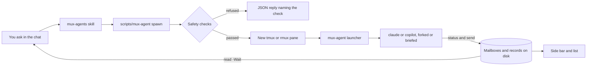

# 使用 mux-agents

[English](Usage)

这里是 [README](https://github.com/D0n9X1n/mux-agents#readme) 背后的细节：如何安装、每个命令做什么、侧边栏、安全检查、升级，以及启动被拒绝时该怎么办。

## 安装

```text
claude plugin marketplace add D0n9X1n/mux-agents
claude plugin install mux-agents@mux-agents
copilot plugin marketplace add D0n9X1n/mux-agents
copilot plugin install mux-agents@mux-agents
```

插件市场安装的是 `dist` 分支，每次发布都会把适用于 macOS、Linux 和 Windows（x86_64 和 aarch64）的预编译 `mux-agent` 二进制文件及其 `SHA256SUMS` 放进去。入口 `scripts/mux-agent`（Windows 上是 `scripts\mux-agent.cmd`）会挑出适合你机器的那一个。

若要在 Claude Code 中改用从源码构建的版本，克隆到技能文件夹并在其中构建：`git clone https://github.com/D0n9X1n/mux-agents ~/.claude/skills/mux-agents`，然后在该文件夹中运行 `cargo build --release`。下一个会话会把它加载为 `mux-agents@skills-dir`，入口会找到 `target/release/mux-agent`。不要同时安装插件市场中的插件：同名的已安装插件市场插件优先。

## 一次启动的流程



## 命令

你很少需要手动输入：技能会替你运行它们。每个命令都是 `<plugin>/scripts/mux-agent <verb> …`（Windows 上是 `<plugin>\scripts\mux-agent.cmd <verb> …`），并输出一个 JSON 对象（`-Text` 改为输出文本行）。代理只通过文件传递自由文本（`-TaskFile`、`-BriefFile`、`-BodyFile`），从不放在命令行上。

| 动词 | 示例 | 作用 |
|---|---|---|
| `spawn` | `spawn -Client copilot -TaskFile task.md -BriefFile brief.md -Split h` | 按会话的 `placement` 启动代理（默认是新窗口）；`-Split h\|v` 或 `-Tab` 只决定这一次；`-Model <model>` 指定它的模型（否则用客户端的默认模型） |
| `placement` | `placement h`，`placement tab` | 本会话之后 `spawn` 在哪里打开代理：`tab`（新窗口，默认）、`h` 或 `v`（在你旁边分屏） |
| `list` | `list -All` | 存活的代理、各自在做什么、未读消息；`-All` 加上已结束的 |
| `status` | `status -BodyFile step.txt` | 代理报告自己当前在做什么 |
| `send` | `send claude-1 -BodyFile note.md`，`send parent -BodyFile result.md` | 给某个代理或你的父代理发消息 |
| `read` | `read -Wait 600`，`read claude-1 -Lines 40` | 等待你的消息，或读取某个代理的窗格 |
| `focus` | `focus claude-1` | 让多路复用器切换到某个代理的窗格 |
| `stop` | `stop claude-1` | 关闭代理的窗格及其进程 |
| `sidebar` | `sidebar`，`sidebar -Close` | 重新打开侧边栏分屏，或在本会话剩余时间内关闭它 |

退出码 0 表示成功，1 表示错误，2 表示拒绝或用法错误；失败时由 `check` 指明原因。

每个会话选一次代理在哪里打开：`placement h`（或 `v`）让之后每次 `spawn` 都拆分你的窗格，`placement tab` 改回新窗口，单独的 `placement` 显示当前选择。它保存在多路复用器会话上，随会话结束，不写入磁盘；单次 `spawn` 上的 `-Split h|v` 或 `-Tab` 会覆盖它。

## 侧边栏

在 Claude Code 中，第一次成功 `spawn` 后（或用 `/mux-agents-pane`）会在聊天旁打开 `Agents` 窗格，每 3 秒刷新一次。在任何客户端中，第一次成功 `spawn` 还会在你旁边打开一个 42 列宽的分屏，每 2 秒重绘一次；之后的启动复用它，`sidebar -Close` 在本会话剩余时间内关闭它，`sidebar` 重新打开它：

```text
mux-agents · 2 running
● claude-1  claude  4m
  running the parser tests (14/20 pass)
● copilot-1  copilot  1m
  reviewing src/spawn.rs
○ claude-2  exited 0
```

“正在做的事”是代理最近用 `status` 报告的内容，否则是它最后一条消息的第一行，否则是它的任务。

在标签页模式下，侧边栏留在你启动代理的窗口里，而不在每个代理的窗口里。`sidebar -Close` 只关闭这个多路复用器侧边栏；Claude Code 的 `Agents` 窗格与它无关。

## 安全检查

代理启动时关闭了权限提示，所以 mux-agents 从不给代理超出其调用者已有的权限。除非满足以下条件，`spawn` 会被拒绝并指明检查项：

- `sandbox`：调用者不在沙箱中。
- `policy`：调用者已经以绕过权限或全部允许的方式运行。
- `flags`：从代理到窗格的每个客户端命令行都只使用允许列表中的参数。
- `directory`：能确认调用者的工作目录；代理在该目录中启动。
- `tagged`：调用者本身不是代理；子代理不能再启动代理。
- `cap`：会话中存活的代理少于 6 个。

子代理以 `claude --dangerously-skip-permissions --effort high` 或 `copilot --no-sandbox --allow-all` 运行，位于调用者的目录中。

## 要求

- macOS、Linux 或 Windows，x86_64 或 aarch64；不需要 PowerShell 或 .NET。
- macOS、Linux 或 Windows 上的 rmux 0.10 或更高版本，或 macOS 或 Linux 上的 tmux 3.2 或更高版本，且调用者位于窗格中。
- `PATH` 上有 Claude Code 或 GitHub Copilot CLI（`claude` 或 `copilot`；Windows 上为 `.exe`）。

在 rmux 中 `RMUX` 和 `TMUX` 可能都已设置；以 `RMUX` 为准。

## 升级

先关闭正在运行的部分，再更新，然后重启：

1. 用 `sidebar -Close` 关闭侧边栏。
2. `stop` 每个代理（`list` 会列出它们）。
3. 在你使用的每个客户端中用一行命令更新插件：

```text
claude plugin marketplace update mux-agents && claude plugin update mux-agents@mux-agents
copilot plugin marketplace update mux-agents && copilot plugin update mux-agents@mux-agents
```

先刷新插件市场：Claude Code 的插件更新读取的是添加插件市场时缓存的目录，单独运行时可能把旧版本报告为最新。

4. 重启你的 Claude Code 和 Copilot CLI 会话，然后重新启动代理并打开侧边栏。

原因：每个代理窗格和侧边栏都按启动时的绝对路径运行二进制文件，所以重启前会一直使用旧版本。从 0.1 升级时顺序最重要：0.1 的命名互斥体和 0.2 的锁文件不会互相串行，所以 0.1 的窗格和 0.2 的命令绝不能同时运行。在 0.2.x 内，状态文件夹以及记录、邮件和锁文件的格式保持不变。

对于像本插件这样的第三方插件市场，Claude Code 默认关闭后台自动更新。要开启它，打开 `/plugin`，进入 **Marketplaces**，选择 `mux-agents`，再选择 **Enable auto-update**。之后 Claude Code 会在会话中你发出第一条消息后的十分钟内刷新插件市场并更新磁盘上的插件；已在运行的窗格在你重启它们之前保留原来的二进制文件。

## 故障排查

每次拒绝都是一行 JSON，由 `check` 指明原因：

| 检查 | 含义 | 处理办法 |
|---|---|---|
| `entry` | 没有适用于此操作系统和架构的 `mux-agent` 二进制文件 | 从插件市场重新安装插件，或按上文从源码构建 |
| `endpoint` | 不在多路复用器窗格中，或 tmux 低于 3.2、rmux 低于 0.10 | 在 tmux 3.2+ 或 rmux 0.10+ 中启动客户端 |
| `sandbox` | 调用者在沙箱中运行（`SANDBOX_RUNTIME=1`、macOS 沙箱、Linux `NoNewPrivs`、受限的 Windows 令牌） | 在沙箱外运行客户端 |
| `policy` | 调用者没有以绕过权限或全部允许的方式运行；对 Claude Code，`reason` 指明哪一半未通过：`transcript: no session id`、`transcript: not found`、`transcript: no mode`、`transcript: other mode`、`screen: unreadable`、`screen: no mode line` 或 `screen: other mode` | Claude Code：绕过权限（`--dangerously-skip-permissions` 或 Shift+Tab），并让页脚标记 `⏵⏵ bypass permissions on` 出现在窗格的最后 8 行内；Copilot CLI：`--allow-all` |
| `cap` | 此会话中已有 6 个存活代理 | `stop` 其中一个 |
| `tagged` | 代理尝试启动代理、打开侧边栏或设置 `placement` | 只有顶层聊天可以启动代理 |

## 工作原理

- `spawn` 打开一个分离的窗口（或按 `-Split h|v` 或会话的 `placement` 拆分调用者的窗格），按二进制文件的绝对路径运行 `<binary> launcher <spec.json>`，用 `@agent-*` 选项标记窗格，并在状态文件夹中记录代理：若设置了 `MUX_AGENTS_STATE` 则用它，否则 Windows 上为 `%LOCALAPPDATA%\mux-agents\state`，Linux 和 macOS 上为 `$XDG_STATE_HOME/mux-agents/state` 或 `~/.local/state/mux-agents/state`。
- 代理提交后，`spawn` 在侧边栏自己的锁下找到或打开会话的侧边栏；那里的失败以 `sidebarError` 报告，从不让启动失败。
- 消息进入每个窗格的邮箱，从不作为按键输入。`read -Wait` 每条消息只返回一次。每个子代理恰好向父代理发送一条退出通知：`exited`、`stopped` 或 `lost`。
- 锁按用户划分：Unix 上是 `~/.local/state/mux-agents/locks` 下的文件；Windows 上是命名互斥体 `Local\MuxAgents-<hex>`。这修复了 .NET 命名互斥体公告 [GHSA-2j93-m82w-73j2](https://github.com/advisories/GHSA-2j93-m82w-73j2)，它曾影响 0.1 在 Linux 和 macOS 上的版本。
- 有六个存活代理时，`list` 平均约 23 ms（`scripts/dev/bench-list.sh`，Apple 芯片 Mac 上的 tmux 3.8）。
