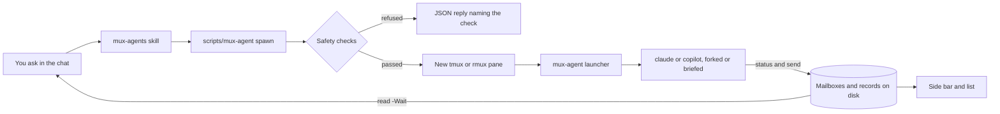

# 使用 mux-agents

[English](Usage)

这里是 [README](https://github.com/D0n9X1n/mux-agents#readme) 背后的细节：如何安装、每个命令做什么、侧边栏、安全检查、升级，以及启动被拒绝时该怎么办。

## 安装

```text
claude plugin marketplace add D0n9X1n/mux-agents
claude plugin install mux-agents@mux-agents
copilot plugin marketplace add D0n9X1n/mux-agents
copilot plugin install mux-agents@mux-agents
```

插件市场安装的是 `dist` 分支，每次发布都会把适用于 macOS、Linux 和 Windows（x86_64 和 aarch64）的预编译 `mux-agent` 二进制文件及其 `SHA256SUMS` 放进去。入口 `scripts/mux-agent`（Windows 上是 `scripts\mux-agent.cmd`）会挑出适合你机器的那一个。

若要在 Claude Code 中改用从源码构建的版本，克隆到技能文件夹并在其中构建：`git clone https://github.com/D0n9X1n/mux-agents ~/.claude/skills/mux-agents`，然后在该文件夹中运行 `cargo build --release`。下一个会话会把它加载为 `mux-agents@skills-dir`，入口会找到 `target/release/mux-agent`。不要同时安装插件市场中的插件：同名的已安装插件市场插件优先。

## 一次启动的流程



## 命令

你很少需要手动输入：技能会替你运行它们。每个命令都是 `<plugin>/scripts/mux-agent <verb> …`（Windows 上是 `<plugin>\scripts\mux-agent.cmd <verb> …`），并输出一个 JSON 对象（`-Text` 改为输出文本行）。代理只通过文件传递自由文本（`-TaskFile`、`-BriefFile`、`-BodyFile`），从不放在命令行上。

| 动词 | 示例 | 作用 |
|---|---|---|
| `spawn` | `spawn -Client copilot -Name add-tests -TaskFile task.md -BriefFile brief.md -Split h` | 按会话的 `placement` 启动代理（默认是新窗口）；`-Split h\|v` 或 `-Tab` 只决定这一次；`-Model <model>` 指定它的模型（否则用客户端的默认模型） |
| `placement` | `placement h`，`placement tab` | 本会话之后 `spawn` 在哪里打开代理：`tab`（新窗口，默认）、`h` 或 `v`（在你旁边分屏） |
| `list` | `list -All` | 存活的代理、各自在做什么、未读消息；`-All` 加上已结束的，各带其 `exitCode` |
| `status` | `status -BodyFile step.txt` | 代理报告自己当前在做什么 |
| `send` | `send claude-1 -BodyFile note.md`，`send parent -BodyFile result.md` | 给某个代理或你的父代理发消息 |
| `read` | `read -Wait 600`，`read claude-1 -Lines 40` | 等待你的消息，或读取某个代理的窗格 |
| `focus` | `focus claude-1`、`focus -Next` | 让多路复用器切换到某个代理的窗格；`-Next` / `-Prev` 按侧边栏的顺序逐个切换 |
| `stop` | `stop claude-1` | 关闭代理的窗格及其进程；已结束的代理回答 `ok` 并带 `already`（`exited`、`stopped` 或 `lost`） |
| `sidebar` | `sidebar`，`sidebar -Close` | 重新打开侧边栏分屏，或在本会话剩余时间内关闭它 |
| `version` | `version`，`--version` | 二进制文件的版本，用来分辨窗格运行的是哪一个；在多路复用器之外也能用 |

退出码 0 表示成功，1 表示错误，2 表示拒绝或用法错误；失败时由 `check` 指明原因。

每个会话选一次代理在哪里打开：`placement h`（或 `v`）让之后每次 `spawn` 都拆分你的窗格，`placement tab` 改回新窗口，单独的 `placement` 显示当前选择。它保存在多路复用器会话上，随会话结束，不写入磁盘；单次 `spawn` 上的 `-Split h|v` 或 `-Tab` 会覆盖它。

每个代理的名字说明它做什么，也是它的标签页名或窗格标题。技能总是传 `-Name <short-kebab-name>`（1-24 个小写字母、数字或连字符，以字母开头；`parent`、`root` 和 `all` 是保留名）。不传 `-Name` 时，名字取自任务的前几个词："Please add a subtract function to calc.py" 变成 `add-subtract-function`，没有可用词的任务得到 `claude-1` 或 `copilot-1`。名字在其会话中永不复用，即使代理已结束：被占用的派生名加上 `-2`、`-3`……（在词边界截断以保持在 24 以内），被占用的 `-Name` 会被拒绝，并给出一个可用的名字。即使代理的客户端自己设置标题，窗格标题仍保持为该名字；tmux 3.2a 除外，它无法阻止客户端改写窗格标题（标签页名仍然保持）。

## 侧边栏

在 Claude Code 中，第一次成功 `spawn` 后（或用 `/mux-agents-pane`）会在聊天旁打开 `Agents` 窗格，每 3 秒刷新一次。在任何客户端中，第一次成功 `spawn` 还会在你的窗口右边缘打开一个占满整个高度、宽为窗口 20%（至少 40 列）的分屏，每 2 秒重绘一次；之后的启动复用它，`sidebar -Close` 在本会话剩余时间内关闭它，`sidebar` 重新打开它：

```text
 mux-agents        1 need you / 1 done

 Needs you · 1
 ! add-subtract [sonnet]            12s
   Adding subtract(a, b) under add i...

 Done · 1
 ✦ test-calc  ✉ 1                   30s
   Done: test_calc.py passed, exit 0

 Working · 1
 ◉ fix-ci-flake                     11m
   Re-running tests/test_watch.rs wi...

 ended -------------------------------
 ✓ docs-usage                 done  18m
 ✗ bump-deps              exit 101  25m
 - spike-rmux              stopped   1h
   +4 more  (list -All)
```

“正在做的事”是代理最近用 `status` 报告的内容，否则是它最后一条消息的第一行，否则是它的任务。

每个运行中的代理显示它的状态、用自己颜色显示的名字、选定模型时的 `[model]`，以及其父窗格还有 N 条来自它的未读消息时的 `✉ N`。状态沿用 herdr 的说法，由代理自己的客户端报告（绝不从它的屏幕猜测），并按谁需要你排序：`! needs you`（粗体黄色）表示它在向你提问；`✦ done`（粗体青色）表示它在你没看着时结束了这一轮，直到你看过它的窗格并离开前都保持 done；`◉ working`（绿色）表示正在执行一轮；`◌ idle`（整行变暗）表示无事可做。同一状态中，最近变化的排在前面，显示的时间是从那次变化算起。Claude Code 通过插件的钩子模块报告，Copilot CLI 通过插件的 `hooks.json` 报告（提交提示时为 working，提问时为 blocked 直到被回答，停止时为 idle），macOS 和 Linux 上用 `bash`，Windows 上用经 `scripts\mux-agent.cmd` 的通用 `command`；`report -Quiet` 不输出任何内容且总是成功，因此钩子不需要 shell 来消除输出。客户端不报告状态的代理（较旧的客户端）显示为 `◉ working`，在 `read -Wait` 中等待时显示为 `◌ idle`。标题像 herdr 统计各分组那样统计运行中的代理：`N need you`（黄色）、`N done`、`N working`、`N idle`，为 0 的不显示（没有运行中的代理时显示 `0 running`），然后是 `M ended`；侧边栏较窄时从末尾去掉。之后是已结束的代理，最新的 3 个非 `lost` 结束的代理（`lost` 的代理计入数量但不绘制）：`✓ done`（以 0 退出）、`✗ exit N`（红色）、`- stopped`（黄色）；`+K more` 统计其余的。`list -All` 列出最新的 10 个已结束代理，所以只有当所有已结束代理都在其中时，侧边栏才写 `+K more  (list -All)`，否则写 `+K more ended`。启动代理时会选取本会话运行中代理用得最少的名字颜色（蓝、品红、亮蓝、亮品红；绝不与状态颜色相同），`list -Text` 也用同样的颜色显示名字。

当运行中的代理处于多种状态时，每种状态的第一个代理上方都有 herdr 的分组标题及其数量（`Needs you · 1`），并且像 herdr 的优先级视图那样，标题下的各行只显示字形和时间，让名字有更多空间；侧边栏较矮时，紧接空行之后去掉这些标题，状态文字随之恢复。所有运行中的代理处于同一状态时没有标题，每行显示自己的状态。

当某个代理开始需要你，或者结束了，而你没有在看它的窗格时，侧边栏会在本会话的客户端上显示一条 tmux 消息，持续 5 秒，例如 `mux-agents: w2 needs you`，相当于 herdr 的提示。多路复用器选项 `@mux-agents-alerts` 控制它：`off` 不发送，`blocked` 只提示需要你的代理，未设置或其他值两者都提示（例如 `tmux set -g @mux-agents-alerts blocked`）。第一次看到某个代理时从不提示，所以打开侧边栏是安静的。

侧边栏每次重绘都按窗格的实际大小排版，绝不换行：过长的文字用 `...` 截断；窗格太矮时先去掉空行，再去掉已结束的行，然后去掉最早代理的“正在做的事”行和整行；标题始终保留。颜色依次遵循 `NO_COLOR`（关）、`FORCE_COLOR` 或 `CLICOLOR_FORCE`（开）、然后 `TERM=dumb`（关）；`MUX_AGENTS_ASCII=1` 用 `! @ * o + x m -` 代替符号。每次重绘都在原处改写各行（不整屏清除），所以侧边栏不会闪烁；在 `TERM=dumb` 下则输出普通的帧。

在标签页模式下，侧边栏留在你启动代理的窗口里，而不在每个代理的窗口里。`sidebar -Close` 只关闭这个多路复用器侧边栏；Claude Code 的 `Agents` 窗格与它无关。该窗格绘制各行的方式与侧边栏相同，包括 `MUX_AGENTS_ASCII=1`：`! needs you`、`✦ done`、`◉ working`、`◌ idle`、`✓ done`、`✗ exit N`、`- stopped` 和 `✉ N`；不报告状态、在 `read -Wait` 中等待的代理在那里显示为 `◉ working`，因为只有侧边栏读取这一点。

侧边栏始终停在右边缘、占满整个高度：拆分、布局变化、`swap-pane` 或 `rotate-window` 移动了它时，下一次重绘会把它移回去，且不改变你的焦点。它的宽度随窗口宽度变化；你拖出来的宽度会保留到窗口大小或宽度选项改变为止。两个多路复用器选项决定宽度：`@mux-agents-sidebar-percent`（1-100，默认 20）和 `@mux-agents-sidebar-min`（列数，1-9999，默认 40）；侧边栏取两者中较大的值。可在 `~/.tmux.conf` 中用 `set -g` 设置，也可按会话、窗口或窗格设置（例如 `tmux set -g @mux-agents-sidebar-percent 10`）；改动在下一次重绘时生效，不是范围内整数的值使用其默认值。有窗格处于放大（zoom）状态时，侧边栏不做任何调整，所以绝不会取消你的放大。如果连续 3 次移回失败，它会停止尝试并显示 `layout: repair paused`，直到布局改变或过了一分钟。

侧边栏是 `sidebar` 在其中启动的那个进程，而不是它的 `@agent-role sidebar` 标签，所以标签被移动后（rmux 的 `rotate-window` 会把标签留在原处）也绝不会把你的窗格当作侧边栏。带有该标签但不是那个进程的窗格绝不会被关闭：`sidebar`、`sidebar -Close` 和 spawn 都会拒绝并指出它。如果它是旧的侧边栏（例如由 0.2.1 打开、`sidebar -Close` 无法证明的那种），用 `kill-pane -t <pane>` 关闭它；如果它是你自己的窗格，用 `set-option -p -u -t <pane> @agent-role` 清除标签。你手动运行的 `mux-agent watch` 会绘制面板，也像侧边栏一样接收点击和按键，但只有侧边栏会维持布局。

在侧边栏中点击代理的名字行，即可切换到它的窗口和窗格。只有开启 `mouse on`（`set -g mouse on`）时点击才会到达侧边栏；开启后用 Shift 拖动来选择文字。`MUX_AGENTS_ASCII=1` 时点击无效。调整侧边栏大小期间的点击不起作用，侧边栏会重绘。侧边栏窗格处于活动状态时，`j`/`k` 或方向键选择一个运行中的代理，Enter 切换到它，`n`/`N` 切换到下一个或上一个代理，`p` 查看一个代理，Esc 取消选择；切换失败时显示 `focus failed: <name>`。按键或按下左键会让侧边栏立即重绘，在侧边栏中键入 Ctrl-C 会结束它（`interrupted`）；每次退出时它都会恢复终端。`TERM=dumb` 时，侧边栏只绘制：它不接收点击或按键。在任何窗格中（你的或代理的），`focus -Next` 和 `focus -Prev` 都按侧边栏的顺序（需要你的排在最前）在运行中的代理之间逐个切换，就像 herdr 的下一个和上一个代理快捷键，并会循环；在不属于代理的窗格中，`-Next` 切换到最紧急的代理。在侧边栏中，`n` 和 `N` 起同样的作用，`p` 像 herdr 的 peek 那样查看选中的代理（未选中时为第一个）：在你的窗口上方弹出一个窗口，从末尾显示它最近的 200 行（以 `-- peek: <name> --` 结尾），而不切换过去（`q` 关闭；需要 tmux 3.2 或更高版本、rmux 0.10 或更高版本）。弹出窗口打开时即删除它的文本副本；未能打开的弹出窗口会把副本留在状态目录中。查看需要状态目录路径只含普通字符（字母、数字、空格和 `_ . - / : + , @ = ~`）；含有其他字符时显示 `focus failed: <name>`。在 `~/.tmux.conf` 中绑定的快捷键可以从任何地方把这些键发给侧边栏，例如 `bind ] run-shell 'tmux send-keys -t "$(tmux show -qv @mux-agents-sidebar-id | cut -d" " -f1)" n'`；`focus -Next` 本身不能绑定，因为 `run-shell` 不在任何窗格之下，调用者检查会拒绝它。在 Windows 上，侧边栏在 rmux 0.10 或更高版本中通过控制台接收点击和按键，与 macOS 和 Linux 相同。代理状态或模型中的 `◉`、`◌` 和 `✦` 显示为 `•`。

## 安全检查

代理启动时关闭了权限提示，所以 mux-agents 从不给代理超出其调用者已有的权限。除非满足以下条件，`spawn` 会被拒绝并指明检查项：

- `sandbox`：调用者不在沙箱中。
- `policy`：调用者已经以绕过权限或全部允许的方式运行。
- `flags`：从代理到窗格的每个客户端命令行都只使用允许列表中的参数。
- `directory`：能确认调用者的工作目录；代理在该目录中启动。
- `tagged`：调用者本身不是代理；子代理不能再启动代理。
- `cap`：会话中存活的代理少于 6 个。

子代理以 `claude --dangerously-skip-permissions --effort high` 或 `copilot --no-sandbox --allow-all` 运行，位于调用者的目录中。

## 要求

- macOS、Linux 或 Windows，x86_64 或 aarch64；不需要 PowerShell 或 .NET。
- macOS、Linux 或 Windows 上的 rmux 0.10 或更高版本，或 macOS 或 Linux 上的 tmux 3.2 或更高版本，且调用者位于窗格中。
- `PATH` 上有 Claude Code 或 GitHub Copilot CLI（`claude` 或 `copilot`；Windows 上为 `.exe`）。
- 仅限终端 CLI（在 tmux 或 rmux 中运行的 Claude Code 或 Copilot CLI）；桌面应用和其他非终端界面会被跳过：没有 Agents 窗格，技能也会说明不要使用它。
- 不在 herdr 中：在 tmux 和 rmux 之外的 herdr 终端里（设置了 `HC_TERMINAL_ID`）每个命令都以 `herdr` 拒绝，钩子不报告任何状态，Agents 窗格也不会打开；在那里请使用 herdr 自己的技能（`hc --skill`）。在 tmux 或 rmux 中，即使它是从 herdr 终端启动的，窗格也属于多路复用器，mux-agents 照常工作。此时 herdr 也能看到整个团队：每次 `spawn` 还会启动一个中继，即 herdr 终端下一个运行 `mux-agent relay` 的隐藏 hc 终端，herdr 因此把该代理列为那个终端的子代理，显示它的状态（working、needs you、done、idle）和当前步骤，spawn 的回复也会给出它（`herdr: t7`，或带原因的 `herdrError`）。在中继里输入的一行（herdr 的输入框，或 `hc send t7 "…"`）会以 `herdr` 的名义进入该代理的邮箱；结束中继只会结束中继，不会结束代理（用 `stop <name>`）。中继随代理一同结束。它需要 `PATH` 上有 `hc`；在你的环境里设置 `MUX_AGENTS_HERDR=off` 可关闭它。代理不会继承 `HC_TERMINAL_ID`。

在 rmux 中 `RMUX` 和 `TMUX` 可能都已设置；以 `RMUX` 为准。

## 升级

先关闭正在运行的部分，再更新，然后重启：

1. 用 `sidebar -Close` 关闭侧边栏。
2. `stop` 每个代理（`list` 会列出它们）。
3. 在你使用的每个客户端中用一行命令更新插件：

```text
claude plugin marketplace update mux-agents && claude plugin update mux-agents@mux-agents
copilot plugin marketplace update mux-agents && copilot plugin update mux-agents@mux-agents
```

先刷新插件市场：Claude Code 的插件更新读取的是添加插件市场时缓存的目录，单独运行时可能把旧版本报告为最新。

4. 重启你的 Claude Code 和 Copilot CLI 会话，然后重新启动代理并打开侧边栏。

原因：每个代理窗格和侧边栏都按启动时的绝对路径运行二进制文件，所以重启前会一直使用旧版本。从 0.1 升级时顺序最重要：0.1 的命名互斥体和 0.2 的锁文件不会互相串行，所以 0.1 的窗格和 0.2 的命令绝不能同时运行。在 0.2.x 内，状态文件夹以及记录、邮件和锁文件的格式保持不变。

对于像本插件这样的第三方插件市场，Claude Code 默认关闭后台自动更新。要开启它，打开 `/plugin`，进入 **Marketplaces**，选择 `mux-agents`，再选择 **Enable auto-update**。之后 Claude Code 会在会话中你发出第一条消息后的十分钟内刷新插件市场并更新磁盘上的插件；已在运行的窗格在你重启它们之前保留原来的二进制文件。

## 故障排查

每次拒绝都是一行 JSON，由 `check` 指明原因：

| 检查 | 含义 | 处理办法 |
|---|---|---|
| `entry` | 没有适用于此操作系统和架构的 `mux-agent` 二进制文件，或（`spawn` 时）二进制文件路径含有字母、数字、空格和 `_\/:.()-` 以外的字符 | 从插件市场重新安装插件，或按上文从源码构建；若是路径问题，把插件或二进制文件移到路径只含这些字符的文件夹 |
| `endpoint` | 不在多路复用器窗格中、tmux 低于 3.2 或 rmux 低于 0.10、服务器没有应答，或服务器在此窗格启动后重启过 | 在 tmux 3.2+ 或 rmux 0.10+ 中启动客户端；服务器重启后，在新窗格中重新启动客户端 |
| `sandbox` | 调用者在沙箱中运行（`SANDBOX_RUNTIME=1`、macOS 沙箱、Linux `NoNewPrivs`、受限的 Windows 令牌） | 在沙箱外运行客户端 |
| `policy` | 调用者没有以绕过权限或全部允许的方式运行；对 Claude Code，`reason` 指明哪一半未通过：`transcript: no session id`、`transcript: not found`、`transcript: no mode`、`transcript: other mode`、`screen: unreadable`、`screen: no mode line` 或 `screen: other mode` | Claude Code：绕过权限（`--dangerously-skip-permissions` 或 Shift+Tab），并让页脚标记 `⏵⏵ bypass permissions on` 出现在窗格的最后 8 行内；Copilot CLI：`--allow-all` |
| `cap` | 此会话中已有 6 个存活代理 | `stop` 其中一个 |
| `tagged` | 代理尝试启动代理、打开侧边栏或设置 `placement` | 只有顶层聊天可以启动代理 |
| `flags` | 从代理到窗格之间的某个 `claude` 或 `copilot` 进程带有允许列表之外的标志，或其命令行无法读取 | 只用允许列表中的标志重新启动客户端 |
| `directory` | 无法从调用者的会话或进程确认其启动目录，或该目录不是一个存在的绝对路径文件夹 | 在一个存在的文件夹中启动客户端，并留在该文件夹 |
| `name` | `-Name` 不是以字母开头的 1-24 个小写字母、数字或连字符，是 `parent`、`root` 或 `all`，或在此会话中已被占用；或某个代理记录无法读取，因而无法检查名字 | 使用消息建议的空闲名字或另选一个；记录无法读取时，检查状态文件夹中该代理的文件夹 |
| `brief` | 代理调用者启动的子代理从简报而不是对话分叉开始（`-NoFork`、另一种客户端、没有会话 id、非交互式的 Claude Code，或 Copilot CLI 会话复制失败），却没有传 `-BriefFile` | 传入 `-BriefFile`，写明子代理需要的上下文 |
| `target` | 没有存活代理叫这个名字、接收者不是此会话的存活窗格、代理的窗格已不再运行它自己的启动命令，或 `status` 来自一个不是代理的窗格 | 用 `list` 核对名字；只有代理报告 `status` |
| `parent` | 从不是代理的窗格执行 `send parent`、代理停止不是它启动的代理，或代理窗格的记录缺失或无法证明在此运行 | 按名字发送给代理；只有父代理或人类可以停止代理 |
| `caller` | `mux-agent` 与其上方最近的客户端（没有客户端时为窗格）之间运行着 shell 以外的进程，或该客户端进程的启动时间无法读取或在检查期间发生了变化 | 从客户端自己的 shell 命令（或窗格的 shell）运行 `mux-agent`，不要经由其他程序 |
| `lock` | 另一个命令持有代理锁达 15 秒 | 重试；若反复出现，查找卡住的 `mux-agent` 进程 |
| `state` | 状态文件夹或锁文件夹不安全或无法读取：是链接、是文件、属于其他用户、权限不是 700、有扩展 ACL、与其他用户共享，或其上层文件夹可被他人写入；或 `HOME`、`MUX_AGENTS_STATE` 不是绝对路径 | 修正消息指出的文件夹或变量 |
| `launch` | 代理没有启动：其窗格无法创建，或窗格已创建但客户端没有启动；消息会说明是否关闭了窗格 | 先确认多路复用器能在那里打开窗口或分屏、客户端能在该文件夹中手动启动，关闭留下的窗格，再重新启动代理 |
| `rmux` | 一次 tmux 或 rmux 调用失败，或回答不符合格式 | 重试；确认 tmux 或 rmux 服务器仍在运行 |
| `sidebar` | 某个窗格带有侧边栏标签却无法证明是侧边栏、新侧边栏没有启动本插件的 watch，或侧边栏无法关闭 | 按消息处理：用 `kill-pane -t <pane>` 关闭它指出的窗格，或清除其标签 |
| `usage` | 动词、标志或值有误；任务或状态为空或过长；消息大于 64 KB；代理在命令行上传自由文本；任务、简报或正文文件无法读取、过大或不是 UTF-8；在终端之外运行 `watch` | 按消息中的用法行改正；代理用文件传自由文本 |
| `internal` | 意外错误：I/O 错误（只显示其类型）、状态文件不是 JSON 或大于 1 MB，或程序 panic | 重试；若反复出现，附上回复提交 issue |

## 工作原理

- `spawn` 打开一个分离的窗口（或按 `-Split h|v` 或会话的 `placement` 拆分调用者的窗格），按二进制文件的绝对路径运行 `<binary> launcher <spec.json>`，用 `@agent-*` 选项标记窗格，并在状态文件夹中记录代理：若设置了 `MUX_AGENTS_STATE` 则用它，否则 Windows 上为 `%LOCALAPPDATA%\mux-agents\state`，Linux 和 macOS 上为 `$XDG_STATE_HOME/mux-agents/state` 或 `~/.local/state/mux-agents/state`。
- 代理提交后，`spawn` 在侧边栏自己的锁下找到或打开会话的侧边栏；那里的失败以 `sidebarError` 报告，从不让启动失败。
- 消息进入每个窗格的邮箱，从不作为按键输入。`read -Wait` 每条消息只返回一次。就像 herdr 把消息作为接收方的下一条输入送达，发往 Claude Code 会话的 `send` 也会立即唤醒它：发送方的 Claude Code 钩子向该会话传递一行 `<mux-agents from="w2">You have a new mux-agents message from w2. Run your read command to get it.</mux-agents>`，从不传递消息本身（邮箱仍是消息所在）。只有由普通字词组成的单独一条 `send` 命令（不含变量、引号技巧或其他命令）才会唤醒对方。无法到达的会话、Copilot CLI 接收方或其他任何 `send`，仍通过 `read -Wait` 收到邮件。每个子代理恰好向父代理发送一条退出通知：`exited`、`stopped` 或 `lost`。
- 标签页或窗格已不存在的代理，会在下一次 `list`、`read`、`spawn`、`stop` 或侧边栏刷新时被关闭：一条 `lost` 通知（或带退出码的 `exited`），从 `list` 和侧边栏中消失，在 `list -All` 中保留并带 `closedBy: "pane"`。代理结束后被 `remain-on-exit` 留下的窗格也会被关闭，但仅当它仍在运行该代理启动的那条命令时。
- 代理按其窗格及该窗格启动的那条命令查找，从不按其 `@agent-*` 标签查找，因此 rmux 的 `rotate-window`（它把标签留在原处）无法让 `send`、`read`、`focus` 或 `stop` 作用到错误的窗格：已不再是其代理自身启动的窗格会以 `target` 拒绝。
- 锁按用户划分：Unix 上是 `~/.local/state/mux-agents/locks` 下的文件；Windows 上是命名互斥体 `Local\MuxAgents-<hex>`。这修复了 .NET 命名互斥体公告 [GHSA-2j93-m82w-73j2](https://github.com/advisories/GHSA-2j93-m82w-73j2)，它曾影响 0.1 在 Linux 和 macOS 上的版本。
- 有六个存活代理时，`list` 平均约 23 ms（`scripts/dev/bench-list.sh`，Apple 芯片 Mac 上的 tmux 3.8）。
