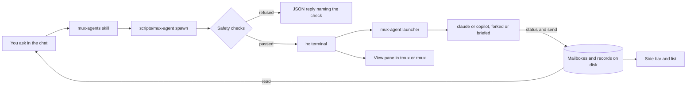

# 使用 mux-agents

[English](Usage)

如何安装 mux-agents、每个命令做什么、侧边栏、安全检查、升级，以及命令被拒绝时该怎么办。由 `up` 启动的团队见[团队与生命周期](Teams-and-Lifecycle-zh-CN)；[README](https://github.com/D0n9X1n/mux-agents#readme) 是简短的介绍。

## 安装

```text
claude plugin marketplace add D0n9X1n/mux-agents
claude plugin install mux-agents@mux-agents
copilot plugin marketplace add D0n9X1n/mux-agents
copilot plugin install mux-agents@mux-agents
```

插件市场安装的是 `dist` 分支，每次发布都会把适用于 macOS、Linux 和 Windows（x86_64 和 aarch64）的预编译 `mux-agent` 二进制文件及其 `SHA256SUMS` 放进去。入口 `scripts/mux-agent`（Windows 上是 `scripts\mux-agent.cmd`）会挑出适合你机器的那一个。

若要在 Claude Code 中改用从源码构建的版本，克隆到技能文件夹并在其中构建：`git clone https://github.com/D0n9X1n/mux-agents ~/.claude/skills/mux-agents`，然后在该文件夹中运行 `cargo build --release`。下一个会话会把它加载为 `mux-agents@skills-dir`，入口会找到 `target/release/mux-agent`。不要同时安装插件市场中的插件：同名的已安装插件市场插件优先。

## 一次启动的流程



代理在它的 hc 终端中运行，而不在窗格中：窗格是附着到该终端的视图，所以关闭窗格不会结束代理。[从启动到窗格](From-Spawn-to-Pane-zh-CN)逐步讲解每一步。

## 命令

你很少需要手动输入：技能会替你运行它们。每个命令都是 `<plugin>/scripts/mux-agent <verb> …`（Windows 上是 `<plugin>\scripts\mux-agent.cmd <verb> …`），并输出一个 JSON 对象（`-Text` 改为输出文本行）。代理只通过文件传递自由文本（`-TaskFile`、`-BriefFile`、`-BodyFile`），从不放在命令行上。

| 动词 | 示例 | 作用 |
|---|---|---|
| `spawn` | `spawn -Client copilot -Name add-tests -TaskFile task.md -BriefFile brief.md -Split h` | 按会话的 `placement` 启动代理（默认是新窗口）；`-Split h\|v` 或 `-Tab` 只决定这一次；`-Model <model>` 指定它的模型（否则用客户端的默认模型）；`-Effort low\|medium\|high` 设置它的推理强度；`-NoFork` 或 `-Context brief` 让它从简报而不是你对话的分叉开始 |
| `placement` | `placement h`，`placement tab` | 本会话之后 `spawn` 在哪里打开代理：`tab`（新窗口，默认）、`h` 或 `v`（在你旁边分屏）；单独的 `placement` 显示当前选择 |
| `list` | `list -All` | 存活的代理、各自在做什么、未读消息；`-All` 加上已结束的，各带其 `exitCode` |
| `focus` | `focus claude-1`、`focus -Next` | 切换到代理的视图，视图已关闭时重新打开它；`-Next` / `-Prev` 按侧边栏的顺序逐个切换 |
| `send` | `send claude-1 -BodyFile note.md`，`send parent -BodyFile result.md` | 给某个代理，或给 `parent`、`leader`、`children` 或 `team` 发消息；在团队中，`-Re <id>` 回复一条消息，`-Id <id>` 完成一次失败的发送（[消息与笔记本](Messaging-and-Notebook-zh-CN)） |
| `read` | `read -Wait 600`，`read claude-1 -Lines 40` | 等待你的消息并用 `-Ack <batch>` 确认，或读取某个代理的窗格；客户端钩子使用 `-Deliver` 和 `-Count` |
| `note` | `note -Title plan -BodyFile plan.md` | 写入团队笔记本；每条新笔记会给其他每个成员发一封邮件 |
| `notes` | `notes`，`notes <id>` | 列出笔记本最新的标题，或读取一条笔记；每次启动的第一条消息列出最新的标题 |
| `peek` | `peek claude-1 -Lines 40` | 读取团队成员的实时窗格，不向其中输入任何内容 |
| `stop` | `stop claude-1`、`stop claude-1 -Generation` | 自下而上结束代理及其启动的所有代理；被中断的停止会在下一轮完成；`-Generation` 只结束它打开的各代，保留成员；回复中的 `life` 说明其终端现在的状态：`ended`、`lost`、`unknown` 或 `running` |
| `drop` | `drop claude-1` | 由人停止团队会话中的成员；其保留的 shell 仍然保留 |
| `resume` | `resume claude-1`、`resume claude-1 -Fresh` | 把已停止的代理作为带着原对话的新成员恢复，或重试侧边栏标为 `recover` 的成员；`-Fresh` 用新对话启动；只要仍有存活进程可能占用该对话就会被拒绝 |
| `restore` | `restore` | 把本团队每个丢失的成员恢复为它的下一代；其之前的终端作为保留的 shell 留下 |
| `up` | `up -Client claude -- --model opus` | 启动团队：领导者、侧边栏和视图；视图关闭、服务器被杀或重启之后再次运行，可找回视图、侧边栏和丢失的成员；已停止的团队会被退役并启动新团队；`-Name <name>` 在同一文件夹中启动第二个团队（[团队与生命周期](Teams-and-Lifecycle-zh-CN)） |
| `status` | `status -BodyFile step.txt` | 代理报告自己当前在做什么；侧边栏显示它 |
| `report` | `report working -Quiet` | 客户端钩子为侧边栏报告代理的状态（`working`、`blocked`、`idle`、`done`）；你从不需要运行它 |
| `notify` | `notify -On`，`notify -Off` | 由人选择开启：开启期间，每次团队发送还会把一行通知粘贴到每个接收者的终端 |
| `sidebar` | `sidebar`，`sidebar -Close` | 重新打开侧边栏分屏，或在本会话剩余时间内关闭它 |
| `watch` | `watch` | 在此终端中绘制面板；侧边栏运行的就是它 |
| `version` | `version`，`--version` | 二进制文件的版本，用来分辨窗格运行的是哪一个；在多路复用器之外也能用 |
| `kept` | `kept`、`kept -Close t7` | 列出团队保留的 shell（`restore` 之后留下的代理之前的终端）；`-Close <address>` 关闭其中一个；只供人使用，在代理窗格中会被拒绝 |

退出码 0 表示成功，1 表示错误，2 表示拒绝或用法错误；失败时由 `check` 指明原因。

动词、标志或值有误时会以 `usage` 拒绝，并给出该动词的用法行：

```text
usage: mux-agent spawn -Client <claude|copilot> [-Task <text>] [-TaskFile <path>] [-BriefFile <path>] [-Name <name>] [-Model <model>] [-Split <value>] [-Tab] [-NoFork] [-Context <fork|brief>] [-Effort <low|medium|high>] [-Text]
usage: mux-agent placement [tab|h|v] [-Text]
usage: mux-agent list [-All] [-Text]
usage: mux-agent focus (<name> | -Next | -Prev) [-Text]
usage: mux-agent send <name|parent|leader|children|team|%pane> (-Body <text> | -BodyFile <path>) [-Re <id>] [-Id <id>] [-Text]
usage: mux-agent read [-Wait <seconds> | -Deliver | -Id <id> | -Count | -Cancel] [-Ack <batch>] | read <name> [-Lines <n>] [-Text]
usage: mux-agent note -Title <title> (-Body <text> | -BodyFile <path>) [-Id <id>] [-Text]
usage: mux-agent notes [-Since <id>] [-Lines <n>] | notes <id> [-Text]
usage: mux-agent peek <name> [-Lines <n>] [-Text]
usage: mux-agent stop <name> [-Generation] [-Text]
usage: mux-agent drop <name|id> [-Text]
usage: mux-agent resume <name|id> [-Fresh] [-Text]
usage: mux-agent restore [-Text]
usage: mux-agent up -Client <claude|copilot> [-Name <name>] [-Text] [-- <client flags>]
usage: mux-agent status (-Body <text> | -BodyFile <path>) [-Text]
usage: mux-agent report <working|blocked|idle|done> [-Kind <permission|question>] [-Quiet] [-Text] | report -Session (<sessionId> [-Source <word>] | -Stdin) [-Quiet]
usage: mux-agent notify (-On | -Off) [-Text]
usage: mux-agent sidebar [-Close] [-Text]
usage: mux-agent watch [-Text]
usage: mux-agent version [-Text]
usage: mux-agent kept [-Close <address>] [-Text]
```

每个会话选一次代理在哪里打开：`placement h`（或 `v`）让之后每次 `spawn` 都拆分你的窗格，`placement tab` 改回新窗口，单独的 `placement` 显示当前选择。它保存在多路复用器会话上，随会话结束，不写入磁盘；单次 `spawn` 上的 `-Split h|v` 或 `-Tab` 会覆盖它。 分屏时你的窗格始终最大：第一个代理占它的一半，第二、第三个在那一半里均分堆叠；第四个，或分屏后会小于 60 列或 10 行的代理，改为在标签页中打开；侧边栏打开后，你的窗格会恢复一半宽度。

每个代理的名字说明它做什么，也是它的标签页名或窗格标题。技能总是传 `-Name <short-kebab-name>`（1-24 个小写字母、数字或连字符，以字母开头；`parent`、`root`、`all`、`leader`、`children` 和 `team` 是保留名）。不传 `-Name` 时，名字取自任务的前几个词："Please add a subtract function to calc.py" 变成 `add-subtract-function`，没有可用词的任务得到 `claude-1` 或 `copilot-1`。名字在其会话中永不复用，即使代理已结束：被占用的派生名加上 `-2`、`-3`……（在词边界截断以保持在 24 以内），被占用的 `-Name` 会被拒绝，并给出一个可用的名字。即使代理的客户端自己设置标题，窗格标题仍保持为该名字；tmux 3.2a 除外，它无法阻止客户端改写窗格标题（标签页名仍然保持）。

## 侧边栏

你的 Claude Code 或 Copilot CLI 对话在 tmux 或 rmux 中启动或恢复时，以及第一次成功的 `spawn` 或 `up` 时，会打开侧边栏：在你的窗口右边缘、占满整个高度的一个分屏，每秒重读一次面板数据，切换标签页或智能体的报告在 200 毫秒内显示。之后的启动复用它，`sidebar -Close` 在本会话剩余时间内关闭它（对话启动也不会再打开它），`sidebar` 重新打开它；只有你或团队的领导者可以打开或关闭它。在 Claude Code 中，聊天旁的 `Agents` 窗格（由第一次启动或 `/mux-agents-pane` 打开）显示同样的行，每 3 秒刷新一次；`sidebar -Close` 不会关闭它。

在团队之外，侧边栏是按谁需要你排序的平铺列表；在团队中，它把团队画成一棵树。每个运行中的代理显示由它自己的客户端报告的状态：`! needs you`（在向你提问）、`✦ done`（在你没看着时结束了这一轮）、`◉ working` 或 `◌ idle`；然后是用自己颜色显示的名字、它的 `[model]`、表示来自它的未读消息的 `✉ N`，以及距上次变化的时间。它下面的一行说明它在做什么：它最近的 `status`，否则是它最后一条消息的第一行，否则是它的任务。之后是已结束的代理（`✓ done`、`✗ exit N`、`- stopped`），`+K more` 统计其余的。[侧边栏](Side-Bar-zh-CN)展示两种布局和每个标记。

点击代理的行即可打开它；只有开启 `mouse on`（`set -g mouse on`）时点击才会到达侧边栏，开启后用 Shift 拖动来选择文字。在团队之外，`MUX_AGENTS_ASCII=1` 时点击无效。侧边栏窗格处于活动状态时，`j`/`k` 或方向键选择一行，Enter 打开它，`p` 在弹出窗口中查看它，Esc 取消选择；切换失败时显示 `focus failed: <name>`。在任何窗格中，`focus -Next` 和 `focus -Prev` 都按侧边栏的顺序（需要你的排在最前）在运行中的代理之间逐个切换。

在团队的侧边栏中（由 `up` 启动的会话），`n`/`N` 选择下一个或上一个有实时视图的代理，并会循环，但它们本身不切换；Enter 打开它。在团队之外，`n`/`N` 立即切换到下一个或上一个代理。

重新打开的视图（`resume`、代理的视图被关闭后的 `focus`，或在个人窗格中运行的 `sidebar`）在调用者的窗口中打开，旁边带一个侧边栏，而不是在团队负责人的窗口中：每个代理视图都有一个侧边栏。

侧边栏的宽度取 `@mux-agents-sidebar-min` 列（1-9999，默认 40）与窗口的 `@mux-agents-sidebar-percent`（1-100，默认 20）中较大的一个；可用 `set -g` 设置，也可按会话、窗口或窗格设置。当某个代理开始需要你，或者结束了，而你没有在看它时，侧边栏会显示 `mux-agents: w2 needs you` 5 秒；`@mux-agents-alerts` 设为 `off` 时不发送，设为 `blocked` 时只提示需要你的代理。

侧边栏是 `sidebar` 启动的那个进程，而不是它的 `@agent-role sidebar` 标签，所以只带有该标签的窗格绝不会被关闭：`sidebar`、`sidebar -Close` 和 spawn 都会拒绝并指出它。用 `kill-pane -t <pane>` 关闭它；如果它是你自己的窗格，用 `set-option -p -u -t <pane> @agent-role` 清除标签。

## 保留的 shell

当 `restore` 或 `up` 在代理的终端丢失后把它带回来时，代理在新的终端中运行，而它的旧终端作为普通 shell 保持打开；旧窗格仍显示它。`restore` 和 `up` 不会为新终端打开视图：`focus <name>` 会打开一个。侧边栏在代理上方的 `kept shells` 下列出这些 shell：用 `j`/`k` 选中一个，按 Enter，再按 `y` 关闭它（按其他任意键则保留）。在团队会话的窗格中，`kept` 列出它们，`kept -Close <address>` 关闭其中一个；只有 hc 仍显示它处于打开状态并由本团队保留时才会关闭。关闭的 shell 不会再回来，`stop` 和 `restore` 也从不关闭它。

## 安全检查

代理启动时关闭了权限提示，所以 mux-agents 从不给代理超出其调用者已有的权限。除 `version` 之外的每个动词都会先拒绝在沙箱中运行的调用者（`sandbox`）。之后，除非满足以下条件，`spawn` 会被拒绝并指明检查项：

- `tagged`：调用者不是团队之外的代理。在团队之外只有顶层聊天可以启动代理；在由 `up` 启动的团队中，成员可以启动自己的子代理。
- `flags`：对团队之外的客户端聊天，从该聊天到窗格的每个客户端命令行都只使用允许列表中的参数。
- `policy`：该聊天已经以绕过权限或全部允许的方式运行。
- `directory`：能确认该聊天的启动目录；代理在该目录中启动。
- `cap`：在团队之外，会话中存活的代理少于 6 个。
- `depth`：在团队中，子代理的深度不超过 3（领导者为 0）。
- `limit`：在团队中，除领导者外的成员少于 6 个。
- `ceiling`：在团队中，子代理的参数不超过其父代理的策略和团队的权限上限。
- `budget`：在团队中，成员的每次启动从团队的启动预算中取一个令牌：共 20 个令牌，每 180 秒增加一个，由会话选项 `@mux-agents-spawn-budget` 和 `@mux-agents-spawn-refill` 设置。

在团队之外，子代理以 `claude --dangerously-skip-permissions --effort high` 或 `copilot --no-sandbox --allow-all` 运行，位于调用者的目录中；`-Effort` 设置 Claude Code 的 `--effort` 或 Copilot CLI 的 `--reasoning-effort`。在团队中，子代理获得其父代理和团队上限所允许的最高权限。[安全与占用](Safety-and-Occupancy-zh-CN)给出每项检查的顺序和原因。

## 要求

- macOS、Linux 或 Windows，x86_64 或 aarch64；一个原生二进制文件，不需要 PowerShell。
- macOS、Linux 或 Windows 上的 rmux 0.10 或更高版本，或 macOS 或 Linux 上的 tmux 3.2 或更高版本，且调用者位于窗格中。
- `PATH` 上有 Claude Code 或 GitHub Copilot CLI（`claude` 或 `copilot`；Windows 上为 `.exe`）。
- herdr-core 0.1.21 或更高版本，且 `PATH` 上有 `hc`（或 `herdr-core`）：每个代理都在 hc 终端中运行。
- 仅限终端 CLI（在 tmux 或 rmux 中运行的 Claude Code 或 Copilot CLI）；桌面应用和其他非终端界面会被跳过：没有 Agents 窗格，技能也会说明不要使用它。
- 不在 herdr 中：在 tmux 和 rmux 之外的 herdr 终端里（设置了 `HC_TERMINAL_ID`），除已证明的团队成员外，任何命令都以 `herdr` 拒绝；在那里请使用 herdr 自己的技能（`hc --skill`）。在 tmux 或 rmux 中，即使它是从 herdr 终端启动的，窗格也属于多路复用器，mux-agents 照常工作：herdr 看不到 tmux 里的代理。

在 rmux 中 `RMUX` 和 `TMUX` 可能都已设置；以 `RMUX` 为准。

## 升级

先关闭正在运行的部分，再更新，然后重启：

1. 用 `sidebar -Close` 关闭侧边栏。
2. `stop` 每个代理（`list` 会列出它们）。
3. 在你使用的每个客户端中用一行命令更新插件：

```text
claude plugin marketplace update mux-agents && claude plugin update mux-agents@mux-agents
copilot plugin marketplace update mux-agents && copilot plugin update mux-agents@mux-agents
```

先刷新插件市场：Claude Code 的插件更新读取的是添加插件市场时缓存的目录，单独运行时可能把已安装的版本报告为最新。

4. 重启你的 Claude Code 和 Copilot CLI 会话，然后重新启动代理并打开侧边栏。

原因：每个代理窗格和侧边栏都按启动时的绝对路径运行二进制文件，所以在重启前一直使用启动时的版本。

对于像本插件这样的第三方插件市场，Claude Code 默认关闭后台自动更新。要开启它，打开 `/plugin`，进入 **Marketplaces**，选择 `mux-agents`，再选择 **Enable auto-update**。之后 Claude Code 会在会话中你发出第一条消息后的十分钟内刷新插件市场并更新磁盘上的插件；已在运行的窗格在你重启它们之前保留原来的二进制文件。

由 0.2.x 启动且尚未运行的代理窗格会拒绝启动：运行 `stop <name>` 结束它，然后启动一个新代理。

## 故障排查

每次拒绝都是一行 JSON，由 `check` 指明原因：

| 检查 | 含义 | 处理办法 |
|---|---|---|
| `entry` | 没有适用于此操作系统和架构的 `mux-agent` 二进制文件，或（`spawn` 时）二进制文件路径含有字母、数字、空格和 `_\/:.()-` 以外的字符 | 从插件市场重新安装插件，或按上文从源码构建；若是路径问题，把插件或二进制文件移到路径只含这些字符的文件夹 |
| `endpoint` | 不在多路复用器窗格中、tmux 低于 3.2 或 rmux 低于 0.10、服务器没有应答，或服务器在此窗格启动后重启过 | 在 tmux 3.2+ 或 rmux 0.10+ 中启动客户端；服务器重启后，在新窗格中重新启动客户端 |
| `herdr` | 在 tmux 和 rmux 之外的 herdr 终端中，由已证明的团队成员以外的调用者运行的命令 | 在那里使用 herdr 自己的技能（`hc --skill`），或在 tmux 或 rmux 中启动客户端 |
| `hc` | `PATH` 上没有 `hc`（或 `herdr-core`），或其版本低于 0.1.21，或某次 hc 调用失败 | 安装或升级 herdr-core 到 0.1.21 或更高版本；调用失败后，先用 `list` 检查再重试 |
| `sandbox` | 调用者在沙箱中运行（`SANDBOX_RUNTIME=1`、macOS 沙箱、Linux `NoNewPrivs`、受限的 Windows 令牌） | 在沙箱外运行客户端 |
| `policy` | 调用者没有以绕过权限或全部允许的方式运行；对 Claude Code，`reason` 指明哪一半未通过：`transcript: no session id`、`transcript: not found`、`transcript: no mode`、`transcript: other mode`、`screen: unreadable`、`screen: no mode line` 或 `screen: other mode` | Claude Code：绕过权限（`--dangerously-skip-permissions` 或 Shift+Tab），并让页脚标记 `⏵⏵ bypass permissions on` 出现在窗格的最后 8 行内；Copilot CLI：`--allow-all` |
| `flags` | 从调用者到窗格之间的某个 `claude` 或 `copilot` 进程带有允许列表之外的标志，或其命令行无法读取 | 只用允许列表中的标志重新启动客户端 |
| `directory` | 无法从调用者的会话或进程确认其启动目录，或该目录不是一个存在的绝对路径文件夹 | 在一个存在的文件夹中启动客户端，并留在该文件夹 |
| `tagged` | 团队之外的代理尝试启动代理；成员尝试打开侧边栏或设置 `placement`；在代理或成员窗格中运行了 `up`、`restore`、`drop`、`kept` 或 `stop -Generation` | 团队之外只有顶层聊天可以启动代理；从你自己的窗格运行只供人使用的动词 |
| `cap` | 在团队之外，此会话中已有 6 个存活代理 | `stop` 其中一个 |
| `depth` | 在团队中，子代理的深度会超过 3 | 让更浅层的成员启动它 |
| `limit` | 在团队中，除领导者外已有 6 个成员；消息会指出仍占用名额的成员以及释放它的方法 | `stop` 其中一个 |
| `ceiling` | 在团队中，子代理的参数会超过其父代理的策略或团队的权限上限 | 从拥有该权限的成员启动它 |
| `budget` | 在团队中，团队的启动预算已用完；消息会说明下一个令牌何时到来 | 等待，或调高 `@mux-agents-spawn-budget`、调低 `@mux-agents-spawn-refill` |
| `views` | 团队的视图已关闭时，成员运行 `spawn`、`focus`、`resume`、`sidebar`、`watch` 或 `placement` | 运行 `up` |
| `name` | `-Name` 不是以字母开头的 1-24 个小写字母、数字或连字符，是保留名（`parent`、`root`、`all`、`leader`、`children`、`team`），或在此会话中已被占用；或某个代理记录无法读取，因而无法检查名字 | 使用消息建议的空闲名字或另选一个；记录无法读取时，检查状态文件夹中该代理的文件夹 |
| `brief` | 代理调用者启动的子代理从简报而不是对话分叉开始（`-NoFork`、另一种客户端、没有会话 id、非交互式的 Claude Code，或 Copilot CLI 会话复制失败），却没有传 `-BriefFile` | 传入 `-BriefFile`，写明子代理需要的上下文 |
| `target` | 没有存活代理叫这个名字、接收者不是此会话的存活窗格、代理的窗格已不再运行它自己的启动命令、`status` 来自一个不是代理的窗格，或保留 shell 的地址或笔记 id 有误 | 用 `list` 核对名字，用 `kept` 核对地址；只有代理报告 `status` |
| `parent` | 从不是代理的窗格执行 `send parent`、代理停止不是它启动的代理，或代理窗格的记录缺失或无法证明在此运行 | 按名字发送给代理；只有父代理或人类可以停止代理 |
| `authority` | 成员对不在其团队下级中的代理运行 `stop`、`read <name>` 或 `resume`，或由人以外的调用者运行 `notify` | 请该代理的祖先或一个人来做 |
| `team` | 在团队之外运行 `peek`、`note` 或 `notes`，或团队记录缺失 | 在团队文件夹中运行 `up` |
| `caller` | `mux-agent` 与其上方最近的客户端（没有客户端时为窗格）之间运行着 shell 以外的进程，或该客户端进程的启动时间无法读取或在检查期间发生了变化 | 从客户端自己的 shell 命令（或窗格的 shell）运行 `mux-agent`，不要经由其他程序 |
| `lock` | 另一个命令持有代理锁达 15 秒 | 重试；若反复出现，查找卡住的 `mux-agent` 进程 |
| `state` | 状态文件夹或锁文件夹不安全或无法读取：是链接、是文件、属于其他用户、权限不是 700、有扩展 ACL、与其他用户共享，或其上层文件夹可被他人写入；或 `HOME`、`MUX_AGENTS_STATE` 不是绝对路径 | 修正消息指出的文件夹或变量 |
| `launch` | 代理没有启动：其窗格无法创建，或窗格已创建但客户端没有启动；消息会说明是否关闭了窗格 | 先确认多路复用器能在那里打开窗口或分屏、客户端能在该文件夹中手动启动，关闭留下的窗格，再重新启动代理 |
| `rmux` | 一次 tmux 或 rmux 调用失败，或回答不符合格式 | 重试；确认 tmux 或 rmux 服务器仍在运行 |
| `sidebar` | 某个窗格带有侧边栏标签却无法证明是侧边栏、新侧边栏没有启动本插件的 watch，或侧边栏无法关闭 | 按消息处理：用 `kill-pane -t <pane>` 关闭它指出的窗格，或清除其标签 |
| `usage` | 动词、标志或值有误；任务或状态为空，或任务对客户端命令行而言过长；消息大于 64 KB；代理在命令行上传自由文本；任务、简报或正文文件无法读取、过大或不是 UTF-8；在终端之外运行 `watch` | 按消息中的用法行改正；代理用文件传自由文本 |
| `internal` | 意外错误：I/O 错误（只显示其类型）、状态文件不是 JSON 或大于 1 MB，或程序 panic | 重试；若反复出现，附上回复提交 issue |

`resume`、修复、`restore` 和 `up` 有各自的拒绝（`life`、`taken`、`session`、`leader`）：见[团队与生命周期](Teams-and-Lifecycle-zh-CN)。邮件的拒绝见[消息与笔记本](Messaging-and-Notebook-zh-CN)。

## 工作原理

- 每个代理都在自己的 herdr-core 终端中运行，与你看到的窗格分开；窗格只是附着到该终端的视图。见[架构](Architecture-zh-CN)和[从启动到窗格](From-Spawn-to-Pane-zh-CN)。
- 从人的角度看团队、`up`、`stop`、`resume` 和修复：[团队与生命周期](Teams-and-Lifecycle-zh-CN)。
- 侧边栏画什么、它的按键以及它如何保持位置：[侧边栏](Side-Bar-zh-CN)。
- 代次、`stop`、`resume`、修复、`restore` 和 `up` 的再次进入：[代理生命周期](Agent-Lifecycle-zh-CN)。
- 状态文件夹、只创建一次的写入、锁和失败即关闭的读取：[状态与持久性](State-and-Durability-zh-CN)。
- 邮件、回执、钩子和笔记本：[消息与笔记本](Messaging-and-Notebook-zh-CN)。
- 启动检查、进程身份以及什么可能占用一段对话：[安全与占用](Safety-and-Occupancy-zh-CN)。
- 构建、测试和发布：[开发与发布](Development-and-Release-zh-CN)。
- 有六个存活代理时，`list` 平均约 23 ms（`scripts/dev/bench-list.sh`，Apple 芯片 Mac 上的 tmux 3.8）。
