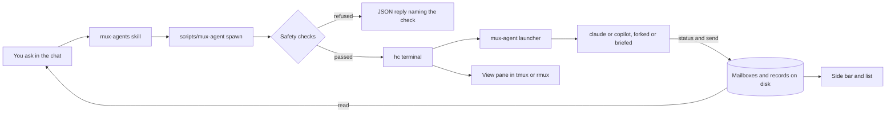

# Using mux-agents

[简体中文](Usage-zh-CN)

How to install mux-agents, what each command does, the side bar, the safety checks, upgrades and what to do when a command is refused. Teams that `up` starts are in [Teams and Lifecycle](Teams-and-Lifecycle); the [README](https://github.com/D0n9X1n/mux-agents#readme) is the short tour.

## Install

```text
claude plugin marketplace add D0n9X1n/mux-agents
claude plugin install mux-agents@mux-agents
copilot plugin marketplace add D0n9X1n/mux-agents
copilot plugin install mux-agents@mux-agents
```

The marketplace installs the `dist` branch, which each release fills with the prebuilt `mux-agent` binary for macOS, Linux and Windows on x86_64 and aarch64, plus their `SHA256SUMS`. The entry `scripts/mux-agent` (`scripts\mux-agent.cmd` on Windows) picks the one for your machine.

To run a build from source in Claude Code instead, clone into the skills folder and build there: `git clone https://github.com/D0n9X1n/mux-agents ~/.claude/skills/mux-agents`, then `cargo build --release` in that folder. The next session loads it as `mux-agents@skills-dir`, and the entry finds `target/release/mux-agent`. Don't install the marketplace plugin beside it: an installed marketplace plugin of the same name takes precedence.

## How a spawn flows



The agent runs in its hc terminal, not in the pane: the pane is a view that attaches to it, so closing the pane does not end the agent. [From Spawn to Pane](From-Spawn-to-Pane) follows each step.

## Commands

You rarely type these: the skill runs them for you. Every command is `<plugin>/scripts/mux-agent <verb> …` (`<plugin>\scripts\mux-agent.cmd <verb> …` on Windows) and prints one JSON object (`-Text` prints lines instead). An agent passes free text in a file (`-TaskFile`, `-BriefFile`, `-BodyFile`), never on the command line.

| verb | example | what it does |
|---|---|---|
| `spawn` | `spawn -Client copilot -Name add-tests -TaskFile task.md -BriefFile brief.md -Split h` | start an agent where the session's `placement` says (a new window by default); `-Split h\|v` or `-Tab` decides for this one; `-Model <model>` picks its model (else the client's default); `-Effort low\|medium\|high` sets its effort; `-NoFork` or `-Context brief` starts it from the brief instead of a fork of your conversation |
| `placement` | `placement h`, `placement tab` | where `spawn` opens agents for the rest of the session: `tab` (a new window, the default), `h` or `v` (a split beside you); `placement` alone shows the choice |
| `list` | `list -All` | live agents, what each is doing, and each one's unread messages (the reports it sent, counted as the side bar's ✉ badge counts them, never the notice of its own exit); `-All` adds ended ones, each with its `exitCode` |
| `focus` | `focus claude-1`, `focus -Next` | switch to an agent's view, reopening it if it was closed; `-Next` / `-Prev` step through the bar's order |
| `send` | `send claude-1 -BodyFile note.md`, `send parent -BodyFile result.md` | post a message to an agent, or to `parent`, `leader`, `children` or `team`; in a team, `-Re <id>` answers a message and `-Id <id>` finishes a send that failed ([Messaging and Notebook](Messaging-and-Notebook)) |
| `read` | `read -Wait 600`, `read claude-1 -Lines 40` | wait for your messages and acknowledge them with `-Ack <batch>`, or read an agent's pane; the client hooks use `-Deliver` and `-Count` |
| `note` | `note -Title plan -BodyFile plan.md` | add to the team notebook; every other member gets one mail per new note |
| `notes` | `notes`, `notes <id>` | list the notebook's newest titles, or read one note; each launch's first message lists the newest titles |
| `peek` | `peek claude-1 -Lines 40` | read a team member's live pane without typing into it |
| `stop` | `stop claude-1`, `stop claude-1 -Generation` | end an agent and every agent it started, bottom-up; a stop cut short is finished on the next pass; `-Generation` ends only its open generations and keeps the member; the reply's `life` says what its terminal is now: `ended`, `lost`, `unknown` or `running` |
| `drop` | `drop claude-1` | a person's stop of a member of the team's session; its kept shells stay |
| `resume` | `resume claude-1`, `resume claude-1 -Fresh`, `resume claude-1 -Tab` | bring a stopped agent back as a new member carrying its conversation, or retry a member the bar marks `recover`; `-Fresh` starts it on a new conversation; `-Tab` opens its view in a new window whatever the session's `placement` says; refused while any live process may still hold that conversation |
| `restore` | `restore` | bring every lost member of this team back as its next generation; its previous terminal stays as a kept shell |
| `up` | `up -Client claude -- --model opus` | start a team: its leader, side bar and views; run it again after a closed view, a killed server or a reboot to bring the views, bar and lost members back; a stopped team is retired and a new one starts; `-Name <name>` starts a second team in the same folder ([Teams and Lifecycle](Teams-and-Lifecycle)) |
| `status` | `status -BodyFile step.txt` | an agent says what it is doing now; the bar shows it |
| `report` | `report working -Quiet` | the client hooks report an agent's state (`working`, `blocked`, `idle`, `done`) for the side bar; you never run it |
| `notify` | `notify -On`, `notify -Off` | a person's opt-in: while it is on, each team send also pastes a one-line notice into each recipient's terminal |
| `sidebar` | `sidebar`, `sidebar -Close` | reopen the side-bar split, or close it for the rest of the session |
| `watch` | `watch` | draw the board in this terminal; the side bar runs it |
| `version` | `version`, `--version` | the binary's version, to tell which one a pane runs; works outside a multiplexer |
| `kept` | `kept`, `kept -Close t7` | list the team's kept shells (an agent's previous terminal left open after `restore`); `-Close <address>` closes one; a person's command, refused in an agent pane |

Exit code 0 means ok, 1 an error and 2 a refusal or usage error; on failure, `check` names the cause.

A bad verb, flag or value refuses `usage` with that verb's usage line:

```text
usage: mux-agent spawn -Client <claude|copilot> [-Task <text>] [-TaskFile <path>] [-BriefFile <path>] [-Name <name>] [-Model <model>] [-Split <value>] [-Tab] [-NoFork] [-Context <fork|brief>] [-Effort <low|medium|high>] [-Text]
usage: mux-agent placement [tab|h|v] [-Text]
usage: mux-agent list [-All] [-Text]
usage: mux-agent focus (<name> | -Next | -Prev) [-Text]
usage: mux-agent send <name|parent|leader|children|team|%pane> (-Body <text> | -BodyFile <path>) [-Re <id>] [-Id <id>] [-Text]
usage: mux-agent read [-Wait <seconds> | -Deliver | -Id <id> | -Count | -Cancel] [-Ack <batch>] | read <name> [-Lines <n>] [-Text]
usage: mux-agent note -Title <title> (-Body <text> | -BodyFile <path>) [-Id <id>] [-Text]
usage: mux-agent notes [-Since <id>] [-Lines <n>] | notes <id> [-Text]
usage: mux-agent peek <name> [-Lines <n>] [-Text]
usage: mux-agent stop <name> [-Generation] [-Text]
usage: mux-agent drop <name|id> [-Text]
usage: mux-agent resume <name|id> [-Fresh] [-Tab] [-Text]
usage: mux-agent restore [-Text]
usage: mux-agent up -Client <claude|copilot> [-Name <name>] [-Text] [-- <client flags>]
usage: mux-agent status (-Body <text> | -BodyFile <path>) [-Text]
usage: mux-agent report <working|blocked|idle|done> [-Kind <permission|question>] [-Quiet] [-Text] | report -Session (<sessionId> [-Source <word>] | -Stdin) [-Quiet]
usage: mux-agent notify (-On | -Off) [-Text]
usage: mux-agent sidebar [-Close] [-Text]
usage: mux-agent watch [-Text]
usage: mux-agent version [-Text]
usage: mux-agent kept [-Close <address>] [-Text]
```

Choose where agents open once per session: `placement h` (or `v`) splits your pane for every later `spawn`, `placement tab` goes back to new windows, and `placement` alone shows the choice. It lives on the multiplexer session, so it ends with the session and nothing is written to disk; `-Split h|v` or `-Tab` on one `spawn` overrides it. A split keeps your pane the largest: the first agent takes half of it, the second and third stack evenly in that half, and a fourth, or an agent the split would leave under 60 columns or 10 rows, opens as a tab instead; once the side bar opens, your pane gets its half back.

Every agent's name says what it does and is its tab's name or its pane's title. The skill always passes `-Name <short-kebab-name>` (1-24 lowercase letters, digits or hyphens, starting with a letter; `parent`, `root`, `all`, `leader`, `children` and `team` are reserved). Without `-Name`, the name comes from the task's first words: "Please add a subtract function to calc.py" becomes `add-subtract-function`, and a task with no usable words gets `claude-1` or `copilot-1`. A name is never reused in its session, even after its agent ended: a taken derived name gets `-2`, `-3`, … (cut at a word boundary to stay within 24), and a taken `-Name` is refused with a free one to try. The pane's title stays the name even when the agent's client sets a title of its own, except on tmux 3.2a, which cannot stop a client from retitling its pane (the tab's name still holds).

## Side bar

The side bar opens when your Claude Code or Copilot CLI chat starts or resumes in tmux or rmux, and on the first successful `spawn` or `up`: a split at the right edge of your window, full height, that rereads the board every second and shows a tab switch or an agent's report within 200 ms. Later spawns reuse it, `sidebar -Close` closes it for the rest of the session (no chat start reopens it) and `sidebar` opens it again; only you or a team's leader opens or closes it. In Claude Code, an `Agents` pane beside the chat, opened by the first spawn or by `/mux-agents-pane`, shows the same rows and refreshes every 3 seconds; `sidebar -Close` does not close it.

Outside a team the bar is a flat list ranked by who needs you; in a team it draws the team as a tree. Each live agent shows its state as its own client reports it: `! needs you` (asking you a question), `✦ done` (finished its turn while you were not looking), `◉ working` or `◌ idle`; then its name in its own color, its `[model]`, `✉ N` for unread messages from it, and the time since its last change. The line under it says what it is doing: its last `status`, else the first line of its last message, else its task. Ended agents follow (`✓ done`, `✗ exit N`, `- stopped`), and `+K more` counts the rest. [Side Bar](Side-Bar) shows both layouts and every mark.

Click an agent's lines to open it; clicks reach the bar only with `mouse on` (`set -g mouse on`), and with it on, Shift-drag selects text. Outside a team clicks are off with `MUX_AGENTS_ASCII=1`. With the bar pane active, `j`/`k` or the arrow keys select a row, Enter opens it, `p` peeks at it in a popup and Esc clears; a switch that fails shows `focus failed: <name>`. From any pane, `focus -Next` and `focus -Prev` step through the live agents in the bar's order, who needs you first.

In a team's bar (a session `up` started), `n`/`N` select the next or previous agent with a live view, wrapping, and do not switch on their own; Enter opens it. Outside a team, `n`/`N` switch to the next or previous agent at once.

A reopened view (`resume`, `focus` after an agent's view was closed, or `sidebar` from a person pane) opens in the caller's window, with a bar beside it, not in the team's leader window: every agent view has a bar.

The bar's width is the larger of `@mux-agents-sidebar-min` columns (1-9999, default 40) and `@mux-agents-sidebar-percent` of the window (1-100, default 20); set them with `set -g` or per session, window or pane. When an agent starts needing you, or finishes, while you are not looking at it, the bar shows `mux-agents: w2 needs you` for 5 seconds; `@mux-agents-alerts` set to `off` sends none, and `blocked` only who needs you.

The bar is the process `sidebar` started, not its `@agent-role sidebar` label, so a pane that only carries the label is never closed: `sidebar`, `sidebar -Close` and a spawn refuse and name it. Close it with `kill-pane -t <pane>`, or, if it is your own pane, clear the label with `set-option -p -u -t <pane> @agent-role`.

## Kept shells

When `restore` or `up` brings an agent back after its terminal was lost, the agent runs in a new terminal, and its old terminal stays open as a plain shell; its old pane keeps showing it. `restore` and `up` open no view of the new terminal: `focus <name>` opens one. The side bar lists these under `kept shells`, above the agents: select one with `j`/`k`, press Enter, and answer `y` to close it (any other key keeps it). From a pane in the team's session, `kept` lists them and `kept -Close <address>` closes one; a shell is closed only while hc still shows it open and kept by this team. A closed shell never comes back, and `stop` and `restore` never close one.

## Safety checks

Agents start with permission prompts off, so mux-agents never gives an agent more than its caller already has. Every verb but `version` first refuses a caller that runs in a sandbox (`sandbox`). A `spawn` is then refused, naming the check, unless:

- `tagged`: the caller is not an agent outside a team. Outside a team only the top-level chat spawns; in a team that `up` started, members spawn their own children.
- `flags`: for a client chat outside a team, every client command line from the chat up to the pane uses only allowlisted flags.
- `policy`: that chat already runs with bypass permissions or allow-all.
- `directory`: that chat's launch directory can be confirmed; the agent starts there.
- `cap`: outside a team, fewer than 10 agents are live in the session.
- `depth`: in a team, the child is at depth 3 or less (the leader is 0).
- `limit`: in a team, fewer than 10 members are there besides the leader.
- `ceiling`: in a team, the child's flags stay within its parent's policy and the team's permission ceiling.
- `budget`: in a team, a member's spawn takes one token from the team's spawn budget: 20 tokens, one more every 180 seconds, set by the session options `@mux-agents-spawn-budget` and `@mux-agents-spawn-refill`.

Outside a team, children run `claude --dangerously-skip-permissions --effort high` or `copilot --no-sandbox --allow-all`, in the caller's directory; `-Effort` sets Claude Code's `--effort` or Copilot CLI's `--reasoning-effort`. In a team, a child gets the highest permission its parent and the team's ceiling allow. [Safety and Occupancy](Safety-and-Occupancy) gives each check's order and reason.

## Requirements

- macOS, Linux or Windows, x86_64 or aarch64; one native binary, no PowerShell needed.
- rmux 0.10 or later on macOS, Linux or Windows, or tmux 3.2 or later on macOS or Linux, with the caller inside a pane.
- Claude Code or GitHub Copilot CLI on `PATH` (`claude` or `copilot`; `.exe` on Windows).
- herdr-core 0.1.21 or later, with `hc` (or `herdr-core`) on `PATH`: every agent runs in an hc terminal.
- Terminal CLI only (Claude Code or Copilot CLI inside tmux or rmux); the desktop app and other non-terminal surfaces are skipped: no Agents pane, and the skill says not to use it.
- Not in herdr: in a herdr terminal outside tmux and rmux (`HC_TERMINAL_ID` is set), a command from anything but a proven team member refuses with `herdr`; use herdr's own skills (`hc --skill`) there. Inside tmux or rmux, even one started from a herdr terminal, the pane is the multiplexer's and mux-agents works as usual: herdr cannot see agents inside tmux.

Inside rmux both `RMUX` and `TMUX` may be set; `RMUX` wins.

## Upgrade

Close what runs, update, then restart:

1. Close the side bar with `sidebar -Close`.
2. `stop` every agent (`list` shows them).
3. Update the plugin in each client you use, with one line:

```text
claude plugin marketplace update mux-agents && claude plugin update mux-agents@mux-agents
copilot plugin marketplace update mux-agents && copilot plugin update mux-agents@mux-agents
```

Refresh the marketplace first: Claude Code's plugin update reads the catalog it cached when you added the marketplace, so on its own it can report the installed version as the latest.

4. Restart your Claude Code and Copilot CLI sessions, then spawn agents and open the side bar again.

Why: each agent pane and the side bar run the binary by the absolute path they started with, so they keep the version they started with until restarted.

Claude Code turns background auto-update off by default for a third-party marketplace such as this one. To turn it on, open `/plugin`, go to **Marketplaces**, select `mux-agents` and select **Enable auto-update**. Claude Code then, within ten minutes of your first message in a session, refreshes the marketplace and updates the plugin on disk; panes already running keep their binary until you restart them.

An agent pane started by 0.2.x and not yet running refuses to launch: run `stop <name>` to end it, then start a new agent.

## Troubleshooting

Every refusal is one JSON line with `check` naming the cause:

| check | what it means | what to do |
|---|---|---|
| `entry` | no `mux-agent` binary for this OS and architecture, or (on `spawn`) the binary's path has a character outside letters, digits, space and `_\/:.()-` | reinstall the plugin from the marketplace, or build from source as above; for a path, move the plugin or binary to a folder whose path has only those characters |
| `endpoint` | not inside a multiplexer pane, tmux older than 3.2 or rmux older than 0.10, a server that did not answer, or a server restarted since this pane started | start the client inside tmux 3.2+ or rmux 0.10+; after a server restart, start the client again in a new pane |
| `herdr` | a command in a herdr terminal outside tmux and rmux, from anything but a proven team member | use herdr's own skills (`hc --skill`) there, or start the client inside tmux or rmux |
| `hc` | `hc` (or `herdr-core`) is not on `PATH` or is older than 0.1.21, or an hc call failed | install or upgrade herdr-core to 0.1.21 or later; after a failed call, check with `list` before you retry |
| `sandbox` | the caller runs in a sandbox (`SANDBOX_RUNTIME=1`, a macOS sandbox, Linux `NoNewPrivs`, a restricted Windows token) | run the client outside the sandbox |
| `policy` | the caller is not in bypass or allow-all; for Claude Code, `reason` says which half failed: `transcript: no session id`, `transcript: not found`, `transcript: no mode`, `transcript: other mode`, `screen: unreadable`, `screen: no mode line` or `screen: other mode` | Claude Code: bypass permissions (`--dangerously-skip-permissions` or Shift+Tab), with the footer badge `⏵⏵ bypass permissions on` in the pane's last 8 rows; Copilot CLI: `--allow-all` |
| `flags` | a `claude` or `copilot` process from the caller up to the pane has a flag outside the allowlist, or its command line cannot be read | restart the client with only allowlisted flags |
| `directory` | the caller's launch directory cannot be confirmed from its session or process, or is not an existing absolute folder | start the client in an existing folder and stay in it |
| `tagged` | an agent outside a team tried to spawn; a member tried to open the side bar or set `placement`; `up`, `restore`, `drop`, `kept` or `stop -Generation` ran from an agent or member pane | outside a team only the top-level chat spawns; run a person's verbs from your own pane |
| `cap` | outside a team, 10 agents already live in this session | `stop` one |
| `depth` | in a team, the child would be deeper than 3 | let a shallower member spawn it |
| `limit` | in a team, 10 members already besides the leader; the message names any member still holding a slot and what frees it | `stop` one |
| `ceiling` | in a team, the child's flags would exceed its parent's policy or the team's permission ceiling | spawn it from a member that has that permission |
| `budget` | in a team, the team's spawn budget is spent; the message says when the next token arrives | wait, or raise `@mux-agents-spawn-budget` or lower `@mux-agents-spawn-refill` |
| `views` | a member's `spawn`, `focus`, `resume`, `sidebar`, `watch` or `placement` while the team's views are down | run `up` |
| `name` | `-Name` is not 1-24 lowercase letters, digits or hyphens starting with a letter, is reserved (`parent`, `root`, `all`, `leader`, `children`, `team`), or is taken in this session; or an agent record cannot be read, so names cannot be checked | use the free name the message suggests, or another; for an unreadable record, check that agent's folder in the state folder |
| `brief` | an agent caller spawns a child that starts from a brief, not a fork of its conversation (`-NoFork`, the other client, no session id, a Claude Code that is not interactive, or a failed Copilot CLI session copy), without `-BriefFile` | pass `-BriefFile` with the context the child needs |
| `target` | no live agent has that name, the recipient is not a live pane of this session, the agent's pane no longer runs its own launch, `status` comes from a pane that is not an agent, or a kept-shell address or note id is wrong | check the name with `list` and the address with `kept`; only an agent reports `status` |
| `parent` | `send parent` from a pane that is not an agent, an agent stopping an agent it did not spawn, or an agent pane whose record is missing or cannot be proven to run there | send to an agent by name; only its parent or a human stops an agent |
| `authority` | a member's `stop`, `read <name>` or `resume` of an agent that is not below it in the team, or a `notify` from anyone but a person | ask an ancestor of that agent, or a person |
| `team` | `peek`, `note` or `notes` outside a team, or a team whose record is missing | run `up` from the team folder |
| `caller` | a process other than a shell runs between `mux-agent` and the nearest client above it (or, with no client, the pane), or that client's process start cannot be read or changed while it was checked | run `mux-agent` from the client's own shell commands (or the pane's shell), not through another program |
| `lock` | another command held the agent lock for 15 s | retry; if it keeps happening, look for a stuck `mux-agent` process |
| `state` | the state or lock folder is unsafe or unreadable: a link, a file, another owner, a mode other than 700, an extended ACL, shared with other users, or a folder above it writable by others; or `HOME` or `MUX_AGENTS_STATE` is not an absolute path | fix the folder or variable the message names |
| `launch` | the agent did not start: its pane could not be created, or it was created and the client did not start; the message says whether a pane was closed | check that the multiplexer can open a window or split there and that the client starts by hand in that folder, close a pane left open, then spawn again |
| `rmux` | a tmux or rmux call failed or answered out of its format | retry; check that the tmux or rmux server still runs |
| `sidebar` | a pane carries the side-bar label but cannot be proven the bar, a new bar did not start this plugin's watch, or a bar could not be closed | follow the message: close the pane it names with `kill-pane -t <pane>`, or clear its label |
| `usage` | a bad verb, flag or value; an empty task or status, or a task too long for the client command line; a message larger than 64 KB; free text on an agent's command line; a task, brief or body file that cannot be read, is too large or is not UTF-8; `watch` outside a terminal | follow the usage line in the message; agents pass free text in files |
| `internal` | an unexpected error: an I/O error (only its kind is shown), a state file that is not JSON or larger than 1 MB, or a panic | retry; if it repeats, open an issue with the reply |

`resume`, recovery, `restore` and `up` have refusals of their own (`life`, `taken`, `session`, `leader`): see [Teams and Lifecycle](Teams-and-Lifecycle). Mail refusals are in [Messaging and Notebook](Messaging-and-Notebook).

## How it works

- Each agent runs in its own herdr-core terminal, apart from the pane you see; the pane is a view that attaches to it. See [Architecture](Architecture) and [From Spawn to Pane](From-Spawn-to-Pane).
- Teams, `up`, `stop`, `resume` and recovery from a person's side: [Teams and Lifecycle](Teams-and-Lifecycle).
- What the bar draws, its keys and how it keeps its place: [Side Bar](Side-Bar).
- Generations, `stop`, `resume`, recover, `restore` and `up` re-entry: [Agent Lifecycle](Agent-Lifecycle).
- The state folder, create-once writes, locks and fail-closed reads: [State and Durability](State-and-Durability).
- Mail, receipts, hooks and the notebook: [Messaging and Notebook](Messaging-and-Notebook).
- Spawn checks, process identity and what may hold a conversation: [Safety and Occupancy](Safety-and-Occupancy).
- Building, testing and releasing: [Development and Release](Development-and-Release).
- `list` with six live agents averages about 23 ms (`scripts/dev/bench-list.sh`, tmux 3.8 on an Apple silicon Mac).
