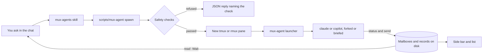

# Using mux-agents

[简体中文](Usage-zh-CN)

The details behind the [README](https://github.com/D0n9X1n/mux-agents#readme): how to install, what each command does, the side bar, the safety checks, upgrades and what to do when a spawn is refused.

## Install

```text
claude plugin marketplace add D0n9X1n/mux-agents
claude plugin install mux-agents@mux-agents
copilot plugin marketplace add D0n9X1n/mux-agents
copilot plugin install mux-agents@mux-agents
```

The marketplace installs the `dist` branch, which each release fills with the prebuilt `mux-agent` binary for macOS, Linux and Windows on x86_64 and aarch64, plus their `SHA256SUMS`. The entry `scripts/mux-agent` (`scripts\mux-agent.cmd` on Windows) picks the one for your machine.

To run a build from source in Claude Code instead, clone into the skills folder and build there: `git clone https://github.com/D0n9X1n/mux-agents ~/.claude/skills/mux-agents`, then `cargo build --release` in that folder. The next session loads it as `mux-agents@skills-dir`, and the entry finds `target/release/mux-agent`. Don't install the marketplace plugin beside it: an installed marketplace plugin of the same name takes precedence.

## How a spawn flows



## Commands

You rarely type these: the skill runs them for you. Every command is `<plugin>/scripts/mux-agent <verb> …` (`<plugin>\scripts\mux-agent.cmd <verb> …` on Windows) and prints one JSON object (`-Text` prints lines instead). An agent passes free text in a file (`-TaskFile`, `-BriefFile`, `-BodyFile`), never on the command line.

| verb | example | what it does |
|---|---|---|
| `spawn` | `spawn -Client copilot -TaskFile task.md -BriefFile brief.md -Split h` | start an agent in a new window, or a split with `-Split h\|v` |
| `list` | `list -All` | live agents, what each is doing, unread messages; `-All` adds ended ones |
| `status` | `status -BodyFile step.txt` | an agent says what it is doing now |
| `send` | `send claude-1 -BodyFile note.md`, `send parent -BodyFile result.md` | post a message to an agent or to your parent |
| `read` | `read -Wait 600`, `read claude-1 -Lines 40` | wait for your messages, or read an agent's pane |
| `focus` | `focus claude-1` | switch the multiplexer to an agent's pane |
| `stop` | `stop claude-1` | close an agent's pane and its processes |
| `sidebar` | `sidebar`, `sidebar -Close` | open or close the side-bar split |

Exit code 0 means ok, 1 an error and 2 a refusal or usage error; on failure, `check` names the cause.

## Side bar

In Claude Code, an `Agents` pane beside the chat opens after the first successful `spawn` (or with `/mux-agents-pane`) and refreshes every 3 seconds. In any client, `sidebar` opens a split 42 columns wide that redraws every 2 seconds:

```text
mux-agents · 2 running
● claude-1  claude  4m
  running the parser tests (14/20 pass)
● copilot-1  copilot  1m
  reviewing src/spawn.rs
○ claude-2  exited 0
```

"Doing" is what the agent last reported with `status`, else the first line of its last message, else its task.

## Safety checks

Agents start with permission prompts off, so mux-agents never gives an agent more than its caller already has. A `spawn` is refused, naming the check, unless:

- `sandbox`: the caller is not sandboxed.
- `policy`: the caller already runs with bypass or allow-all.
- `flags`: every client command line from the agent up to the pane uses only allowlisted flags.
- `directory`: the caller's working directory can be confirmed; the agent starts there.
- `tagged`: the caller is not itself an agent; children cannot spawn.
- `cap`: fewer than 6 agents are live in the session.

Children run `claude --dangerously-skip-permissions --effort high` or `copilot --no-sandbox --allow-all`, in the caller's directory.

## Requirements

- macOS, Linux or Windows, x86_64 or aarch64; no PowerShell or .NET needed.
- rmux 0.10 or later on macOS, Linux or Windows, or tmux 3.2 or later on macOS or Linux, with the caller inside a pane.
- Claude Code or GitHub Copilot CLI on `PATH` (`claude` or `copilot`; `.exe` on Windows).

Inside rmux both `RMUX` and `TMUX` may be set; `RMUX` wins.

## Upgrade

Close what runs, update, then restart:

1. Close the side bar with `sidebar -Close`.
2. `stop` every agent (`list` shows them).
3. Update the plugin in each client you use, with one line:

```text
claude plugin marketplace update mux-agents && claude plugin update mux-agents@mux-agents
copilot plugin marketplace update mux-agents && copilot plugin update mux-agents@mux-agents
```

Refresh the marketplace first: Claude Code's plugin update reads the catalog it cached when you added the marketplace, so on its own it can report the old version as the latest.

4. Restart your Claude Code and Copilot CLI sessions, then spawn agents and open the side bar again.

Why: each agent pane and the side bar run the binary by the absolute path they started with, so they keep the old version until restarted. From 0.1 the order matters most: the 0.1 named mutex and the 0.2 lock files do not serialize, so a 0.1 pane and a 0.2 command must never run at the same time. Within 0.2.x the state folder, the record, mail and lock file formats stay the same.

Claude Code turns background auto-update off by default for a third-party marketplace such as this one. To turn it on, open `/plugin`, go to **Marketplaces**, select `mux-agents` and select **Enable auto-update**. Claude Code then, within ten minutes of your first message in a session, refreshes the marketplace and updates the plugin on disk; panes already running keep their binary until you restart them.

## Troubleshooting

Every refusal is one JSON line with `check` naming the cause:

| check | what it means | what to do |
|---|---|---|
| `entry` | no `mux-agent` binary for this OS and architecture | reinstall the plugin from the marketplace, or build from source as above |
| `endpoint` | not inside a multiplexer pane, or tmux older than 3.2 or rmux older than 0.10 | start the client inside tmux 3.2+ or rmux 0.10+ |
| `sandbox` | the caller runs in a sandbox (`SANDBOX_RUNTIME=1`, a macOS sandbox, Linux `NoNewPrivs`, a restricted Windows token) | run the client outside the sandbox |
| `policy` | the caller is not in bypass or allow-all | Claude Code: bypass permissions (`--dangerously-skip-permissions` or Shift+Tab); Copilot CLI: `--allow-all` |
| `cap` | 6 agents already live in this session | `stop` one |
| `tagged` | an agent tried to spawn or open the side bar | only the top-level chat spawns |

## How it works

- `spawn` opens a detached window (or `-Split h|v` splits the caller's pane) running `<binary> launcher <spec.json>` by the binary's absolute path, tags the pane with `@agent-*` options, and records the agent in the state folder: `MUX_AGENTS_STATE` if set, else `%LOCALAPPDATA%\mux-agents\state` on Windows and `$XDG_STATE_HOME/mux-agents/state` or `~/.local/state/mux-agents/state` on Linux and macOS.
- Messages go to per-pane mailboxes, never as keystrokes. `read -Wait` returns each message once. Every child posts exactly one exit notice to its parent: `exited`, `stopped` or `lost`.
- Locks are per user: on Unix, files under `~/.local/state/mux-agents/locks`; on Windows, a named mutex `Local\MuxAgents-<hex>`. This fixes the .NET named-mutex advisory [GHSA-2j93-m82w-73j2](https://github.com/advisories/GHSA-2j93-m82w-73j2) that affected 0.1 on Linux and macOS.
- `list` with six live agents averages about 23 ms (`scripts/dev/bench-list.sh`, tmux 3.8 on an Apple silicon Mac).
