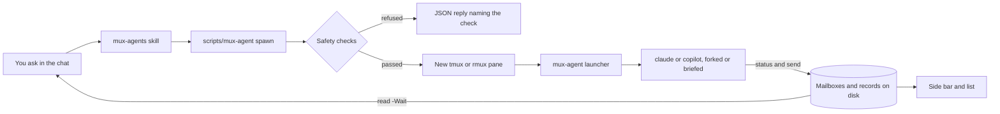

# Using mux-agents

[简体中文](Usage-zh-CN)

The details behind the [README](https://github.com/D0n9X1n/mux-agents#readme): how to install, what each command does, the side bar, the safety checks, upgrades and what to do when a spawn is refused.

## Install

```text
claude plugin marketplace add D0n9X1n/mux-agents
claude plugin install mux-agents@mux-agents
copilot plugin marketplace add D0n9X1n/mux-agents
copilot plugin install mux-agents@mux-agents
```

The marketplace installs the `dist` branch, which each release fills with the prebuilt `mux-agent` binary for macOS, Linux and Windows on x86_64 and aarch64, plus their `SHA256SUMS`. The entry `scripts/mux-agent` (`scripts\mux-agent.cmd` on Windows) picks the one for your machine.

To run a build from source in Claude Code instead, clone into the skills folder and build there: `git clone https://github.com/D0n9X1n/mux-agents ~/.claude/skills/mux-agents`, then `cargo build --release` in that folder. The next session loads it as `mux-agents@skills-dir`, and the entry finds `target/release/mux-agent`. Don't install the marketplace plugin beside it: an installed marketplace plugin of the same name takes precedence.

## How a spawn flows



## Commands

You rarely type these: the skill runs them for you. Every command is `<plugin>/scripts/mux-agent <verb> …` (`<plugin>\scripts\mux-agent.cmd <verb> …` on Windows) and prints one JSON object (`-Text` prints lines instead). An agent passes free text in a file (`-TaskFile`, `-BriefFile`, `-BodyFile`), never on the command line.

| verb | example | what it does |
|---|---|---|
| `spawn` | `spawn -Client copilot -Name add-tests -TaskFile task.md -BriefFile brief.md -Split h` | start an agent where the session's `placement` says (a new window by default); `-Split h\|v` or `-Tab` decides for this one; `-Model <model>` picks its model (else the client's default) |
| `placement` | `placement h`, `placement tab` | where `spawn` opens agents for the rest of the session: `tab` (a new window, the default), `h` or `v` (a split beside you) |
| `list` | `list -All` | live agents, what each is doing, unread messages; `-All` adds ended ones, each with its `exitCode` |
| `status` | `status -BodyFile step.txt` | an agent says what it is doing now |
| `send` | `send claude-1 -BodyFile note.md`, `send parent -BodyFile result.md` | post a message to an agent or to your parent |
| `read` | `read -Wait 600`, `read claude-1 -Lines 40` | wait for your messages, or read an agent's pane |
| `focus` | `focus claude-1`, `focus -Next` | switch the multiplexer to an agent's pane; `-Next` / `-Prev` step through the bar's order |
| `stop` | `stop claude-1` | close an agent's pane and its processes; an agent that already ended answers `ok` with `already` (`exited`, `stopped` or `lost`) |
| `sidebar` | `sidebar`, `sidebar -Close` | reopen the side-bar split, or close it for the rest of the session |
| `version` | `version`, `--version` | the binary's version, to tell which one a pane runs; works outside a multiplexer |

Exit code 0 means ok, 1 an error and 2 a refusal or usage error; on failure, `check` names the cause.

Choose where agents open once per session: `placement h` (or `v`) splits your pane for every later `spawn`, `placement tab` goes back to new windows, and `placement` alone shows the choice. It lives on the multiplexer session, so it ends with the session and nothing is written to disk; `-Split h|v` or `-Tab` on one `spawn` overrides it.

Every agent's name says what it does and is its tab's name or its pane's title. The skill always passes `-Name <short-kebab-name>` (1-24 lowercase letters, digits or hyphens, starting with a letter; `parent`, `root` and `all` are reserved). Without `-Name`, the name comes from the task's first words: "Please add a subtract function to calc.py" becomes `add-subtract-function`, and a task with no usable words gets `claude-1` or `copilot-1`. A name is never reused in its session, even after its agent ended: a taken derived name gets `-2`, `-3`, … (cut at a word boundary to stay within 24), and a taken `-Name` is refused with a free one to try. The pane's title stays the name even when the agent's client sets a title of its own, except on tmux 3.2a, which cannot stop a client from retitling its pane (the tab's name still holds).

## Side bar

In Claude Code, an `Agents` pane beside the chat opens after the first successful `spawn` (or with `/mux-agents-pane`) and refreshes every 3 seconds. In any client, the first successful `spawn` also opens a split at the right edge of your window, full height and 20% of its width (at least 40 columns), that redraws every 2 seconds; later spawns reuse it, `sidebar -Close` closes it for the rest of the session and `sidebar` opens it again:

```text
 mux-agents        1 need you / 1 done

 Needs you · 1
 ! add-subtract [sonnet]            12s
   Adding subtract(a, b) under add i...

 Done · 1
 ✦ test-calc  ✉ 1                   30s
   Done: test_calc.py passed, exit 0

 Working · 1
 ◉ fix-ci-flake                     11m
   Re-running tests/test_watch.rs wi...

 ended -------------------------------
 ✓ docs-usage                 done  18m
 ✗ bump-deps              exit 101  25m
 - spike-rmux              stopped   1h
   +4 more  (list -All)
```

"Doing" is what the agent last reported with `status`, else the first line of its last message, else its task.

Each live agent shows its state, its name in its own color, its `[model]` when one was chosen, and `✉ N` when its parent has N unread messages from it. The states are herdr's, reported by the agent's own client (never read from its screen) and ranked so who needs you comes first: `! needs you` (bold yellow) is asking you a question; `✦ done` (bold cyan) finished its turn while you were not looking at it, and stays done until you have looked at its pane and moved on; `◉ working` (green) is running a turn; `◌ idle` (dim, the whole row) has nothing to do. Within a state, the most recent change comes first, and the time shown is since that change. Claude Code reports through the plugin's hooks module, Copilot CLI through the plugin's `hooks.json` (a prompt works, a question blocks until answered, a stop idles), with `bash` on macOS and Linux and a portable `command` through `scripts\mux-agent.cmd` on Windows; `report -Quiet` prints nothing and always succeeds, so no hook needs a shell to quiet it. An agent whose client reports nothing (an older client) is `◉ working`, or `◌ idle` while it listens in `read -Wait`. The header counts the live agents as herdr counts its sections, `N need you` (yellow), `N done`, `N working`, `N idle`, leaving out any 0 (`0 running` when none lives), then `M ended`; a narrow bar drops them from the end. Ended agents follow, the 3 newest that did not end `lost` (a lost agent is counted but not drawn): `✓ done` (exited 0), `✗ exit N` (red), `- stopped` (yellow); `+K more` counts the rest. `list -All` shows the 10 newest ended agents, so the bar writes `+K more  (list -All)` only when every ended agent is among them, and `+K more ended` otherwise. A spawn picks the name color least used by the session's live agents (blue, magenta, bright blue, bright magenta; never a state color), and `list -Text` paints names the same way.

When the live agents are in more than one state, each state's first agent has herdr's section heading above it with its count (`Needs you · 1`), and, as in herdr's priority view, the rows under the headings show only their glyph and time, so names keep the room; a short bar drops the headings right after the blank lines and the words come back. With every live agent in one state there are no headings and each row says its state.

When an agent starts needing you, or finishes, while you are not looking at its pane, the bar shows one tmux message on the session's clients for 5 seconds, `mux-agents: w2 needs you`, as herdr's toast. The multiplexer option `@mux-agents-alerts` sets it: `off` sends none, `blocked` only who needs you, unset or anything else both (for example `tmux set -g @mux-agents-alerts blocked`). The first sight of an agent is never news, so opening the bar is quiet.

The bar is laid out at its pane's size on every redraw and never wraps: long text is cut with `...`, and a short pane drops blank lines first, then ended rows, then the "doing" lines and whole rows of the oldest agents; the header stays. Color follows `NO_COLOR` (off), `FORCE_COLOR` or `CLICOLOR_FORCE` (on), then `TERM=dumb` (off); `MUX_AGENTS_ASCII=1` draws `! @ * o + x m -` instead of the symbols. Each redraw rewrites the rows in place (no full clear), so the bar does not flicker; with `TERM=dumb` it prints plain frames instead.

In tab mode the bar stays in the window you spawned from, not in each agent's window. `sidebar -Close` closes only this multiplexer bar; the Claude Code `Agents` pane is separate. That pane draws its rows as the bar does, `MUX_AGENTS_ASCII=1` included: `! needs you`, `✦ done`, `◉ working`, `◌ idle`, `✓ done`, `✗ exit N`, `- stopped` and `✉ N`; an agent with no report that listens in `read -Wait` shows `◉ working` there, since only the bar reads that.

The bar stays at the right edge, full height: when a split, a layout change, `swap-pane` or `rotate-window` moves it, the next redraw puts it back without moving your focus. Its width follows the window's width; a width you drag it to is kept until the window is resized or a width option changes. Two multiplexer options set the width: `@mux-agents-sidebar-percent` (1-100, default 20) and `@mux-agents-sidebar-min` (columns, 1-9999, default 40); the bar is the larger of the two. Set them with `set -g` in `~/.tmux.conf` or per session, window or pane (for example `tmux set -g @mux-agents-sidebar-percent 10`); a change applies at the next redraw, and a value that is not a whole number in range uses its default. While a pane is zoomed the bar is left alone, so it never unzooms your pane. If putting it back fails 3 times in a row, it stops trying and shows `layout: repair paused` until the layout changes or a minute passes.

The bar is the process `sidebar` started in it, not its `@agent-role sidebar` label, so a label that moved (rmux's `rotate-window` leaves labels behind) never makes your pane the bar. A pane that carries the label without being that process is never closed: `sidebar`, `sidebar -Close` and a spawn refuse and name it. If it is an old bar, for example one opened by 0.2.1, which `sidebar -Close` cannot prove, close it with `kill-pane -t <pane>`; if it is your own pane, clear the label with `set-option -p -u -t <pane> @agent-role`. A `mux-agent watch` you run by hand draws the board and takes clicks and keys as the bar does, but only the bar keeps the layout.

Click an agent's name line in the bar to switch to its window and pane. Clicks reach the bar only with `mouse on` (`set -g mouse on`); with it on, Shift-drag selects text. Clicks are off with `MUX_AGENTS_ASCII=1`. A click made while the bar is being resized does nothing and the bar redraws. With the bar pane active, `j`/`k` or the arrow keys select a running agent, Enter switches to it and Esc clears; a switch that fails shows `focus failed: <name>`. A key or a left press redraws the bar at once, and Ctrl-C typed in the bar ends it (`interrupted`); it puts the terminal back on every exit. With `TERM=dumb` the bar only draws: it takes no clicks or keys. From any pane, yours or an agent's, `focus -Next` and `focus -Prev` step through the live agents in the bar's order (who needs you first), as herdr's next and previous agent keys do, wrapping; from a pane that is no agent's, `-Next` goes to the most urgent. A tmux key binding cannot run them yet: `run-shell` is not below a pane, so the caller check refuses it (#90). On Windows the bar reads clicks and keys through the console in rmux 0.10 or later, the same as on macOS and Linux. `◉`, `◌` and `✦` in an agent's status or model show as `•`.

## Safety checks

Agents start with permission prompts off, so mux-agents never gives an agent more than its caller already has. A `spawn` is refused, naming the check, unless:

- `sandbox`: the caller is not sandboxed.
- `policy`: the caller already runs with bypass or allow-all.
- `flags`: every client command line from the agent up to the pane uses only allowlisted flags.
- `directory`: the caller's working directory can be confirmed; the agent starts there.
- `tagged`: the caller is not itself an agent; children cannot spawn.
- `cap`: fewer than 6 agents are live in the session.

Children run `claude --dangerously-skip-permissions --effort high` or `copilot --no-sandbox --allow-all`, in the caller's directory.

## Requirements

- macOS, Linux or Windows, x86_64 or aarch64; no PowerShell or .NET needed.
- rmux 0.10 or later on macOS, Linux or Windows, or tmux 3.2 or later on macOS or Linux, with the caller inside a pane.
- Claude Code or GitHub Copilot CLI on `PATH` (`claude` or `copilot`; `.exe` on Windows).
- Terminal CLI only (Claude Code or Copilot CLI inside tmux or rmux); the desktop app and other non-terminal surfaces are skipped: no Agents pane, and the skill says not to use it.
- Not in herdr: in a herdr terminal outside tmux and rmux (`HC_TERMINAL_ID` is set) every command refuses with `herdr`, the hooks report nothing and the Agents pane never opens; use herdr's own skills (`hc --skill`) there. Inside tmux or rmux, even one started from a herdr terminal, the pane is the multiplexer's and mux-agents works as usual: herdr cannot see agents inside tmux.

Inside rmux both `RMUX` and `TMUX` may be set; `RMUX` wins.

## Upgrade

Close what runs, update, then restart:

1. Close the side bar with `sidebar -Close`.
2. `stop` every agent (`list` shows them).
3. Update the plugin in each client you use, with one line:

```text
claude plugin marketplace update mux-agents && claude plugin update mux-agents@mux-agents
copilot plugin marketplace update mux-agents && copilot plugin update mux-agents@mux-agents
```

Refresh the marketplace first: Claude Code's plugin update reads the catalog it cached when you added the marketplace, so on its own it can report the old version as the latest.

4. Restart your Claude Code and Copilot CLI sessions, then spawn agents and open the side bar again.

Why: each agent pane and the side bar run the binary by the absolute path they started with, so they keep the old version until restarted. From 0.1 the order matters most: the 0.1 named mutex and the 0.2 lock files do not serialize, so a 0.1 pane and a 0.2 command must never run at the same time. Within 0.2.x the state folder, the record, mail and lock file formats stay the same.

Claude Code turns background auto-update off by default for a third-party marketplace such as this one. To turn it on, open `/plugin`, go to **Marketplaces**, select `mux-agents` and select **Enable auto-update**. Claude Code then, within ten minutes of your first message in a session, refreshes the marketplace and updates the plugin on disk; panes already running keep their binary until you restart them.

## Troubleshooting

Every refusal is one JSON line with `check` naming the cause:

| check | what it means | what to do |
|---|---|---|
| `entry` | no `mux-agent` binary for this OS and architecture, or (on `spawn`) the binary's path has a character outside letters, digits, space and `_\/:.()-` | reinstall the plugin from the marketplace, or build from source as above; for a path, move the plugin or binary to a folder whose path has only those characters |
| `endpoint` | not inside a multiplexer pane, tmux older than 3.2 or rmux older than 0.10, a server that did not answer, or a server restarted since this pane started | start the client inside tmux 3.2+ or rmux 0.10+; after a server restart, start the client again in a new pane |
| `sandbox` | the caller runs in a sandbox (`SANDBOX_RUNTIME=1`, a macOS sandbox, Linux `NoNewPrivs`, a restricted Windows token) | run the client outside the sandbox |
| `policy` | the caller is not in bypass or allow-all; for Claude Code, `reason` says which half failed: `transcript: no session id`, `transcript: not found`, `transcript: no mode`, `transcript: other mode`, `screen: unreadable`, `screen: no mode line` or `screen: other mode` | Claude Code: bypass permissions (`--dangerously-skip-permissions` or Shift+Tab), with the footer badge `⏵⏵ bypass permissions on` in the pane's last 8 rows; Copilot CLI: `--allow-all` |
| `cap` | 6 agents already live in this session | `stop` one |
| `tagged` | an agent tried to spawn, open the side bar or set `placement` | only the top-level chat spawns |
| `flags` | a `claude` or `copilot` process from the agent up to the pane has a flag outside the allowlist, or its command line cannot be read | restart the client with only allowlisted flags |
| `directory` | the caller's launch directory cannot be confirmed from its session or process, or is not an existing absolute folder | start the client in an existing folder and stay in it |
| `name` | `-Name` is not 1-24 lowercase letters, digits or hyphens starting with a letter, is `parent`, `root` or `all`, or is taken in this session; or an agent record cannot be read, so names cannot be checked | use the free name the message suggests, or another; for an unreadable record, check that agent's folder in the state folder |
| `brief` | an agent caller spawns a child that starts from a brief, not a fork of its conversation (`-NoFork`, the other client, no session id, a Claude Code that is not interactive, or a failed Copilot CLI session copy), without `-BriefFile` | pass `-BriefFile` with the context the child needs |
| `target` | no live agent has that name, the recipient is not a live pane of this session, the agent's pane no longer runs its own launch, or `status` comes from a pane that is not an agent | check the name with `list`; only an agent reports `status` |
| `parent` | `send parent` from a pane that is not an agent, an agent stopping an agent it did not spawn, or an agent pane whose record is missing or cannot be proven to run there | send to an agent by name; only its parent or a human stops an agent |
| `caller` | a process other than a shell runs between `mux-agent` and the nearest client above it (or, with no client, the pane), or that client's process start cannot be read or changed while it was checked | run `mux-agent` from the client's own shell commands (or the pane's shell), not through another program |
| `lock` | another command held the agent lock for 15 s | retry; if it keeps happening, look for a stuck `mux-agent` process |
| `state` | the state or lock folder is unsafe or unreadable: a link, a file, another owner, a mode other than 700, an extended ACL, shared with other users, or a folder above it writable by others; or `HOME` or `MUX_AGENTS_STATE` is not an absolute path | fix the folder or variable the message names |
| `launch` | the agent did not start: its pane could not be created, or it was created and the client did not start; the message says whether a pane was closed | check that the multiplexer can open a window or split there and that the client starts by hand in that folder, close a pane left open, then spawn again |
| `rmux` | a tmux or rmux call failed or answered out of its format | retry; check that the tmux or rmux server still runs |
| `sidebar` | a pane carries the side-bar label but cannot be proven the bar, a new bar did not start this plugin's watch, or a bar could not be closed | follow the message: close the pane it names with `kill-pane -t <pane>`, or clear its label |
| `usage` | a bad verb, flag or value; an empty or too long task or status; a message larger than 64 KB; free text on an agent's command line; a task, brief or body file that cannot be read, is too large or is not UTF-8; `watch` outside a terminal | follow the usage line in the message; agents pass free text in files |
| `internal` | an unexpected error: an I/O error (only its kind is shown), a state file that is not JSON or larger than 1 MB, or a panic | retry; if it repeats, open an issue with the reply |

## How it works

- `spawn` opens a detached window (or, by `-Split h|v` or the session's `placement`, splits the caller's pane) running `<binary> launcher <spec.json>` by the binary's absolute path, tags the pane with `@agent-*` options, and records the agent in the state folder: `MUX_AGENTS_STATE` if set, else `%LOCALAPPDATA%\mux-agents\state` on Windows and `$XDG_STATE_HOME/mux-agents/state` or `~/.local/state/mux-agents/state` on Linux and macOS.
- Once the agent is committed, `spawn` finds or opens the session's side bar under the side bar's own lock; a failure there is reported as `sidebarError` and never fails the spawn.
- Messages go to per-pane mailboxes, never as keystrokes. `read -Wait` returns each message once. As herdr delivers a message as the recipient's next input, a `send` to a Claude Code session also wakes it at once: the sender's Claude Code hooks pass that session one line, `<mux-agents from="w2">You have a new mux-agents message from w2. Run your read command to get it.</mux-agents>`, never the message itself (the mailbox stays the message). Only a command that is one `send` of plain words (no variable, quoting trick, or other command) wakes anyone. A session that cannot be reached, a Copilot CLI recipient, or any other `send` still finds the mail with `read -Wait`. Every child posts exactly one exit notice to its parent: `exited`, `stopped` or `lost`.
- An agent whose tab or pane is gone is closed on the next `list`, `read`, `spawn`, `stop` or side-bar tick: one `lost` notice (or `exited` with its code), gone from `list` and the side bar, kept in `list -All` with `closedBy: "pane"`. A pane that `remain-on-exit` keeps after its agent ended is closed too, only while it still runs the exact command that agent started.
- Agents are found by their pane and the exact command it started, never by their `@agent-*` tags, so an rmux `rotate-window` (which leaves the tags behind) cannot make `send`, `read`, `focus` or `stop` reach the wrong pane: a pane that is no longer its agent's own launch is refused with `target`.
- Locks are per user: on Unix, files under `~/.local/state/mux-agents/locks`; on Windows, a named mutex `Local\MuxAgents-<hex>`. This fixes the .NET named-mutex advisory [GHSA-2j93-m82w-73j2](https://github.com/advisories/GHSA-2j93-m82w-73j2) that affected 0.1 on Linux and macOS.
- `list` with six live agents averages about 23 ms (`scripts/dev/bench-list.sh`, tmux 3.8 on an Apple silicon Mac).
